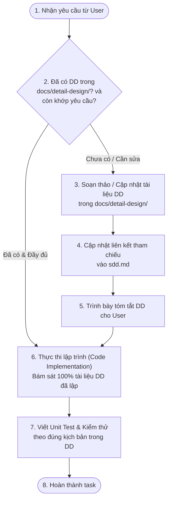

# AI AGENT GUIDELINES & PROJECT RULES: SMARTPC

> **Quy định Dự án bắt buộc cho AI Agent khi hoạt động trong codebase SmartPC**
> Mọi AI Agent tham gia phát triển, bảo trì hoặc refactor dự án này phải tuân thủ nghiêm ngặt các quy tắc dưới đây.

---

## 🚨 QUY TẮC CỐT LÕI: DETAILED DESIGN FIRST (DD-FIRST)

> [!IMPORTANT]
> **TUYỆT ĐỐI KHÔNG VIẾT CODE TRƯỚC KHI CÓ THIẾT KẾ CHI TIẾT.**
> Trước khi viết bất kỳ dòng mã nguồn nào (Backend Java Spring Boot, Frontend React, SQL Migration Flyway, Scripts, Config...), AI Agent **BẮT BUỘC PHẢI TẠO HOẶC CẬP NHẬT TÀI LIỆU THIẾT KẾ CHI TIẾT (DETAILED DESIGN - DD)** và lưu trong thư mục `docs/detail-design/`.

---

## 1. Quy chuẩn Lưu trữ & Đặt tên Tài liệu DD

* **Thư mục lưu trữ duy nhất:** `docs/detail-design/`
* **Quy ước đặt tên file:** `dd-<ma-usecase-hoac-ten-module>.md`
  * Ví dụ đã có: `docs/detail-design/dd-uc6-core-rule-engine.md`
  * Ví dụ chuẩn cho các module tiếp theo:
    * `docs/detail-design/dd-uc0-auth-security.md` (Xác thực, JWT, OAuth2)
    * `docs/detail-design/dd-uc1-semantic-search.md` (Tìm kiếm ngữ nghĩa & AI Chatbot)
    * `docs/detail-design/dd-uc2-pc-builder.md` (PC Builder & Kiểm tra tương thích real-time)
    * `docs/detail-design/dd-uc3-pc-profile.md` (PC Profile & Bottleneck Detection)
    * `docs/detail-design/dd-uc4-cart-checkout.md` (Giỏ hàng & Thanh toán ACID)
    * `docs/detail-design/dd-uc5-product-catalog.md` (Quản lý sản phẩm & JSON Specs)
    * `docs/detail-design/dd-uc7-order-user-admin.md` (Quản lý đơn hàng & người dùng)
    * `docs/detail-design/dd-uc8-dashboard-analytics.md` (Thống kê & KPI)

---

## 2. Cấu trúc Chuẩn của một Bản Thiết kế Chi tiết (DD Template)

Mỗi tài liệu DD trong `docs/detail-design/` phải bao gồm tối thiểu các mục sau:

1. **Header / Metadata:**
   * Mã tài liệu (VD: `DD-UC6-RULE-ENGINE`)
   * Package Backend (`com.smartpc.modules.<domain>`) & Thư mục Frontend tương ứng
   * Use-Case liên quan (`UCx`) & Mã phân rã WBS (`7.x`)
2. **Tổng quan Phân hệ & Mục tiêu Kỹ thuật (Module Overview & Objectives):**
   * Phạm vi nghiệp vụ, mục tiêu độ trễ/hiệu năng, nguyên tắc thiết kế (SOLID, Zero-Code, ACID...)
   * Cấu trúc Package / File Layout chi tiết
3. **Thiết kế Sơ đồ Lớp (Class Diagram - Mermaid):**
   * Đầy đủ Controller, Service, Validator, Strategy, Repository, Entity, DTO
   * Quan hệ kế thừa, implement interface, dependency injection
4. **Thiết kế Sơ đồ Tuần tự (Sequence Diagram - Mermaid):**
   * Luồng dữ liệu qua từng tầng (Client $\rightarrow$ Controller $\rightarrow$ Service $\rightarrow$ DB/Cache/AI)
   * Các nhánh xử lý thành công, ngoại lệ (Validation error, Not found, Conflict...)
5. **Thiết kế Chi tiết Logic / Thuật toán Nội bộ (Component Internal Design):**
   * Bảng quy tắc kiểm tra (Validation Rules & Error Codes)
   * Thuật toán, Strategy Pattern, Cache Invalidation, Concurrency / Thread-safety
   * Chính sách Null-safety & Fallback
6. **Đặc tả REST API (REST API Specification):**
   * Bảng tổng hợp Endpoint, HTTP Method, Role phân quyền
   * Mẫu Request Body JSON & Response Body JSON (kèm mã HTTP status)
7. **Thiết kế Cơ sở Dữ liệu & Indexing (Database Design & DDL):**
   * DDL script tạo bảng / cập nhật cột
   * Chỉ mục (Index, Unique Constraint, Foreign Key) tối ưu hóa truy vấn
8. **Kịch bản Kiểm thử (Test Cases & Scenarios):**
   * Danh sách Test Case Unit Test & Integration Test (Mã test, input, expected output)

---

## 3. Quy trình Làm việc Bắt buộc của AI Agent (Standard Workflow)

Khi nhận được bất kỳ yêu cầu lập trình hay phát triển tính năng nào từ User:

1. **Bước 1 — Phân tích:** Đọc kỹ `sdd.md` và `docs/prj1.md` để nắm rõ bối cảnh và ràng buộc kiến trúc.
2. **Bước 2 — Lập Thiết kế Chi tiết:** Tạo mới hoặc cập nhật file tương ứng trong `docs/detail-design/`.
3. **Bước 3 — Cập nhật Tham chiếu:** Bổ sung liên kết tài liệu vào mục `4. Thiết kế chi tiết` và mục `6. Cấu trúc thư mục` của [sdd.md](sdd.md).
4. **Bước 4 — Triển khai Code:** Chỉ bắt đầu viết code Java / React / SQL sau khi tài liệu DD đã hoàn thiện. Code phải tuân thủ đúng tên Class, Method, DTO, Endpoint, Error Code đã định nghĩa trong tài liệu DD.
5. **Bước 5 — Kiểm thử:** Viết Unit Test bám sát các kịch bản kiểm thử (Test Cases) đã liệt kê ở Mục 8 của file DD.

---

## 4. Quy chuẩn Thiết kế Giao diện Header Toàn Cục (Frontend Header Design Rule)

> [!IMPORTANT]
> Mọi AI Agent khi phát triển, chỉnh sửa hoặc thêm route/trang mới trên Frontend (`frontend/src/App.tsx` hoặc các layout liên quan) **BẮT BUỘC PHẢI GIỮ NGUYÊN VÀ TUÂN THỦ** thiết kế **Bright Global Header 3 tầng** dưới đây:

1. **Tổng thể Header (`<header>`):**
   * Sticky top (`sticky top-0 z-50 bg-white text-slate-800 shadow-sm border-b border-slate-200`), sử dụng tông màu **Sáng (Bright White `#FFFFFF` & Light Slate `#F8F9FA`)**.
2. **Tầng 1 — Thanh Công cụ Chính (`bg-white border-b border-slate-100`, chiều cao `h-16`):**
   * **Logo SmartPC (Trái):** Icon `Cpu` trong hộp bo góc xanh (`bg-smart-blue p-2 rounded-xl text-white`) + chữ `Smart` (`text-smart-navy font-black`) và `PC` (`text-smart-blue font-black`).
   * **Thanh Tìm kiếm Toàn cục (Giữa):** Form bo tròn (`rounded-full bg-slate-50 border border-slate-200`), icon `Search`, input placeholder `"Tìm kiếm linh kiện, VGA, CPU, PC Gaming..."` đồng bộ với query param `?search=`, và nút submit `Tìm kiếm` (`bg-smart-blue text-white rounded-full`).
   * **Cụm Tiện ích & Chuyển đổi Chế độ (Phải):**
     * **Tổng đài tư vấn:** Icon `Phone` (`bg-blue-50 text-smart-blue`) + `"Tổng đài tư vấn"` / `"1900 8899"`.
     * **Bộ chọn ngôn ngữ:** Pill `VN` kèm icon `ChevronDown`.
     * **Chuyển đổi `Store` / `Admin`:** Hộp pill (`bg-slate-100 p-1 rounded-xl border border-slate-200`), nút `Store` (`/products`, active `bg-smart-blue text-white`), nút `Admin` (`/admin/products`, kèm icon `ShieldAlert`, active `bg-amber-500 text-white`).
     * **Giỏ hàng & Đăng nhập:** Icon `ShoppingCart` kèm badge số lượng đỏ (`bg-smart-red`) và nút `Đăng nhập` kèm icon `User` (`bg-blue-50 text-smart-blue border border-blue-200/80`).
3. **Tầng 2 — Thanh Điều hướng Nghiệp vụ (`bg-white border-b border-slate-200/70`, chiều cao `h-11`):**
   * **Menu điều hướng bên trái (`font-semibold text-slate-700`):** Hiển thị đúng 5 mục theo thứ tự:
     1. `Sản phẩm` (`/products`)
     2. `Danh mục linh kiện` (`/products?category=CPU`)
     3. `PC Builder` (`/#builder`, kèm icon `Wrench` màu `text-smart-blue` — **TUYỆT ĐỐI chỉ hiển thị nhãn `PC Builder`, KHÔNG ghi `PC Builder (AI)` và KHÔNG gắn badge/icon `PRO` bên cạnh**)
     4. `PC Profile` (`/#profile`, kèm icon `Bot` màu `text-smart-blue`)
     5. `Hỗ trợ kỹ thuật` (`/#support`, kèm icon `Headphones` màu `text-slate-500`)
   * **Huy hiệu cam kết bên phải:** `Chính hãng 100%` (icon `CheckCircle2` màu `text-emerald-600`) | `Giao nhanh 2h` (icon `Zap` màu `text-amber-500`, chữ `text-smart-blue`).
4. **Tầng 3 — Thanh Ngữ cảnh theo Route (Storefront vs Admin):**
   * **Trên các route Storefront:** Thanh danh mục phổ biến (`bg-slate-50/90 px-4 py-2`) hiển thị nhãn `Phổ biến:` kèm danh sách 8 danh mục chuẩn (`CPU`, `GPU`, `MOTHERBOARD`, `RAM`, `SSD_M2`, `PSU`, `CASE`, `CPU_COOLER`) dẫn tới `/products?category=<code>`, bên phải là badge `AI Compatibility Engine V4.2 Sẵn sàng` và `Bảo hành 36T 1 đổi 1 tận nơi`.
   * **Trên các route Admin (`/admin/*`):** Thanh submenu quản trị nền vàng sáng (`bg-amber-50/90 border-t border-amber-200/80`) gồm nhãn `Portal Quản Trị:` và các lối tắt `Linh kiện & Vector Specs (UC5)` (`/admin/products`), `Cây Danh Mục (2 Cấp)` (`/admin/categories`).
