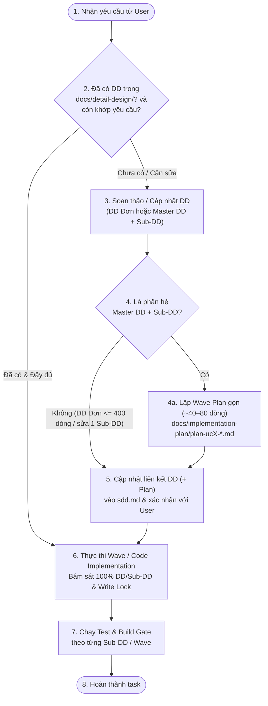

# AI AGENT GUIDELINES & PROJECT RULES: SMARTPC

> **Quy định Dự án bắt buộc cho AI Agent khi hoạt động trong codebase SmartPC**
> Mọi AI Agent tham gia phát triển, bảo trì hoặc refactor dự án này phải tuân thủ nghiêm ngặt các quy tắc dưới đây.

---

## 🚨 QUY TẮC CỐT LÕI: DETAILED DESIGN FIRST (DD-FIRST)

> [!IMPORTANT]
> **TUYỆT ĐỐI KHÔNG VIẾT CODE TRƯỚC KHI CÓ THIẾT KẾ CHI TIẾT.**
> Trước khi viết bất kỳ dòng mã nguồn nào (Backend Java Spring Boot, Frontend React, SQL Migration Flyway, Scripts, Config...), AI Agent **BẮT BUỘC PHẢI TẠO HOẶC CẬP NHẬT TÀI LIỆU THIẾT KẾ CHI TIẾT (DETAILED DESIGN - DD)** và lưu trong thư mục `docs/detail-design/`.

---

## 1. Quy chuẩn Lưu trữ, Đặt tên & Phân tách Tài liệu DD

* **Thư mục lưu trữ duy nhất:** `docs/detail-design/`
* **Quy ước đặt tên file chuẩn:** `dd-<ma-usecase-hoac-ten-module>.md`
  * Ví dụ đã có: `docs/detail-design/dd-uc6-core-rule-engine.md`
  * Ví dụ chuẩn cho các module tiếp theo:
    * `docs/detail-design/dd-uc0-auth-security.md` (Xác thực, JWT, OAuth2)
    * `docs/detail-design/dd-uc1-semantic-search.md` (Tìm kiếm ngữ nghĩa & AI Chatbot)
    * `docs/detail-design/dd-uc2-pc-builder.md` (PC Builder & Kiểm tra tương thích real-time)
    * `docs/detail-design/dd-uc3-pc-profile.md` (PC Profile & Bottleneck Detection)
    * `docs/detail-design/dd-uc4-cart-checkout.md` (Giỏ hàng & Thanh toán ACID)
    * `docs/detail-design/dd-uc5-product-catalog.md` (Quản lý sản phẩm & JSON Specs)
    * `docs/detail-design/dd-uc7-order-user-admin.md` (Quản lý đơn hàng & người dùng)
    * `docs/detail-design/dd-uc8-dashboard-analytics.md` (Thống kê & KPI)
* **Quy tắc Ngưỡng kích thước & Phân tách (Hub-and-Spoke DD):**
  * **DD Đơn (Single-file DD):** Áp dụng khi toàn bộ phân hệ gọn trong **$\le$ 400 dòng** (hoặc $\le$ ~20 KB) và có dưới 3 chức năng độc lập (VD: `dd-uc1-ai-chat.md`).
  * **Master DD + Sub-DD (Bắt buộc tách):** Áp dụng khi tài liệu vượt quá **400 dòng** (hoặc **$\ge$ 3 chức năng / Work Package `7.x.y` độc lập**):
    * **Master DD (`docs/detail-design/dd-ucX-<module>.md`):** Mục tiêu **150–250 dòng**. Giữ nguyên tên file để không vỡ liên kết từ `sdd.md`. Chỉ chứa tổng quan kiến trúc, **Shared Contracts** dùng chung và **Bảng Điều phối Chức năng** trỏ (`refer`) sang các Sub-DD.
    * **Sub-DD theo chức năng (`docs/detail-design/ucX-<module>/dd-ucX-<chuc-nang>.md`):** Mục tiêu **150–350 dòng/file**. Mỗi Sub-DD đặc tả trọn vẹn **1 chức năng / 1 Work Package (`7.x.y`)** (VD: `uc5-product-catalog/dd-uc5-category-tree.md`, `dd-uc5-dynamic-specs.md`, `dd-uc5-vector-sync.md`, `dd-uc5-media-assets.md`).
    * **Khi mở rộng tính năng cho UC đã có:** Tạo thêm 1 Sub-DD mới và bổ sung 1 dòng tham chiếu ở Master DD; **không nhồi nối đuôi vào file DD lớn**.

---

## 2. Cấu trúc Chuẩn của một Bản Thiết kế Chi tiết (DD Template)

### 2.1. Đối với DD Đơn (Single-file DD $\le$ 400 dòng)

Mỗi tài liệu DD đơn trong `docs/detail-design/` phải bao gồm tối thiểu các mục sau:

1. **Header / Metadata:**
   * Mã tài liệu (VD: `DD-UC1-AI-CHAT`)
   * Package Backend (`com.smartpc.modules.<domain>`) & Thư mục Frontend tương ứng
   * Use-Case liên quan (`UCx`) & Mã phân rã WBS (`7.x`)
2. **Tổng quan Phân hệ & Mục tiêu Kỹ thuật (Module Overview & Objectives):**
   * Phạm vi nghiệp vụ, mục tiêu độ trễ/hiệu năng, nguyên tắc thiết kế (SOLID, Zero-Code, ACID...)
   * Cấu trúc Package / File Layout chi tiết
3. **Thiết kế Sơ đồ Lớp (Class Diagram - Mermaid):**
   * Đầy đủ Controller, Service, Validator, Strategy, Repository, Entity, DTO
   * Quan hệ kế thừa, implement interface, dependency injection
4. **Thiết kế Sơ đồ Tuần tự (Sequence Diagram - Mermaid):**
   * Luồng dữ liệu qua từng tầng (Client $\rightarrow$ Controller $\rightarrow$ Service $\rightarrow$ DB/Cache/AI)
   * Các nhánh xử lý thành công, ngoại lệ (Validation error, Not found, Conflict...)
5. **Thiết kế Chi tiết Logic / Thuật toán Nội bộ (Component Internal Design):**
   * Bảng quy tắc kiểm tra (Validation Rules & Error Codes)
   * Thuật toán, Strategy Pattern, Cache Invalidation, Concurrency / Thread-safety
   * Chính sách Null-safety & Fallback
6. **Đặc tả REST API (REST API Specification):**
   * Bảng tổng hợp Endpoint, HTTP Method, Role phân quyền
   * Mẫu Request Body JSON & Response Body JSON (kèm mã HTTP status)
7. **Thiết kế Cơ sở Dữ liệu & Indexing (Database Design & DDL):**
   * DDL script tạo bảng / cập nhật cột
   * Chỉ mục (Index, Unique Constraint, Foreign Key) tối ưu hóa truy vấn
8. **Kịch bản Kiểm thử (Test Cases & Scenarios):**
   * Danh sách Test Case Unit Test & Integration Test (Mã test, input, expected output)

### 2.2. Đối với Mô hình Master DD + Sub-DD (Phân hệ lớn > 400 dòng)

1. **Cấu trúc Master DD (`dd-ucX-<module>.md`, 150–250 dòng):**
   * **Header / Metadata & Phạm vi Phân hệ**
   * **Kiến trúc Tổng thể & Package Layout:** Sơ đồ thành phần/lớp mức module và luồng giao tiếp giữa các chức năng con.
   * **Shared Contracts (Hợp đồng Dùng chung):** Bảng DB cốt lõi, `ErrorCode` dùng chung, Base Entity/DTO/Interface, chính sách Auth/Cache chung.
   * **Bảng Điều phối Chức năng (Feature Index & Refer Table):**

     | WBS | Chức năng | Sub-DD | Owned Files (Phạm vi code) | Depends on | Test Targets |
     |---|---|---|---|---|---|
     | `7.x.1` | Tên chức năng 1 | [dd-ucX-func1.md](ucX-module/dd-ucX-func1.md) | `FooService.java`, `FooPage.tsx` | — | `FooServiceTest` (`TC-...`) |

2. **Cấu trúc Sub-DD (`ucX-<module>/dd-ucX-<chuc-nang>.md`, 150–350 dòng):**
   * **Agent Context Card (bắt buộc ở đầu file, ~8–10 dòng):**
     * `Parent DD:` link về Master DD (kèm lưu ý chỉ đọc mục Shared Contracts khi cần)
     * `WBS:` `7.x.y`
     * `Owned Files:` danh sách file/class được phép tạo hoặc sửa
     * `Shared / Read-only Dependencies:` các thành phần dùng chung chỉ đọc (nếu cần sửa file chung phải qua Coordinator)
     * `Test Target:` class test và mã `TC-...` cần pass
   * **Nội dung đặc tả riêng của chức năng:** (1) Mục tiêu & Phạm vi, (2) Class/Sequence Diagram cục bộ, (3) Logic/Thuật toán/Validation nội bộ, (4) REST API Spec của chức năng, (5) Delta DDL/Index (nếu có), (6) Test Cases riêng của chức năng.

---

## 3. Quy trình Làm việc Bắt buộc của AI Agent (Standard Workflow)

Khi nhận được bất kỳ yêu cầu lập trình hay phát triển tính năng nào từ User:



1. **Bước 1 — Phân tích:** Đọc kỹ `sdd.md` và `docs/prj1.md` để nắm rõ bối cảnh và ràng buộc kiến trúc.
2. **Bước 2 — Lập Thiết kế Chi tiết:** Tạo mới hoặc cập nhật tài liệu DD trong `docs/detail-design/`. Nếu phân hệ lớn (> 400 dòng hoặc $\ge$ 3 chức năng), tạo **Master DD** kèm các **Sub-DD** theo từng chức năng (Mục 2.2) thay vì dồn vào một file quá dài.
3. **Bước 3 — Lập Wave Plan (nếu dùng Master DD + Sub-DD):** Với phân hệ chia Master DD + Sub-DD, lập `plan-ucX-*.md` gọn nhẹ theo Mục 3.1 để sắp xếp Wave và khóa quyền ghi file dùng chung; bỏ qua bước này nếu chỉ làm **DD Đơn ($\le$ 400 dòng)** hoặc sửa cục bộ trong 1 Sub-DD.
4. **Bước 4 — Cập nhật Tham chiếu & Xác nhận:** Bổ sung liên kết Master DD (hoặc DD đơn) và Wave Plan (nếu có) vào mục `4` và mục `6` của [sdd.md](sdd.md), sau đó trình bày tóm tắt cho User xác nhận trước khi code.
5. **Bước 5 — Triển khai & Kiểm thử theo Wave:** Chỉ viết code Java / React / SQL sau khi DD/Sub-DD (và Wave Plan nếu có) hoàn thiện. Tuân thủ đúng tên Class, Method, DTO, Endpoint, Error Code và chạy đủ Test Case (`TC-*`) cùng build gate tương ứng.

### 3.1. Lập Kế hoạch Điều phối Wave cho Phân hệ Master DD + Sub-DD (Wave & Coordination Plan)

> [!IMPORTANT]
> **CHỈ ÁP DỤNG CHO PHÂN HỆ MASTER DD + SUB-DD (TRÁNH LẶP LẠI DD):**
> Khi triển khai toàn bộ một Use-Case / phân hệ đã tách **Master DD + Sub-DD** (`>= 3` Sub-DD), AI Agent **BẮT BUỘC** lập **Wave & Coordination Plan** sau khi DD hoàn thiện và **trước khi viết code**.
> * **BỎ QUA (Không cần tạo file plan)** đối với **DD Đơn ($\le$ 400 dòng)**, hotfix hoặc chỉnh sửa cục bộ chỉ chạm **1 Sub-DD**.

* **Vị trí lưu trữ:** `docs/implementation-plan/plan-<ma-usecase-hoac-ten-module>.md` (cùng hậu tố với Master DD, VD: `dd-uc2-pc-builder.md` $\rightarrow$ `plan-uc2-pc-builder.md`).
* **Nguyên tắc Cốt lõi (Zero Duplication):** Master DD (`§3`) và `Agent Context Card` của từng Sub-DD đã khai báo đầy đủ `WBS`, `Owned Files`, `Depends on` và `Test Target`. Do đó **KHÔNG lặp lại** danh sách file chi tiết, tham chiếu mục DD hay bẻ nhỏ từng Work Package thành micro-task `7.x.y.z` theo tầng ngang (`DB -> ENTITY/REPO -> SERVICE -> API -> FE -> TEST`). Mỗi Sub-DD đã là một **vertical slice** hoàn chỉnh; file Plan chỉ giữ đúng phần điều phối thực thi (~40–80 dòng).

#### a) Quy tắc Tổ chức Wave & Khóa Ghi (Wave & Lock Rules)

1. **Chia thành các Wave thực thi (`Wave 0` $\rightarrow$ `Wave 1..N` $\rightarrow$ `Final Wave`):**
   * **`Wave 0` (Coordinator — Shared Contracts & Skeleton):** Thực hiện trước các phần dùng chung toàn cục hoặc làm khung cho nhiều Sub-DD (`ErrorCode.java`, đặt số Flyway `V<n>__*.sql`, shared DTOs, Controller skeleton).
   * **`Wave 1..N` (Sub-DD Execution):** Gom các Work Package / Sub-DD (`7.x.y`) vào từng Wave dựa trên `Depends on` và mức độ trùng file ghi. Các Sub-DD **chỉ được chạy song song trong cùng Wave** khi không ghi đè lên cùng một file.
   * **`Final Wave` (Integration & Release Gate):** Ghép nối toàn cục (`App.tsx`, routes, cross-module smoke flow) và chạy kiểm chứng tổng thể (`mvn test`, `npm run build`).
2. **Khóa Quyền ghi File Dùng chung (Shared-File Write Locks):** Mọi file dùng chung toàn cục (`ErrorCode.java`, `App.tsx`, `types/index.ts`, Flyway `V<n>__*.sql`) hoặc **file nội bộ xuất hiện ở $\ge 2$ Sub-DD** (VD: `PCBuilderController.java`, `PCBuilderCandidateService.java`) phải được gán rõ **duy nhất 1 Wave / 1 Sub-DD (hoặc Coordinator)** giữ quyền ghi tại một thời điểm (tuần tự hóa qua các Wave khác nhau).
3. **Gán Chế độ Thực thi:** Mỗi dòng chỉ định rõ `Coordinator` hay `Scoped Subagent` (theo tiêu chí Mục `3.2`).
4. **Đồng bộ DD-First:** Nếu khi lập Wave phát hiện thiếu file, thiếu `ErrorCode` hoặc sai thứ tự phụ thuộc $\rightarrow$ cập nhật **Master DD / Sub-DD** trước rồi mới cập nhật Wave Plan.

#### b) Cấu trúc Chuẩn của File Wave Plan (~40–80 dòng)

1. **Header:** Mã plan (VD: `PLAN-UC2-PC-BUILDER`), link **Master DD** tương ứng, UC & mã WBS `7.x`, trạng thái tổng.
2. **Sơ đồ Wave (Mermaid `flowchart LR`):** Vẽ luồng phụ thuộc giữa `Wave 0`, các node `7.x.y` (Sub-DD) và `Final Wave` (không vẽ chi tiết từng class hay từng tầng).
3. **Bảng Điều phối Wave & Trạng thái (1 dòng cho `Wave 0`, 1 dòng/Sub-DD, 1 dòng cho `Final Wave`):**

   | Wave | Hạng mục (`WBS` / Scope) | Chế độ | Shared-File Write Lock | Depends on | Cổng kiểm chứng (Verify Gate) | Trạng thái |
   |---|---|---|---|---|---|---|
   | `Wave 0` | Shared Contracts (`ErrorCode`, `Controller` skeleton) | `Coordinator` | `ErrorCode.java`, `PCBuilderController.java` | — | `mvn test-compile` pass | `TODO` |
   | `Wave 1` | `7.5.2` Evaluation & Telemetry (`dd-uc2-compatibility-eval.md`) | `Scoped Subagent` | `PCBuilderEvaluationService.java` | `Wave 0`, `UC6` | `PCBuilderEvaluationServiceTest` (`TC-UC2-05..10`) | `TODO` |

   * Trạng thái dùng: `TODO` / `IN_PROGRESS` / `DONE` / `BLOCKED` (ghi rõ lý do).
4. **Rủi ro & Câu hỏi mở:** Các điểm giao tiếp liên UC (VD: ranh giới với UC chưa hoàn thiện) hoặc quyết định cần User chốt.

#### c) Quy trình Thực thi theo Wave Plan

1. Trình bày tóm tắt Master DD + Wave Plan cho User xác nhận trước khi code (Bước 4 của quy trình).
2. Thực hiện lần lượt từng Wave (các Sub-DD độc lập trong cùng Wave có thể giao song song cho Scoped Subagent theo Mục `3.2`); sau mỗi Sub-DD / Wave: chạy Verify Gate và cập nhật cột `Trạng thái` trong file plan.
3. Nếu phát hiện sai lệch khi code $\rightarrow$ dừng, cập nhật Sub-DD / Master DD + Wave Plan rồi mới tiếp tục (giữ nguyên nguyên tắc DD-FIRST).
4. Kết thúc UC: mọi Wave `DONE`, toàn bộ `TC-*` và build gate pass, cập nhật liên kết plan cạnh link Master DD trong [sdd.md](sdd.md).

### 3.2. Điều phối Scoped Subagent theo Sub-DD (Context Isolation & Subagent Execution)

Khi phân hệ đã chia thành **Master DD + Sub-DD**, áp dụng mô hình **Coordinator $\leftrightarrow$ Scoped Subagent** để giữ context gọn, đọc đúng tài liệu cần thiết và tránh nhiễu giữa các chức năng:

1. **Phân vai Agent:**
   * **Agent chính (Coordinator / Architect):** Chỉ đọc `sdd.md`, **Master DD** và **Wave Plan** (`plan-ucX-*.md`) để nắm kiến trúc, quản lý `Shared Contracts`, xử lý `Wave 0` / `Final Wave`, điều phối Subagent và rà soát tích hợp; không cần nạp chi tiết toàn bộ các Sub-DD vào context chính.
   * **Agent nhỏ (Scoped Subagent):** Thực thi trong ngữ cảnh sạch cho **1 chức năng / 1 Work Package (`7.x.y`)**. Chỉ đọc:
     1. **Sub-DD được giao** (đọc `Agent Context Card` đầu file để xác định phạm vi),
     2. Mục **Shared Contracts** trong Master DD (khi cần dùng chung `ErrorCode`, Entity, Auth...),
     3. Các file nằm trong `Owned Files` (theo `Shared-File Write Lock` của Wave) và file test tương ứng.
2. **Khi nào NÊN / KHÔNG NÊN gọi Subagent:**
   * **KHÔNG cần spawn Subagent** cho task nhỏ hoặc sửa lỗi cục bộ 1–2 file thuộc một chức năng: Agent chính tự đọc duy nhất Sub-DD liên quan và xử lý trực tiếp để tránh độ trễ khởi tạo.
   * **NÊN spawn Subagent** khi: (a) triển khai trọn vẹn một Work Package đa tầng (`DB -> Service -> API -> FE -> Test`), (b) có $\ge$ 2 Sub-DD độc lập trong cùng Wave có thể triển khai song song mà không đụng Write Lock, hoặc (c) context agent chính đã dày và cần tách luồng triển khai / kiểm thử (Implementer / Verifier) độc lập.
3. **Ranh giới Bắt buộc khi Giao việc cho Subagent:**
   * **Truyền đủ hợp đồng:** Prompt giao việc phải nêu rõ đường dẫn Sub-DD, mục `Shared Contracts` liên quan trong Master DD, danh sách `Owned Files` (kèm giới hạn `Shared-File Write Lock` từ Wave Plan) và Verify Gate (lệnh build/test cần pass).
   * **File Ownership (Chống xung đột ghi):** Các file dùng chung toàn cục (`ErrorCode.java`, `App.tsx`, `types/index.ts`, đánh số Flyway `V<n>__*.sql`) do Coordinator kiểm soát trong `Wave 0` / `Final Wave`, và file dùng chung nội bộ giữa $\ge 2$ Sub-DD phải tuân thủ `Shared-File Write Lock` trong Wave Plan; subagent khác chỉ đề xuất bổ sung chứ không sửa trực tiếp ngoài quyền ghi được cấp trong Wave đó.
   * **Kỷ luật DD-First:** Nếu subagent phát hiện thiết kế trong Sub-DD mâu thuẫn với thực tế codebase, **tuyệt đối không tự ý code sai lệch DD** — dừng và báo Coordinator để cập nhật Sub-DD/Master DD trước khi tiếp tục.

---

## 4. Quy chuẩn Thiết kế Giao diện Header Toàn Cục (Frontend Header Design Rule)

> [!IMPORTANT]
> Mọi AI Agent khi phát triển, chỉnh sửa hoặc thêm route/trang mới trên Frontend (`frontend/src/App.tsx` hoặc các layout liên quan) **BẮT BUỘC PHẢI GIỮ NGUYÊN VÀ TUÂN THỦ** thiết kế **Bright Global Header 3 tầng** dưới đây:

1. **Tổng thể Header (`<header>`):**
   * Sticky top (`sticky top-0 z-50 bg-white text-slate-800 shadow-sm border-b border-slate-200`), sử dụng tông màu **Sáng (Bright White `#FFFFFF` & Light Slate `#F8F9FA`)**.
2. **Tầng 1 — Thanh Công cụ Chính (`bg-white border-b border-slate-100`, chiều cao `h-16`):**
   * **Logo SmartPC (Trái):** Icon `Cpu` trong hộp bo góc xanh (`bg-smart-blue p-2 rounded-xl text-white`) + chữ `Smart` (`text-smart-navy font-black`) và `PC` (`text-smart-blue font-black`).
   * **Thanh Tìm kiếm Toàn cục (Giữa):** Form bo tròn (`rounded-full bg-slate-50 border border-slate-200`), icon `Search`, input placeholder `"Tìm kiếm linh kiện, VGA, CPU, PC Gaming..."` đồng bộ với query param `?search=`, và nút submit `Tìm kiếm` (`bg-smart-blue text-white rounded-full`).
   * **Cụm Tiện ích & Chuyển đổi Chế độ (Phải):**
     * **Tổng đài tư vấn:** Icon `Phone` (`bg-blue-50 text-smart-blue`) + `"Tổng đài tư vấn"` / `"1900 8899"`.
     * **Bộ chọn ngôn ngữ:** Pill `VN` kèm icon `ChevronDown`.
     * **Chuyển đổi `Store` / `Admin`:** Hộp pill (`bg-slate-100 p-1 rounded-xl border border-slate-200`), nút `Store` (`/products`, active `bg-smart-blue text-white`), nút `Admin` (`/admin/products`, kèm icon `ShieldAlert`, active `bg-amber-500 text-white`).
     * **Giỏ hàng & Đăng nhập:** Icon `ShoppingCart` kèm badge số lượng đỏ (`bg-smart-red`) và nút `Đăng nhập` kèm icon `User` (`bg-blue-50 text-smart-blue border border-blue-200/80`).
3. **Tầng 2 — Thanh Điều hướng Nghiệp vụ (`bg-white border-b border-slate-200/70`, chiều cao `h-11`):**
   * **Menu điều hướng bên trái (`font-semibold text-slate-700`):** Hiển thị đúng 5 mục theo thứ tự:
     1. `Sản phẩm` (`/products`)
     2. `Danh mục linh kiện` (`/products?category=CPU`)
     3. `PC Builder` (`/#builder`, kèm icon `Wrench` màu `text-smart-blue` — **TUYỆT ĐỐI chỉ hiển thị nhãn `PC Builder`, KHÔNG ghi `PC Builder (AI)` và KHÔNG gắn badge/icon `PRO` bên cạnh**)
     4. `PC Profile` (`/#profile`, kèm icon `Bot` màu `text-smart-blue`)
     5. `Hỗ trợ kỹ thuật` (`/#support`, kèm icon `Headphones` màu `text-slate-500`)
   * **Huy hiệu cam kết bên phải:** `Chính hãng 100%` (icon `CheckCircle2` màu `text-emerald-600`) | `Giao nhanh 2h` (icon `Zap` màu `text-amber-500`, chữ `text-smart-blue`).
4. **Tầng 3 — Thanh Ngữ cảnh theo Route (Storefront vs Admin):**
   * **Trên các route Storefront:** Thanh danh mục phổ biến (`bg-slate-50/90 px-4 py-2`) hiển thị nhãn `Phổ biến:` kèm danh sách 8 danh mục chuẩn (`CPU`, `GPU`, `MOTHERBOARD`, `RAM`, `SSD_M2`, `PSU`, `CASE`, `CPU_COOLER`) dẫn tới `/products?category=<code>`, bên phải là badge `AI Compatibility Engine V4.2 Sẵn sàng` và `Bảo hành 36T 1 đổi 1 tận nơi`.
   * **Trên các route Admin (`/admin/*`):** Thanh submenu quản trị nền vàng sáng (`bg-amber-50/90 border-t border-amber-200/80`) gồm nhãn `Portal Quản Trị:` và các lối tắt `Linh kiện & Vector Specs (UC5)` (`/admin/products`), `Cây Danh Mục (2 Cấp)` (`/admin/categories`).

---

## 5. Quy chuẩn Phát triển Cục bộ & Triển khai Docker (Local Dev First & Docker Release Rule)

> [!IMPORTANT]
> **ƯU TIÊN LOCAL DEV TRONG QUÁ TRÌNH PHÁT TRIỂN (LOCAL DEV FIRST):**
> Trong giai đoạn phát triển, dự án ưu tiên chạy trực tiếp ở máy trạm (Localhost) để tận dụng Hot Module Replacement (HMR) phản hồi tức thì, **chỉ đóng gói và chạy Docker khi hoàn thiện tính năng hoặc release**.
> 
> 1. **Đối với Frontend (`frontend/`):**
>    * Chạy trực tiếp qua Vite dev server: `npm --prefix frontend run dev` hoặc lệnh wrapper `dev.cmd ui` trên cổng `3000`.
>    * Nhờ cơ chế Vite HMR, mọi thay đổi trong file React/TypeScript/CSS sẽ cập nhật ngay lập tức trên trình duyệt mà không cần build lại hay khởi động lại server.
>    * **Tuyệt đối không ép buộc build bundle hay copy file vào Docker container Nginx sau mỗi lần sửa nhỏ**, tránh gây độ trễ không cần thiết cho quá trình dev.
>    * Lưu ý: Đảm bảo container `smartpc-frontend` đã dừng (`docker stop smartpc-frontend`) để giải phóng cổng `3000` cho Vite dev server.
> 2. **Đối với Backend & Hạ tầng Dữ liệu:**
>    * Mô hình phát triển khuyên dùng (Hybrid Local Dev): Backend API (port 8080), MySQL (port 3307) và Redis (port 6379) chạy nền qua Docker (`docker compose up -d backend mysql redis`), trong khi Frontend chạy `npm run dev` ở máy host và tự động proxy `/api` sang `http://localhost:8080`.
>    * Nếu chạy thuần Localhost không dùng Docker: Có thể chạy Spring Boot backend qua Maven/Java nếu máy đã cài JDK 21+, hoặc Frontend có thể chạy độc lập với cơ chế Mock Data Fallback tích hợp sẵn.
> 3. **Đóng gói & Kiểm thử Docker (Release / Complete Phase):**
>    * Chỉ khi hoàn thiện tính năng hoặc chuẩn bị bàn giao/triển khai production, mới tiến hành kiểm tra đóng gói Docker toàn diện:
>      ```bash
>      npm --prefix frontend run build
>      docker compose build
>      docker compose up -d
>      ```

---

## 6. Quy chuẩn Bộ Sắp xếp (Product Sort Rule)

Mọi bộ `sort` (UI & API: Catalog, PC Builder...) chỉ gồm **4 lựa chọn đúng thứ tự**:
1. `newest` — Mới nhất (mặc định)
2. `oldest` — Cũ nhất
3. `price_asc` — Giá tăng dần
4. `price_desc` — Giá giảm dần

Cấm thêm tiêu chí khác (`benchmark_desc`, `popular_desc`, `AI Phù hợp nhất`...). Xem `.agents/rules/product-sort-standard.md`.
