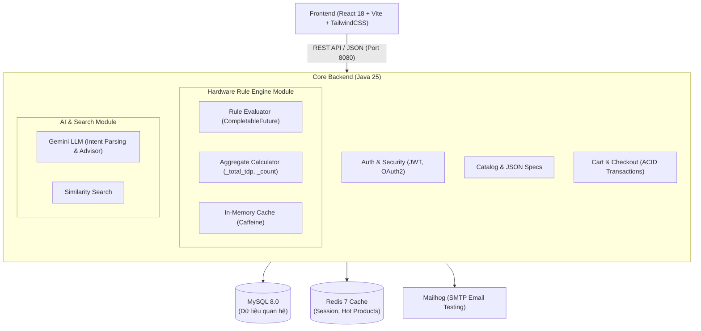

# ⚡ SmartPC - Nền Tảng TMĐT Linh Kiện & Build PC Tương Thích Thông Minh

[](https://spring.io/projects/spring-boot)
[](https://openjdk.org/projects/jdk/25/)
[](https://react.dev/)
[](https://www.mysql.com/)
[](https://www.docker.com/)

SmartPC là giải pháp thương mại điện tử chuyên sâu cho lĩnh vực phần cứng công nghệ và máy tính lắp ráp (Custom PC), tích hợp:
1. **Hardware Rule Engine:** Đánh giá tương thích phần cứng đa chiều (Socket, Chuẩn RAM, Tổng công suất nguồn TDP, Chiều dài VGA vs Vỏ Case...) song song với độ trễ `< 2ms`.
2. **AI Semantic Search & Reasoning (Google Gemini):** Trích xuất nhu cầu bằng ngôn ngữ tự nhiên, tìm kiếm theo độ tương tự vector và đóng vai trò "chuyên gia tư vấn phần cứng".
3. **PC Profile & Bottleneck Detection:** Phân tích điểm nghẽn của cấu hình người dùng và đưa ra lộ trình nâng cấp tối ưu chi phí.

---

## 🏛️ 1. Kiến trúc Tổng thể (High-Level Architecture)

Dự án áp dụng mô hình **Monorepo** với kiến trúc **Java Monolith (Spring Boot 3.5 + Java 25 LTS)** kết hợp **React 18 Frontend**, được tối ưu cho nhóm phát triển 2 người (loại bỏ chi phí vận hành microservices và độ trễ gọi mạng cục bộ).



---

## 📂 2. Cấu trúc Thư mục Repository (Monorepo Layout)

```text
.
├── .github/
│   └── workflows/
│       ├── backend-ci.yml           # CI: Build, Unit test Spring Boot với JDK 25
│       └── frontend-ci.yml          # CI: Lint, Type-check, Build React Vite
├── backend/                         # Core Monolith (Spring Boot 3.5.x, Java 25)
│   ├── src/main/java/com/smartpc/
│   │   ├── SmartPcApplication.java  # Main Application Entry Point
│   │   ├── common/                  # Global exceptions, ApiResponse, BaseEntity
│   │   ├── config/                  # SecurityConfig, CacheConfig, AsyncConfig
│   │   └── modules/
│   │       ├── auth/                # UC0: Đăng ký, Đăng nhập, OAuth2
│   │       ├── product/             # UC1a, UC5: Sản phẩm, Danh mục, JSON Specs
│   │       ├── ruleengine/          # UC6: Hardware Rule Engine, Caffeine Cache
│   │       ├── pcbuilder/           # UC2: PC Builder & Real-time Rule Check
│   │       ├── pcprofile/           # UC3: PC Profile & Bottleneck Detector
│   │       ├── ai/                  # UC1: Semantic Search, Gemini LLM Client
│   │       ├── cart/                # UC4: Quản lý giỏ hàng & kiểm tra chéo
│   │       ├── order/               # UC4, UC7: Checkout ACID, Quản lý đơn hàng
│   │       └── dashboard/           # UC8: Thống kê KPI, Doanh thu, Báo cáo
│   ├── src/main/resources/
│   │   ├── application.yml          # Cấu hình chung
│   │   ├── application-dev.yml      # Cấu hình môi trường dev
│   │   └── db/migration/            # Flyway Migrations (V1 Schema, V2 Rules Seed)
│   ├── pom.xml                      # Maven Dependencies
│   └── Dockerfile                   # Multi-stage Java 25 Container Build
├── frontend/                        # Web Client (React 18, Vite, TypeScript, TailwindCSS)
│   ├── src/
│   │   ├── components/              # Reusable UI (Button, Modal, Badges, QuickChips)
│   │   ├── features/                # Domain Modules: auth, catalog, pc-builder, profile
│   │   ├── services/                # Axios API Service Clients
│   │   ├── stores/                  # Zustand Global State (builderStore, cartStore)
│   │   ├── types/                   # TypeScript DTOs & Entity Types
│   │   ├── App.tsx                  # Root Application Component
│   │   └── main.tsx                 # Entry Point
│   ├── package.json
│   ├── vite.config.ts
│   ├── tailwind.config.js           # Bảng màu thiết kế SmartPC: Navy, Blue, Cyan, Red
│   ├── nginx.conf                   # Reverse proxy routing /api -> Backend
│   └── Dockerfile                   # Multi-stage Nginx Container Build
├── docker/
│   └── mysql/
│       └── init.sql                 # Khởi tạo database smartpc_db
├── docs/
│   ├── detail-design/               # Tài liệu Thiết kế chi tiết (Detailed Design - DD)
│   │   ├── dd-uc6-core-rule-engine.md # DD Core Rule Engine & Quản lý Tập luật (UC6)
│   │   ├── dd-uc5-product-catalog.md  # DD Quản lý Sản phẩm & Danh mục (UC1a, UC5)
│   │   ├── dd-java-runtime-upgrade.md # DD Nâng cấp Java Runtime lên Java 25 LTS
│   │   └── dd-local-dev-automation.md # DD Kịch bản tự động hóa Local Dev / Demo
│   ├── screens/                     # Toàn bộ ảnh mockup giao diện (screen0.png -> screen6.png)
│   ├── stitch_prompts.md            # Bộ prompt UI Stitch tương ứng screen0 -> screen6
│   └── REPO_DESIGN.md               # Bản thiết kế chi tiết kiến trúc repository
├── scripts/
│   ├── dev.ps1                      # Kịch bản điều phối Local Dev / Demo (PowerShell)
│   └── seed-compat-rules.sql        # 10 tập luật tương thích phần cứng mẫu
├── dev.cmd                          # 1-Click Local Dev & Demo Launcher trên Windows
├── docker-compose.yml               # Khởi chạy full-stack 1-click
├── .gitignore
├── AGENTS.md                        # Quy định bắt buộc cho AI Agent (DD-First Rule)
├── GEMINI.md                        # Cấu hình chỉ dẫn AI Agent
├── README.md                        # Hướng dẫn dự án & khởi chạy
└── sdd.md                           # Tài liệu thiết kế kiến trúc toàn diện hệ thống
```

---

## 🚀 3. Hướng dẫn Cài đặt & Khởi chạy Nhanh (Quickstart)

### Cách 0: Khởi chạy tự động bằng 1-Click Script trên Windows (Nhanh nhất)
Sử dụng công cụ điều phối `dev.cmd` / `scripts/dev.ps1` để tự động kiểm tra môi trường và bật Demo:

```powershell
# Mở Menu tương tác + Bảng chẩn đoán môi trường:
.\dev.cmd

# Hoặc chạy trực tiếp từng chế độ:
.\dev.cmd ui         # Bật ngay giao diện Frontend Demo (http://localhost:3000)
.\dev.cmd full       # Bật đồng thời Backend (8080) + Frontend (3000)
.\dev.cmd setup-db   # Tự động khởi tạo smartpc_db trên MySQL 8.0 cài sẵn trên máy
.\dev.cmd check      # Kiểm tra trạng thái Node, Java, Maven, MySQL, Docker & Ports
.\dev.cmd stop       # Dừng toàn bộ tiến trình dev trên port 3000 / 8080
```

### Cách 1: Khởi chạy bằng Docker Compose (Khuyến nghị)
Yêu cầu: Đã cài đặt [Docker Desktop](https://www.docker.com/products/docker-desktop).

```bash
# 1. Clone repository
git clone <repo_url>
cd project1

# 2. Khởi chạy toàn bộ hệ thống (MySQL, Redis, Mailhog, Backend, Frontend)
docker compose up -d

# 3. Truy cập các dịch vụ:
# - Frontend:        http://localhost:3000
# - Backend API:     http://localhost:8080/api/v1
# - Swagger UI:      http://localhost:8080/swagger-ui.html
# - Mailhog Web UI:  http://localhost:8025
```

### Cách 2: Khởi chạy thủ công cho Môi trường Phát triển (Local Dev)
Yêu cầu: Đã cài đặt **JDK 25 LTS**, **Maven 3.9+**, và **Node.js 20+**.

#### Bước 1: Chạy Database & Redis qua Docker
```bash
docker compose up -d mysql redis mailhog
```

#### Bước 2: Chạy Backend (Spring Boot 3.5 + Java 25 LTS)
```bash
cd backend
mvn clean spring-boot:run
```

#### Bước 3: Chạy Frontend (React + Vite)
```bash
cd frontend
npm install
npm run dev
# Truy cập giao diện tại: http://localhost:3000
```

---

## 🛠️ 4. Bộ Quy tắc Tương thích Phần cứng (Hardware Rule Engine)

Dự án cài đặt sẵn **10 quy tắc cốt lõi** trong `scripts/seed-compat-rules.sql` và Flyway `V2__seed_rules.sql`:

| Tên Quy Tắc | Cặp Linh Kiện | Thuộc Tính Nguồn | Toán Tử | Thuộc Tính Đích | Mức Độ |
| :--- | :--- | :--- | :---: | :--- | :---: |
| **CPU-Motherboard Socket Match** | CPU → Motherboard | `socket_type` | `IN` | `supported_sockets` | `ERROR` |
| **RAM Type Compatibility** | RAM → Motherboard | `memory_type` | `IN` | `supported_memory_types` | `ERROR` |
| **RAM Slot Count** | RAM (số lượng) → Motherboard | `_count` | `LTE` | `ram_slots` | `ERROR` |
| **Max RAM Capacity** | RAM (tổng GB) → Motherboard | `_sum_capacity_gb` | `LTE` | `max_ram_gb` | `ERROR` |
| **GPU Length vs Case** | GPU → Case | `length_mm` | `LTE` | `max_gpu_length_mm` | `ERROR` |
| **CPU Cooler Socket Support** | CPU → CPU_Cooler | `socket_type` | `IN` | `supported_sockets` | `ERROR` |
| **PSU Wattage Sufficiency** | Hệ thống (TDP) → PSU | `_total_tdp_w` | `LTE` | `rated_wattage_w` | `WARNING` |
| **Mainboard Form Factor vs Case** | Motherboard → Case | `form_factor` | `IN` | `supported_form_factors` | `ERROR` |
| **M.2 Slot Count** | SSD_M2 (số lượng) → Motherboard | `_count` | `LTE` | `m2_slots` | `WARNING` |
| **PCIe Generation** | GPU → Motherboard | `pcie_gen` | `LTE` | `max_pcie_gen` | `INFO` |

> *Ghi chú:* Các trường có tiền tố `_` là trường tính toán động (aggregate values) được `AggregateCalculator` tính toán trong bộ nhớ runtime trước khi evaluate rules song song bằng `CompletableFuture`.

---

## 👥 5. Phân chia Công việc & Quy ước Git Flow (Dành cho Nhóm 2 người)

### 📌 Phân vai:
- **Developer 1 (Backend & AI Lead):**
  - Quản lý Database, JPA Entities, Flyway migrations.
  - Xây dựng Core Rule Engine (`RuleEvaluator`, `AggregateCalculator`, Caffeine cache).
  - Tích hợp Spring AI (Gemini LLM Intent Parsing & Similarity Search).
  - Xử lý ACID Checkout transaction, Stock lock & Email notification.
- **Developer 2 (Frontend & Full-stack Support):**
  - Xây dựng giao diện React 18 theo mockup `screen0.png` → `screen6.png`.
  - Quản lý State PC Builder & Cart bằng Zustand.
  - Tích hợp gọi REST API Backend & xử lý UI cảnh báo lỗi/tương thích.
  - Xây dựng cổng Admin Dashboard (Quản lý sản phẩm, đơn hàng, tập luật).

### 🌿 Nhánh Git (Branching Strategy):
- `main`: Nhánh production ổn định, chỉ merge từ `develop` khi có bản release.
- `develop`: Nhánh làm việc chung, tích hợp các tính năng mới.
- `feat/<feature-name>`: Các nhánh tính năng con (ví dụ: `feat/rule-engine`, `feat/pc-builder-ui`, `feat/ai-chat`).
- Quy ước commit: [Conventional Commits](https://www.conventionalcommits.org/) (`feat:`, `fix:`, `refactor:`, `test:`, `docs:`).
