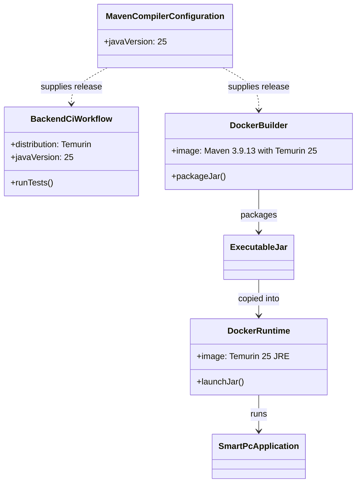

# Detailed Design: Java Runtime Upgrade

## Header / Metadata

- **Document ID:** DD-JAVA-RUNTIME-UPGRADE
- **Backend package:** `com.smartpc` (cross-cutting runtime; no package changes)
- **Frontend directory:** Not applicable
- **Use case:** Cross-cutting platform/runtime maintenance
- **WBS:** 7.0 - Platform runtime compatibility
- **Target runtime:** Java 25 LTS (JDK 25 for compilation and CI; Java 25 JRE for the container runtime)
- **Build framework:** Keep the Spring Boot 3.5 line and update to 3.5.16, the current maintenance release compatible with Java 25. Do not perform a Spring Boot major-version migration in this change.

## 1. Module Overview & Technical Objectives

Move the SmartPC backend from Java 21 LTS to Java 25 LTS consistently across developer builds, CI, and the production container while retaining the existing application behavior and Spring Boot 3.5 architecture.

The Maven compiler target, CI JDK, Docker build JDK, and Docker runtime JRE must all use Java 25. Keep the application source/API behavior unchanged. Do not alter the frontend, database schema, REST contracts, or persistence behavior.

### Scope and layout

| Surface | Location | Required state |
|---|---|---|
| Maven compiler target | `backend/pom.xml` | `java.version` is `25` |
| Spring Boot parent | `backend/pom.xml` | Remains on 3.5.x and uses 3.5.16 for Java 25 support |
| Build container | `backend/Dockerfile` | Maven image uses Temurin 25 |
| Runtime container | `backend/Dockerfile` | Temurin 25 JRE |
| CI | `.github/workflows/backend-ci.yml` | `actions/setup-java` uses Temurin 25 |
| Project documentation | `README.md`, `docs/REPO_DESIGN.md`, `sdd.md` | Runtime references say Java 25 |

No Java package or class layout changes are planned.

## 2. Component / Class Diagram



## 3. Upgrade / Verification Sequence

```mermaid
sequenceDiagram
    participant Dev as Developer or CI
    participant Maven as Maven compiler/test
    participant Image as Docker builder
    participant Runtime as Java 25 JRE
    participant App as Spring Boot application

    Dev->>Maven: Compile and run tests with JDK 25
    alt Compile and tests pass
        Maven-->>Dev: Java 25-targeted executable JAR
        Dev->>Image: Build with Temurin 25 Maven image
        Image->>Runtime: Copy executable JAR into Temurin 25 JRE image
        Runtime->>App: Launch JAR
        App-->>Dev: Startup succeeds
    else Compile, test, or startup fails
        Maven-->>Dev: Report failure; do not accept runtime upgrade
    end
```

## 4. Runtime Rules and Compatibility

| Check | Requirement | Failure handling |
|---|---|---|
| Java release | Maven compiles with `java.version=25` | Build must fail rather than silently target an older release |
| CI toolchain | Temurin JDK 25 | CI build/test is the acceptance gate |
| Container build/runtime | Both stages use Temurin 25; runtime remains JRE-only | Docker build or startup failure blocks completion |
| Framework compatibility | Use Spring Boot 3.5.16 with Java 25 | Do not migrate to Spring Boot 4 as part of this request |
| Runtime behavior | Existing API, database, cache, and security behavior remain unchanged | Existing tests and application startup must pass |
| Null-safety/fallback | No application-level fallback or behavior change is introduced | Surface build/startup/test errors; do not disguise them |

No new dependency, database migration, API endpoint, or Java language feature is required solely to select Java 25 as the runtime. The Spring Boot patch-level update is limited to the compatible 3.5 maintenance line.

## 5. REST API Specification

Not applicable. The upgrade does not change endpoint paths, methods, request/response bodies, status codes, or authorization roles.

## 6. Database Design

Not applicable. No schema, data, index, migration, or database-driver behavior is intentionally changed.

## 7. Deployment and Rollback

- Build the backend using JDK 25 and run the existing Maven test suite.
- Build the multi-stage backend image and verify that the executable JAR starts on the Java 25 JRE.
- Rollback is limited to restoring the previous runtime declarations and image tags (Java 21) if Java 25-specific build or startup incompatibility is found. Do not alter persisted data or database migrations.

## 8. Test Cases and Scenarios

| ID | Scenario | Expected result |
|---|---|---|
| RT-25-01 | Inspect Maven effective Java release | Compiler target is 25 |
| RT-25-02 | Run `mvn clean test` under JDK 25 | Build and all tests pass |
| RT-25-03 | Build the backend Docker image | Builder and runtime image resolve to Temurin 25 |
| RT-25-04 | Start the containerized backend | Application starts on Java 25 and existing health/API behavior is preserved |
| RT-25-05 | Review runtime declarations | No active Java 21 references remain in backend CI, Docker, Maven, or current project documentation |
