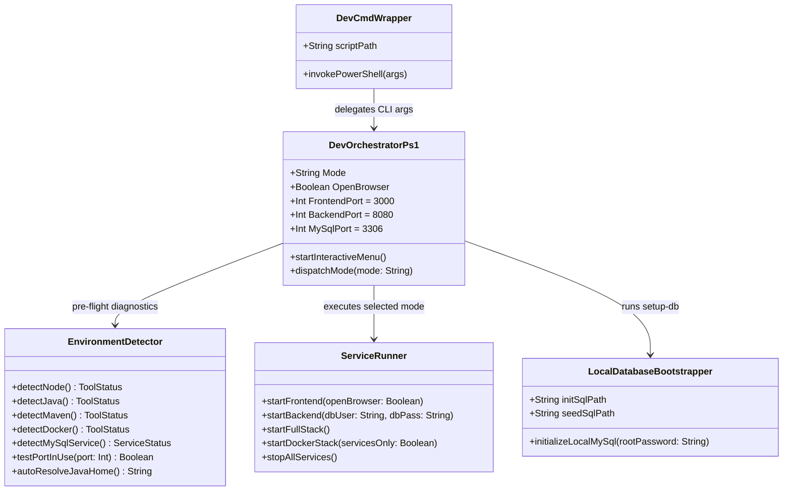
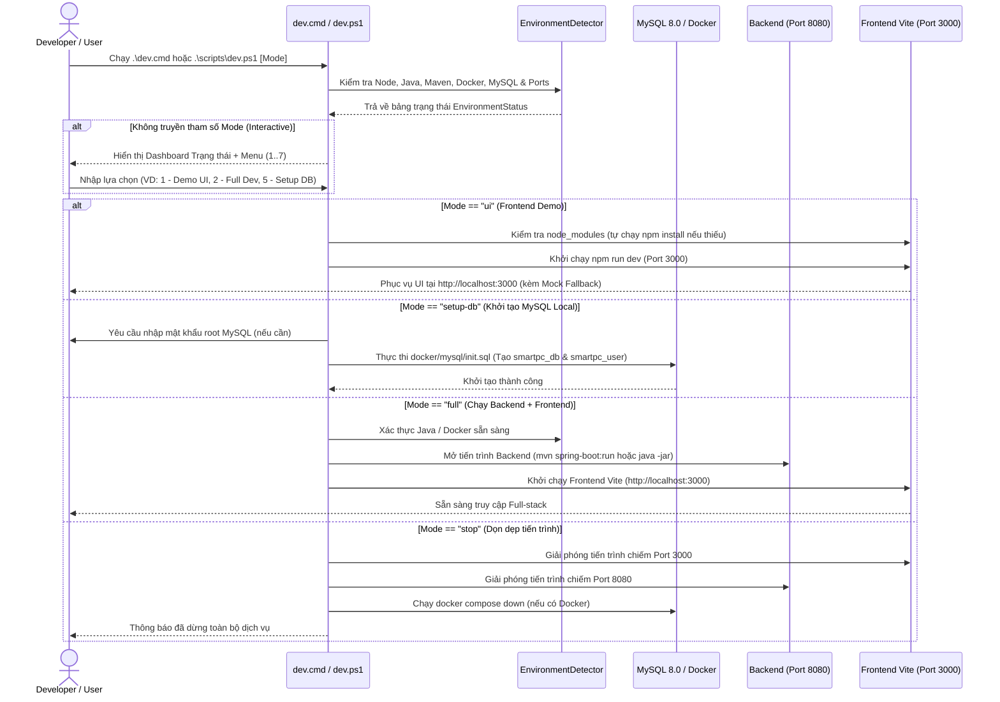

# Thiết kế Chi tiết: Kịch bản Tự động hóa Môi trường Phát triển Cục bộ (Local Dev Automation Script)

## 1. Header / Metadata

| Thuộc tính | Giá trị Chi tiết |
| :--- | :--- |
| **Mã tài liệu (Document ID)** | `DD-LOCAL-DEV-AUTOMATION` |
| **Package Backend liên quan** | `com.smartpc` (Cross-cutting Developer Tooling & Bootstrap) |
| **Thư mục Script & Frontend** | `scripts/dev.ps1`, `dev.cmd` (Root Wrapper), `frontend/` |
| **Use-Case liên quan** | Cross-cutting Local Development, Demo & Infrastructure Bootstrap |
| **Mã phân rã WBS** | `7.0` (Developer Experience, Localhost Demo & Runtime Orchestration) |
| **Nền tảng mục tiêu** | Windows PowerShell 5.1+ / PowerShell 7+, Docker Compose, Node.js 20+, Java 25 LTS, MySQL 8.0 |

---

## 2. Tổng quan Phân hệ & Mục tiêu Kỹ thuật (Module Overview & Objectives)

### 2.1. Phạm vi Nghiệp vụ & Vấn đề Giải quyết
Dự án **SmartPC** là hệ thống Monorepo gồm nhiều thành phần (React 18 Vite Frontend, Spring Boot 3.5 Java 25 Backend, MySQL 8.0, Redis 7, Mailhog). Khi lập trình viên hoặc người kiểm thử cần chạy Demo / Localhost trên máy cá nhân Windows, việc kiểm tra thủ công từng công cụ (`node`, `java`, `mvn`, `docker`, `mysql`), khởi tạo schema DB hoặc mở nhiều cửa sổ terminal gây tốn thời gian và dễ phát sinh lỗi thiếu biến môi trường `PATH`.

Phân hệ **Local Dev Automation (`scripts/dev.ps1` & `dev.cmd`)** cung cấp công cụ điều phối 1-click giúp:
1. **Chẩn đoán môi trường tự động (Pre-flight Check):** Kiểm tra phiên bản Node.js, npm, Java JDK (tự động quét các thư mục cài đặt chuẩn trên Windows nếu chưa có trong `PATH`), Maven, Docker và trạng thái cổng mạng (`3000`, `8080`, `3306`, `6379`).
2. **Đa chế độ khởi chạy linh hoạt (Multi-mode Execution):**
   * `ui`: Chạy ngay lập tức giao diện Frontend (`http://localhost:3000`) kèm cơ chế Mock Data Fallback tích hợp sẵn khi chưa bật Backend.
   * `backend`: Khởi chạy Backend Spring Boot qua Maven (`mvn spring-boot:run`) hoặc chạy trực tiếp file gói thực thi `backend/target/smartpc-backend-1.0.0-SNAPSHOT.jar`.
   * `docker`: Khởi chạy trọn gói Full-stack qua `docker compose up -d`.
   * `infra`: Chỉ bật các container hạ tầng (`mysql`, `redis`, `mailhog`) qua Docker để code Backend/Frontend trực tiếp trên máy host.
   * `setup-db`: Tự động nạp `docker/mysql/init.sql` và `scripts/seed-compat-rules.sql` vào MySQL 8.0 cục bộ trên máy Windows.
   * `full`: Điều phối chạy đồng thời Backend (cửa sổ/tiến trình riêng) và Frontend kèm tự động mở trình duyệt.
   * `stop`: Dừng toàn bộ tiến trình đang chiếm cổng `3000`, `8080` và tắt Docker containers.
3. **Menu tương tác trực quan (Interactive CLI Menu):** Khi chạy không kèm tham số (hoặc click đúp vào `dev.cmd`), hiển thị bảng trạng thái môi trường trực quan và menu chọn số từ `1` đến `7`.

### 2.2. Cấu trúc File Layout
```text
project1/
├── dev.cmd                                     # Batch wrapper tại thư mục gốc (cho phép gõ .\dev.cmd hoặc double-click)
├── scripts/
│   ├── dev.ps1                                 # Kịch bản PowerShell điều phối chính
│   └── seed-compat-rules.sql                   # Script SQL nạp 10 tập luật tương thích phần cứng mẫu
└── docs/
    └── detail-design/
        └── dd-local-dev-automation.md          # Tài liệu Thiết kế Chi tiết này
```

---

## 3. Thiết kế Sơ đồ Lớp / Thành phần (Component Class Diagram)



---

## 4. Thiết kế Sơ đồ Tuần tự (Sequence Diagram)



---

## 5. Thiết kế Chi tiết Logic / Thuật toán Nội bộ (Component Internal Design)

### 5.1. Bảng Quy tắc Kiểm tra & Mã Trạng thái (Validation Rules & Exit Codes)

| Mã Kiểm tra | Thành phần | Logic Kiểm tra | Xử lý Fallback / Tự phục hồi | Mã Exit khi Lỗi |
| :--- | :--- | :--- | :--- | :---: |
| `ENV-NODE-01` | Node.js & npm | Kiểm tra `Get-Command node` và `npm` | Báo lỗi kèm lệnh cài `winget install OpenJS.NodeJS.LTS` | `10` |
| `ENV-FE-DEPS` | `frontend/node_modules` | Kiểm tra `Test-Path frontend/node_modules` | Tự động chạy `npm install` trong thư mục `frontend` | `11` |
| `ENV-JAVA-01` | Java Runtime (JDK) | Kiểm tra `java` trong `PATH`; nếu không có, quét `C:\Program Files\Java\*`, `C:\Program Files\Eclipse Adoptium\*`, `C:\Program Files\Microsoft\jdk*` | Tự động gắn `$env:JAVA_HOME` và nối vào `$env:PATH` trong phiên chạy; nếu chưa cài thì hướng dẫn lệnh `winget` | `20` |
| `ENV-BE-JAR` | Backend Artifact | Kiểm tra `mvn` hoặc file `backend/target/smartpc-backend-*.jar` | Nếu chưa cài Maven nhưng có sẵn file `.jar` trong `backend/target`, tự động fallback sang `java -jar` | `21` |
| `ENV-MYSQL-01` | MySQL 8.0 | Kiểm tra Windows Service `MySQL80` hoặc kết nối TCP cổng `3306` | Nếu service `MySQL80` đang `Stopped`, gợi ý hoặc khởi chạy service | `30` |
| `ENV-DOCKER-01` | Docker Compose | Kiểm tra `docker compose version` và Docker daemon | Nếu chưa có Docker, tự động hướng dẫn chuyển sang chế độ `ui` hoặc `local` | `40` |

### 5.2. Chiến lược Điều phối Chế độ (`Mode` Dispatch Strategy)
Kịch bản `scripts/dev.ps1` nhận tham số chuẩn hóa:
```powershell
param(
    [ValidateSet("menu", "check", "ui", "backend", "full", "docker", "infra", "setup-db", "stop", "help")]
    [string]$Mode = "menu",
    [switch]$NoBrowser
)
```
* **Null-safety & Idempotency:**
  * Mọi thao tác kiểm tra đường dẫn và tiến trình đều bọc trong `try / catch` hoặc `-ErrorAction SilentlyContinue`.
  * Khi giải phóng cổng (`stop`), chỉ dừng tiến trình đang lắng nghe (`Listen`) tại cổng `3000` và `8080`, tuyệt đối không chạm tới MySQL (`3306`) của hệ thống Windows.

---

## 6. Đặc tả Giao diện CLI & Health Check (CLI & Probe Specification)

### 6.1. Bảng Lệnh CLI Hỗ trợ

| Lệnh gọi từ thư mục gốc | Chế độ (`Mode`) | Mô tả Hành vi | Cổng Mở |
| :--- | :---: | :--- | :---: |
| `.\dev.cmd` hoặc `.\scripts\dev.ps1` | `menu` | Hiển thị bảng chẩn đoán môi trường và menu chọn số tương tác | Tùy chọn |
| `.\dev.cmd check` | `check` | Chạy kiểm tra toàn bộ công cụ (Node, Java, Maven, MySQL, Docker, Ports) và xuất báo cáo | Không |
| `.\dev.cmd ui` | `ui` | Khởi chạy ngay giao diện React + Vite (tự động dùng Mock Data nếu Backend tắt) | `3000` |
| `.\dev.cmd backend` | `backend` | Khởi chạy Spring Boot Backend (qua Maven hoặc file JAR đóng gói sẵn) | `8080` |
| `.\dev.cmd full` | `full` | Mở cửa sổ chạy Backend + chạy Frontend ở cửa sổ hiện tại | `3000`, `8080` |
| `.\dev.cmd docker` | `docker` | Chạy `docker compose up -d` cho toàn bộ 5 container | `3000`, `8080`, `3306`, `6379`, `8025` |
| `.\dev.cmd infra` | `infra` | Chạy `docker compose up -d mysql redis mailhog` phục vụ code local | `3306`, `6379`, `8025` |
| `.\dev.cmd setup-db` | `setup-db` | Tạo DB `smartpc_db` và user `smartpc_user` trên MySQL 8.0 cài sẵn trên máy | `3306` |
| `.\dev.cmd stop` | `stop` | Dừng tiến trình trên cổng `3000`, `8080` và dừng Docker Compose | Không |

---

## 7. Thiết kế Khởi tạo Cơ sở Dữ liệu Cục bộ (Database Bootstrap Design)

Khi người dùng chạy chế độ `.\dev.cmd setup-db` trên máy Windows đã cài sẵn dịch vụ `MySQL80`:
1. Script tự động định vị `mysql.exe` (trong `PATH` hoặc `C:\Program Files\MySQL\MySQL Server 8.0\bin\mysql.exe`).
2. Thực thi câu lệnh khởi tạo an toàn (Idempotent SQL) tương đương với `docker/mysql/init.sql`:
   ```sql
   CREATE DATABASE IF NOT EXISTS smartpc_db CHARACTER SET utf8mb4 COLLATE utf8mb4_unicode_ci;
   CREATE USER IF NOT EXISTS 'smartpc_user'@'localhost' IDENTIFIED BY 'smartpc_password';
   CREATE USER IF NOT EXISTS 'smartpc_user'@'%' IDENTIFIED BY 'smartpc_password';
   GRANT ALL PRIVILEGES ON smartpc_db.* TO 'smartpc_user'@'localhost';
   GRANT ALL PRIVILEGES ON smartpc_db.* TO 'smartpc_user'@'%';
   FLUSH PRIVILEGES;
   ```
3. Khi Backend khởi chạy, **Flyway Migration** (`V1__init_schema.sql`, `V2__seed_rules.sql`, `V3__product_catalog_enhancements.sql`) sẽ tự động tạo bảng và nạp dữ liệu mẫu.

---

## 8. Kịch bản Kiểm thử (Test Cases & Scenarios)

| Mã Test Case | Kịch bản Kiểm thử | Đầu vào (Input) | Kết quả Mong đợi (Expected Output) |
| :--- | :--- | :--- | :--- |
| `DEV-TC-01` | Hiển thị trợ giúp CLI | `.\scripts\dev.ps1 -Mode help` | Hiển thị danh sách đầy đủ các lệnh, tham số và URL truy cập, mã thoát `0`. |
| `DEV-TC-02` | Chẩn đoán môi trường (`check`) | `.\scripts\dev.ps1 -Mode check` | Phát hiện chính xác Node.js, npm, `frontend/node_modules`, trạng thái MySQL `MySQL80`, file `smartpc-backend-1.0.0-SNAPSHOT.jar`, trạng thái Java/Docker và xuất gợi ý cài đặt nếu thiếu, mã thoát `0`. |
| `DEV-TC-03` | Chạy Frontend Demo (`ui`) | `.\scripts\dev.ps1 -Mode ui -NoBrowser` | Vite dev server khởi động tại `http://localhost:3000` và phản hồi HTTP `200 OK`. |
| `DEV-TC-04` | Chạy Backend khi thiếu Java | `.\scripts\dev.ps1 -Mode backend` (trên máy chưa cài JDK) | Bắt lỗi an toàn (`ENV-JAVA-01`), hiển thị lệnh `winget` cài đặt JDK 21/25 rõ ràng, không văng raw stacktrace. |
| `DEV-TC-05` | Wrapper `dev.cmd` hoạt động | `.\dev.cmd check` | Chuyển tiếp chính xác tham số vào `scripts/dev.ps1` mà không bị chặn bởi PowerShell ExecutionPolicy. |
