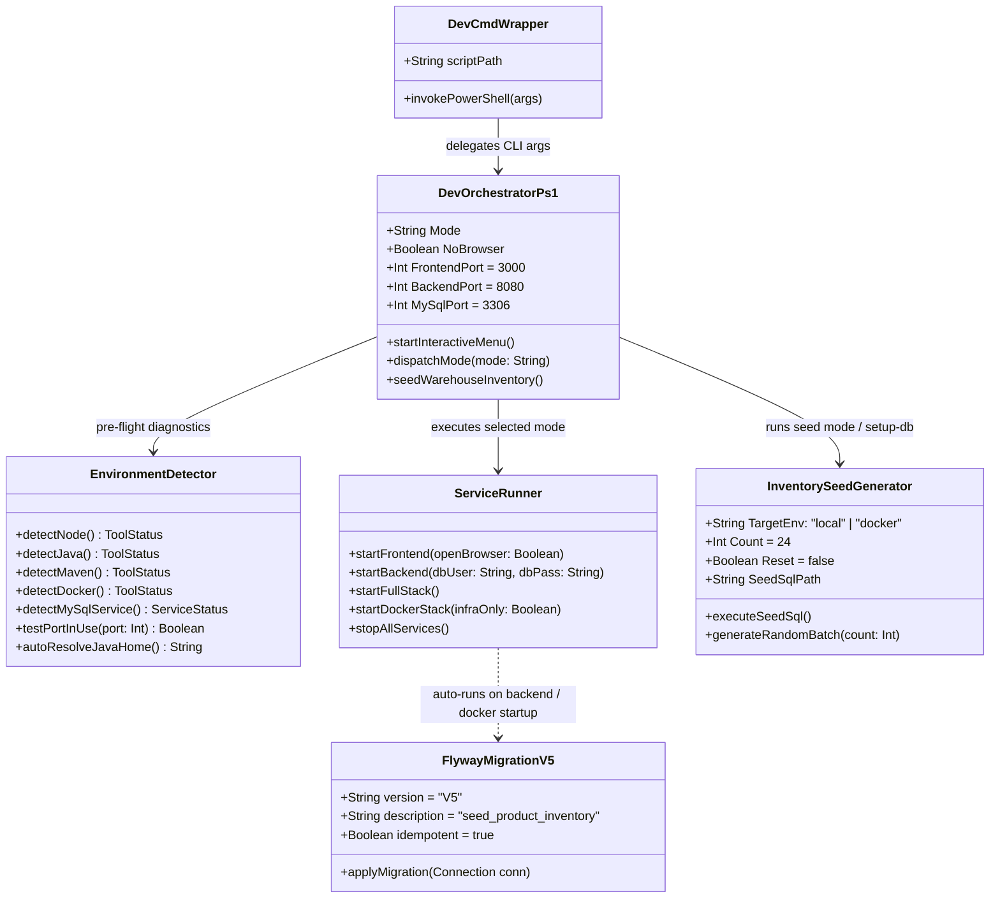
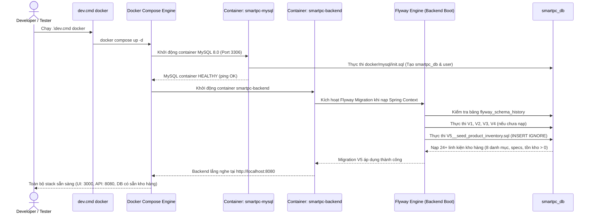
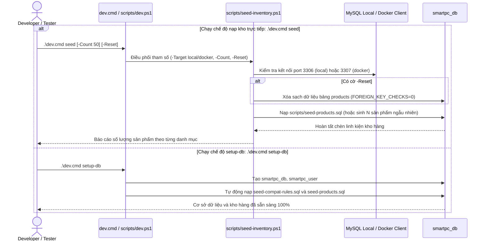

# Thiết kế Chi tiết: Kịch bản Tự động hóa Môi trường Phát triển Cục bộ & Khởi tạo Kho hàng (Local Dev Automation & Product Inventory Seeding)

## 1. Header / Metadata

| Thuộc tính | Giá trị Chi tiết |
| :--- | :--- |
| **Mã tài liệu (Document ID)** | `DD-LOCAL-DEV-AUTOMATION` |
| **Phiên bản (Version)** | `v1.2` (Bổ sung Cơ chế Tự động Sinh Sản phẩm Kho hàng khi Khởi động Docker & Dev Run) |
| **Package Backend liên quan** | `com.smartpc.modules.product` & `com.smartpc` (Cross-cutting Developer Tooling, Migration & Seed) |
| **Thư mục Script & Migrations** | `scripts/dev.ps1`, `scripts/seed-inventory.ps1`, `scripts/seed-products.sql`, `backend/src/main/resources/db/migration/V5__seed_product_inventory.sql`, `dev.cmd` |
| **Use-Case liên quan** | Cross-cutting Local Development, Demo, Infrastructure Bootstrap, UC1a (Catalog), UC2 (PC Builder), UC4 (Kho hàng & Giỏ hàng), UC5 (Specs) |
| **Mã phân rã WBS** | `7.0` (Developer Experience, Localhost Demo & Runtime Orchestration) & `7.2.2` (Kho hàng & Sản phẩm mẫu) |
| **Nền tảng mục tiêu** | Windows PowerShell 5.1+ / PowerShell 7+, Docker Compose, Node.js 20+, Java 25 LTS, MySQL 8.0 |

---

## 2. Tổng quan Phân hệ & Mục tiêu Kỹ thuật (Module Overview & Objectives)

### 2.1. Phạm vi Nghiệp vụ & Vấn đề Giải quyết
Dự án **SmartPC** là hệ thống Monorepo gồm nhiều thành phần (React 18 Vite Frontend, Spring Boot 3.5 Java 25 Backend, MySQL 8.0, Redis 7, Mailhog). 
Khi lập trình viên hoặc người kiểm thử khởi động hệ thống qua **Docker Compose (`docker compose up`)** hoặc **Dev Run (`.\dev.cmd` / `.\scripts\dev.ps1`)**, cơ sở dữ liệu mặc định chỉ chứa bảng rỗng và 8 danh mục gốc từ migration `V1..V3`. Kho hàng (`products`) hoàn toàn chưa có dữ liệu sản phẩm, khiến cho:
* Trang danh mục sản phẩm Storefront (`/products`) và trang quản trị Admin (`/admin/products`) bị trống rỗng.
* Công cụ PC Builder (`/#builder` - UC2) không có linh kiện để chọn và kiểm tra quy tắc tương thích phần cứng.
* Chức năng Giỏ hàng và Checkout (UC4) không thể kiểm tra trừ tồn kho (`stock_quantity`) hoặc xử lý đơn hàng.
* Chức năng AI Semantic Search (UC1) không có vector embedding để truy vấn độ tương đồng.

Phân hệ **Local Dev Automation & Product Inventory Seeding** giải quyết triệt để vấn đề này bằng cách cung cấp:
1. **Khởi tạo kho hàng tự động 100% khi khởi động Docker hoặc Spring Boot (`V5__seed_product_inventory.sql`):** Sử dụng Flyway Migration tự động thực thi khi Spring Boot backend boot up trong container Docker hoặc chạy cục bộ. Dữ liệu nạp có tính idempotent (`INSERT IGNORE`), chứa đầy đủ 8 danh mục phần cứng chuẩn với thông số JSON Specs khớp 100% với Rule Engine (UC6).
2. **Kịch bản điều phối và sinh dữ liệu kho hàng tùy biến (`scripts/seed-inventory.ps1` & `scripts/dev.ps1 -Mode seed`):** Cho phép lập trình viên nạp nhanh catalog mẫu, hoặc sinh ngẫu nhiên $N$ sản phẩm kho hàng tùy biến (tùy chỉnh số lượng tồn kho, giá, thương hiệu) vào MySQL cục bộ hoặc MySQL Docker container.
3. **Chẩn đoán môi trường tự động (Pre-flight Check):** Kiểm tra phiên bản Node.js, npm, Java JDK, Maven, Docker và cổng mạng (`3000`, `8080`, `3306`, `6379`).
4. **Đa chế độ khởi chạy linh hoạt:** `ui`, `backend`, `full`, `docker`, `infra`, `setup-db`, `seed`, `stop`.

### 2.2. Cấu trúc File Layout
```text
project1/
├── dev.cmd                                                # Batch wrapper tại thư mục gốc (cho phép gõ .\dev.cmd hoặc double-click)
├── scripts/
│   ├── dev.ps1                                            # Kịch bản PowerShell điều phối chính (hỗ trợ Mode seed)
│   ├── seed-inventory.ps1                                 # Script sinh & nạp sản phẩm kho hàng linh hoạt (Local / Docker)
│   ├── seed-products.sql                                  # SQL seed độc lập chứa 24+ linh kiện chuẩn có tồn kho
│   └── seed-compat-rules.sql                              # SQL seed 10 quy tắc tương thích UC6
├── backend/
│   └── src/main/resources/db/migration/
│       ├── V1__init_schema.sql                            # Khởi tạo bảng DDL gốc
│       ├── V2__seed_rules.sql                             # Seed 8 danh mục gốc & 10 luật ban đầu
│       ├── V3__product_catalog.sql                        # Virtual columns, audit fields, indexes
│       ├── V4__compat_rules_enhancements.sql              # Nâng cấp bảng compat_rules
│       └── V5__seed_product_inventory.sql                 # Seed tự động 24+ sản phẩm kho hàng khi khởi động Backend/Docker
└── docs/
    └── detail-design/
        └── dd-local-dev-automation.md                     # Bản thiết kế chi tiết này (v1.2)
```

---

## 3. Thiết kế Sơ đồ Lớp / Thành phần (Component Class Diagram)



---

## 4. Thiết kế Sơ đồ Tuần tự (Sequence Diagram)

### 4.1. Luồng Khởi động Tự động với Docker (`docker compose up` hoặc `.\dev.cmd docker`)



### 4.2. Luồng Khởi động Dev Cục bộ & Nạp Kho hàng (`dev.cmd full` hoặc `dev.cmd seed`)



---

## 5. Thiết kế Chi tiết Logic / Thuật toán Nội bộ (Component Internal Design)

### 5.1. Danh mục Linh kiện Kho hàng Chuẩn (Seed Catalog Specs Matrix)
Để phục vụ việc kiểm thử toàn diện các tính năng của SmartPC (Duyệt sản phẩm UC1a, PC Builder UC2, Giỏ hàng/Tồn kho UC4, Specs động UC5, Rule Engine UC6), bộ dữ liệu khởi động kho hàng chứa tối thiểu 24 linh kiện bao phủ trọn vẹn 8 danh mục:

| Danh mục (`category_code`) | Mã Danh mục ID | Số lượng SP Mẫu | Thông số Kỹ thuật Cốt lõi (JSON Specs) | Ràng buộc Tồn kho (`stock_quantity`) & Tương thích |
| :--- | :--- | :---: | :--- | :--- |
| **CPU** | `c0000001-...0001` | 4 | `socket_type` (LGA1700, AM5, AM4, LGA1851), `tdp_w` (65-170W), `core_count`, `thread_count`, `integrated_graphics` | Tồn kho từ 10-30 cái; 1 mã tồn kho = 0 để test hết hàng; khớp socket với Mainboard và Cooler |
| **MOTHERBOARD** | `c0000001-...0002` | 4 | `supported_sockets` (mảng), `form_factor` (ATX, Micro-ATX, Mini-ITX), `supported_memory_types` (DDR4, DDR5), `ram_slots` (2, 4), `max_ram_gb`, `m2_slots`, `chipset` | Đa dạng kích cỡ để kiểm tra quy tắc Form Factor vs Case; hỗ trợ cả DDR4 lẫn DDR5 |
| **RAM** | `c0000001-...0003` | 4 | `memory_type` (DDR4, DDR5), `capacity_gb` (16, 32, 64), `bus_speed_mhz` (3200, 3600, 5600, 6000), `modules_per_kit` (1, 2) | Kiểm tra quy tắc `RAM Type Compatibility`, `RAM Slot Count`, `Max RAM Capacity` |
| **GPU** | `c0000001-...0004` | 4 | `vram_gb` (8, 12, 16, 24), `length_mm` (227mm - 336mm), `tdp_w` (115W - 450W), `recommended_psu_w` (550W - 1000W), `pcie_gen` (4.0) | Kiểm tra quy tắc `GPU Length vs Case` và `GPU vs PSU Wattage Warning` |
| **SSD_M2** | `c0000001-...0005` | 3 | `interface_type` (NVMe PCIe 3.0, 4.0, 5.0), `capacity_gb` (500, 1000, 2000), `read_speed_mbps` (3500 - 7450), `tdp_w` (5-10W) | Phục vụ kiểm tra khe M.2 và tốc độ đọc ghi |
| **PSU** | `c0000001-...0006` | 3 | `rated_wattage_w` (550, 750, 850, 1000W), `efficiency_rating` (80 Plus Bronze/Gold), `form_factor` (ATX) | Kiểm tra công suất tổng hệ thống vs công suất nguồn |
| **CASE** | `c0000001-...0007` | 3 | `supported_form_factors` (['ATX', 'Micro-ATX', 'Mini-ITX']), `max_gpu_length_mm` (330 - 400mm), `max_cooler_height_mm` (160 - 185mm) | Kiểm tra giới hạn kích thước linh kiện lắp vào vỏ |
| **CPU_COOLER** | `c0000001-...0008` | 3 | `supported_sockets` (['LGA1700', 'AM5', 'AM4']), `cooler_type` (AIR, AIO_240, AIO_360), `height_mm` (52 - 160mm) | Kiểm tra chiều cao tản khí vs Case và socket tản nhiệt |

### 5.2. Thuật toán Idempotent & Chống Trùng lặp
1. **Khóa chính tiền định (Deterministic UUIDs):** Mỗi sản phẩm mẫu mang một UUID cố định dạng `e0000001-0000-0000-0000-0000000000XX` tương ứng với từng danh mục.
2. **Cú pháp `INSERT IGNORE`:** Nếu sản phẩm đã tồn tại trong cơ sở dữ liệu (đã nạp từ trước hoặc đã chỉnh sửa), câu lệnh sẽ bỏ qua mà không làm hỏng dữ liệu hiện tại, không gây lỗi Rollback cho Flyway hoặc script.
3. **Đồng bộ Virtual Columns:** Các trường `v_socket_type`, `v_form_factor`, `v_memory_type`, `v_vram_gb` là cột ảo tự động sinh bởi MySQL 8.0 từ JSON specs, tuyệt đối không được chèn tường minh trong câu lệnh `INSERT`.
4. **Trạng thái Vector Sync:** Đặt `sync_status = 'PENDING'` và `sync_requested_at = NOW()` để `ProductSyncRecoveryJob` tự động vector hóa khi hệ thống bật Spring AI, hoặc đặt sẵn trạng thái `'SYNCED'` cho môi trường demo không có AI key.

### 5.3. Bảng Quy tắc Kiểm tra & Mã Lỗi Mới (Validation Rules & Exit Codes)

| Mã Kiểm tra | Thành phần | Logic Kiểm tra | Xử lý Fallback / Tự phục hồi | Mã Exit |
| :--- | :--- | :--- | :--- | :---: |
| `ENV-SEED-01` | Seed SQL Script | Kiểm tra sự tồn tại của `scripts/seed-products.sql` hoặc `V5__seed_product_inventory.sql` | Thông báo thiếu file seed, fallback sang tạo file mẫu | `31` |
| `ENV-SEED-02` | MySQL Connection | Kiểm tra khả năng kết nối tới MySQL host/port | Thử cổng 3306 (local) rồi fallback sang cổng 3307 (docker) | `32` |
| `ENV-SEED-03` | Foreign Key Check | Kiểm tra 8 danh mục cha đã tồn tại trong bảng `categories` | Tự động chạy nạp `V2__seed_rules.sql` trước khi nạp sản phẩm | `33` |

---

## 6. Đặc tả Giao diện CLI & Tham số Kịch bản (CLI Specification)

### 6.1. Bổ sung Lệnh trong `scripts/dev.ps1` & `dev.cmd`

| Lệnh gọi | Chế độ (`Mode`) | Tham số Bổ sung | Mô tả Hành vi |
| :--- | :---: | :--- | :--- |
| `.\dev.cmd seed` | `seed` | `[-Count <n>] [-Reset]` | Nạp hoặc sinh mới linh kiện kho hàng vào MySQL (tự động nhận diện local hay Docker) |
| `.\dev.cmd setup-db` | `setup-db` | `[-NoSeed]` | Tạo database, user, cấp quyền và nạp ngay cả rule engine lẫn sản phẩm kho hàng |
| `.\dev.cmd docker` | `docker` | Không | Chạy Docker Compose, backend tự động chạy Flyway `V5` sinh kho hàng ngay khi khởi động |

### 6.2. Đặc tả Kịch bản Độc lập `scripts/seed-inventory.ps1`
```powershell
param(
    [Parameter(Position = 0)]
    [ValidateSet("auto", "local", "docker")]
    [string]$Target = "auto",

    [Parameter(Position = 1)]
    [int]$Count = 24,

    [switch]$Reset,
    [switch]$GenerateRandom
)
```
* **Cơ chế hoạt động:**
  1. Nếu `$Target = "auto"`: Kiểm tra cổng `3306` (Local MySQL). Nếu mở, kết nối tới Local MySQL; nếu cổng `3306` đóng nhưng cổng `3307` mở (Docker MySQL), tự động chuyển sang Docker.
  2. Nếu có cờ `-Reset`: Thực thi lệnh dọn dẹp an toàn:
     `SET FOREIGN_KEY_CHECKS = 0; TRUNCATE TABLE product_embeddings; TRUNCATE TABLE cart_items; TRUNCATE TABLE order_details; TRUNCATE TABLE products; SET FOREIGN_KEY_CHECKS = 1;`
  3. Nếu không có `-GenerateRandom`: Thực thi file `scripts/seed-products.sql` chứa 24 linh kiện chuẩn.
  4. Nếu có `-GenerateRandom`: Sinh thêm $N$ sản phẩm ngẫu nhiên với tên thương hiệu, dải giá và tồn kho đa dạng.

---

## 7. Thiết kế Cơ sở Dữ liệu & DDL Seed Data (Database Design & Flyway V5)

### 7.1. Cấu trúc Flyway Migration `V5__seed_product_inventory.sql`
* **Vị trí lưu trữ:** `backend/src/main/resources/db/migration/V5__seed_product_inventory.sql`
* **Mẫu câu lệnh DDL/DML Idempotent:**

```sql
-- ============================================================================
-- V5__seed_product_inventory.sql
-- Seed dữ liệu linh kiện kho hàng khởi tạo (UC1a, UC2, UC4, UC5)
-- Tự động chạy khi khởi động Docker backend hoặc Spring Boot dev run
-- ============================================================================

INSERT IGNORE INTO products (
    product_id, name, brand, description, specs, image_url, gallery_urls,
    price, stock_quantity, benchmark_score, sync_status, is_active, category_id,
    version, created_at, updated_at
) VALUES
-- 1. CPU Intel & AMD
(
    'e0000001-0000-0000-0000-000000000001',
    'Bộ vi xử lý Intel Core i5-13600K (Up to 5.1GHz, 14 Cores 20 Threads, 24MB Cache)',
    'INTEL',
    'Vi xử lý Raptor Lake socket LGA1700, 14 nhân 20 luồng, hiệu năng gaming và render vượt trội.',
    JSON_OBJECT('socket_type', 'LGA1700', 'tdp_w', 125, 'core_count', 14, 'thread_count', 20, 'integrated_graphics', true),
    'https://images.unsplash.com/photo-1555680202-c86f0e12f086?auto=format&fit=crop&w=600&q=80',
    JSON_ARRAY(),
    7490000, 25, 88.0, 'SYNCED', true, 'c0000001-0000-0000-0000-000000000001', 0, NOW(), NOW()
),
(
    'e0000001-0000-0000-0000-000000000002',
    'Bộ vi xử lý AMD Ryzen 7 7800X3D (4.2GHz~5.0GHz, 8 Cores 16 Threads, Socket AM5)',
    'AMD',
    'Vua vi xử lý Gaming với công nghệ 3D V-Cache độc quyền, tối ưu tuyệt đối cho game thủ.',
    JSON_OBJECT('socket_type', 'AM5', 'tdp_w', 120, 'core_count', 8, 'thread_count', 16, 'integrated_graphics', true),
    'https://images.unsplash.com/photo-1591799264318-7e6ef8ddb7ea?auto=format&fit=crop&w=600&q=80',
    JSON_ARRAY(),
    10490000, 15, 96.5, 'SYNCED', true, 'c0000001-0000-0000-0000-000000000001', 0, NOW(), NOW()
),
-- [Các linh kiện khác tiếp tục cho đủ 8 danh mục]
;
```

---

## 8. Kịch bản Kiểm thử (Test Cases & Scenarios)

| Mã Test Case | Kịch bản Kiểm thử | Đầu vào (Input) | Kết quả Mong đợi (Expected Output) |
| :--- | :--- | :--- | :--- |
| `DEV-TC-06` | Tự động seed kho hàng qua Flyway khi chạy Docker | `docker compose up -d` khi volume DB mới | Backend log hiển thị `Successfully applied migration V5__seed_product_inventory.sql`. Truy vấn `SELECT COUNT(*) FROM products` trả về $\ge 24$. |
| `DEV-TC-07` | Lệnh `.\dev.cmd seed` hoạt động độc lập | `.\dev.cmd seed` | Script định vị được MySQL, nạp 24 linh kiện thành công, in ra số lượng tồn kho từng danh mục, mã thoát `0`. |
| `DEV-TC-08` | Idempotent khi chạy `seed` nhiều lần | Chạy `.\dev.cmd seed` 2 lần liên tiếp | Không phát sinh lỗi Primary Key Duplicate, số lượng bản ghi giữ nguyên, mã thoát `0`. |
| `DEV-TC-09` | Reset và tái tạo kho hàng | `.\scripts\seed-inventory.ps1 -Reset` | Xóa sạch bảng products cũ và nạp lại chính xác 24 linh kiện mẫu, tất cả ràng buộc ngoại khóa đều nguyên vẹn. |
| `DEV-TC-10` | Hiển thị sản phẩm kho hàng trên Storefront UI | Mở `http://localhost:3000/products` sau khi khởi động | Giao diện hiển thị các card sản phẩm thực tế từ cơ sở dữ liệu thay vì mock rỗng. |
