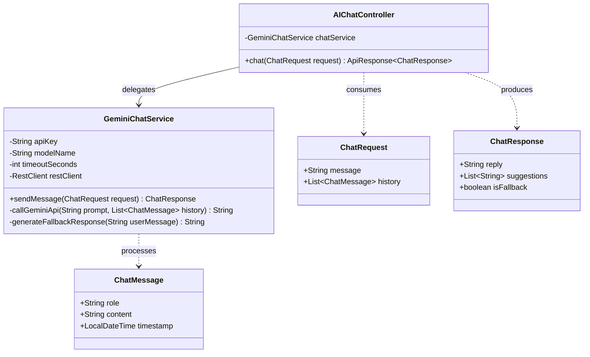
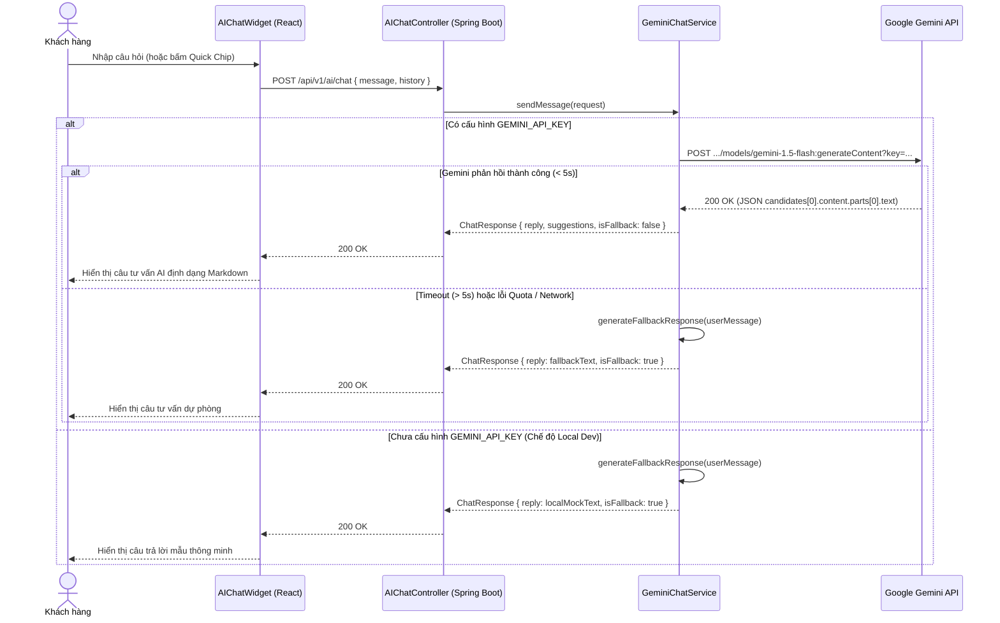

# TÀI LIỆU THIẾT KẾ CHI TIẾT (DETAILED DESIGN)
## Phân hệ: Chat Tư Vấn Phần Cứng Với AI (UC1 & WBS 7.3)

* **Mã tài liệu:** `DD-UC1-AI-CHAT`
* **Phân hệ (Package):** `com.smartpc.modules.ai` (Backend) & `src/features/ai-chat` (Frontend)
* **Liên kết Use-Case:** `UC1` (Chat với AI & Tư vấn cấu hình phần cứng thông minh).
* **Liên kết WBS:** `7.3 Tìm kiếm Ngữ nghĩa & AI Chat (UC1)` (`7.3.1` $\rightarrow$ `7.3.4`).

---

## 1. Tổng quan Phân hệ & Mục tiêu Kỹ thuật

Phân hệ **Chat AI Tư vấn Phần cứng** là tính năng tương tác hội thoại trực tiếp giữa người dùng và mô hình ngôn ngữ lớn (Google Gemini), đóng vai trò như một chuyên gia công nghệ của SmartPC để giải đáp thắc mắc, tư vấn build máy, so sánh linh kiện và gợi ý nâng cấp.

Đặc biệt, hệ thống áp dụng cơ chế **Store Catalog Grounding (RAG-lite)**: Toàn bộ danh mục sản phẩm & linh kiện thực tế đang có sẵn trong kho SmartPC được tổng hợp và đưa trực tiếp vào System Prompt / Context khi gọi Gemini API. Nhờ đó, AI tuyệt đối chỉ tư vấn, báo giá và lắp ráp từ các mặt hàng web đang kinh doanh, không đề xuất các linh kiện không có sẵn trong kho.

### 1.1. Mục tiêu Kỹ thuật & Nghiệp vụ
1. **Kiến trúc Tinh gọn & Chuỗi Ưu tiên Model Động (Dynamic Model Fallback Chain):** Backend tiếp nhận tin nhắn từ người dùng và tự động chọn model AI mạnh nhất còn quota trong chuỗi ưu tiên (`gemini-3.1-pro-preview` $\rightarrow$ `gemini-3.5-flash` $\rightarrow$ `gemini-3-flash-preview` $\rightarrow$ `gemini-3.5-flash-lite` $\rightarrow$ `gemini-3.1-flash-lite`). Nếu một model hết quota (HTTP 429) hoặc tạm thời quá tải (HTTP 503), hệ thống lập tức chuyển sang model nhẹ hơn tiếp theo trong chuỗi.
2. **Kho Hàng Ràng Buộc (Inventory-Grounded System Prompt):** Đưa danh sách sản phẩm thực tế (Tên, Hãng, Giá niêm yết, Tồn kho, Thông số chính) vào ngữ cảnh hệ thống. Ép buộc LLM chỉ tư vấn các mã hàng đang mở bán tại SmartPC và khéo léo điều hướng sang sản phẩm tương đương nếu khách hỏi mặt hàng chưa có.
3. **Cơ chế Fallback an toàn (Graceful Degradation):** Nếu chưa cấu hình `GEMINI_API_KEY`, API gặp lỗi mạng hoặc vượt hạn mức (quota limit), hệ thống tự động phản hồi câu tư vấn gợi ý sẵn có từ kho hàng, tuyệt đối không làm crash ứng dụng hay trả về mã lỗi 500 cho người dùng.
4. **Giao diện trực quan (Floating Chat Widget):** Người dùng có thể bật/tắt hộp thoại chat ở bất kỳ trang nào (Storefront, Chi tiết SP, PC Builder), hỗ trợ các câu hỏi mẫu gợi ý (Quick Suggestion Chips).

### 1.2. Cấu trúc Package & Thư mục

```text
backend/src/main/java/com/smartpc/modules/ai/
├── controller/
│   └── AIChatController.java              # REST API: POST /api/v1/ai/chat
├── service/
│   └── GeminiChatService.java             # Service gọi trực tiếp Gemini API + Fallback logic
└── dto/
    ├── ChatRequest.java                   # DTO nhận câu hỏi & lịch sử chat
    ├── ChatResponse.java                  # DTO trả về câu trả lời Markdown
    └── ChatMessage.java                   # Model tin nhắn (role: user/assistant, content)

frontend/src/
├── features/ai-chat/
│   ├── components/
│   │   ├── AIChatWidget.tsx               # Floating Chat Launcher & Chat Box Popup
│   │   └── ChatMessageItem.tsx            # Hiển thị từng tin nhắn (User / Bot)
│   └── types/
│       └── chat.types.ts                  # TypeScript interfaces cho hội thoại
└── services/
    └── aiChatService.ts                   # Axios client gọi /api/v1/ai/chat kèm Mock Fallback
```

---

## 2. Thiết kế Sơ đồ Lớp (Class Diagram)



---

## 3. Thiết kế Sơ đồ Tuần tự (Sequence Diagram)



---

## 4. Thiết kế Chi tiết Logic & Prompt Engineering (Store Catalog Grounding)

### 4.1. Cơ chế Đưa Kho hàng vào Ngữ cảnh (Inventory Grounding)
Nhằm đảm bảo AI **chỉ tập trung tư vấn những mặt hàng website đang kinh doanh và có sẵn trong kho**, hệ thống trích xuất thông tin các sản phẩm active (`ProductRepository.findByIsActiveTrueAndDeletedAtIsNull()` hoặc `MOCK_PRODUCTS`) và tạo khối dữ liệu `[DANH SÁCH MẶT HÀNG ĐANG CÓ SẴN TRONG KHO SMARTPC]`.

Khối dữ liệu này được chèn trực tiếp vào phần `systemInstruction` cùng bộ quy tắc nghiêm ngặt:
1. **Chỉ được tư vấn sản phẩm trong kho**: Tuyệt đối không đề xuất, bịa đặt hoặc khuyên người dùng mua các linh kiện không nằm trong danh mục đang bán.
2. **Xử lý khi khách hỏi linh kiện ngoài kho**: Nếu khách hàng hỏi một sản phẩm không có (hoặc ngân sách không khớp hoàn toàn), AI phải giải thích lịch sự rằng kho hàng hiện chưa có mã đó, đồng thời chủ động đề xuất linh kiện tương đương đang có trong kho của SmartPC để thay thế.
3. **Báo giá & Thông số chuẩn xác**: Nêu đúng tên thương hiệu, tên mã sản phẩm, giá bán niêm yết (VNĐ) và đặc tính kỹ thuật đã có trong danh mục.

### 4.2. Mẫu System Prompt Hoàn chỉnh

```text
Bạn là "Chuyên gia Tư vấn Phần cứng SmartPC" — trợ lý AI thông minh của nền tảng thương mại điện tử linh kiện máy tính SmartPC.

=== DANH SÁCH MẶT HÀNG ĐANG CÓ SẴN TRONG KHO SMARTPC ===
{CATALOG_INVENTORY_BLOCK}
=========================================================

QUY TẮC BẮT BUỘC VỀ KHO HÀNG & TƯ VẤN:
1. Bạn CHỈ ĐƯỢC đề xuất, tư vấn hoặc lên cấu hình từ NHỮNG SẢN PHẨM CÓ TRONG KHO Ở TRÊN.
2. TUYỆT ĐỐI KHÔNG ĐƯỢC tự bịa đặt hoặc đề xuất các linh kiện không có trong kho hàng này.
3. Nếu khách hàng hỏi về một sản phẩm hoặc mức giá mà kho hàng chưa có sản phẩm khớp 100%, hãy giải thích rõ: "Hiện tại SmartPC chưa có sẵn mã này, nhưng cửa hàng đang có các lựa chọn tương đương rất tốt sau..." và đề xuất sản phẩm đang có sẵn trong kho.
4. Khi tư vấn, nêu rõ: Tên sản phẩm, Hãng, Giá niêm yết và lý do phù hợp.
5. Luôn lưu ý tính tương thích: Socket CPU khớp Mainboard, TDP hệ thống không vượt công suất nguồn, chuẩn RAM (DDR4/DDR5) và kích thước VGA vừa vỏ case.
6. Nếu câu hỏi không liên quan đến máy tính/công nghệ, hãy lịch sự từ chối.
```

### 4.3. Xử lý Định dạng Payload Gọi Gemini API

* Endpoint: `https://generativelanguage.googleapis.com/v1beta/models/gemini-1.5-flash:generateContent?key={API_KEY}`
* Request Body gửi sang Gemini:
```json
{
  "systemInstruction": {
    "parts": [{ "text": "Hệ thống prompt chuyên gia SmartPC..." }]
  },
  "contents": [
    {
      "role": "user",
      "parts": [{ "text": "Tin nhắn của khách hàng" }]
    }
  ],
  "generationConfig": {
    "temperature": 0.7,
    "topK": 40,
    "topP": 0.95,
    "maxOutputTokens": 1024
  }
}
```

---

## 5. Đặc tả REST API

### `POST /api/v1/ai/chat`
* **Mô tả:** Tiếp nhận câu hỏi tư vấn từ khách hàng và trả về nội dung tư vấn của AI.
* **Xác thực:** Công khai (Public Endpoint, không yêu cầu Bearer token).
* **Mã phản hồi:** `200 OK`.

#### Request Body:
```json
{
  "message": "Tư vấn cho mình cấu hình tầm 18 triệu để dựng video Premiere và chơi mượt FIFA",
  "history": [
    {
      "role": "user",
      "content": "Chào SmartPC"
    },
    {
      "role": "assistant",
      "content": "Chào bạn! Mình có thể hỗ trợ bạn tư vấn linh kiện hoặc xây dựng dàn PC nào hôm nay?"
    }
  ]
}
```

#### Response Body:
```json
{
  "success": true,
  "message": "Thành công",
  "data": {
    "reply": "Chào bạn! Với ngân sách **18 triệu đồng** tối ưu cho dựng video Premiere và chơi mượt FIFA, mình gợi ý cấu hình sau:\n\n* **CPU:** Intel Core i5-13400F (10 nhân 16 luồng, render video cực tốt)\n* **Mainboard:** ASUS PRIME B760M-A WIFI D4\n* **RAM:** 32GB (2x16GB) DDR4 3200MHz (Đủ dung lượng cho Premiere preview mượt mà)\n* **VGA:** NVIDIA GeForce RTX 3060 12GB (Hỗ trợ CUDA tăng tốc encode video)\n* **SSD:** 500GB M.2 NVMe PCIe 4.0\n* **Nguồn:** 650W chuẩn 80 Plus Bronze\n* **Vỏ Case:** Vỏ case thoáng khí kèm 3 quạt RGB.\n\nCấu hình này đảm bảo tương thích 100% và chạy tốt các tác vụ bạn yêu cầu!",
    "suggestions": [
      "Có thể đổi sang dùng CPU AMD Ryzen được không?",
      "Cấu hình này có nâng cấp thêm được không?",
      "Thêm toàn bộ linh kiện này vào giỏ hàng"
    ],
    "is_fallback": false
  }
}
```

---

## 6. Thiết kế Cơ sở Dữ liệu

Phân hệ Chat AI hoạt động theo cơ chế **Stateless / In-Memory Session**: Lịch sử hội thoại được lưu tại State của Frontend (React Session/State) và gửi kèm trong mảng `history` khi cần duy trì ngữ cảnh. Không yêu cầu thay đổi lược đồ database quan hệ.

---

## 7. Kịch bản Kiểm thử (Test Cases)

| Mã Test | Kịch bản kiểm thử | Dữ liệu đầu vào | Kết quả kỳ vọng |
| :--- | :--- | :--- | :--- |
| **`TC-CHAT-01`** | Gửi tin nhắn hợp lệ khi có API Key | `message = "Tư vấn máy 15tr"` | Trả về 200 OK, `reply` không rỗng, `is_fallback = false`. |
| **`TC-CHAT-02`** | Gửi tin nhắn khi chưa cấu hình Key | Không truyền `GEMINI_API_KEY` | Trả về 200 OK với câu trả lời fallback, `is_fallback = true`. |
| **`TC-CHAT-03`** | Tin nhắn rỗng hoặc khoảng trắng | `message = "   "` | Ném `BusinessException` mã `PARAM_INVALID` hoặc 400 Bad Request. |
| **`TC-CHAT-04`** | Câu hỏi ngoài lề (Thời tiết/Xã hội) | `message = "Thời tiết Hà Nội hôm nay thế nào?"` | AI lịch sự từ chối và nhắc nhở nhiệm vụ tư vấn phần cứng máy tính. |
| **`TC-CHAT-05`** | Bấm Quick Suggestion Chip | Người dùng bấm chip gợi ý trên UI | Khung chat tự động gửi nội dung của chip và hiển thị phản hồi. |

