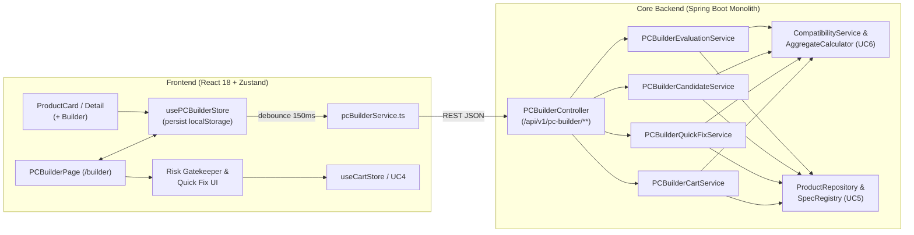

# TÀI LIỆU THIẾT KẾ CHI TIẾT (MASTER DETAILED DESIGN)
## Phân hệ: PC Builder & Kiểm tra Tương thích Real-time (UC2 & WBS 7.5)

* **Mã tài liệu:** `DD-UC2-PC-BUILDER`
* **Phiên bản:** `v1.2` *(Đưa `SSD_SATA` 2.5" vào danh sách linh kiện trong thùng máy ngay dưới `SSD_M2` với nhãn `Tùy chọn` & `is_core = false`; khôi phục nhóm Ngoại vi gồm `MONITOR`, `KEYBOARD`, `MOUSE`)*
* **Kiến trúc áp dụng:** Master DD + Sub-DD (Hub-and-Spoke theo `AGENTS.md` §1 & §2.2)
* **Package Backend:** `com.smartpc.modules.pcbuilder` (tích hợp nội bộ với `ruleengine` và `product`)
* **Thư mục Frontend:** `frontend/src/features/pc-builder`, `frontend/src/stores/usePCBuilderStore.ts`, `frontend/src/services/pcBuilderService.ts`
* **Use-Case liên quan:** `UC2` (Xây dựng PC & Kiểm tra tương thích); kết nối đầu vào từ `UC1a` (Product Catalog) và đầu ra sang `UC4` (Giỏ hàng), `UC1` (AI Chat).
* **Liên kết WBS (`sdd.md` §7):** `7.5 Công cụ Xây dựng PC - PC Builder (UC2)` (`7.5.1` $\rightarrow$ `7.5.6`).

---

## 1. Tổng quan Phân hệ & Kiến trúc Tổng thể

Phân hệ **PC Builder (UC2)** cung cấp trình lắp ráp cấu hình máy tính trực quan theo **8 khe cắm linh kiện cốt lõi** (`CPU`, `MOTHERBOARD`, `RAM`, `GPU`, `SSD_M2`, `PSU`, `CASE`, `CPU_COOLER`; `total_core_slots = 8`), kèm khe lưu trữ nội bộ tùy chọn **`SSD_SATA` (`Ổ cứng SSD SATA 2.5"`, `is_core = false`, nhãn `Tùy chọn`) hiển thị ngay dưới `SSD_M2`** trong danh sách linh kiện chính và khối thu gọn **3 thiết bị ngoại vi tùy chọn (`MONITOR`, `KEYBOARD`, `MOUSE`)**. Mọi thao tác chọn, đổi hoặc thay đổi số lượng linh kiện đều kích hoạt kiểm tra tương thích phần cứng trong thời gian thực ($< 5\text{ms}$ server-side) thông qua **Hardware Rule Engine (`UC6`)** chạy nội bộ trong cùng tiến trình **Spring Boot Java 25 Monolith** (tuyệt đối không gọi qua mạng tới engine ngoài).



### 1.1. Cấu trúc Package & Thư mục Phân hệ (`UC2`)

```text
backend/src/main/java/com/smartpc/modules/pcbuilder/
├── controller/PCBuilderController.java          # REST endpoints /api/v1/pc-builder/**
├── service/
│   ├── PCBuilderEvaluationService.java          # Đánh giá cấu hình, TDP, Balance Index, Slot Status
│   ├── PCBuilderCandidateService.java           # Lọc ứng viên theo slot & badge tương thích
│   ├── PCBuilderQuickFixService.java            # Mô phỏng Rule Engine gợi ý thay thế Zero-Code
│   └── PCBuilderCartService.java                # Gatekeeper server-side & đẩy cấu hình vào giỏ
├── validator/PCBuilderRequestValidator.java     # Kiểm tra biên 30 SP, qty 1..16, slot hợp lệ
├── model/                                       # BuilderSlotCode, SlotStatusLevel, BuilderGateStatus
└── dto/{request,response}/                      # Request/Response DTOs chuẩn snake_case

frontend/
├── package.json                                 # Script "test": "vitest run" (Vitest + RTL + jsdom)
├── vitest.config.ts                             # Kế thừa vite.config.ts (@ alias, jsdom, setupFiles)
└── src/
    ├── test/setup.ts                            # @testing-library/jest-dom/vitest + cleanup()
    ├── features/pc-builder/
    │   ├── pages/PCBuilderPage.tsx              # Route /builder (3-layer Bright Header compliant)
    │   ├── components/                          # TelemetryBar, SlotRow, PickerModal, Diagnostics, QuickFix, GateModal
    │   ├── constants/slotConfig.ts              # Metadata 8 slot cốt lõi + SSD_SATA nội bộ tùy chọn + ngoại vi tùy chọn
    │   └── types/builder.types.ts               # TypeScript interfaces đồng bộ 100% Backend DTO
    ├── stores/{usePCBuilderStore.ts,useCartStore.ts}# Zustand persist state cho Builder & Guest Cart
    └── services/pcBuilderService.ts             # Axios client + Mock Fallback khi offline
```

### 1.2. Mục tiêu Kỹ thuật & Phi chức năng (Objectives & SLAs)
* **Độ trễ Đánh giá Real-time:** Backend `POST /api/v1/pc-builder/evaluate` đạt **P99 $< 15\text{ms}$** (trong đó Rule Engine `CompatibilityService` chiếm $< 2\text{ms}$ trên Caffeine Cache). Frontend debounce `150ms` kèm sequence guard chống race condition khi click liên tiếp.
* **Zero-Code Rule Sync:** Mọi luật tương thích và gợi ý thay thế (`Quick Fix`) đều đọc động từ `PreIndexedRuleCache` (`UC6`) và `CategorySpecSchemaRegistry` (`UC5`), tuyệt đối không hardcode socket/bus RAM/chiều dài GPU trong Java hay React.
* **An toàn Giá & Tồn kho (Server-Authoritative):** Frontend chỉ gửi `{ product_id, quantity }`; Backend luôn tính lại `total_price`, kiểm tra `is_active`, `deleted_at IS NULL`, `stock_quantity` và chạy lại Gatekeeper trước khi cho phép thêm vào giỏ hàng.
* **Local Dev Resilience:** Nếu Backend chưa chạy ở môi trường Local Dev, `pcBuilderService.ts` tự động fallback sang `MOCK_PRODUCTS` (`mockData.ts`) để màn hình `/builder` vẫn hoạt động đầy đủ luồng UI.

---

## 2. Shared Contracts (Hợp đồng Dùng chung Toàn Phân hệ)

Mọi Sub-DD (`7.5.1` $\rightarrow$ `7.5.6`) phải tuân thủ nghiêm ngặt các hợp đồng dùng chung dưới đây; không tự ý đổi tên trường JSON, mã lỗi hay cấu trúc bảng.

### 2.1. Phụ thuộc Dữ liệu & Hạ tầng (Không thay đổi Breaking Schema)
* **Bảng tái sử dụng:** `categories`, `products` (`V1`, `V3` virtual columns & `specs` JSON), `compat_rules` (`V1`, `V2`, `V4`), `carts` & `cart_items` (`V1`). Phân hệ **không tạo bảng mới**; toàn bộ cấu hình nháp của khách lưu tại `localStorage` (`smartpc_builder_v1`) và URL share param `?items=...`.
* **Phụ thuộc chéo Read-Only:**
  * `UC6` (`com.smartpc.modules.ruleengine`): `CompatibilityService.evaluateContexts(...)`, `AggregateCalculator.calculateAggregates(...)`, `CompatibilityResult`, `ViolationDetail`. Lưu ý giới hạn bảo vệ DoS của UC6: tối đa `MAX_DISTINCT_PRODUCTS = 30`, `MAX_QUANTITY_PER_PRODUCT = 16`.
  * `UC5` (`com.smartpc.modules.product`): `ProductRepository.findAllActiveWithCategoryByIds(...)`, `ProductSpecifications.of(...)`, `ProductMapper.toSummaryDto(...)`, `CategorySpecSchemaRegistry`.
  * **Lưu ý `ProductController`:** Endpoint `GET /api/v1/products` hiện chưa bind query param `search`, do đó UC2 cung cấp endpoint riêng `POST /api/v1/pc-builder/slots/{categoryCode}/candidates` dùng trực tiếp `ProductFilterCriteria.search` + `ProductSpecifications.of(...)`.

### 2.2. Danh mục 8 Slot Cốt lõi & Chính sách Số lượng (`BuilderSlotCode`)

| Slot (`category_code`) | Thứ tự | Chế độ chọn | Số lượng tối đa | Bắt buộc khuyến nghị | Quy tắc UC6 liên quan chính |
| :--- | :---: | :--- | :---: | :---: | :--- |
| `CPU` | 1 | Single (`maxDistinct = 1`) | 1 | Có | Socket vs Mainboard/Cooler, `_total_tdp_w` |
| `MOTHERBOARD` | 2 | Single (`maxDistinct = 1`) | 1 | Có | Socket, RAM type/slots/maxGB, Form Factor, M.2, PCIe |
| `RAM` | 3 | Multi (`allowQuantity = true`) | Tổng `qty <= 16` | Có | `memory_type`, `_count * modules_per_kit`, `_sum_capacity_gb` |
| `GPU` | 4 | Single (`maxDistinct = 1`) | 1 | Khuyến nghị | `length_mm <= max_gpu_length_mm`, `pcie_gen`, TDP |
| `SSD_M2` | 5 | Multi (`allowQuantity = true`) | Tổng `qty <= 16` | Có | `_count <= m2_slots`, TDP |
| `PSU` | 6 | Single (`maxDistinct = 1`) | 1 | Có | `_total_tdp_w <= rated_wattage_w` |
| `CASE` | 7 | Single (`maxDistinct = 1`) | 1 | Có | `supported_form_factors`, `max_gpu_length_mm`, `max_cooler_height_mm` |
| `CPU_COOLER` | 8 | Single (`maxDistinct = 1`) | 1 | Tùy chọn | `supported_sockets`, `height_mm` (`tdp_w` không cộng vào nguồn!) |

* **Khe lưu trữ nội bộ tùy chọn (`SSD_SATA` — Ổ cứng SSD SATA 2.5"):** Trên Frontend nằm trực tiếp trong `CORE_SLOT_CONFIGS` / `BuilderSlotCode` (`coreSlots.SSD_SATA`) ngay dưới `SSD_M2` với badge `Tùy chọn`, `selection_mode = 'MULTI'` (tối đa `16`), `is_core = false`; trên Backend giữ enum `BuilderSlotCode` ở 8 khe cốt lõi và đăng ký `"SSD_SATA"` vào `BuilderSlotCode.OPTIONAL_INTERNAL_CODES` (`isOptionalInternalSlot("SSD_SATA") == true`). Do đó `SSD_SATA` **không** tính vào tiến độ `X/8` (`total_core_slots = 8`) và **không** đếm vào `Rule 9 (M.2 Slot Count)` của `SSD_M2`, nhưng vẫn cộng `tdp_w` (khi đã có linh kiện cốt lõi), kiểm tra tồn kho, xuất báo giá, chia sẻ `?items=` và đẩy vào giỏ hàng cùng bộ máy.
* **Nhóm thiết bị ngoại vi tùy chọn (`MONITOR`, `KEYBOARD`, `MOUSE`):** Nằm ngoài 8 khe cốt lõi thông qua `BuilderSlotCode.PERIPHERAL_CODES` (Backend) và `PeripheralSlotCode` / `PERIPHERAL_SLOT_CONFIGS` (Frontend, hiển thị ở khối thu gọn `"Thiết bị ngoại vi tùy chọn (Màn hình, Bàn phím, Chuột)"`), hỗ trợ chọn nhiều (`MULTI`, tối đa `16`), xuất báo giá, chia sẻ `?items=` và đẩy vào giỏ hàng cùng bộ máy.

### 2.3. Hợp đồng `ErrorCode` Bổ sung (`com.smartpc.common.exception.ErrorCode`)

| Mã lỗi (`ErrorCode`) | HTTP | Thông điệp mặc định | Nơi kích hoạt |
| :--- | :---: | :--- | :--- |
| `BUILDER_EMPTY_CONFIG` | `400` | `"Vui lòng chọn ít nhất một linh kiện trong cấu hình PC"` | `add-to-cart`, `resolve` |
| `BUILDER_INVALID_SLOT` | `400` | `"Mã khe linh kiện (slot) không hợp lệ cho PC Builder"` | `candidates`, `quick-fix` |
| `BUILDER_SLOT_CAPACITY_EXCEEDED` | `400` | `"Khe linh kiện đơn chỉ cho phép chọn tối đa 1 sản phẩm với số lượng 1"` | `PCBuilderRequestValidator` |
| `BUILDER_COMPATIBILITY_CONFLICT` | `409` | `"Cấu hình đang có xung đột phần cứng mức ERROR. Vui lòng khắc phục trước khi thêm vào giỏ"` | `PCBuilderCartService` (`7.5.4`) |
| `BUILDER_WARNING_ACK_REQUIRED` | `409` | `"Cấu hình có cảnh báo kỹ thuật (WARNING). Vui lòng xác nhận rủi ro để tiếp tục"` | `PCBuilderCartService` (`7.5.4`) |
| `BUILDER_PRODUCT_UNAVAILABLE` | `409` | `"Một hoặc nhiều linh kiện không tồn tại hoặc đã ngừng kinh doanh"` | `PCBuilderCartService` (`7.5.6`) |

### 2.4. Hợp đồng Giao diện & Bảo mật (UI Header & Auth Boundary)
* **Tuân thủ `AGENTS.md` §4 (Bright Global Header 3 tầng):** Khi gắn route `/builder` vào `frontend/src/App.tsx`, liên kết trên Tầng 2 **BẮT BUỘC** giữ nguyên icon `Wrench` (`text-smart-blue`) và nhãn chính xác là **`PC Builder`** — **TUYỆT ĐỐI KHÔNG** ghi `PC Builder (AI)` và **KHÔNG** gắn badge `PRO`.
* **Ranh giới Auth / Cart (`UC0` & `UC4` chưa hoàn thiện):** Endpoint `/api/v1/pc-builder/**` mở công khai (`permitAll` theo `SecurityConfig` hiện tại). Khi đẩy vào giỏ hàng: nếu có người dùng đăng nhập (sau khi tích hợp UC0/UC4), Backend ghi vào `carts`/`cart_items`; nếu là khách vãng lai (`guest_mode = true` hoặc chưa có principal), Backend kiểm tra Gatekeeper + tồn kho + tính giá chuẩn server rồi trả về `AddBuildToCartResponseDTO` (`cart_persisted = false`) để Frontend `useCartStore` lưu cục bộ và cập nhật badge giỏ hàng trên Header.

### 2.5. Hợp đồng DTO Dùng chung (`BuildItemInput` & `PCBuilderEvaluateResponse`)
Mọi endpoint thuộc `/api/v1/pc-builder/**` sử dụng chuẩn snake_case và bọc trong `ApiResponse<T>`:
```json
// BuildItemInput (Request item chuẩn dùng chung cho evaluate, candidates, quick-fix, add-to-cart)
{ "product_id": "e0000001-0000-0000-0000-000000000001", "quantity": 1, "slot_code": "CPU" }
```
* **Enum `SlotStatusLevel`:** `EMPTY` | `COMPATIBLE` | `INFO` | `WARNING` | `ERROR`.
* **Enum `BuilderGateStatus`:** `BLOCKED_EMPTY` | `BLOCKED_OUT_OF_STOCK` | `BLOCKED_COMPATIBILITY_ERROR` | `WARNING_CONFIRM_REQUIRED` | `READY_SAFE`.
* **`PCBuilderEvaluateResponse` (Core Output dùng chung cho `7.5.2`, `7.5.3`, `7.5.4`, `7.5.6`):**
  * `compatibility`: `CompatibilityResult` nguyên bản từ `UC6` (`is_compatible`, `errors`, `warnings`, `info`, `unresolved_product_ids`).
  * `telemetry`: `BuildTelemetryDTO` (`total_price`, `estimated_tdp_w`, `recommended_psu_w`, `selected_psu_wattage_w`, `psu_load_percent`, `balance_index`, `balance_label`, `selected_core_slots`, `total_core_slots`, `evaluation_time_ms`).
  * `slot_statuses`: `Map<String, SlotDiagnosticDTO>` ánh xạ `slot_code` $\rightarrow$ `{ status, error_count, warning_count, info_count, violation_rule_ids }`.
  * `gate_status`: `BuilderGateStatus`, `stock_issues`: `List<StockIssueDTO>`, `missing_recommended_slots`: `List<String>`.

### 2.6. Tổng hợp Endpoint REST API Toàn phân hệ (`/api/v1/pc-builder`)

| Method | Endpoint | Phân quyền | Sub-DD đặc tả | Mục đích chính |
| :--- | :--- | :--- | :--- | :--- |
| `POST` | `/api/v1/pc-builder/slots/{categoryCode}/candidates` | Public | `7.5.1`, `7.5.5` | Lọc ứng viên theo slot kèm tìm kiếm & trạng thái tương thích trước |
| `POST` | `/api/v1/pc-builder/evaluate` | Public | `7.5.2`, `7.5.4` | Đánh giá tương thích real-time, tính TDP, Balance Index & Gatekeeper |
| `POST` | `/api/v1/pc-builder/quick-fix` | Public | `7.5.5` | Mô phỏng Rule Engine gợi ý linh kiện thay thế xóa xung đột |
| `POST` | `/api/v1/pc-builder/add-to-cart` | Public / User | `7.5.4`, `7.5.6` | Kiểm tra Gatekeeper lần cuối, tồn kho & đẩy cấu hình vào giỏ |
| `POST` | `/api/v1/pc-builder/resolve` | Public | `7.5.6` | Khôi phục chi tiết linh kiện & đánh giá từ link chia sẻ `?items=...` |

---

## 3. Bảng Điều phối Chức năng (Feature Index & Refer Table)

> Các Agent triển khai theo mô hình Scoped Subagent: đọc **Sub-DD** được giao + Mục **2. Shared Contracts** ở trên. Các file dùng chung (`ErrorCode.java`, `App.tsx`, `PCBuilderController.java`, `usePCBuilderStore.ts`) phải tuân thủ kiểm soát ghi của Coordinator theo `AGENTS.md` §3.2.
> **Wave Plan:** [plan-uc2-pc-builder.md](../implementation-plan/plan-uc2-pc-builder.md) — thứ tự Wave & `Shared-File Write Lock` (mục 3.1 bên dưới là nguồn chuẩn về quyền ghi file dùng chung).

| WBS | Chức năng | Sub-DD | Owned Files (Phạm vi code chính) | Depends on | Test Targets |
| :--- | :--- | :--- | :--- | :--- | :--- |
| `7.5.1` | Giao diện chọn linh kiện theo slot & Store cấu hình | [dd-uc2-slot-picker.md](uc2-pc-builder/dd-uc2-slot-picker.md) | `PCBuilderPage.tsx`, `BuilderSlotList.tsx`, `BuilderSlotRow.tsx`, `ComponentPickerModal.tsx`, `slotConfig.ts`, `builder.types.ts`, `usePCBuilderStore.ts`, `PCBuilderCandidateService.java` | `UC5`, `7.5.2` | `PCBuilderCandidateServiceTest`, `ComponentPickerModal.test.tsx` (`TC-UC2-01..04`, `31`, `33`) |
| `7.5.2` | Gọi Rule Engine check tương thích real-time & Telemetry | [dd-uc2-compatibility-eval.md](uc2-pc-builder/dd-uc2-compatibility-eval.md) | `PCBuilderController.java`, `PCBuilderEvaluationService.java`, `PCBuilderRequestValidator.java`, `BuilderSlotCode.java`, `pcBuilderService.ts` | `UC6` (`CompatibilityService`), `UC5` | `PCBuilderEvaluationServiceTest` (`TC-UC2-05..10`, `32`) |
| `7.5.3` | Hiển thị thông báo màu sắc (`ERROR`/`WARNING`/`INFO`) & Sidebar | [dd-uc2-diagnostics-ui.md](uc2-pc-builder/dd-uc2-diagnostics-ui.md) | `BuilderTelemetryBar.tsx`, `RuleDiagnosticsSidebar.tsx`, `SlotViolationBanner.tsx`, `AIChatWidget.tsx` (event hook) | `7.5.1`, `7.5.2`, `UC1` | Component UI Tests (`TC-UC2-11..14`) |
| `7.5.4` | Thuật toán chặn `ERROR` / cảnh báo xác nhận rủi ro `WARNING` | [dd-uc2-risk-gatekeeper.md](uc2-pc-builder/dd-uc2-risk-gatekeeper.md) | `BuilderGateStatus` logic (`determineGateStatus`), `RiskConfirmationModal.tsx`, `BuilderBottomBar.tsx`, gatekeeper logic trong `PCBuilderEvaluationService` & `PCBuilderCartService` | `7.5.2`, `7.5.3` | `PCBuilderGatekeeperTest` (`TC-UC2-15..19`) |
| `7.5.5` | Gợi ý linh kiện thay thế tương thích (`Quick Fix Suggestions`) | [dd-uc2-quick-fix.md](uc2-pc-builder/dd-uc2-quick-fix.md) | `PCBuilderQuickFixService.java`, `QuickFixPanel.tsx`, candidate compat pre-check trong `PCBuilderCandidateService.java` | `UC6`, `7.5.2` | `PCBuilderQuickFixServiceTest` (`TC-UC2-20..24`) |
| `7.5.6` | Đẩy toàn bộ cấu hình vào giỏ hàng, `+ Builder` & Share URL | [dd-uc2-add-to-cart.md](uc2-pc-builder/dd-uc2-add-to-cart.md) | `PCBuilderCartService.java`, `useCartStore.ts`, `BuilderPrintSheetModal.tsx`, `ProductCard.tsx`, `ProductDetailPage.tsx` (`App.tsx` → Coordinator `Final Wave`) | `7.5.1`, `7.5.4`, `UC5` | `PCBuilderCartServiceTest` (`TC-UC2-25..30`) |


### 3.1. Phân quyền Ghi File Dùng chung giữa các Sub-DD (Shared-File Ownership)

Các file dưới đây xuất hiện ở $\ge 2$ Sub-DD hoặc là file toàn cục; quyền ghi được tuần tự hóa theo Wave trong [plan-uc2-pc-builder.md](../implementation-plan/plan-uc2-pc-builder.md). Sub-DD khác chỉ đọc.

| File dùng chung | Người tạo (Wave) | Sub-DD được mở rộng (theo thứ tự Wave) | Ghi chú |
| :--- | :--- | :--- | :--- |
| `ErrorCode.java` (6 mã `BUILDER_*` ở §2.3) | Coordinator (`Wave 0`) | — | Sub-DD chỉ tham chiếu |
| `PCBuilderController.java` | Coordinator (`Wave 0`: skeleton `@RequestMapping("/api/v1/pc-builder")`) | `7.5.2` `/evaluate` $\rightarrow$ `7.5.1` `/slots/{categoryCode}/candidates` $\rightarrow$ `7.5.5` `/quick-fix` $\rightarrow$ `7.5.6` `/add-to-cart`, `/resolve` | Mỗi Sub-DD chỉ thêm method endpoint của mình |
| `model/BuilderGateStatus.java` (5 hằng số §2.5) | Coordinator (`Wave 0`) | — | `7.5.2` cần enum cho `gate_status`; `7.5.4` sở hữu logic `determineGateStatus(...)` |
| `frontend/.../types/builder.types.ts` | Coordinator (`Wave 0`: mirror TS của §2.5) | `7.5.2` $\rightarrow$ `7.5.1` $\rightarrow$ `7.5.5` $\rightarrow$ `7.5.4` $\rightarrow$ `7.5.6` | Append-only phần type riêng của từng Sub-DD |
| `PCBuilderEvaluationService.java` | `7.5.2` | `7.5.4` (`determineGateStatus`) | |
| `PCBuilderCandidateService.java` | `7.5.1` | `7.5.5` (pre-check `evaluate_compatibility`) | |
| `PCBuilderCartService.java` | `7.5.4` (gate server-side) | `7.5.6` (persist / guest cart, `/resolve`) | |
| `PCBuilderPage.tsx` | `7.5.1` | `7.5.3` (mount Telemetry/Sidebar/Banner) $\rightarrow$ `7.5.4` (mount `BuilderBottomBar`) $\rightarrow$ `7.5.6` (`?items=` resolve on mount) | Gắn `QuickFixPanel` qua prop `renderQuickFix` ở `Final Wave` |
| `usePCBuilderStore.ts` | `7.5.1` | `7.5.4` (`Auto-Reset Ack`) | |
| `App.tsx` | Coordinator (`Final Wave`) | — | Thực thi đặc tả `7.5.6` §3.3, tuân thủ `AGENTS.md` §4 |
