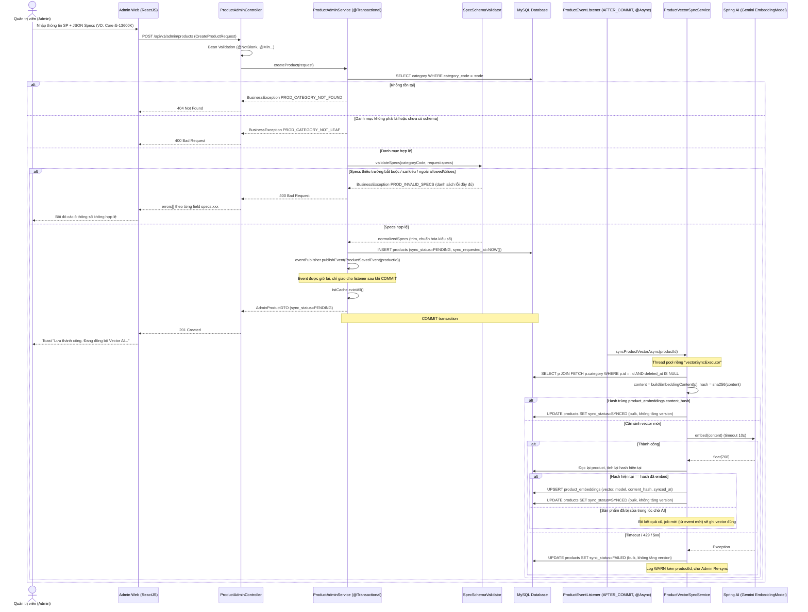
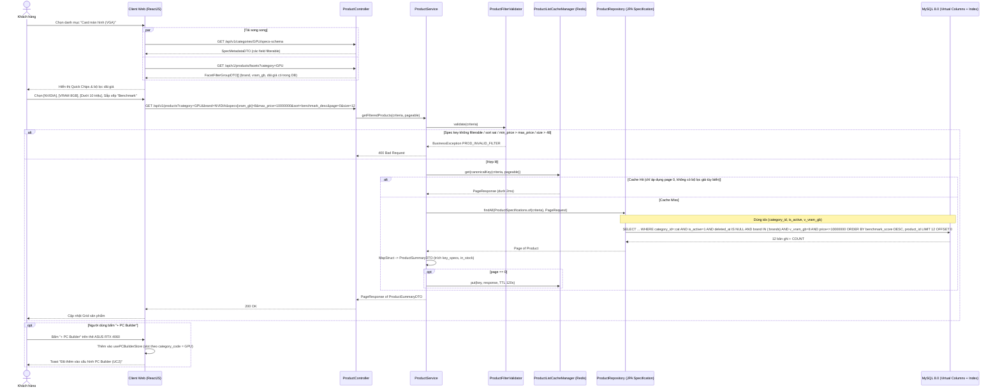
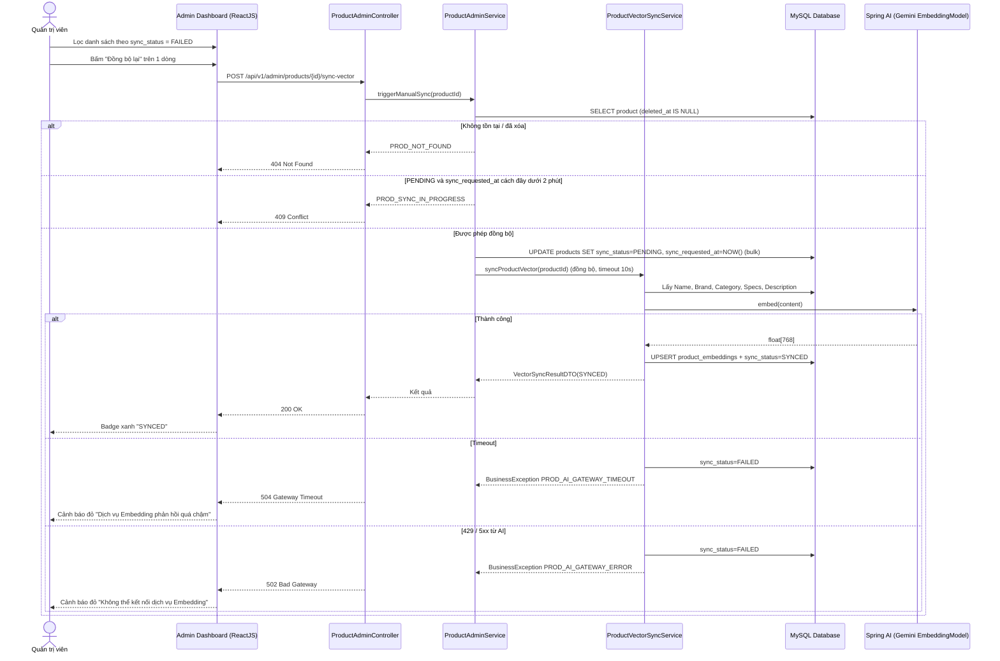
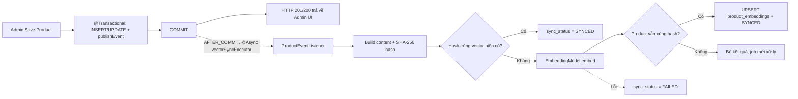

# TÀI LIỆU THIẾT KẾ CHI TIẾT (DETAILED DESIGN)
## Phân hệ: Quản lý Sản phẩm & Danh mục (UC1a, UC5 & WBS 7.2)

* **Mã tài liệu:** `DD-UC5-PRODUCT-CATALOG`
* **Phiên bản:** `v1.1` (Bản rà soát & hiệu chỉnh — xem [Phụ lục A](#phụ-lục-a-lịch-sử-hiệu-chỉnh-v10--v11))
* **Phân hệ (Package):** `com.smartpc.modules.product` (Backend) & `src/features/product-catalog`, `src/features/admin/products`, `src/features/admin/categories` (Frontend)
* **Liên kết Use-Case:** 
  * `UC1a` (Duyệt sản phẩm theo danh mục & Quick Chips Filter)
  * `UC5` (Quản lý Thông tin Sản phẩm & Dynamic JSON Specs)
  * Hỗ trợ trực tiếp cho `UC1` (Semantic Search Vector Store), `UC2` (PC Builder Component Picker & Specs Extraction), `UC3` (PC Profile & Benchmark Ranking), `UC4` (Giỏ hàng & Kiểm tra tồn kho Real-time), `UC6` (Tập luật đối chiếu `source_spec_key` và `target_spec_key`).
* **Liên kết WBS:** `7.2 Quản lý Sản phẩm & Danh mục (UC1a, UC5)` (`7.2.1` $\rightarrow$ `7.2.6`).
* **Phụ thuộc dữ liệu:** `V1__init_schema.sql` (bảng gốc), `V2__seed_rules.sql` (8 danh mục chuẩn + 10 luật UC6). Thay đổi schema của phân hệ này được thực hiện qua migration mới `V3__product_catalog.sql` (Mục 6).

---

## 1. Tổng quan Phân hệ & Mục tiêu Kỹ thuật (Module Overview & Objectives)

Phân hệ **Quản lý Sản phẩm & Danh mục (Product Catalog Subsystem)** là xương sống dữ liệu của toàn bộ nền tảng SmartPC. Khác với các hệ thống TMĐT bán lẻ thông thường, phân hệ linh kiện phần cứng máy tính đòi hỏi cấu trúc dữ liệu lai (Hybrid Relational & Dynamic Schema):
* Thông tin thương mại cốt lõi (Tên, Hãng, Giá, Tồn kho, Trạng thái, Benchmark Score) được lưu trữ theo cấu trúc chuẩn RDBMS ACID.
* Thông số kỹ thuật chuyên sâu (Hardware Specifications: Socket, TDP, Bus RAM, Form Factor, Chiều dài, Số khe cắm...) thay đổi hoàn toàn theo từng loại linh kiện và được mô hình hóa dưới dạng **Dynamic JSON Specs**. Dữ liệu này đóng vai trò quyết định đầu vào cho **Hardware Rule Engine (UC6)** và **AI Semantic Search (UC1)**.

### 1.1. Mục tiêu Kỹ thuật & Nghiệp vụ
1. **Dynamic Specifications có kiểm soát (UC5 & WBS 7.2.3):** Lưu thông số kỹ thuật bằng kiểu `JSON` trong MySQL 8.0. `SpecSchemaValidator` xác thực JSON theo `category_code` (`CPU`, `MOTHERBOARD`, `RAM`, `GPU`, `SSD_M2`, `PSU`, `CASE`, `CPU_COOLER` — **khớp 100% với `V2__seed_rules.sql`**) và **khớp 100% với các `spec_key` được các luật UC6 tham chiếu**, nhằm bảo vệ tính toàn vẹn dữ liệu đầu vào của Rule Engine.
2. **Event-Driven Vector Synchronization (UC5 & WBS 7.2.4, 7.2.6):** Khi các trường mang ngữ nghĩa (tên, hãng, danh mục, mô tả, specs) thay đổi, hệ thống phát `ProductSavedEvent`. `ProductEventListener` (`@TransactionalEventListener(AFTER_COMMIT)` + `@Async`) gọi Spring AI `EmbeddingModel` để vector hóa, lưu vào `product_embeddings` và cập nhật `sync_status` (`SYNCED`, `PENDING`, `FAILED`). Có cơ chế chống ghi đè vector cũ (content hash), tự phục hồi sự kiện bị mất (Scheduled Recovery) và Re-sync thủ công / hàng loạt cho Admin.
3. **Hiệu năng Truy vấn Lọc & Phân trang (UC1a & WBS 7.2.5):**
   * Tận dụng **MySQL 8.0 Generated Virtual Columns + Composite Index** cho các spec key được lọc thường xuyên (`socket_type`, `form_factor`, `memory_type`, `vram_gb`) và **Multi-Valued Index** cho mảng `supported_sockets` (phục vụ PC Builder lọc Mainboard/Tản nhiệt theo socket).
   * Chỉ cho phép lọc theo **danh sách spec key được whitelist** (`FieldDefinition.filterable = true`) — chống truy vấn full-scan JSON và chống injection đường dẫn JSON.
   * Mục tiêu: truy vấn lọc đa tiêu chí $< 25\text{ms}$ (P95, dữ liệu $\le 50.000$ sản phẩm).
4. **Quản lý Cây Danh mục Phân cấp (WBS 7.2.1):** Mô hình Adjacency List 2 cấp (Nhóm $\rightarrow$ Danh mục lá). Chỉ danh mục lá có schema đăng ký mới được gắn sản phẩm. `category_code` là **bất biến** sau khi tạo (vì được tham chiếu bởi `compat_rules` và `CategorySpecSchemaRegistry`). Cache Redis + Eviction khi Admin thay đổi.
5. **Toàn vẹn Tồn kho & Benchmark Ranking (WBS 7.2.2):** Optimistic Locking (`@Version`) chống ghi đè khi Admin sửa đồng thời; trừ kho khi checkout (UC4) dùng câu lệnh UPDATE nguyên tử có điều kiện. Các cập nhật hệ thống (như `sync_status`) **không được tăng `version`** để tránh gây `OptimisticLockException` giả cho Admin/UC4. `benchmark_score` chuẩn hóa thang $[0, 100]$ phục vụ Tier Ranking % (UC3).

### 1.2. Cấu trúc Package & Thư mục Chi tiết

#### A. Backend Layout (`com.smartpc.modules.product`)
```text
backend/src/main/java/com/smartpc/modules/product/
├── controller/
│   ├── ProductController.java              # REST API công khai duyệt sản phẩm, lọc Quick Chips (UC1a)
│   ├── CategoryController.java             # REST API công khai cây danh mục & specs schema (UC1a)
│   ├── ProductAdminController.java         # REST API Admin quản trị sản phẩm, specs, manual sync (UC5)
│   └── CategoryAdminController.java        # REST API Admin quản trị cây danh mục (UC5)
├── service/
│   ├── ProductService.java                 # Nghiệp vụ duyệt sản phẩm, lọc faceted, chi tiết
│   ├── ProductAdminService.java            # Nghiệp vụ CRUD sản phẩm, soft delete, kích hoạt sync
│   ├── CategoryService.java                # Nghiệp vụ nạp & cache cây danh mục
│   ├── CategoryAdminService.java           # Nghiệp vụ CRUD danh mục & evict cache
│   ├── ProductVectorSyncService.java       # Sinh Embedding Vector qua Spring AI (sync + async)
│   └── ProductSyncRecoveryJob.java         # @Scheduled: phục hồi sản phẩm kẹt PENDING (mất event do restart)
├── cache/
│   └── ProductListCacheManager.java        # Cache trang danh sách theo namespace version + evict toàn cục
├── validator/
│   ├── SpecSchemaValidator.java            # Validate JSON specs theo schema từng danh mục (gom đủ lỗi)
│   ├── ProductFilterValidator.java         # Validate tham số lọc: whitelist spec key, khoảng giá, sort
│   └── CategoryValidator.java              # Validate quan hệ cha-con, chống vòng lặp, giới hạn độ sâu
├── schema/
│   ├── CategorySpecSchemaRegistry.java     # Đăng ký specs bắt buộc/tùy chọn cho 8 loại linh kiện
│   ├── FieldDefinition.java                # Khai báo key, kiểu, đơn vị, bắt buộc, filterable, label
│   └── FieldType.java                      # Enum: STRING, NUMBER, INTEGER, BOOLEAN, ARRAY_STRING
├── event/
│   ├── ProductSavedEvent.java              # Domain Event (productId) phát trong transaction
│   └── ProductEventListener.java           # @TransactionalEventListener(AFTER_COMMIT) + @Async
├── repository/
│   ├── ProductRepository.java              # Spring Data JPA + JpaSpecificationExecutor + bulk update sync_status
│   ├── ProductSpecifications.java          # Factory JPA Specification cho dynamic filter (map key -> virtual column)
│   ├── CategoryRepository.java             # JPA Repository cho bảng categories
│   └── ProductEmbeddingRepository.java     # JPA Repository cho bảng product_embeddings
├── entity/
│   ├── Product.java                        # Entity bảng products (JSON specs, sync_status, version, deleted_at)
│   ├── Category.java                       # Entity bảng categories (tự tham chiếu parent)
│   ├── ProductEmbedding.java               # Entity bảng product_embeddings (vector, model, content_hash)
│   └── ProductSyncStatus.java              # Enum: SYNCED, PENDING, FAILED
├── mapper/
│   ├── ProductMapper.java                  # MapStruct Entity <-> DTO (trích key_specs theo registry)
│   └── CategoryMapper.java                 # MapStruct cho Category Tree DTO
└── dto/
    ├── request/
    │   ├── CreateProductRequest.java       # Payload tạo sản phẩm mới kèm JSON specs
    │   ├── UpdateProductRequest.java       # Payload cập nhật sản phẩm (bắt buộc kèm version)
    │   ├── UpdateProductStatusRequest.java # { is_active }
    │   ├── ProductFilterCriteria.java      # Tham số lọc (category, brand, price, specs map, sort)
    │   ├── CreateCategoryRequest.java      # Payload tạo danh mục
    │   ├── UpdateCategoryRequest.java      # Payload sửa danh mục (không cho đổi category_code)
    │   └── BatchResyncRequest.java         # Danh sách product_id cần sync lại vector (tối đa 100)
    └── response/
        ├── ProductSummaryDTO.java          # Thông tin tóm tắt hiển thị thẻ Grid (UC1a)
        ├── ProductDetailDTO.java           # Thông tin đầy đủ + specs hiển thị chi tiết (Screen 3)
        ├── AdminProductDTO.java            # ProductDetailDTO + sync_status, version, deleted_at (chỉ Admin)
        ├── CategoryTreeDTO.java            # Cấu trúc cây danh mục lồng nhau
        ├── SpecMetadataDTO.java            # Định nghĩa specs hỗ trợ render bộ lọc và form Admin
        ├── VectorSyncResultDTO.java        # Kết quả đồng bộ vector 1 sản phẩm
        ├── BatchSyncAcceptedDTO.java       # Kết quả tiếp nhận batch re-sync (job_id, accepted, rejected)
        └── FacetFilterGroupDTO.java        # Danh sách Quick Chips & dải giá sinh động từ DB
```

#### B. Frontend Layout
```text
frontend/src/
├── App.tsx                                     # Layout toàn cục: Bright Global Header (3 tầng sáng) & Bright Footer
├── features/
│   ├── product-catalog/                    # Phân hệ Duyệt sản phẩm & Bộ lọc (UC1a)
│   │   ├── pages/
│   │   │   ├── CategoryBrowsePage.tsx      # Màn hình duyệt danh mục, Bright Hero Banner & danh sách sản phẩm
│   │   │   └── ProductDetailPage.tsx       # Màn hình chi tiết SP (Screen 3: Gallery, Specs, Compat widget)
│   │   ├── components/
│   │   │   ├── CategoryHierarchyNav.tsx    # Breadcrumb & Menu danh mục con
│   │   │   ├── QuickChipsFilterBar.tsx     # Dãy nút lọc nhanh (Brand, Socket, VRAM, Giá...)
│   │   │   ├── DynamicSpecsFilterPanel.tsx # Bộ lọc thuộc tính mở rộng theo loại linh kiện
│   │   │   ├── ProductGrid.tsx             # Lưới hiển thị danh sách sản phẩm
│   │   │   ├── ProductCard.tsx             # Thẻ sản phẩm kèm nút "Thêm giỏ" & "+ PC Builder"
│   │   │   ├── ProductSpecsTable.tsx       # Bảng thông số kỹ thuật chi tiết zebra striping
│   │   │   └── SortDropdown.tsx            # Dropdown sắp xếp (Mới nhất, Giá tăng/giảm, Benchmark)
│   │   ├── hooks/
│   │   │   ├── useProductFilter.ts         # Đồng bộ state bộ lọc <-> URL query (page, size, filters)
│   │   │   └── useProductDetail.ts         # Hook fetch chi tiết sản phẩm & trạng thái tồn kho
│   │   └── types/
│   │       └── product.types.ts            # TypeScript interfaces cho Product, Category, Specs
│   ├── admin/
│   │   ├── products/                       # Phân hệ Quản trị Sản phẩm (UC5)
│   │   │   ├── pages/
│   │   │   │   └── AdminProductListPage.tsx # Bảng danh sách linh kiện, bộ lọc, trạng thái vector
│   │   │   ├── components/
│   │   │   │   ├── ProductFormModal.tsx     # Modal Thêm/Sửa sản phẩm
│   │   │   │   ├── DynamicSpecsEditor.tsx   # Form specs tự sinh trường theo SpecMetadataDTO
│   │   │   │   ├── VectorSyncBadge.tsx      # Badge SYNCED (xanh), PENDING (vàng), FAILED (đỏ)
│   │   │   │   └── ManualSyncButton.tsx     # Nút kích hoạt Re-sync vector
│   │   └── categories/                     # Phân hệ Quản trị Danh mục
│   │       ├── pages/
│   │       │   └── AdminCategoryPage.tsx    # Quản lý cây danh mục phân cấp
│   │       └── components/
│   │           └── CategoryTreeEditor.tsx   # Modal tạo/sửa nút danh mục cha-con
├── services/
│   ├── productService.ts                   # Axios client gọi API /api/v1/products
│   ├── categoryService.ts                  # Axios client gọi API /api/v1/categories
│   └── productAdminService.ts              # Axios client gọi API /api/v1/admin/products
└── stores/
    └── useCategoryStore.ts                 # Zustand store lưu trữ cây danh mục toàn cục
```

---

## 2. Thiết kế Sơ đồ Lớp (Class Diagram)

```mermaid
classDiagram
    direction TB

    %% Controller Layer
    class ProductController {
        -ProductService productService
        +getProducts(ProductFilterCriteria, Pageable) ApiResponse~PageResponse~ProductSummaryDTO~~
        +getProductById(UUID) ApiResponse~ProductDetailDTO~
        +getFacets(String categoryCode) ApiResponse~List~FacetFilterGroupDTO~~
    }

    class CategoryController {
        -CategoryService categoryService
        +getCategoryTree() ApiResponse~List~CategoryTreeDTO~~
        +getCategorySpecsSchema(String) ApiResponse~SpecMetadataDTO~
    }

    class ProductAdminController {
        -ProductAdminService productAdminService
        +getAdminProducts(ProductFilterCriteria, Pageable) ApiResponse~PageResponse~AdminProductDTO~~
        +createProduct(CreateProductRequest) ApiResponse~AdminProductDTO~
        +updateProduct(UUID, UpdateProductRequest) ApiResponse~AdminProductDTO~
        +updateProductStatus(UUID, UpdateProductStatusRequest) ApiResponse~Void~
        +deleteProduct(UUID) ApiResponse~Void~
        +retryVectorSync(UUID) ApiResponse~VectorSyncResultDTO~
        +batchRetryVectorSync(BatchResyncRequest) ApiResponse~BatchSyncAcceptedDTO~
    }

    class CategoryAdminController {
        -CategoryAdminService categoryAdminService
        +createCategory(CreateCategoryRequest) ApiResponse~CategoryTreeDTO~
        +updateCategory(UUID, UpdateCategoryRequest) ApiResponse~CategoryTreeDTO~
        +deleteCategory(UUID) ApiResponse~Void~
    }

    %% Service Layer
    class ProductService {
        -ProductRepository productRepository
        -CategoryRepository categoryRepository
        -ProductFilterValidator filterValidator
        -ProductListCacheManager listCache
        -ProductMapper productMapper
        +getFilteredProducts(ProductFilterCriteria, Pageable) PageResponse~ProductSummaryDTO~
        +getProductDetails(UUID) ProductDetailDTO
        +getFilterFacets(String categoryCode) List~FacetFilterGroupDTO~
    }

    class ProductAdminService {
        -ProductRepository productRepository
        -CategoryRepository categoryRepository
        -SpecSchemaValidator specValidator
        -ProductMapper productMapper
        -ApplicationEventPublisher eventPublisher
        -ProductVectorSyncService syncService
        -ProductListCacheManager listCache
        +createProduct(CreateProductRequest) AdminProductDTO
        +updateProduct(UUID, UpdateProductRequest) AdminProductDTO
        +updateStatus(UUID, boolean) void
        +softDeleteProduct(UUID) void
        +triggerManualSync(UUID) VectorSyncResultDTO
        +triggerBatchSync(List~UUID~) BatchSyncAcceptedDTO
        -isSemanticChange(Product before, UpdateProductRequest req) boolean
    }

    class CategoryService {
        -CategoryRepository categoryRepository
        -CategoryMapper categoryMapper
        -CategorySpecSchemaRegistry schemaRegistry
        +getTree() List~CategoryTreeDTO~
        +getSpecsSchema(String categoryCode) SpecMetadataDTO
    }

    class CategoryAdminService {
        -CategoryRepository categoryRepository
        -ProductRepository productRepository
        -CategoryValidator categoryValidator
        -CacheManager cacheManager
        +createCategory(CreateCategoryRequest) CategoryTreeDTO
        +updateCategory(UUID, UpdateCategoryRequest) CategoryTreeDTO
        +deleteCategory(UUID) void
        -evictCategoryCache() void
    }

    class ProductVectorSyncService {
        -EmbeddingModel embeddingModel
        -ProductRepository productRepository
        -ProductEmbeddingRepository embeddingRepository
        -CategorySpecSchemaRegistry schemaRegistry
        +syncProductVector(UUID productId) VectorSyncResultDTO
        +syncProductVectorAsync(UUID productId) void
        +processBatchSyncAsync(UUID jobId, List~UUID~ productIds) void
        ~buildEmbeddingContent(Product product) String
        ~computeContentHash(String content) String
    }

    class ProductEventListener {
        -ProductVectorSyncService syncService
        +onProductSaved(ProductSavedEvent) void
    }

    class ProductSyncRecoveryJob {
        -ProductRepository productRepository
        -ProductVectorSyncService syncService
        +recoverStalePending() void
    }

    class ProductListCacheManager {
        -RedisTemplate redisTemplate
        +get(String criteriaKey) Optional~PageResponse~
        +put(String criteriaKey, PageResponse value) void
        +evictAll() void
        -currentNamespaceVersion() long
    }

    %% Validator & Registry
    class SpecSchemaValidator {
        -CategorySpecSchemaRegistry schemaRegistry
        +validateSpecs(String categoryCode, Map~String, Object~ specs) Map~String, Object~
        -validateFieldType(FieldDefinition def, Object value, List~FieldError~ errors) void
    }

    class ProductFilterValidator {
        -CategorySpecSchemaRegistry schemaRegistry
        +validate(ProductFilterCriteria criteria) void
    }

    class CategoryValidator {
        -CategoryRepository categoryRepository
        +validateParent(UUID categoryId, UUID newParentId) void
    }

    class CategorySpecSchemaRegistry {
        -Map~String, List~FieldDefinition~~ registry
        +getSchema(String categoryCode) List~FieldDefinition~
        +hasCategory(String categoryCode) boolean
        +getFilterableKeys(String categoryCode) Set~String~
    }

    class FieldDefinition {
        +String key
        +String label
        +FieldType type
        +boolean required
        +boolean filterable
        +String unit
        +Double minValue
        +List~String~ allowedValues
    }

    %% Entity Layer
    class Product {
        +UUID productId
        +String name
        +String brand
        +String description
        +Map~String, Object~ specs
        +String imageUrl
        +List~String~ galleryUrls
        +Integer price
        +Integer stockQuantity
        +Double benchmarkScore
        +ProductSyncStatus syncStatus
        +LocalDateTime syncRequestedAt
        +Boolean isActive
        +Category category
        +Long version
        +LocalDateTime createdAt
        +LocalDateTime updatedAt
        +LocalDateTime deletedAt
    }

    class Category {
        +UUID categoryId
        +String categoryCode
        +String categoryName
        +String description
        +Category parentCategory
        +List~Category~ subCategories
    }

    class ProductEmbedding {
        +UUID productId
        +List~Float~ embeddingVector
        +String embeddingModel
        +Integer dimensions
        +String contentHash
        +LocalDateTime syncedAt
    }

    class ProductSyncStatus {
        <<enumeration>>
        SYNCED
        PENDING
        FAILED
    }

    %% Relationships
    ProductController --> ProductService
    CategoryController --> CategoryService
    ProductAdminController --> ProductAdminService
    CategoryAdminController --> CategoryAdminService

    ProductService --> ProductRepository
    ProductService --> ProductFilterValidator
    ProductService --> ProductListCacheManager
    ProductAdminService --> SpecSchemaValidator
    ProductAdminService --> ProductRepository
    ProductAdminService --> ProductVectorSyncService
    ProductAdminService --> ProductListCacheManager

    CategoryService --> CategoryRepository
    CategoryService --> CategorySpecSchemaRegistry
    CategoryAdminService --> CategoryRepository
    CategoryAdminService --> CategoryValidator

    ProductEventListener --> ProductVectorSyncService
    ProductSyncRecoveryJob --> ProductVectorSyncService

    SpecSchemaValidator --> CategorySpecSchemaRegistry
    ProductFilterValidator --> CategorySpecSchemaRegistry
    CategorySpecSchemaRegistry --> FieldDefinition

    ProductVectorSyncService --> ProductRepository
    ProductVectorSyncService --> ProductEmbeddingRepository

    Product --> Category : belongs to
    Product --> ProductSyncStatus : has status
    ProductEmbedding --> Product : 1-to-1 embeds
    Category --> Category : parent-child hierarchy
```



> [!NOTE]
> `ProductVectorSyncService.syncProductVectorAsync()` được gọi từ **bean khác** (`ProductEventListener`, `ProductSyncRecoveryJob`, `ProductAdminService`) — không gọi nội bộ (self-invocation) để `@Async` proxy có hiệu lực. `syncProductVector()` là bản đồng bộ (blocking) dùng cho Manual Re-sync 1 sản phẩm.

---

## 3. Thiết kế Sơ đồ Tuần tự (Sequence Diagrams)

### 3.1. Luồng Admin Thêm/Sửa Sản phẩm & Bất đồng bộ Hóa Embedding Vector (UC5)



**Luồng cập nhật (`PUT /api/v1/admin/products/{id}`)** giống luồng trên, bổ sung:
1. So khớp `request.version` với `product.version` — lệch thì ném `PROD_CONCURRENT_MODIFICATION` (`409`).
2. Chỉ khi `isSemanticChange()` = `true` (đổi `name`, `brand`, `description`, `specs`, hoặc `category`) mới đặt `sync_status = PENDING` và phát `ProductSavedEvent`. Thay đổi giá, tồn kho, ảnh, `is_active` **không** kích hoạt re-embed.
3. Không cho đổi sang danh mục khác `category_code` (VD: CPU $\rightarrow$ GPU) nếu specs không hợp lệ với schema danh mục mới — validator chạy lại theo danh mục đích.

---

### 3.2. Luồng Khách hàng Duyệt Sản phẩm theo Danh mục & Lọc Quick Chips (UC1a)



---

### 3.3. Luồng Quản trị viên Chạy Lại Đồng bộ Vector Thủ công (Manual Re-sync - WBS 7.2.6)



**Batch Re-sync** (`POST /api/v1/admin/products/batch-sync-vectors`) **không chạy đồng bộ** trong HTTP request: Service đánh dấu các ID hợp lệ về `PENDING`, gọi `syncProductVectorAsync`/`processBatchSyncAsync(jobId, ids)` rồi trả ngay `202 Accepted` + `BatchSyncAcceptedDTO`. UI polling `GET /api/v1/admin/products?sync_status=PENDING` hoặc làm mới bảng để thấy tiến độ.

---

## 4. Thiết kế Chi tiết theo Tác vụ WBS (7.2.1 $\rightarrow$ 7.2.6)

### 4.1. Quản lý Cây Danh mục Phân cấp (Category Hierarchy - WBS 7.2.1)

#### A. Cấu trúc Mô hình Adjacency List & Quan hệ Tự Tham chiếu
Bảng `categories` lưu cây **tối đa 2 cấp** qua `parent_category_id`:
* **Cấp 1 — Nhóm (Group, không gắn sản phẩm):** `PC_CORE` (Linh kiện cốt lõi), `STORAGE_DEVICES` (Thiết bị lưu trữ), `POWER_COOLING_CASE` (Nguồn, Tản nhiệt & Vỏ máy). Được thêm bởi migration `V3`.
* **Cấp 2 — Danh mục lá (Leaf, có schema specs, dùng cho Rule Engine)** — mã đã có sẵn trong `V2__seed_rules.sql`:

| Nhóm cha | `category_code` | Tên hiển thị |
| :--- | :--- | :--- |
| `PC_CORE` | `CPU` | Bộ vi xử lý (CPU) |
| `PC_CORE` | `MOTHERBOARD` | Bo mạch chủ (Mainboard) |
| `PC_CORE` | `RAM` | Bộ nhớ trong (RAM) |
| `PC_CORE` | `GPU` | Card màn hình (VGA) |
| `STORAGE_DEVICES` | `SSD_M2` | Ổ cứng SSD M.2 NVMe |
| `POWER_COOLING_CASE` | `PSU` | Nguồn máy tính (PSU) |
| `POWER_COOLING_CASE` | `CASE` | Vỏ máy tính (Case) |
| `POWER_COOLING_CASE` | `CPU_COOLER` | Tản nhiệt CPU |

> [!IMPORTANT]
> Mã `category_code` phải trùng khớp tuyệt đối với `compat_rules.source_category/target_category` (UC6). Không dùng các mã `VGA`, `STORAGE`, `COOLER` trong API / dữ liệu. "VGA" chỉ là nhãn hiển thị.

#### B. Quy tắc Nghiệp vụ Danh mục (`CategoryValidator` & `CategoryAdminService`)

| # | Quy tắc | Mã lỗi |
| :--- | :--- | :--- |
| C1 | `category_code` khớp regex `^[A-Z][A-Z0-9_]{1,49}$` và duy nhất | `PROD_CATEGORY_CODE_EXISTS` (409) |
| C2 | `category_code` **bất biến** sau khi tạo (`UpdateCategoryRequest` không có trường này; nếu client gửi khác giá trị cũ thì báo lỗi) | `PROD_CATEGORY_CODE_IMMUTABLE` (400) |
| C3 | Không đặt cha là chính nó hoặc hậu duệ của nó (duyệt ngược chuỗi cha, tối đa 10 bước) | `PROD_CATEGORY_CIRCULAR_REF` (400) |
| C4 | Độ sâu cây tối đa 2 cấp: cha phải là nút gốc (không có cha) và chưa chứa sản phẩm | `PROD_CATEGORY_INVALID_PARENT` (400) |
| C5 | Không xóa danh mục còn danh mục con | `PROD_CATEGORY_HAS_CHILDREN` (409) |
| C6 | Không xóa danh mục còn sản phẩm (kể cả sản phẩm đã soft delete, vì FK `RESTRICT`) | `PROD_CATEGORY_HAS_PRODUCTS` (409) |
| C7 | Không xóa danh mục đang được `compat_rules` tham chiếu (tránh `ON DELETE CASCADE` xóa ngầm luật UC6) | `PROD_CATEGORY_IN_USE_BY_RULES` (409) |

> [!NOTE]
> Danh mục lá mới do Admin tạo (VD: `MONITOR`) có thể hiển thị nhưng **không nhận sản phẩm** cho đến khi lập trình viên bổ sung schema vào `CategorySpecSchemaRegistry` (Registry là code, không phải dữ liệu) — `createProduct` sẽ trả `PROD_CATEGORY_NOT_LEAF`. `SpecMetadataDTO` trả về `has_schema=false` để UI Admin hiển thị cảnh báo.

#### C. Thuật toán Xây dựng Cây Danh mục (`CategoryService.getTree()`)
Tải toàn bộ danh mục trong 1 câu SQL `SELECT * FROM categories ORDER BY category_name`, dựng cây trên RAM với độ phức tạp $O(N)$ bằng `HashMap` (tránh $N+1$ query và tránh lazy-load `subCategories`):
```java
public List<CategoryTreeDTO> buildHierarchy(List<Category> allCategories) {
    Map<UUID, CategoryTreeDTO> dtoMap = new LinkedHashMap<>();
    List<CategoryTreeDTO> rootNodes = new ArrayList<>();

    // Bước 1: Khởi tạo tất cả DTO node (children = new ArrayList<>())
    for (Category cat : allCategories) {
        dtoMap.put(cat.getCategoryId(), categoryMapper.toTreeDto(cat));
    }

    // Bước 2: Ghép nối quan hệ cha-con (dùng parentId, không chạm tới proxy lazy)
    for (Category cat : allCategories) {
        CategoryTreeDTO current = dtoMap.get(cat.getCategoryId());
        UUID parentId = cat.getParentCategoryId();
        CategoryTreeDTO parent = (parentId == null) ? null : dtoMap.get(parentId);
        if (parent == null) {
            rootNodes.add(current);          // gốc thật hoặc mồ côi -> đưa lên gốc, không mất dữ liệu
        } else {
            parent.getChildren().add(current);
        }
    }
    return rootNodes;
}
```

#### D. Chiến lược Cache Redis cho Cây Danh mục
* **Cơ chế:** Spring Cache `@Cacheable(cacheNames = "category", key = "'tree'")` trên `CategoryService.getTree()` $\rightarrow$ khóa Redis `category::tree`, TTL 24 giờ, serializer JSON.
* **Eviction:** `createCategory`, `updateCategory`, `deleteCategory` gắn `@CacheEvict(cacheNames = "category", allEntries = true)` — chạy **sau khi transaction commit** (cấu hình `TransactionAwareCacheManagerProxy`) để không nạp lại dữ liệu cũ trước khi commit.
* **Fallback:** Redis lỗi $\rightarrow$ `CacheErrorHandler` log WARN và truy vấn trực tiếp DB, không trả lỗi cho client.

---

### 4.2. Quản lý Thông tin Cơ bản Linh kiện & Tồn kho (WBS 7.2.2)

#### A. Quy tắc Kiểm tra Trường Cơ bản (Bean Validation + Service)

| Trường | Ràng buộc | Mã lỗi |
| :--- | :--- | :--- |
| `name` | Bắt buộc, 3–255 ký tự, trim | `VALIDATION_ERROR` (400) |
| `brand` | Bắt buộc, 1–100 ký tự, chuẩn hóa **UPPERCASE** (VD: `asus` $\rightarrow$ `ASUS`) để bộ lọc brand nhất quán | `VALIDATION_ERROR` (400) |
| `category_code` | Bắt buộc, tồn tại, là danh mục lá có schema | `PROD_CATEGORY_NOT_FOUND` (404) / `PROD_CATEGORY_NOT_LEAF` (400) |
| `price` | Bắt buộc, số nguyên VND, $0 < price \le 2.000.000.000$ | `VALIDATION_ERROR` (400) |
| `stock_quantity` | Bắt buộc, $\ge 0$ | `VALIDATION_ERROR` (400) |
| `benchmark_score` | Tùy chọn (mặc định 0), $0 \le score \le 100$ (thang chuẩn hóa) | `VALIDATION_ERROR` (400) |
| `image_url`, `gallery_urls[]` | URL `https://`, tối đa 2048 ký tự, `gallery_urls` tối đa 10 phần tử | `VALIDATION_ERROR` (400) |
| `version` (chỉ Update) | Bắt buộc, phải bằng `version` hiện tại trong DB | `PROD_CONCURRENT_MODIFICATION` (409) |

* `benchmark_score` **chỉ** dùng thang chuẩn hóa $[0, 100]$ (quy đổi từ Cinebench/3DMark trước khi nhập). Không lưu điểm thô vì UC3 so sánh % giữa các linh kiện cùng loại.
* **Chính sách bảo mật & hiển thị tồn kho (`stock_quantity` vs `in_stock`):**
  * Số lượng tồn kho thực tế (`stock_quantity`) chỉ dành cho **Quản trị viên (`AdminProductDTO`)** và **Hệ thống nội bộ** (đối chiếu điều kiện trừ kho khi Checkout UC4 và tính toán trạng thái sẵn hàng).
  * Các API công khai (`ProductSummaryDTO` tại `GET /api/v1/products` và `ProductDetailDTO` tại `GET /api/v1/products/{id}`) **không trả về `stock_quantity`**, chỉ trả về trường tính toán `in_stock: boolean` (`stock_quantity > 0`) để thông báo cho khách hàng sản phẩm có sẵn sàng để mua hay không.

#### B. Kiểm soát Đồng thời (Concurrency)
1. **Admin sửa đồng thời:** `@Version private Long version;` trên `Product`. `UpdateProductRequest.version` được so khớp trước khi merge — tránh "lost update" khi 2 Admin cùng mở form.
2. **Trừ kho khi checkout (UC4):** Không đọc–sửa–ghi entity. Dùng câu lệnh nguyên tử trong transaction đặt hàng:
   ```sql
   UPDATE products SET stock_quantity = stock_quantity - :qty, version = version + 1
   WHERE product_id = :id AND stock_quantity >= :qty AND is_active = 1 AND deleted_at IS NULL;
   -- affectedRows = 0  =>  BusinessException("PROD_OUT_OF_STOCK")
   ```
   (Chi tiết transaction thuộc `dd-uc4-cart-checkout.md`; phương thức `ProductRepository.decreaseStock(id, qty)` do phân hệ này cung cấp.)
3. **Cập nhật hệ thống không tăng version:** `sync_status`, `sync_requested_at` được ghi bằng `@Modifying @Query("UPDATE Product p SET p.syncStatus = :s WHERE p.productId = :id")` — JPQL bulk update **không** tăng `@Version`, nên tác vụ Vector Sync chạy ngầm không làm hỏng form Admin đang mở hay giao dịch checkout.

#### C. Hiển thị theo tồn kho & trạng thái
* **Giao diện Khách hàng (`/products` & `/products/:id`):** Chỉ hiển thị trạng thái sẵn sàng giao dịch dựa trên `in_stock` (`"Còn hàng"` khi `in_stock = true`; nhãn `"HẾT HÀNG"` / `"Tạm hết"` / `"Tạm thời hết hàng"` khi `in_stock = false`), **tuyệt đối không hiển thị con số tồn kho (`n sp`)** ra giao diện người dùng cuối. Khi `in_stock = false`, vô hiệu hóa nút *"Thêm vào giỏ"*, nhưng vẫn cho phép *"+ PC Builder"* (thử cấu hình giả lập).
* **Giao diện Quản trị (`/admin/products`):** Hiển thị đầy đủ con số `stock_quantity` để Admin theo dõi và nhập kho.
* `is_active = false` hoặc `deleted_at IS NOT NULL`: không xuất hiện ở API công khai (`GET /products`, `/products/{id}` trả `404 PROD_NOT_FOUND`), không xuất hiện trong kết quả Semantic Search UC1 (UC1 phải JOIN `products` và lọc 2 điều kiện này).

#### D. Xóa sản phẩm — Chính sách Soft Delete
Vì `order_details.product_id` và `profile_components.product_id` là FK `ON DELETE RESTRICT`, sản phẩm đã từng bán / có trong PC Profile **không thể xóa cứng**. Do đó `DELETE /api/v1/admin/products/{id}` **luôn là soft delete**:
1. `deleted_at = NOW()`, `is_active = false`.
2. Xóa bản ghi `product_embeddings` tương ứng (loại khỏi Semantic Search).
3. Xóa các dòng `cart_items` chứa sản phẩm (giỏ hàng không giữ hàng đã ngừng bán).
4. `listCache.evictAll()`.
Không hỗ trợ khôi phục qua API ở phiên bản này (Admin có thể khôi phục bằng script nếu cần).

---

### 4.3. Quản lý Thông số Kỹ thuật Động (Dynamic JSON Specs & Schema Registry - WBS 7.2.3)

#### A. Từ điển Specs Chuẩn cho 8 Danh mục (`CategorySpecSchemaRegistry`)
Mọi `spec_key` mà luật UC6 trong `V2__seed_rules.sql` tham chiếu đều **bắt buộc có mặt** trong bảng dưới (cột "Luật UC6"). Cột "Lọc" = `filterable` (được phép dùng trong `specs[...]` của API lọc).

| Danh mục | `spec_key` | Kiểu | Bắt buộc | Lọc | Đơn vị / Giá trị hợp lệ | Luật UC6 / Mục đích |
| :--- | :--- | :--- | :--- | :--- | :--- | :--- |
| **`CPU`** | `socket_type` | `STRING` | **Có** | ✔ | `"LGA1700"`, `"AM5"` | Socket Match (CPU→MB, CPU→CPU_COOLER) |
| | `tdp_w` | `NUMBER` | **Có** | | Watt, $> 0$ | `_total_tdp_w` → PSU |
| | `core_count` | `INTEGER` | **Có** | ✔ | $\ge 1$ | AI tư vấn Render / Gaming |
| | `thread_count` | `INTEGER` | Không | | $\ge 1$ | AI tư vấn đa nhiệm |
| | `integrated_graphics` | `BOOLEAN` | Không | ✔ | `true` / `false` | Cảnh báo xuất hình khi không có card rời |
| **`MOTHERBOARD`** | `supported_sockets` | `ARRAY_STRING` | **Có** | ✔ | `["LGA1700"]` (không rỗng) | Socket Match (đích) |
| | `form_factor` | `STRING` | **Có** | ✔ | `ATX`, `Micro-ATX`, `Mini-ITX`, `E-ATX` | Form Factor vs Case |
| | `supported_memory_types` | `ARRAY_STRING` | **Có** | | `["DDR4"]`, `["DDR5"]` | RAM Type Compatibility (đích) |
| | `ram_slots` | `INTEGER` | **Có** | | $\ge 1$ | RAM Slot Count (đích) |
| | `max_ram_gb` | `INTEGER` | **Có** | | GB, $\ge 1$ | Max RAM Capacity (đích) |
| | `m2_slots` | `INTEGER` | **Có** | | $\ge 0$ | M.2 Slot Count (đích) |
| | `max_pcie_gen` | `NUMBER` | Không | | `3.0`, `4.0`, `5.0` | PCIe Generation (đích, INFO) |
| | `chipset` | `STRING` | Không | ✔ | `"B760"`, `"X670E"` | Hiển thị & AI |
| **`RAM`** | `memory_type` | `STRING` | **Có** | ✔ | `DDR4`, `DDR5` | RAM Type Compatibility (nguồn) |
| | `capacity_gb` | `INTEGER` | **Có** | ✔ | GB **tổng của 1 kit** | `_sum_capacity_gb` |
| | `bus_speed_mhz` | `INTEGER` | **Có** | | MHz | Hiển thị & AI |
| | `modules_per_kit` | `INTEGER` | **Có** | | `1`, `2`, `4` | Nhân hệ số `_count` |
| **`GPU`** | `vram_gb` | `INTEGER` | **Có** | ✔ | GB | Quick Chips & AI |
| | `length_mm` | `NUMBER` | **Có** | | mm, $> 0$ | GPU Length vs Case (nguồn) |
| | `tdp_w` | `NUMBER` | **Có** | | Watt, $> 0$ | `_total_tdp_w` |
| | `recommended_psu_w` | `INTEGER` | Không | | Watt | Hiển thị cảnh báo nguồn |
| | `pcie_gen` | `NUMBER` | Không | | `3.0`, `4.0`, `5.0` | PCIe Generation (nguồn, toán tử `LTE` nên **phải là số**) |
| | `vram_type` | `STRING` | Không | | `GDDR6`, `GDDR6X` | Hiển thị & AI |
| **`SSD_M2`** | `interface_type` | `STRING` | **Có** | ✔ | `NVMe PCIe 3.0`, `NVMe PCIe 4.0`, `NVMe PCIe 5.0` | Hiển thị & AI |
| | `capacity_gb` | `INTEGER` | **Có** | ✔ | GB | `_sum_capacity_gb` (STORAGE) |
| | `read_speed_mbps` | `INTEGER` | Không | | MB/s | AI tư vấn tốc độ |
| | `tdp_w` | `NUMBER` | Không | | Watt | `_total_tdp_w` |
| **`PSU`** | `rated_wattage_w` | `INTEGER` | **Có** | ✔ | Watt | PSU Wattage Sufficiency (đích) |
| | `efficiency_rating` | `STRING` | Không | ✔ | `80 Plus Bronze/Gold/Platinum` | AI tư vấn |
| | `form_factor` | `STRING` | Không | | `ATX`, `SFX` | Hiển thị |
| **`CASE`** | `supported_form_factors` | `ARRAY_STRING` | **Có** | | `["ATX","Micro-ATX"]` | Form Factor vs Case (đích) |
| | `max_gpu_length_mm` | `NUMBER` | **Có** | | mm | GPU Length vs Case (đích) |
| | `max_cooler_height_mm` | `NUMBER` | Không | | mm | Dự phòng luật chiều cao tản nhiệt |
| **`CPU_COOLER`** | `supported_sockets` | `ARRAY_STRING` | **Có** | ✔ | `["LGA1700","AM5"]` | CPU Cooler Socket Support (đích) |
| | `cooler_type` | `STRING` | **Có** | ✔ | `AIR`, `AIO_240`, `AIO_280`, `AIO_360` | Phân loại |
| | `height_mm` | `NUMBER` | Không | | mm (tản khí) | Dự phòng luật chiều cao tản nhiệt |
| | `tdp_w` | `NUMBER` | Không | | Watt | `_total_tdp_w` |

> [!NOTE]
> `max_ram_gb` và `m2_slots` được nâng lên **bắt buộc** vì luật UC6 `Max RAM Capacity` (ERROR) và `M.2 Slot Count` dựa trên chúng; nếu thiếu, Rule Engine sẽ bỏ qua luật (null-safe) và cho qua cấu hình sai.

#### B. Bộ Xác thực JSON Specs (`SpecSchemaValidator.java`)
Chạy trước mỗi INSERT/UPDATE, **gom toàn bộ lỗi** (không fail-fast) rồi ném 1 lần:

| # | Kiểm tra | Thông điệp mẫu (`errors[].message`) |
| :--- | :--- | :--- |
| S1 | `specs` không null, tối đa 50 key, tổng kích thước JSON $\le 16$ KB | `"specs vượt quá giới hạn cho phép"` |
| S2 | Mọi key khớp `^[a-z][a-z0-9_]{0,63}$` (không bắt đầu bằng `_` — tiền tố `_` dành cho khóa tổng hợp UC6) | `"Khóa 'Socket Type' sai định dạng snake_case"` |
| S3 | Đủ các trường `required = true` | `"Trường 'socket_type' là bắt buộc đối với danh mục CPU"` |
| S4 | Đúng kiểu: `NUMBER` là số (chấp nhận chuỗi số `"125"` và chuẩn hóa thành `125`); `INTEGER` là số nguyên; `BOOLEAN` là `true/false`; `ARRAY_STRING` là mảng chuỗi không rỗng, không phần tử trống | `"Trường 'vram_gb' phải là số nguyên"` |
| S5 | `minValue` (VD: `tdp_w > 0`) | `"Trường 'tdp_w' phải là số dương"` |
| S6 | `allowedValues` (so khớp không phân biệt hoa thường, lưu theo dạng chuẩn trong danh sách) | `"memory_type chỉ nhận DDR4, DDR5"` |
| S7 | Key **không có trong schema** được chấp nhận (VD: `outputs`) nhưng chỉ hiển thị, không được lọc, không được luật UC6 tham chiếu | — |

Kết quả: trả về `normalizedSpecs` để lưu (trim chuỗi, chuẩn hóa số). Lỗi $\rightarrow$ `BusinessException("PROD_INVALID_SPECS", errors)` $\rightarrow$ HTTP `400`, mỗi phần tử có `field = "specs.<key>"`.

`PUT` thay thế **toàn bộ** `specs` (không merge từng phần) để tránh để lại key cũ sai schema.

---

### 4.4. Tự Động Đồng Bộ Vector Embedding (`ProductVectorSyncService` - WBS 7.2.4)

#### A. Kiến trúc Bất đồng bộ Hướng Sự kiện
Thao tác lưu của Admin không chờ AI (thường $1 \sim 3$ giây). Sự kiện được phát **trong** transaction, nhưng `@TransactionalEventListener(phase = AFTER_COMMIT)` chỉ giao sau khi commit thành công (rollback $\rightarrow$ không có sự kiện):



**Cấu hình Thread Pool `vectorSyncExecutor`:** core 2, max 4, queue 500, `CallerRunsPolicy` bị **cấm** (không được chạy trên thread HTTP) $\rightarrow$ dùng `DiscardPolicy` + để lại `PENDING`, Recovery Job sẽ xử lý.

#### B. Định dạng Nội dung Vector Hóa (`buildEmbeddingContent`)
* **Không đưa `price`, `stock_quantity`** vào nội dung embedding: giá thay đổi thường xuyên (gây re-embed tốn quota) và lọc giá phải làm bằng SQL, không bằng tương đồng ngữ nghĩa.
* Specs sắp xếp theo thứ tự key cố định và dùng `label` + `unit` từ Registry để văn bản tự nhiên, đồng thời đảm bảo hash ổn định.
```java
String buildEmbeddingContent(Product p) {
    StringBuilder sb = new StringBuilder();
    sb.append("Linh kiện máy tính: ").append(p.getName()).append('\n');
    sb.append("Thương hiệu: ").append(p.getBrand()).append('\n');
    sb.append("Danh mục: ").append(p.getCategory().getCategoryName()).append('\n');
    sb.append("Thông số kỹ thuật: ");
    Map<String, FieldDefinition> defs = schemaRegistry.getSchemaAsMap(p.getCategory().getCategoryCode());
    new TreeMap<>(p.getSpecs()).forEach((key, val) -> {
        FieldDefinition def = defs.get(key);
        String label = (def != null) ? def.getLabel() : key;
        String unit  = (def != null && def.getUnit() != null) ? " " + def.getUnit() : "";
        String value = (val instanceof Collection<?> c) ? String.join(", ", c.stream().map(String::valueOf).toList())
                                                       : String.valueOf(val);
        sb.append(label).append(": ").append(value).append(unit).append("; ");
    });
    if (p.getDescription() != null && !p.getDescription().isBlank()) {
        sb.append("\nMô tả: ").append(p.getDescription().strip());
    }
    return sb.toString();
}
```
`content_hash = SHA-256(embeddingModel + "|" + content)` — đổi model embedding cũng làm hash thay đổi và buộc re-embed.

#### C. Lưu trữ Vector
* Model: Vertex AI Gemini `text-embedding-004`, **768 chiều** (cố định qua cấu hình `smartpc.ai.embedding.dimensions=768`; vector trả về sai số chiều $\rightarrow$ coi là lỗi, đặt `FAILED`).
* Lưu trong bảng MySQL `product_embeddings` (cột `JSON` mảng số thực) kèm `embedding_model`, `dimensions`, `content_hash`, `synced_at`. Với quy mô catalog (vài nghìn – vài chục nghìn SP), UC1 nạp vector vào bộ nhớ và tính cosine; chuyển sang Vector DB chuyên dụng là quyết định của `dd-uc1-semantic-search.md`.
* `product_id` vừa là PK vừa là FK `ON DELETE CASCADE`. Soft delete xóa bản ghi embedding chủ động (Mục 4.2.D).

#### D. Phục hồi Sự kiện bị mất (`ProductSyncRecoveryJob`)
Sự kiện `@Async` nằm trong bộ nhớ — mất khi ứng dụng restart hoặc queue đầy. Job `@Scheduled(fixedDelay = 10 phút)`:
1. Tìm sản phẩm `sync_status = 'PENDING' AND sync_requested_at < NOW() - INTERVAL 10 MINUTE AND deleted_at IS NULL` (tối đa 50 bản ghi/lần, dùng index `idx_products_sync`).
2. Gọi `syncProductVectorAsync` cho từng sản phẩm.
3. **Không** tự động retry `FAILED` (tránh đốt quota khi AI hết hạn mức) — `FAILED` chỉ được xử lý bởi Admin (Mục 4.6).

---

### 4.5. Giao diện Toàn cục (Bright Header) & Trang Duyệt Sản phẩm theo Danh mục (Frontend - UC1a & WBS 7.2.5)

#### A0. Thiết kế Thanh Header Sáng Toàn Cục trên Mọi Trang (`App.tsx` — `Header` & `Footer`)
Bám sát bộ màn hình mẫu trong `docs/screens/screen0.png` $\rightarrow$ `docs/screens/screen6.png`, thanh Header hiển thị xuyên suốt trên mọi trang Frontend (`/`, `/products`, `/products/:id`, `/admin/products`, `/admin/categories`) sử dụng tông màu **Sáng (Bright White `#FFFFFF` & Light Slate `#F8F9FA`)** thay vì nền tối:
1. **Tầng 1 — Thanh Công cụ Chính (`bg-white border-b border-slate-100`):**
   * **Logo SmartPC:** Biểu tượng hộp bo góc màu xanh `#1A44D8` (`bg-smart-blue text-white`) kết hợp chữ `Smart` (`text-smart-navy font-black`) và `PC` (`text-smart-blue font-black`).
   * **Thanh Tìm kiếm Toàn cục (Global Search Bar):** Hộp input nền sáng (`bg-slate-50 border border-slate-200 rounded-full`) kèm nút `Tìm kiếm` màu xanh (`bg-smart-blue text-white`), đồng bộ trực tiếp với tham số `?search=` trên URL.
   * **Cụm Tiện ích & Chuyển đổi Chế độ (Right Actions):**
     * **Tổng đài tư vấn:** Icon điện thoại trên nền xanh nhạt (`bg-blue-50 text-smart-blue`) kèm số hotline `1900 8899` (`text-smart-navy font-extrabold`).
     * **Bộ chọn ngôn ngữ:** Nhãn `VN` trên nền sáng (`bg-slate-50 border border-slate-200 text-slate-700`).
     * **Chuyển đổi Store / Admin (`Store` | `Admin`):** Hộp pill nền sáng (`bg-slate-100 border border-slate-200`), nút active nổi bật (`bg-smart-blue text-white` cho Store, `bg-amber-500 text-white` cho Admin).
     * **Giỏ hàng & Tài khoản:** Nút giỏ hàng sáng kèm badge số lượng màu đỏ `#E30019` (`bg-smart-red`) và nút `Đăng nhập` sáng (`bg-smart-blue text-white` hoặc `bg-blue-50 text-smart-blue`).
2. **Tầng 2 — Thanh Điều hướng Nghiệp vụ (`bg-white border-b border-slate-200/80`):**
   * **Menu chính bên trái:** `Sản phẩm`, `Danh mục linh kiện`, `PC Builder` (kèm icon `Wrench` màu xanh `#1A44D8`, không có hậu tố `(AI)` và không có badge `PRO`), `PC Profile`, `Hỗ trợ kỹ thuật` với chữ tối `text-slate-700` và trạng thái active màu xanh `#1A44D8` (`text-smart-blue font-bold`).
   * **Huy hiệu cam kết bên phải:** `✓ Chính hãng 100%` (`text-emerald-600`) và `⚡ Giao nhanh 2h` (`text-smart-blue`).
3. **Tầng 3 — Thanh Danh mục Phổ biến / Submenu Quản trị (Sáng):**
   * **Trên các trang Storefront:** Nền xám sáng (`bg-slate-50/90 border-b border-slate-200/70`) hiển thị lối tắt `Phổ biến:` (`CPU / Vi xử lý`, `VGA / Card đồ họa`, `Mainboard / Bo mạch chủ`, `RAM`, `Ổ cứng SSD`, `Nguồn PSU`, `Vỏ Case`, `Tản nhiệt & Phụ kiện`) liên kết trực tiếp tới `?category=<code>`, cùng huy hiệu trạng thái xanh lá `● AI Compatibility Engine V4.2 Sẵn sàng`.
   * **Trên các trang Admin (`/admin/*`):** Thanh điều hướng con nền sáng ấm (`bg-amber-50/80 border-b border-amber-200/80 text-slate-700`) cho phép chuyển nhanh giữa `Linh kiện & Vector Specs (UC5)` và `Cây Danh Mục (2 Cấp)`.
4. **Chân trang (`Footer`):** Nền trắng sáng (`bg-white border-t border-slate-200 text-slate-600`) đồng bộ với các màn hình mẫu `screen1.png`, `screen3.png`, `screen5a.png`, `screen6.png`.

#### A. Giao diện Duyệt Danh mục (`CategoryBrowsePage.tsx`)
Bám sát mockup `docs/screens/screen1.png` và `docs/screens/screen3.png`:
0. **Banner Đầu trang Sáng (Bright Hero / Search Header Banner):** Sử dụng nền chuyển sắc sáng ấm & xanh dịu (`bg-gradient-to-r from-[#FFFDF7] via-[#F9F5EB] to-[#EFF6FF] border border-amber-200/60 text-smart-navy shadow-sm`) như banner đầu trang `docs/screens/screen1.png`, kết hợp các thẻ điểm mạnh nền trắng (`bg-white border border-slate-200/80`) và ô tìm kiếm nền trắng sáng.
1. **Bộ lọc nhanh (Quick Chips - `QuickChipsFilterBar.tsx`):**
   * **Bố cục 2 Box Tinh gọn trên cùng một hàng (Compact & Space-Efficient Dual-Box Layout):**
     * Thiết kế vừa vặn nội dung, loại bỏ hoàn toàn các khoảng trắng dư thừa và viền phân cách rườm rà.
     * Cả 2 nhóm **"Thương hiệu phổ biến"** và **"Khoảng giá"** được tách thành 2 box nền trắng riêng biệt trên cùng một hàng (`grid grid-cols-1 lg:grid-cols-2 gap-3`).
     * **Quy chuẩn Tinh gọn (Space-Efficient Design):**
       * Padding vừa khít (`p-3 md:p-3.5 rounded-xl border border-slate-200/80 bg-white shadow-2xs`), không dùng padding lớn `p-5` gây phình to.
       * Header mỗi box được tích hợp tinh tế, gọn nhẹ: icon và tiêu đề chữ đậm (`text-xs font-bold text-slate-700`) kèm huy hiệu chọn lọc, không có dòng kẻ gạch ngang `border-b` phân cách tốn diện tích dọc.
       * Nút chip bo góc mềm (`rounded-lg px-2.5 py-1 text-xs font-medium`), vừa vặn nội dung text và icon check, khoảng cách `gap-1.5`.
     * **Bỏ phần mô tả văn bản:** Tuyệt đối không hiển thị dòng mô tả tĩnh `| Cùng nhóm: OR • Khác nhóm: AND` trên thanh tiêu đề để giao diện tối giản, hiện đại và sạch sẽ.
     * **Box 1 — Thương hiệu phổ biến (Brand Box):**
       * Tiêu đề: Icon `Tag` + `Thương hiệu phổ biến` (kèm badge số lượng đang chọn nếu có, ví dụ `2 đã chọn`).
       * Nút `Tất cả` (active `bg-slate-900 text-white` khi `activeBrands.length === 0`) và danh sách chip thương hiệu sinh động từ `GET /api/v1/products/facets`.
       * Hỗ trợ chọn nhiều thương hiệu cùng lúc (Multi-select), mỗi chip active có icon `Check` và nền xanh `bg-smart-blue text-white`.
       * Khi đang chọn một hoặc nhiều thương hiệu và bấm nút `Tất cả`, hệ thống gọi trực tiếp `onClearBrands()` (xóa nguyên tử tham số `brand` khỏi URL trong 1 lần cập nhật state, tuyệt đối không gọi `forEach(onToggleBrand)` gây lỗi stale closure chỉ xóa brand cuối cùng), toàn bộ các brand cụ thể được bỏ chọn và nút `Tất cả` sáng màu trở lại.
     * **Box 2 — Khoảng giá (Price Range Box):**
       * Tiêu đề: Icon `Coins` + `Khoảng giá` (kèm hiển thị trạng thái đang lọc giá nếu có).
       * Nút `Tất cả mức giá` (active khi không lọc giá) và các chip khoảng giá chuẩn: `Dưới 5 triệu` (chỉ đặt `max_price=5000000`), `5 - 15 triệu` (`min_price=5000000&max_price=15000000`), `Trên 15 triệu` (chỉ đặt `min_price=15000000`)...
       * Click để chọn một khoảng giá, click lại chip đang active để hủy chọn (toggle về Tất cả).
     * **Nhóm Chips Thông số Mở rộng (Spec Chips - nếu có):** Được xếp ngay hàng bên dưới dạng các dòng chip bổ sung hoặc card phụ đầy đủ độ rộng, cùng quy chuẩn tinh gọn. Nút `Tất cả` của từng nhóm spec gọi `onClearSpec(group.code)` để xóa nguyên tử `specs[<key>]` khỏi URL.
     * **Nút Xóa bộ lọc (`RotateCcw`):** Tích hợp ở góc trên bên phải thanh Quick Chips khi có bất kỳ tiêu chí lọc nào đang kích hoạt (`activeBrands > 0` hoặc có dải giá hoặc specs).
   * **Tối ưu Rút gọn URL & REST API Query String (`useProductFilter.ts` & `productService.ts`):**
     * Loại bỏ hoàn toàn các tham số mặc định hoặc dư thừa trên cả thanh địa chỉ trình duyệt và khi gọi `GET /api/v1/products`:
       * Không gửi `page` khi `page = 0`; không gửi `size` khi `size = 12`; không gửi `sort` khi `sort = 'newest'`.
       * Không gửi `min_price` khi `min_price <= 0` hoặc `undefined` (VD: chọn *"Dưới 5 triệu"* chỉ truyền `?max_price=5000000`).
       * Không gửi `max_price` khi `max_price >= 999999999` / không giới hạn cận trên (VD: chọn *"Trên 15 triệu"* chỉ truyền `?min_price=15000000`).
       * Khi bấm `Tất cả` ở hộp Thương hiệu, xóa hẳn tham số `brand` khỏi URL/API.
   * **Nguyên tắc Logic Lọc Dữ liệu (Filtering Logic):**
     * **Cùng nhóm (Intra-group): Phép toán OR.** Khi chọn nhiều giá trị trong cùng một nhóm (ví dụ chọn nhiều thương hiệu ASUS, MSI), hệ thống truy vấn các sản phẩm thỏa mãn `brand = 'ASUS' OR brand = 'MSI'` (tương đương `brand IN ('ASUS', 'MSI')`).
     * **Khác nhóm (Inter-group): Phép toán AND.** Khi kết hợp giữa các nhóm tiêu chí khác nhau (Thương hiệu, Khoảng giá, và các Thông số kỹ thuật Specs), hệ thống truy vấn các sản phẩm thỏa mãn đồng thời: `(Brand OR ...) AND (Price >= min AND Price <= max) AND (Specs match)`.
2. **Toolbar & Sắp xếp:** Tổng số sản phẩm (VD: *"Tìm thấy 48 card đồ họa"*); Dropdown: `newest` (Mới nhất), `price_asc`, `price_desc`, `benchmark_desc` (Hiệu năng cao nhất).
3. **Lưới 4 cột (`ProductGrid.tsx` & `ProductCard.tsx`):** Ảnh 1:1, tên sản phẩm cố định chiều cao 2 dòng (`block line-clamp-2 min-h-[2.5rem]`) để các dãy tag `key_specs` trên cùng hàng luôn thẳng hàng ngang, các tag `key_specs` (trích tối đa 4 trường theo thứ tự ưu tiên `filterable` rồi tới các trường trong `CategorySpecSchemaRegistry`), giá, nhãn `HẾT HÀNG` khi `in_stock = false`.
   * **Quy chuẩn hiển thị & căn chỉnh `key_specs` trên `ProductCard.tsx`:**
     * Container dùng `flex flex-wrap items-center content-start gap-1.5 mt-2` (tránh `align-items: stretch` / `align-content: stretch` làm giãn chiều cao hộp tag hoặc gây lệch vị trí cao-thấp giữa các thẻ).
     * Mỗi badge dùng `inline-flex items-center px-2 py-1 text-[11px] leading-none` vừa khít nội dung chữ, không dư khoảng trống.
     * **Quy tắc định dạng nhãn & đơn vị (`formatSpecBadge`):** Mọi thông số kiểu số hoặc boolean đều phải kèm đơn vị hoặc nhãn ngữ nghĩa rõ ràng (tuyệt đối không hiển thị số trần không đơn vị):
       * `socket_type` / `supported_sockets`: `Socket LGA1700`, `Socket LGA1700, AM5`
       * `tdp_w`: `TDP 125W` | `rated_wattage_w`: `850W` | `recommended_psu_w`: `Nguồn ≥ 550W`
       * `core_count`: `14 Nhân` | `thread_count`: `20 Luồng` | `integrated_graphics`: `Có iGPU` / `Không iGPU`
       * `vram_gb`: `8GB VRAM` | `capacity_gb`: `32GB` | `max_ram_gb`: `Max 128GB RAM`
       * `bus_speed_mhz`: `6000MHz` | `modules_per_kit`: `Kit 2 thanh` | `ram_slots`: `4 khe RAM` | `m2_slots`: `3 khe M.2`
       * `length_mm`: `Dài 227.2mm` | `max_gpu_length_mm`: `VGA tối đa 365mm` | `max_cooler_height_mm`: `Tản tối đa 165mm` | `height_mm`: `Cao 52mm`
       * `pcie_gen` / `max_pcie_gen`: `PCIe 4.0` | `read_speed_mbps`: `Đọc 7450 MB/s` | `chipset`: `Chipset B760`
       * Fallback tự động theo hậu tố key (`_gb` $\rightarrow$ `GB`, `_mhz` $\rightarrow$ `MHz`, `_w` $\rightarrow$ `W`, `_mm` $\rightarrow$ `mm`, `_mbps` $\rightarrow$ `MB/s`).
   * Nút `🛒 Thêm vào giỏ` (màu `#1A44D8`, gọi `useCartStore` - UC4).
   * Nút `🔧 + PC Builder` (đưa linh kiện vào slot theo `category_code` và kích hoạt kiểm tra tương thích - UC2).
4. **URL là nguồn sự thật:** `useProductFilter` ghi toàn bộ bộ lọc vào query string (chia sẻ link được, Back/Forward hoạt động); debounce 300ms khi kéo thanh giá.

#### B. Facets (`ProductService.getFilterFacets`)
* `brand`: `SELECT brand, COUNT(*) ... GROUP BY brand` trong danh mục (is_active, chưa xóa).
* Spec filterable có virtual column: `GROUP BY v_<key>`; spec filterable không có virtual column: tính trên tập kết quả của danh mục (đủ nhỏ) bằng Java.
* Dải giá: `MIN(price)`, `MAX(price)` + các mốc chip cố định cấu hình theo danh mục.
* Cache Redis theo `facets::<categoryCode>` TTL 10 phút, bị evict cùng `listCache.evictAll()`.

---

### 4.6. Chức năng Đồng bộ lại Vector Thủ công (WBS 7.2.6)

1. Khi Gemini lỗi (timeout, 429 Quota, 5xx) phương thức đồng bộ ghi log `WARN` và đặt `sync_status = 'FAILED'`.
2. **Admin Product List (`AdminProductListPage.tsx`):**
   * Cột trạng thái: Badge `SYNCED` / `PENDING` / `FAILED` + nút `🔄 Đồng bộ lại` (Mục 3.3).
   * Chọn nhiều dòng $\rightarrow$ **Batch Re-sync** `POST /api/v1/admin/products/batch-sync-vectors` với tối đa **100** `product_ids` (vượt $\rightarrow$ `PROD_BATCH_TOO_LARGE`).
3. **Xử lý batch phía server:** chạy nền, chia lô 10 SP, giữa các lô nghỉ 1 giây (rate limit thân thiện với quota Gemini). Nếu nhận lỗi `429` thì dừng toàn bộ lô còn lại và đặt các SP chưa xử lý về `FAILED` (tránh spam API khi đã hết quota).
4. ID không tồn tại / đã xóa / đang `PENDING` mới (dưới 2 phút) được trả trong `rejected[]` của `BatchSyncAcceptedDTO`, không làm hỏng cả request.

---

### 4.7. Bộ lọc Động & Cache Danh sách (Filter Whitelist & List Cache)

#### A. Quy tắc `ProductFilterValidator`

| # | Quy tắc | Mã lỗi |
| :--- | :--- | :--- |
| F1 | `category` bắt buộc khi có `specs[...]` (spec key phụ thuộc danh mục) | `PROD_INVALID_FILTER` |
| F2 | Mỗi key trong `specs[...]` phải thuộc `schemaRegistry.getFilterableKeys(category)` | `PROD_INVALID_FILTER` |
| F3 | Giá trị spec ép kiểu theo `FieldDefinition.type` (VD: `vram_gb=abc` $\rightarrow$ lỗi); hỗ trợ nhiều giá trị phân tách dấu phẩy (OR) | `PROD_INVALID_FILTER` |
| F4 | `0 \le min\_price \le max\_price` | `PROD_INVALID_FILTER` |
| F5 | `sort` $\in$ {`newest`, `price_asc`, `price_desc`, `benchmark_desc`}; mặc định `newest` | `PROD_INVALID_FILTER` |
| F6 | `size` $\in [1, 48]$, `page \ge 0`, `brand` tối đa 10 giá trị | `PROD_INVALID_FILTER` |

#### B. `ProductSpecifications` — ánh xạ key $\rightarrow$ cột
* Key có virtual column (`socket_type`, `form_factor`, `memory_type`, `vram_gb`) $\rightarrow$ điều kiện trên cột `v_<key>` (dùng index).
* Key mảng `supported_sockets` $\rightarrow$ `:value MEMBER OF (specs->'$.supported_sockets')` (dùng multi-valued index).
* Key filterable khác $\rightarrow$ `JSON_UNQUOTE(JSON_EXTRACT(specs, '$.<key>')) = :value`; đường dẫn JSON được **dựng từ key đã whitelist**, giá trị luôn là tham số bind (không nối chuỗi).
* Luôn kèm `is_active = 1 AND deleted_at IS NULL` cho API công khai; sort luôn có khóa phụ `product_id` để phân trang ổn định.

#### C. `ProductListCacheManager` — Cache trang đầu có kiểm soát
* Chỉ cache `page = 0` của API công khai. Khóa: `prodlist:v{ns}:{sha1(canonicalQuery)}` — `canonicalQuery` là chuỗi tham số đã sắp xếp & chuẩn hóa (brand sắp xếp, uppercase).
* `ns` là số nguyên lưu ở `prodlist:ns`. `evictAll()` = `INCR prodlist:ns` $\rightarrow$ toàn bộ khóa cũ tự vô hiệu (hết hạn theo TTL), không cần `KEYS/SCAN`.
* `evictAll()` được gọi **sau commit** khi: tạo/sửa/soft delete sản phẩm, đổi `is_active`, đổi giá. Riêng trừ kho checkout (UC4) **không** evict — TTL ngắn **120 giây** chấp nhận được vì danh sách công khai chỉ hiển thị trạng thái `in_stock` (`true`/`false`), còn trạng thái sẵn sàng mua chính xác luôn được kiểm tra lại tại `GET /products/{id}` (không cache) và kiểm tra `stock_quantity >= qty` nguyên tử tại checkout.
* Redis lỗi $\rightarrow$ bỏ qua cache, truy vấn DB.

---

## 5. Đặc tả REST API Chi tiết (REST API Specification)

### 5.1. Bảng Tổng hợp Endpoints

| STT | HTTP Method & Endpoint | Phân quyền | Mô tả chức năng | Mã trạng thái |
| :--- | :--- | :--- | :--- | :--- |
| **1** | `GET /api/v1/categories` | `PermitAll` | Cây danh mục phân cấp | `200` |
| **2** | `GET /api/v1/categories/{categoryCode}/specs-schema` | `PermitAll` | Schema spec keys phục vụ render bộ lọc & form | `200`, `404` |
| **3** | `GET /api/v1/products` | `PermitAll` | Lọc Quick Chips, specs whitelist, phân trang | `200`, `400` |
| **4** | `GET /api/v1/products/{id}` | `PermitAll` | Chi tiết sản phẩm đang bán (đủ specs & trạng thái `in_stock`) | `200`, `404` |
| **5** | `GET /api/v1/products/facets?category={code}` | `PermitAll` | Giá trị lọc khả dụng (brand, dải giá, spec options) | `200`, `400`, `404` |
| **6** | `POST /api/v1/admin/categories` | `ROLE_ADMIN` | Thêm danh mục & evict cache | `201`, `400`, `409` |
| **7** | `PUT /api/v1/admin/categories/{id}` | `ROLE_ADMIN` | Sửa tên/mô tả/cha (không đổi `category_code`) & evict cache | `200`, `400`, `404` |
| **8** | `DELETE /api/v1/admin/categories/{id}` | `ROLE_ADMIN` | Xóa danh mục rỗng (không con, không SP, không luật) | `204`, `404`, `409` |
| **9** | `GET /api/v1/admin/products` | `ROLE_ADMIN` | Danh sách SP gồm cả SP ẩn; lọc thêm `sync_status`, `include_deleted` | `200`, `400` |
| **10**| `POST /api/v1/admin/products` | `ROLE_ADMIN` | Tạo linh kiện + validate specs + async vector sync | `201`, `400`, `404` |
| **11**| `PUT /api/v1/admin/products/{id}` | `ROLE_ADMIN` | Cập nhật (kèm `version`) + validate specs + re-sync khi đổi nội dung ngữ nghĩa | `200`, `400`, `404`, `409` |
| **12**| `PATCH /api/v1/admin/products/{id}/status` | `ROLE_ADMIN` | Bật/tắt `is_active` (body `{ "is_active": false }`) | `200`, `404` |
| **13**| `DELETE /api/v1/admin/products/{id}` | `ROLE_ADMIN` | **Soft delete** (Mục 4.2.D) | `204`, `404` |
| **14**| `POST /api/v1/admin/products/{id}/sync-vector` | `ROLE_ADMIN` | Re-sync vector đồng bộ cho 1 SP | `200`, `404`, `409`, `502`, `504` |
| **15**| `POST /api/v1/admin/products/batch-sync-vectors` | `ROLE_ADMIN` | Re-sync hàng loạt chạy nền (tối đa 100 ID) | `202`, `400` |

Mọi lỗi dùng cấu trúc `ApiResponse` lỗi chuẩn (`success=false`, `status_code`, `error_code`, `message`, `errors[]`, `timestamp`) như ví dụ Mục 5.2.C. Lỗi xác thực/phân quyền (`401`/`403`) do module Auth (UC0) xử lý.

---

### 5.2. Mẫu Payload & Response Chi tiết

#### A. Duyệt Sản phẩm theo Danh mục & Lọc (`GET /api/v1/products`)
* **Query Parameters:**
  * `category=GPU` (mã `category_code`)
  * `brand=ASUS,MSI` (OR, tối đa 10)
  * `min_price=5000000`, `max_price=15000000`
  * `specs[vram_gb]=8,12` (chỉ key `filterable`; frontend URL-encode thành `specs%5Bvram_gb%5D=8%2C12`)
  * `sort=price_asc` (`newest` | `price_asc` | `price_desc` | `benchmark_desc`)
  * `page=0&size=12` (`size` $\le 48$)
* **Response Body (`200 OK`):**
```json
{
  "success": true,
  "status_code": 200,
  "message": "Lấy danh sách sản phẩm thành công",
  "data": {
    "content": [
      {
        "product_id": "7f000001-92cb-1428-8192-cb8a37910001",
        "name": "Card màn hình ASUS Dual GeForce RTX 4060 V2 OC 8GB GDDR6",
        "brand": "ASUS",
        "category_code": "GPU",
        "category_name": "Card màn hình (VGA)",
        "image_url": "https://cdn.smartpc.vn/products/asus-rtx-4060-dual.png",
        "price": 7990000,
        "in_stock": true,
        "benchmark_score": 78.5,
        "key_specs": {
          "vram_gb": 8,
          "tdp_w": 115,
          "length_mm": 227.2,
          "pcie_gen": 4.0
        }
      }
    ],
    "page": 0,
    "size": 12,
    "total_elements": 1,
    "total_pages": 1,
    "first": true,
    "last": true
  }
}
```
* **Lỗi bộ lọc (`400 Bad Request`):**
```json
{
  "success": false,
  "status_code": 400,
  "error_code": "PROD_INVALID_FILTER",
  "message": "Tham số lọc không hợp lệ",
  "errors": [
    { "field": "specs.price_hack", "message": "Thuộc tính 'price_hack' không được hỗ trợ lọc cho danh mục GPU." }
  ],
  "timestamp": "2026-10-18T16:15:01"
}
```

---

#### B. Xem Chi tiết Sản phẩm (`GET /api/v1/products/{id}`)
* **Response Body (`200 OK`):**
```json
{
  "success": true,
  "status_code": 200,
  "message": "Thành công",
  "data": {
    "product_id": "7f000001-92cb-1428-8192-cb8a37910001",
    "name": "Card Màn Hình ASUS Dual GeForce RTX 4060 V2 OC 8GB GDDR6",
    "brand": "ASUS",
    "category": {
      "category_id": "c0000001-0000-0000-0000-000000000004",
      "category_code": "GPU",
      "category_name": "Card màn hình (VGA)"
    },
    "description": "Kiến trúc Ada Lovelace, hỗ trợ DLSS 3 và Ray Tracing thế hệ mới.",
    "price": 7990000,
    "in_stock": true,
    "benchmark_score": 78.5,
    "image_url": "https://cdn.smartpc.vn/products/asus-rtx-4060-dual.png",
    "gallery_urls": [
      "https://cdn.smartpc.vn/products/asus-rtx-4060-thumb1.png",
      "https://cdn.smartpc.vn/products/asus-rtx-4060-thumb2.png"
    ],
    "specs": {
      "vram_gb": 8,
      "vram_type": "GDDR6",
      "length_mm": 227.2,
      "tdp_w": 115,
      "recommended_psu_w": 550,
      "pcie_gen": 4.0,
      "outputs": ["HDMI 2.1a", "DisplayPort 1.4a x3"]
    },
    "spec_labels": {
      "vram_gb": { "label": "Dung lượng VRAM", "unit": "GB" },
      "length_mm": { "label": "Chiều dài", "unit": "mm" }
    },
    "created_at": "2026-10-18T10:30:00"
  }
}
```
* Sản phẩm `is_active = false` hoặc đã soft delete $\rightarrow$ `404 PROD_NOT_FOUND`.

---

#### C. Thêm mới Linh kiện kèm JSON Specs (`POST /api/v1/admin/products`)
* **Request Header:** `Authorization: Bearer <JWT_TOKEN_ADMIN>`
* **Request Body:**
```json
{
  "name": "Bộ vi xử lý Intel Core i5-13600K (Up to 5.1GHz, 14 Cores 20 Threads, 24MB Cache)",
  "brand": "INTEL",
  "category_code": "CPU",
  "description": "Vi xử lý Raptor Lake thế hệ 13 socket LGA1700, hỗ trợ cả RAM DDR4 và DDR5.",
  "image_url": "https://cdn.smartpc.vn/products/intel-i5-13600k.png",
  "gallery_urls": [],
  "price": 7490000,
  "stock_quantity": 25,
  "benchmark_score": 88.0,
  "is_active": true,
  "specs": {
    "socket_type": "LGA1700",
    "tdp_w": 125,
    "core_count": 14,
    "thread_count": 20,
    "integrated_graphics": true
  }
}
```
* **Response Body (`201 Created`, `Location: /api/v1/admin/products/{id}`) — `AdminProductDTO`:**
```json
{
  "success": true,
  "status_code": 201,
  "message": "Thêm sản phẩm thành công. Đang đồng bộ Vector AI ngầm.",
  "data": {
    "product_id": "7f000001-92cb-1428-8192-cb8a37910088",
    "name": "Bộ vi xử lý Intel Core i5-13600K (Up to 5.1GHz, 14 Cores 20 Threads, 24MB Cache)",
    "brand": "INTEL",
    "category": {
      "category_id": "c0000001-0000-0000-0000-000000000001",
      "category_code": "CPU",
      "category_name": "Bộ vi xử lý (CPU)"
    },
    "price": 7490000,
    "stock_quantity": 25,
    "benchmark_score": 88.0,
    "specs": { "socket_type": "LGA1700", "tdp_w": 125, "core_count": 14, "thread_count": 20, "integrated_graphics": true },
    "is_active": true,
    "sync_status": "PENDING",
    "version": 0,
    "created_at": "2026-10-18T16:15:00",
    "updated_at": "2026-10-18T16:15:00"
  }
}
```
* **Lỗi Validation Specs (`400 Bad Request`):**
```json
{
  "success": false,
  "status_code": 400,
  "error_code": "PROD_INVALID_SPECS",
  "message": "Thông số kỹ thuật linh kiện không hợp lệ đối với danh mục CPU",
  "errors": [
    { "field": "specs.socket_type", "message": "Trường 'socket_type' là bắt buộc đối với danh mục CPU." },
    { "field": "specs.tdp_w", "message": "Trường 'tdp_w' phải là số dương." }
  ],
  "timestamp": "2026-10-18T16:15:01"
}
```

#### D. Cập nhật Linh kiện (`PUT /api/v1/admin/products/{id}`)
Body giống Mục C, **bắt buộc** thêm `"version": 3`. Lệch version:
```json
{
  "success": false,
  "status_code": 409,
  "error_code": "PROD_CONCURRENT_MODIFICATION",
  "message": "Sản phẩm đã được người khác cập nhật. Vui lòng tải lại dữ liệu mới nhất.",
  "timestamp": "2026-10-18T16:20:00"
}
```

---

#### E. Chạy lại Đồng bộ Vector Thủ công (`POST /api/v1/admin/products/{id}/sync-vector`)
* **Thành công (`200 OK`):**
```json
{
  "success": true,
  "status_code": 200,
  "message": "Đã hoàn thành đồng bộ Vector Embedding",
  "data": {
    "product_id": "7f000001-92cb-1428-8192-cb8a37910088",
    "sync_status": "SYNCED",
    "embedding_model": "text-embedding-004",
    "vector_dimensions": 768,
    "synced_at": "2026-10-18T16:15:30"
  }
}
```
* **Lỗi AI (`502 Bad Gateway`):** `error_code = "PROD_AI_GATEWAY_ERROR"`; sản phẩm ở trạng thái `FAILED`.

#### F. Re-sync Hàng loạt (`POST /api/v1/admin/products/batch-sync-vectors`)
* **Request:** `{ "product_ids": ["7f00...0088", "7f00...0089", "00000000-0000-0000-0000-000000000000"] }`
* **Response (`202 Accepted`):**
```json
{
  "success": true,
  "status_code": 202,
  "message": "Đã tiếp nhận yêu cầu đồng bộ lại 2 sản phẩm",
  "data": {
    "job_id": "b7e1c2d0-5a1f-4b7e-9c55-1f2e3d4c5b6a",
    "accepted": 2,
    "rejected": [
      { "product_id": "00000000-0000-0000-0000-000000000000", "reason": "PROD_NOT_FOUND" }
    ]
  }
}
```

---

## 6. Thiết kế Cơ sở Dữ liệu & Indexing (Database Design & DDL)

> [!IMPORTANT]
> Bảng `categories`, `products`, `product_embeddings` **đã được tạo** trong `V1__init_schema.sql` (khóa `VARCHAR(36)`), 8 danh mục lá đã seed trong `V2__seed_rules.sql`. Flyway không cho sửa migration đã chạy, do đó phân hệ này bổ sung schema bằng migration tăng dần **`V3__product_catalog.sql`** (dùng `ALTER TABLE`, giữ kiểu `VARCHAR(36)` để tương thích FK hiện có).

```sql
-- =========================================================================
-- V3__product_catalog.sql  (MySQL >= 8.0.17: cần cho CHECK & Multi-Valued Index)
-- =========================================================================

-- 1. CATEGORIES: thêm audit columns
ALTER TABLE categories
    ADD COLUMN created_at TIMESTAMP NOT NULL DEFAULT CURRENT_TIMESTAMP,
    ADD COLUMN updated_at TIMESTAMP NOT NULL DEFAULT CURRENT_TIMESTAMP ON UPDATE CURRENT_TIMESTAMP;

CREATE INDEX idx_categories_parent ON categories(parent_category_id);

-- 1.1 Seed 3 nhóm cấp 1 và gắn 8 danh mục lá (đã có từ V2) vào nhóm
INSERT IGNORE INTO categories (category_id, category_code, category_name, description, parent_category_id) VALUES
    ('g0000001-0000-0000-0000-000000000001', 'PC_CORE',            'Linh kiện cốt lõi',          'CPU, Mainboard, RAM, VGA', NULL),
    ('g0000001-0000-0000-0000-000000000002', 'STORAGE_DEVICES',    'Thiết bị lưu trữ',           'SSD, HDD',                 NULL),
    ('g0000001-0000-0000-0000-000000000003', 'POWER_COOLING_CASE', 'Nguồn, Tản nhiệt & Vỏ máy',  'PSU, Tản nhiệt, Case',     NULL);

UPDATE categories SET parent_category_id = 'g0000001-0000-0000-0000-000000000001'
 WHERE category_code IN ('CPU', 'MOTHERBOARD', 'RAM', 'GPU');
UPDATE categories SET parent_category_id = 'g0000001-0000-0000-0000-000000000002'
 WHERE category_code IN ('SSD_M2');
UPDATE categories SET parent_category_id = 'g0000001-0000-0000-0000-000000000003'
 WHERE category_code IN ('PSU', 'CASE', 'CPU_COOLER');

-- 2. PRODUCTS: cột nghiệp vụ mới, ràng buộc, cột ảo & chỉ mục
ALTER TABLE products
    ADD COLUMN gallery_urls JSON NULL COMMENT 'Mảng link ảnh bổ sung (tối đa 10)',
    ADD COLUMN version BIGINT NOT NULL DEFAULT 0 COMMENT 'Optimistic Locking',
    ADD COLUMN sync_requested_at TIMESTAMP NULL COMMENT 'Thời điểm chuyển PENDING gần nhất (Recovery Job)',
    ADD COLUMN updated_at TIMESTAMP NOT NULL DEFAULT CURRENT_TIMESTAMP ON UPDATE CURRENT_TIMESTAMP,
    ADD COLUMN deleted_at TIMESTAMP NULL COMMENT 'Soft delete',
    MODIFY COLUMN benchmark_score DOUBLE NOT NULL DEFAULT 0 COMMENT 'Thang chuẩn hóa 0-100',
    MODIFY COLUMN sync_status ENUM('SYNCED', 'PENDING', 'FAILED') NOT NULL DEFAULT 'PENDING',
    MODIFY COLUMN created_at TIMESTAMP NOT NULL DEFAULT CURRENT_TIMESTAMP,

    ADD CONSTRAINT chk_products_price     CHECK (price >= 0),
    ADD CONSTRAINT chk_products_stock     CHECK (stock_quantity >= 0),
    ADD CONSTRAINT chk_products_benchmark CHECK (benchmark_score BETWEEN 0 AND 100),

    -- Generated Virtual Columns (giá trị đã được SpecSchemaValidator chuẩn hóa kiểu)
    ADD COLUMN v_socket_type VARCHAR(50) GENERATED ALWAYS AS (specs->>'$.socket_type') VIRTUAL,
    ADD COLUMN v_form_factor VARCHAR(50) GENERATED ALWAYS AS (specs->>'$.form_factor') VIRTUAL,
    ADD COLUMN v_memory_type VARCHAR(20) GENERATED ALWAYS AS (specs->>'$.memory_type') VIRTUAL,
    ADD COLUMN v_vram_gb     SMALLINT UNSIGNED GENERATED ALWAYS AS (CAST(specs->>'$.vram_gb' AS UNSIGNED)) VIRTUAL;

-- Đặt sync_requested_at cho dữ liệu cũ đang PENDING để Recovery Job xử lý
UPDATE products SET sync_requested_at = created_at WHERE sync_status = 'PENDING' AND sync_requested_at IS NULL;

-- Chỉ mục danh sách công khai (category + active + chưa xóa luôn có trong WHERE)
CREATE INDEX idx_products_cat_price     ON products (category_id, is_active, deleted_at, price);
CREATE INDEX idx_products_cat_brand     ON products (category_id, is_active, deleted_at, brand);
CREATE INDEX idx_products_cat_benchmark ON products (category_id, is_active, deleted_at, benchmark_score);
CREATE INDEX idx_products_cat_newest    ON products (category_id, is_active, deleted_at, created_at);
-- Chỉ xóa index cũ SAU KHI đã có composite index tiền tố category_id (MySQL yêu cầu FK luôn có index hỗ trợ)
DROP INDEX idx_products_category ON products;

-- Chỉ mục trên cột ảo
CREATE INDEX idx_products_v_socket      ON products (category_id, is_active, v_socket_type);
CREATE INDEX idx_products_v_form_factor ON products (category_id, is_active, v_form_factor);
CREATE INDEX idx_products_v_memory      ON products (category_id, is_active, v_memory_type);
CREATE INDEX idx_products_v_vram        ON products (category_id, is_active, v_vram_gb);

-- Multi-Valued Index cho mảng socket (MOTHERBOARD, CPU_COOLER) - truy vấn bằng MEMBER OF
CREATE INDEX idx_products_mv_sockets ON products ((CAST(specs->'$.supported_sockets' AS CHAR(32) ARRAY)));

-- Chỉ mục cho Admin & Recovery Job
CREATE INDEX idx_products_sync ON products (sync_status, sync_requested_at);

-- 3. PRODUCT_EMBEDDINGS: metadata vector
ALTER TABLE product_embeddings
    ADD COLUMN embedding_model VARCHAR(100) NOT NULL DEFAULT 'text-embedding-004',
    ADD COLUMN dimensions SMALLINT UNSIGNED NOT NULL DEFAULT 768,
    ADD COLUMN content_hash CHAR(64) NOT NULL DEFAULT '' COMMENT 'SHA-256 của model + nội dung embedding',
    ADD COLUMN synced_at TIMESTAMP NOT NULL DEFAULT CURRENT_TIMESTAMP ON UPDATE CURRENT_TIMESTAMP;
```

**Ghi chú thiết kế:**
* Không tạo cột ảo cho `tdp_w`: không có use-case lọc theo TDP trên UI; tổng TDP được UC6 tính trong bộ nhớ.
* `v_form_factor` dùng chung cho `MOTHERBOARD` và `PSU`; vì mọi chỉ mục đều có tiền tố `category_id` nên không lẫn dữ liệu.
* `->>` tương đương `JSON_UNQUOTE(JSON_EXTRACT(...))`; key thiếu cho ra `NULL` (an toàn khi INSERT).
* `CAST(... AS UNSIGNED)` cho `v_vram_gb` an toàn vì validator bắt buộc `vram_gb` là `INTEGER`.

---

## 7. Bảng Mã Lỗi Nghiệp vụ (Error Codes)

| Mã lỗi (`ErrorCode`) | HTTP | Ý nghĩa & Nguyên nhân | Hướng dẫn cho Client |
| :--- | :--- | :--- | :--- |
| **`PROD_NOT_FOUND`** | `404` | Không có sản phẩm / sản phẩm bị ẩn hoặc soft delete (với API công khai) | Kiểm tra lại ID |
| **`PROD_CATEGORY_NOT_FOUND`** | `404` | `category_code` / `category_id` không tồn tại | Chọn danh mục từ `GET /categories` |
| **`PROD_CATEGORY_NOT_LEAF`** | `400` | Gắn sản phẩm vào danh mục nhóm hoặc danh mục chưa có schema specs | Chọn danh mục lá có `has_schema = true` |
| **`PROD_INVALID_SPECS`** | `400` | JSON `specs` thiếu trường bắt buộc / sai kiểu / ngoài giá trị cho phép | Đọc `SpecMetadataDTO`, sửa theo `errors[]` |
| **`PROD_INVALID_FILTER`** | `400` | Tham số lọc / sắp xếp / phân trang không hợp lệ | Chỉ dùng key `filterable` và giá trị hợp lệ |
| **`PROD_CONCURRENT_MODIFICATION`** | `409` | `version` trong request lệch với DB | Tải lại sản phẩm rồi sửa lại |
| **`PROD_CATEGORY_CODE_EXISTS`** | `409` | `category_code` trùng | Nhập mã khác |
| **`PROD_CATEGORY_CODE_IMMUTABLE`** | `400` | Cố đổi `category_code` khi cập nhật | Tạo danh mục mới nếu cần mã khác |
| **`PROD_CATEGORY_CIRCULAR_REF`** | `400` | Đặt cha tạo vòng lặp | Không chọn chính nó / hậu duệ làm cha |
| **`PROD_CATEGORY_INVALID_PARENT`** | `400` | Vượt quá 2 cấp hoặc cha đang chứa sản phẩm | Chọn nút gốc làm cha |
| **`PROD_CATEGORY_HAS_CHILDREN`** | `409` | Xóa danh mục còn danh mục con | Xóa / di chuyển danh mục con trước |
| **`PROD_CATEGORY_HAS_PRODUCTS`** | `409` | Xóa danh mục còn sản phẩm (kể cả đã soft delete) | Chuyển sản phẩm sang danh mục khác |
| **`PROD_CATEGORY_IN_USE_BY_RULES`** | `409` | Danh mục được `compat_rules` tham chiếu | Vô hiệu/xóa luật ở UC6 trước |
| **`PROD_OUT_OF_STOCK`** | `409` | Trừ kho thất bại do không đủ hàng (dùng bởi UC4 qua `decreaseStock`) | Giảm số lượng / chọn linh kiện khác |
| **`PROD_SYNC_IN_PROGRESS`** | `409` | Re-sync khi sản phẩm vừa chuyển `PENDING` dưới 2 phút | Chờ rồi thử lại |
| **`PROD_BATCH_TOO_LARGE`** | `400` | Batch re-sync quá 100 ID hoặc rỗng | Chia nhỏ danh sách |
| **`PROD_AI_GATEWAY_ERROR`** | `502` | Gemini trả 429 / 5xx / vector sai số chiều | Thử lại sau; kiểm tra quota |
| **`PROD_AI_GATEWAY_TIMEOUT`** | `504` | Gọi Gemini quá 10 giây | Thử lại sau |

---

## 8. Kịch bản Kiểm thử (Test Cases & Scenarios)

Thư mục test: `backend/src/test/java/com/smartpc/modules/product/`. Integration test dùng Testcontainers MySQL 8.0 + Redis, `EmbeddingModel` được mock.

| Mã Test Case | Loại | Kịch bản | Dữ liệu đầu vào | Kết quả kỳ vọng |
| :--- | :--- | :--- | :--- | :--- |
| **`TC-CAT-01`** | Unit | Dựng cây từ danh sách phẳng | 11 Category (3 nhóm, 8 lá) | 3 root nodes; `PC_CORE` có 4 con, `STORAGE_DEVICES` 1 con, `POWER_COOLING_CASE` 3 con |
| **`TC-CAT-02`** | Unit | Chặn vòng lặp cha-con | A là cha của B; cập nhật cha của A = B | `BusinessException("PROD_CATEGORY_CIRCULAR_REF")` |
| **`TC-CAT-03`** | Unit | Chặn đổi `category_code` | `UpdateCategoryRequest` với code `CPU` $\rightarrow$ `CPU_X` | `PROD_CATEGORY_CODE_IMMUTABLE` |
| **`TC-CAT-04`** | Integration | Chặn xóa danh mục còn sản phẩm / còn con / còn luật | `DELETE` danh mục `CPU` (có SP & luật), `PC_CORE` (có con) | `409` lần lượt `PROD_CATEGORY_HAS_PRODUCTS`, `PROD_CATEGORY_HAS_CHILDREN`; luật UC6 không bị xóa |
| **`TC-CAT-05`** | Integration | Evict cache khi sửa danh mục | `PUT /admin/categories/{id}` đổi tên | Khóa `category::tree` bị xóa sau commit; `GET /categories` trả tên mới |
| **`TC-PROD-01`** | Unit | Specs CPU hợp lệ | `{socket_type:"LGA1700", tdp_w:125, core_count:14}` | Không exception; trả `normalizedSpecs` |
| **`TC-PROD-02`** | Unit | Thiếu trường bắt buộc | CPU `{tdp_w:125}` | `PROD_INVALID_SPECS`, `errors` chứa `specs.socket_type` **và** `specs.core_count` (gom đủ lỗi) |
| **`TC-PROD-03`** | Unit | Sai kiểu dữ liệu | GPU `{vram_gb:"TAM_GIGA", ...}` | `PROD_INVALID_SPECS` báo `vram_gb` phải là số nguyên |
| **`TC-PROD-04`** | Unit | Chuẩn hóa & allowedValues | RAM `{memory_type:"ddr5", capacity_gb:"32", ...}` | Lưu `memory_type="DDR5"`, `capacity_gb=32` (số) |
| **`TC-PROD-05`** | Unit | Đồng bộ schema với luật UC6 | Đọc toàn bộ `compat_rules` seed V2 | Mọi `source_spec_key`/`target_spec_key` (trừ khóa `_`) đều tồn tại trong Registry của danh mục tương ứng |
| **`TC-PROD-06`** | Integration | Tạo sản phẩm thành công | `POST /admin/products` hợp lệ | `201`; DB `sync_status=PENDING`, `version=0`; listener được gọi **sau commit** |
| **`TC-PROD-07`** | Integration | Rollback không phát sự kiện | Ép lỗi DB sau `publishEvent` | Không có bản ghi, listener **không** được gọi |
| **`TC-PROD-08`** | Integration | Async embedding thành công | Mock `embed()` trả 768 phần tử | `product_embeddings` có bản ghi với `content_hash`; `sync_status=SYNCED`; `products.version` **không đổi** |
| **`TC-PROD-09`** | Integration | Async embedding lỗi AI | Mock `embed()` ném `HttpServerErrorException(503)` | `sync_status=FAILED`; HTTP response ban đầu không bị ảnh hưởng |
| **`TC-PROD-10`** | Integration | Chống ghi đè vector cũ | Job 1 embed chậm; trong lúc chờ Admin sửa `name` (Job 2) | Vector cuối cùng có `content_hash` của nội dung mới; kết quả Job 1 bị bỏ |
| **`TC-PROD-11`** | Unit | Không re-embed khi chỉ đổi giá/tồn kho | `PUT` chỉ thay `price` | Không phát `ProductSavedEvent`; `sync_status` giữ nguyên |
| **`TC-PROD-12`** | Integration | Optimistic lock khi Admin sửa đồng thời | 2 `PUT` cùng `version=0` | Request thứ 2 nhận `409 PROD_CONCURRENT_MODIFICATION` |
| **`TC-PROD-13`** | Integration | Manual re-sync thành công / lỗi | `POST /{id}/sync-vector` với mock thành công, rồi mock timeout, rồi mock 429 | `200 SYNCED`; `504 PROD_AI_GATEWAY_TIMEOUT`; `502 PROD_AI_GATEWAY_ERROR` (đều `FAILED`) |
| **`TC-PROD-14`** | Integration | Batch re-sync | 3 ID (2 hợp lệ, 1 không tồn tại); 101 ID | `202`, `accepted=2`, `rejected` có 1 phần tử; 101 ID $\rightarrow$ `400 PROD_BATCH_TOO_LARGE` |
| **`TC-PROD-15`** | Integration | Recovery Job | SP `PENDING`, `sync_requested_at` cách 15 phút | Job gọi sync; trạng thái chuyển `SYNCED` |
| **`TC-PROD-16`** | Integration | Lọc theo virtual column & dùng index | `category=GPU&specs[vram_gb]=8&max_price=10000000` | Đúng tập kết quả; `EXPLAIN` cho thấy dùng `idx_products_v_vram` hoặc `idx_products_cat_price` (không `ALL`) |
| **`TC-PROD-17`** | Integration | Lọc mảng socket (MEMBER OF) | `category=MOTHERBOARD&specs[supported_sockets]=AM5` | Chỉ trả Mainboard có `AM5` trong mảng; `EXPLAIN` dùng `idx_products_mv_sockets` |
| **`TC-PROD-18`** | Integration | Whitelist bộ lọc | `category=GPU&specs[length_mm]=200` (không filterable); `sort=popular_desc` | `400 PROD_INVALID_FILTER` |
| **`TC-PROD-19`** | Integration | Ẩn số lượng tồn kho công khai & Trạng thái sẵn sàng mua | Đặt `stock_quantity=0` / `stock_quantity=15`, gọi `GET /products/{id}` (Public) và `GET /admin/products` (Admin) | Public DTO chỉ trả `in_stock=false`/`true` (không lộ `stock_quantity`); Admin DTO trả đủ `stock_quantity` và `in_stock` |
| **`TC-PROD-20`** | Integration | Trừ kho nguyên tử | 2 luồng đồng thời `decreaseStock(id, 1)` khi tồn = 1 | Đúng 1 luồng thành công, luồng còn lại `PROD_OUT_OF_STOCK`; tồn kho cuối = 0 |
| **`TC-PROD-21`** | Integration | Soft delete | `DELETE /admin/products/{id}` với SP đã có trong `order_details` | `204`; `deleted_at` có giá trị; embedding & `cart_items` bị xóa; `GET /products/{id}` $\rightarrow$ `404` |
| **`TC-PROD-22`** | Integration | Cache danh sách bị vô hiệu khi sửa SP | Gọi `GET /products?category=GPU` (cache), sửa giá 1 SP, gọi lại | Lần 2 trả giá mới (namespace `prodlist:ns` đã tăng) |
| **`TC-PROD-23`** | Frontend / Unit | Bộ lọc Quick Chips 2 box, nút `Tất cả` & Rút gọn Query API | Render `QuickChipsFilterBar` với facets Brand & Price; chọn đồng thời 2 brands ASUS, MSI rồi bấm `Tất cả`; chọn dải giá "Dưới 5 triệu" / "Trên 15 triệu" | Hiển thị 2 box riêng biệt cùng 1 hàng; khi bấm `Tất cả` xóa sạch toàn bộ brand đã chọn (`activeBrands = []`) và tô màu nút `Tất cả`; URL & API rút gọn không chứa tham số mặc định (`page=0`, `size=12`, `sort=newest`, `min_price=0`, `max_price=999999999`) |

---

## Phụ lục A. Lịch sử Hiệu chỉnh (v1.0 → v1.1)

| # | Vấn đề ở v1.0 | Hiệu chỉnh ở v1.1 |
| :--- | :--- | :--- |
| 1 | Mã danh mục `STORAGE`, `COOLER`, `VGA` không khớp `V2__seed_rules.sql` (`SSD_M2`, `CPU_COOLER`, `GPU`) $\rightarrow$ luật UC6 không bao giờ khớp | Thống nhất theo seed V2 (Mục 4.1, 4.3, API) |
| 2 | Thiếu spec `max_pcie_gen` (MB); `pcie_gen` là STRING nhưng luật dùng `LTE`; `max_ram_gb`, `m2_slots` tùy chọn dù luật ERROR/WARNING phụ thuộc | Bổ sung/đổi kiểu/nâng bắt buộc; thêm `TC-PROD-05` đối soát tự động |
| 3 | Cập nhật `sync_status` qua entity có `@Version` $\rightarrow$ gây `OptimisticLockException` giả cho Admin/checkout | Bulk JPQL update không tăng version (Mục 4.2.B) |
| 4 | Job async cũ có thể ghi đè vector mới; event mất khi restart làm SP kẹt `PENDING` | Content hash + kiểm tra lại trước khi ghi; `ProductSyncRecoveryJob` |
| 5 | Mọi lần sửa (kể cả giá/tồn kho) đều re-embed; `price` nằm trong nội dung embedding | Chỉ re-embed khi đổi trường ngữ nghĩa; bỏ `price` khỏi embedding |
| 6 | Manual sync gọi phương thức `@Async` nhưng lại mong đợi kết quả đồng bộ; batch chạy đồng bộ trong HTTP; mã lỗi 502/504 mâu thuẫn | Tách `syncProductVector` (sync) / `syncProductVectorAsync`; batch trả `202`; chuẩn hóa `PROD_AI_GATEWAY_ERROR`(502)/`TIMEOUT`(504) |
| 7 | Cache danh sách sản phẩm không có cơ chế vô hiệu khi SP thay đổi | Namespace version + `evictAll()` sau commit, TTL 120s |
| 8 | Sort `popular_desc` ánh xạ sai thành `ORDER BY stock_quantity` (không có dữ liệu lượt bán) | Bỏ `popular_desc`; sort có khóa phụ ổn định |
| 9 | `specs[...]` nhận key tùy ý $\rightarrow$ full-scan JSON, rủi ro injection JSON path | Whitelist `filterable` + `ProductFilterValidator` + `PROD_INVALID_FILTER` |
| 10 | DELETE "xóa mềm hoặc xóa hẳn" mơ hồ, trong khi FK `RESTRICT` từ `order_details` chặn xóa cứng | Luôn soft delete (`deleted_at`), dọn embedding & cart |
| 11 | Xóa danh mục cha làm con mồ côi (`ON DELETE SET NULL`); đổi `category_code` phá luật UC6; FK `compat_rules` CASCADE xóa ngầm luật | Quy tắc C2, C5, C7 |
| 12 | DDL `CREATE TABLE` trùng bảng V1 & khác kiểu khóa (`CHAR` vs `VARCHAR`) | Chuyển thành migration `V3__product_catalog.sql` dạng `ALTER` |
| 13 | Chỉ mục thiếu `is_active`/`deleted_at`, thiếu index cho `v_memory_type`, index `v_tdp_w` & `benchmark_score` đơn lẻ không dùng được cho truy vấn theo danh mục | Bộ composite index mới + Multi-Valued Index cho `supported_sockets` |
| 14 | DTO công khai/admin dùng chung (lộ hoặc thiếu `sync_status`); `is_in_stock` trong test nhưng không có trong DTO | Tách `AdminProductDTO`; thêm `in_stock` |
| 15 | Test đo thời gian SQL tuyệt đối ($< 15\text{ms}$) dễ flaky; TC-CAT-01 sai số lượng danh mục; package test sai | Kiểm tra bằng `EXPLAIN`; sửa dữ liệu & đường dẫn `com/smartpc/modules/product` |
