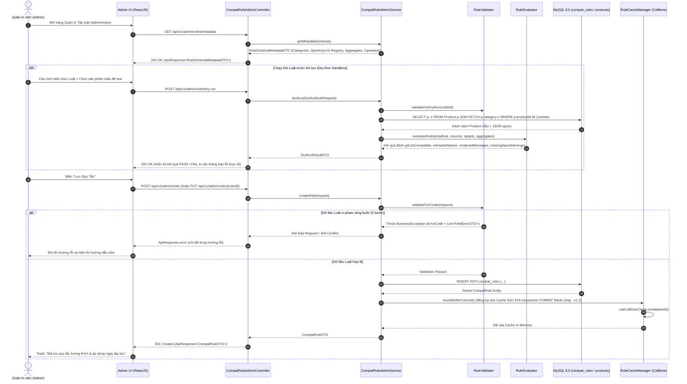
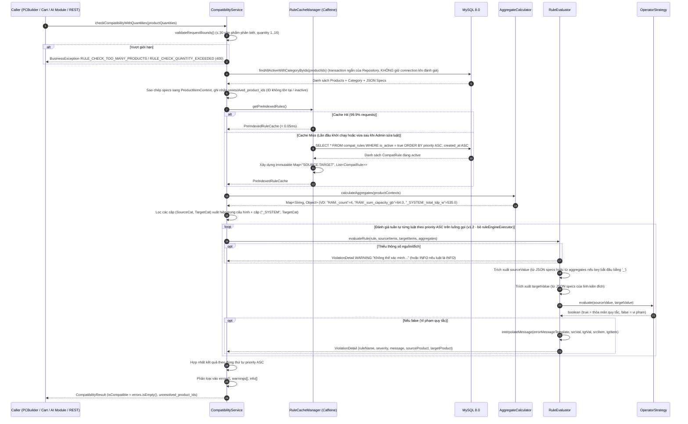

# TÀI LIỆU THIẾT KẾ CHI TIẾT (DETAILED DESIGN)
## Phân hệ: Core Rule Engine - Quản lý Tập luật & Đánh giá Tương thích Phần cứng (UC6 & WBS 7.4)

* **Mã tài liệu:** `DD-UC6-RULE-ENGINE`
* **Phiên bản:** `v1.2` (Gia cố An toàn & Ổn định — Security/Stability Hardening, xem [Mục 4.6](#46-gia-cố-an-toàn--ổn-định-hardening-v12) và [Phụ lục B](#phụ-lục-b-lịch-sử-hiệu-chỉnh-v11--v12)). Bản `v1.1`: chuẩn hóa toàn diện & đồng bộ với `V1__init_schema.sql`, `V2__seed_rules.sql`, `V3__product_catalog.sql` và `DD-UC5-PRODUCT-CATALOG v1.1` — xem [Phụ lục A](#phụ-lục-a-lịch-sử-hiệu-chỉnh-v10--v11))
* **Phân hệ (Package):** `com.smartpc.modules.ruleengine` (Backend) & `src/features/admin/rules` (Frontend)
* **Liên kết Use-Case:**
  * `UC6` (Quản lý Tập Luật Tương thích — Admin CRUD, Validation 5 bước, Dry-Run Sandbox, Cache Eviction)
  * Cung cấp dịch vụ đánh giá tương thích lõi (Internal Service & Public REST API) cho `UC2` (PC Builder Real-time Compatibility Check), `UC3` (PC Profile & AI Upgrade Suggestion Gatekeeper), `UC4` (Cross-Cart Compatibility Check trước khi Checkout).
* **Liên kết WBS:** `7.4 Core Rule Engine - Quản lý Tập luật (UC6)` (`7.4.1` $\rightarrow$ `7.4.5`).
* **Phụ thuộc dữ liệu:** `V1__init_schema.sql` (bảng `compat_rules`), `V2__seed_rules.sql` (8 danh mục chuẩn + 10 luật tương thích gốc), `V3__product_catalog.sql` (indexes & virtual columns của `products`/`categories`). Các nâng cấp schema cho bảng `compat_rules` được thực hiện qua migration mới `V4__compat_rules_enhancements.sql` (Mục 6).

---

## 1. Tổng quan Phân hệ & Mục tiêu Kỹ thuật (Module Overview & Objectives)

Phân hệ **Core Rule Engine** là bộ máy suy diễn tính tương thích phần cứng (Hardware Compatibility Rule Engine) được nhúng trực tiếp dưới dạng **Internal Module** bên trong khối **Core Backend (Java 25 LTS - Spring Boot 3.5.x)**. Thay vì gọi qua mạng tới một microservice rời rạc, các phân hệ `PC Builder (UC2)`, `AI Upgrade Advisor (UC3)` và `Cart/Checkout (UC4)` gọi trực tiếp `CompatibilityService` trong cùng tiến trình JVM, kết hợp với **Caffeine In-Memory Cache tiền phân nhóm (`PreIndexedRuleCache`)** để đạt độ trễ đánh giá dưới $2\text{ms}$.

### 1.1. Mục tiêu Kỹ thuật & Nghiệp vụ
1. **Zero-Code Rule Configuration (UC6 & WBS 7.4.1):** Quản trị viên (Admin) có thể thêm mới, chỉnh sửa, bật/tắt (`is_active`), thay đổi độ ưu tiên (`priority`) hoặc xóa quy tắc tương thích trên giao diện quản trị (`/admin/rules`) mà không cần biên dịch lại mã nguồn hay khởi động lại hệ thống.
2. **Độ trễ cực thấp (Ultra-low Latency $< 2\text{ms}$ P99 - WBS 7.4.3, 7.4.5):**
   * Tập luật đang hoạt động (`is_active = true`) được lưu trong **Caffeine Cache** dưới cấu trúc bất biến `PreIndexedRuleCache` gom nhóm sẵn theo cặp `"SOURCE_CATEGORY:TARGET_CATEGORY"` và sắp xếp theo `priority ASC`.
   * Khi kiểm tra cấu hình PC, `CompatibilityService` chỉ nạp các cặp danh mục thực sự xuất hiện trong cấu hình (cộng với nhóm luật toàn hệ thống `_SYSTEM`) và đánh giá **tuần tự trên luồng gọi** (v1.2: bỏ `ruleEngineExecutor` vì mỗi luật chỉ tốn vài micro-giây, overhead đa luồng lớn hơn lợi ích và gây tranh chấp pool dùng chung — xem Mục 4.6).
3. **An toàn dữ liệu & Đồng bộ chặt với `CategorySpecSchemaRegistry` (WBS 7.4.2):**
   * Bộ `RuleValidator` kiểm tra 5 bước nghiêm ngặt (Danh mục lá hợp lệ, cú pháp `spec_key` & đối chiếu chéo với `CategorySpecSchemaRegistry` của UC5, tính tương thích giữa kiểu dữ liệu trường thông số / khóa tổng hợp với toán tử `RuleOperator`, cú pháp mẫu thông báo lỗi `error_message_template`, và chống trùng lặp quy tắc).
   * Tích hợp công cụ chạy thử **Dry-Run Sandbox** (`POST /api/v1/admin/rules/dry-run`) cho phép Admin kiểm chứng quy tắc mới với các sản phẩm thực tế trong kho trước khi lưu.
4. **Hỗ trợ Thông số Tổng hợp Động (`AggregateCalculator` - WBS 7.4.4):**
   * Tính toán chính xác các chỉ số cộng dồn trên toàn cấu hình có xét đến số lượng (`quantity`) và số thanh trong mỗi kit (`modules_per_kit`), bao gồm: `<CATEGORY>:_count` (số khe vật lý chiếm dụng), `<CATEGORY>:_sum_capacity_gb` (tổng dung lượng), `_SYSTEM:_total_tdp_w` (tổng công suất tiêu thụ toàn hệ thống gồm cả overhead $50\text{W}$), cùng các khóa động `_sum_<field>` và `_max_<field>`.
5. **Mở rộng theo Nguyên lý Open-Closed (SOLID - WBS 7.4.3):**
   * Áp dụng **Strategy Pattern** (`OperatorStrategy`) cho 6 phép toán chuẩn (`EQUALS`, `IN`, `NOT_IN`, `LTE`, `GTE`, `RANGE`), tự động xử lý ép kiểu số học (`BigDecimal`/`Double`), chuỗi không phân biệt hoa thường và tập hợp (`Collection`).
   * Chính sách **Null-Safety**: Không bao giờ ném `NullPointerException` hay chặn nhầm luồng mua hàng nếu một sản phẩm thiếu trường thông số tùy chọn trong JSON `specs`.

### 1.2. Cấu trúc Package & Thư mục Chi tiết

#### A. Backend Layout (`com.smartpc.modules.ruleengine`)
```text
backend/src/main/java/com/smartpc/modules/ruleengine/
├── config/
│   └── RuleEngineConfig.java                # Khai báo Caffeine Cache cho Rules (v1.2: đã bỏ ThreadPool ruleEngineExecutor)
├── controller/
│   ├── CompatRuleAdminController.java       # REST API quản trị tập luật (UC6 - ROLE_ADMIN: /api/v1/admin/rules)
│   └── CompatibilityController.java         # REST API kiểm tra tương thích công khai (UC2/UC4: /api/v1/compatibility)
├── service/
│   ├── CompatRuleAdminService.java          # Nghiệp vụ CRUD luật, Dry-run Sandbox, Metadata Schema & Evict Cache
│   ├── CompatibilityService.java            # Entry-point đánh giá tương thích cấu hình PC (Internal & REST)
│   └── RuleCacheManager.java                # Quản lý Caffeine Cache tiền phân nhóm (PreIndexedRuleCache)
├── validator/
│   └── RuleValidator.java                   # Kiểm tra tính hợp lệ 5 bước khi tạo/sửa/dry-run luật
├── evaluator/
│   └── RuleEvaluator.java                   # Trích xuất JSON specs/aggregates, gọi Strategy & nội suy thông báo lỗi
├── calculator/
│   └── AggregateCalculator.java             # Tính toán thông số tổng hợp (_count, _sum_capacity_gb, _total_tdp_w...)
├── strategy/
│   ├── OperatorStrategy.java                # Interface chung cho các phép toán so sánh
│   ├── EqualsOperatorStrategy.java          # Phép toán EQUALS (BigDecimal / String ignore-case / Boolean)
│   ├── InOperatorStrategy.java              # Phép toán IN (Scalar in Collection hoặc Collection intersection)
│   ├── NotInOperatorStrategy.java           # Phép toán NOT_IN (Phủ định của IN)
│   ├── LteOperatorStrategy.java             # Phép toán LTE (<= cho Number)
│   ├── GteOperatorStrategy.java             # Phép toán GTE (>= cho Number)
│   └── RangeOperatorStrategy.java           # Phép toán RANGE (Number nằm trong [min, max])
├── repository/
│   ├── CompatRuleRepository.java            # Spring Data JPA + JpaSpecificationExecutor cho bảng compat_rules
│   └── CompatRuleSpecifications.java        # Factory JPA Specification lọc luật theo source, target, severity, active, keyword
├── entity/
│   └── CompatRule.java                      # JPA Entity ánh xạ bảng compat_rules (ruleId String VARCHAR(36))
├── mapper/
│   └── CompatRuleMapper.java                # MapStruct / Component chuyển đổi CompatRule <-> CompatRuleDTO
├── model/
│   ├── RuleOperator.java                    # Enum: EQUALS, IN, NOT_IN, LTE, GTE, RANGE
│   ├── RuleSeverity.java                    # Enum: ERROR, WARNING, INFO
│   ├── ProductItemContext.java              # Value Object gói Product + CategoryCode + Specs + Quantity
│   └── PreIndexedRuleCache.java             # Cấu trúc bất biến lưu trong Caffeine Cache theo cặp Category
└── dto/
    ├── request/
    │   ├── CreateCompatRuleRequest.java     # Payload tạo mới quy tắc tương thích
    │   ├── UpdateCompatRuleRequest.java     # Payload cập nhật quy tắc tương thích
    │   ├── UpdateRuleStatusRequest.java     # Payload bật/tắt nhanh { "is_active": boolean }
    │   ├── RuleFilterCriteria.java          # Tham số lọc danh sách quy tắc trên trang Admin
    │   ├── DryRunRuleRequest.java           # Payload chạy thử quy tắc với danh sách sản phẩm mẫu
    │   └── CompatibilityCheckRequest.java   # Payload kiểm tra tương thích (hỗ trợ product_ids và items có quantity)
    └── response/
        ├── CompatRuleDTO.java               # Thông tin chi tiết quy tắc trả về cho Admin
        ├── DryRunResultDTO.java             # Kết quả chạy thử quy tắc trên Sandbox
        ├── RuleSchemaMetadataDTO.java       # Metadata gợi ý Category, Spec Keys, Aggregate Keys, Operators, Placeholders
        └── CompatibilityResult.java         # Kết quả kiểm tra tương thích tổng hợp (is_compatible, errors, warnings, info)
```

#### B. Frontend Layout (`frontend/src/features/admin/rules`)
```text
frontend/src/
├── App.tsx                                         # Giữ nguyên Bright Global Header 3 tầng; bổ sung link "/admin/rules" trên Tầng 3 Admin Bar
├── features/
│   └── admin/
│       └── rules/                                  # Phân hệ Quản trị Tập luật Tương thích (UC6)
│           ├── pages/
│           │   └── AdminRuleListPage.tsx           # Màn hình danh sách tập luật, thanh lọc đa tiêu chí, bật/tắt nhanh
│           ├── components/
│           │   ├── RuleFilterBar.tsx               # Thanh lọc theo Source Category, Target Category, Severity, Active, Từ khóa
│           │   ├── RuleTable.tsx                   # Bảng danh sách quy tắc kèm badge mức độ, biểu thức điều kiện, toggle switch
│           │   ├── RuleFormModal.tsx               # Modal Tạo/Sửa quy tắc tích hợp Visual Expression Builder & Dry-Run Sandbox
│           │   ├── VisualExpressionBuilder.tsx     # Cụm chọn Source -> Spec Key -> Operator -> Target -> Spec Key có gợi ý tự động
│           │   ├── MessageTemplateEditor.tsx       # Ô soạn thảo thông báo lỗi kèm nút chèn nhanh biến nội suy {source_value}...
│           │   ├── DryRunSandboxPanel.tsx          # Khung chọn linh kiện mẫu và chạy thử quy tắc trực tiếp trong Modal
│           │   └── RuleSeverityBadge.tsx           # Badge hiển thị ERROR (Đỏ), WARNING (Vàng), INFO (Xanh dương)
│           └── types/
│               └── rule.types.ts                   # TypeScript interfaces cho CompatRule, DryRun, RuleSchemaMetadata
└── services/
    ├── ruleAdminService.ts                         # Axios client gọi /api/v1/admin/rules/**
    └── compatibilityService.ts                     # Axios client gọi /api/v1/compatibility/check
```

---

## 2. Thiết kế Sơ đồ Lớp (Class Diagram)

```mermaid
classDiagram
    class CompatRuleAdminController {
        -CompatRuleAdminService ruleAdminService
        +getAllRules(RuleFilterCriteria, Pageable) ResponseEntity~ApiResponse~PageResponse~CompatRuleDTO~~~
        +getMetadataSchema() ResponseEntity~ApiResponse~RuleSchemaMetadataDTO~~
        +getRuleById(String ruleId) ResponseEntity~ApiResponse~CompatRuleDTO~~
        +createRule(CreateCompatRuleRequest) ResponseEntity~ApiResponse~CompatRuleDTO~~
        +updateRule(String ruleId, UpdateCompatRuleRequest) ResponseEntity~ApiResponse~CompatRuleDTO~~
        +updateRuleStatus(String ruleId, UpdateRuleStatusRequest) ResponseEntity~ApiResponse~CompatRuleDTO~~
        +deleteRule(String ruleId) ResponseEntity~Void~
        +dryRunRule(DryRunRuleRequest) ResponseEntity~ApiResponse~DryRunResultDTO~~
    }

    class CompatibilityController {
        -CompatibilityService compatibilityService
        +checkCompatibility(CompatibilityCheckRequest) ResponseEntity~ApiResponse~CompatibilityResult~~
    }

    class CompatRuleAdminService {
        -CompatRuleRepository ruleRepository
        -ProductRepository productRepository
        -CategoryRepository categoryRepository
        -CategorySpecSchemaRegistry specSchemaRegistry
        -RuleValidator ruleValidator
        -RuleCacheManager ruleCacheManager
        -AggregateCalculator aggregateCalculator
        -RuleEvaluator ruleEvaluator
        -CompatRuleMapper ruleMapper
        +getRules(RuleFilterCriteria, Pageable) PageResponse~CompatRuleDTO~
        +getRuleById(String ruleId) CompatRuleDTO
        +createRule(CreateCompatRuleRequest) CompatRuleDTO
        +updateRule(String ruleId, UpdateCompatRuleRequest) CompatRuleDTO
        +updateRuleStatus(String ruleId, boolean isActive) CompatRuleDTO
        +deleteRule(String ruleId) void
        +dryRun(DryRunRuleRequest) DryRunResultDTO
        +getMetadataSchema() RuleSchemaMetadataDTO
    }

    class CompatibilityService {
        -ProductRepository productRepository
        -RuleCacheManager ruleCacheManager
        -AggregateCalculator aggregateCalculator
        -RuleEvaluator ruleEvaluator
        +MAX_DISTINCT_PRODUCTS = 30$
        +MAX_QUANTITY_PER_PRODUCT = 16$
        +checkCompatibility(List~String~ productIds) CompatibilityResult
        +checkCompatibilityWithQuantities(Map~String, Integer~ productQuantities) CompatibilityResult
        +evaluateContexts(List~ProductItemContext~ contexts) CompatibilityResult
        +validateRequestBounds(Map~String, Integer~ productQuantities)$ void
    }

    class RuleValidator {
        -CategoryRepository categoryRepository
        -CategorySpecSchemaRegistry specSchemaRegistry
        -CompatRuleRepository ruleRepository
        +validateForCreate(CreateCompatRuleRequest) void
        +validateForUpdate(String ruleId, UpdateCompatRuleRequest) void
        +validateForDryRun(CreateCompatRuleRequest) void
        -validateStructure(CreateCompatRuleRequest, String excludeRuleId, boolean checkDuplicate) void
    }

    class RuleCacheManager {
        -CompatRuleRepository ruleRepository
        -Cache~String, PreIndexedRuleCache~ ruleCaffeineCache
        +getPreIndexedRules() PreIndexedRuleCache
        +getRulesForPair(String sourceCat, String targetCat) List~CompatRule~
        +evictAll() void
        +evictAllAfterCommit() void
    }

    class AggregateCalculator {
        +calculateAggregates(List~ProductItemContext~ items) Map~String, Object~
    }

    class RuleEvaluator {
        -Map~RuleOperator, OperatorStrategy~ strategyMap
        +evaluateRule(CompatRule rule, List~ProductItemContext~ sources, List~ProductItemContext~ targets, Map~String, Object~ aggregates) List~ViolationDetail~
        +evaluateSinglePairForDryRun(CompatRule rule, ProductItemContext source, ProductItemContext target, Map~String, Object~ aggregates) DryRunEvaluationOutcome
    }

    class OperatorStrategy {
        <<interface>>
        +getOperator() RuleOperator
        +evaluate(Object sourceValue, Object targetValue) boolean
    }

    class EqualsOperatorStrategy
    class InOperatorStrategy
    class NotInOperatorStrategy
    class LteOperatorStrategy
    class GteOperatorStrategy
    class RangeOperatorStrategy

    class CompatRule {
        -String ruleId
        -String ruleName
        -String sourceCategory
        -String targetCategory
        -String sourceSpecKey
        -String targetSpecKey
        -RuleOperator operator
        -RuleSeverity severity
        -String errorMessageTemplate
        -Boolean isActive
        -Integer priority
        -LocalDateTime createdAt
        -LocalDateTime updatedAt
    }

    CompatRuleAdminController --> CompatRuleAdminService
    CompatibilityController --> CompatibilityService
    CompatRuleAdminService --> RuleValidator
    CompatRuleAdminService --> RuleCacheManager
    CompatRuleAdminService --> AggregateCalculator
    CompatRuleAdminService --> RuleEvaluator
    CompatibilityService --> RuleCacheManager
    CompatibilityService --> AggregateCalculator
    CompatibilityService --> RuleEvaluator
    RuleValidator --> CategorySpecSchemaRegistry
    RuleEvaluator --> OperatorStrategy
    OperatorStrategy <|.. EqualsOperatorStrategy
    OperatorStrategy <|.. InOperatorStrategy
    OperatorStrategy <|.. NotInOperatorStrategy
    OperatorStrategy <|.. LteOperatorStrategy
    OperatorStrategy <|.. GteOperatorStrategy
    OperatorStrategy <|.. RangeOperatorStrategy
    RuleCacheManager --> PreIndexedRuleCache
    PreIndexedRuleCache --> CompatRule
```



---

## 3. Thiết kế Sơ đồ Tuần tự (Sequence Diagrams)

### 3.1. Luồng Admin Tạo/Cập nhật Luật, Chạy thử (Dry-Run Sandbox) & Xóa Cache (UC6)



### 3.2. Luồng Thực thi Đánh giá Tập luật Nội bộ & Công khai (Rule Engine Execution Flow)



---

## 4. Thiết kế Chi tiết theo Tác vụ WBS (`7.4.1` $\rightarrow$ `7.4.5`)

### 4.1. Quản lý Tập luật - Giao diện Admin & Nghiệp vụ CRUD (`CompatRuleAdminService` - WBS 7.4.1)

#### A. Tuân thủ Quy chuẩn Giao diện Toàn cục (Bright Global Header 3 tầng) & Bố cục Trang Admin (`/admin/rules`)
Khi bổ sung trang Quản trị Tập luật (`/admin/rules`) vào `frontend/src/App.tsx`:
* **Giữ nguyên 100% thiết kế Bright Global Header 3 tầng** theo quy định dự án.
* Tại **Tầng 3 — Thanh Submenu Quản trị (`bg-amber-50/90 border-t border-amber-200/80`)**, hiển thị các lối tắt quản trị đồng nhất:
  1. `Linh kiện & Vector Specs (UC5)` (`/admin/products`)
  2. `Cây Danh Mục (2 Cấp)` (`/admin/categories`)
  3. `Tập Luật Tương Thích (UC6)` (`/admin/rules`, kèm icon `Scale` hoặc `Sliders` màu `text-amber-600`, active `bg-white text-amber-800 font-bold border border-amber-300 shadow-sm`).

Bố cục màn hình `AdminRuleListPage.tsx` gồm 2 khu vực trực quan:
1. **Danh sách & Bộ lọc Tập luật (`RuleFilterBar.tsx` & `RuleTable.tsx`):**
   * **Thanh lọc nhanh:** Lọc theo `Danh mục nguồn (Source Category)` (gồm 8 danh mục chuẩn + `_SYSTEM`), `Danh mục đích (Target Category)`, `Mức độ (ERROR / WARNING / INFO)`, `Trạng thái (Active / Inactive)`, và ô tìm kiếm từ khóa (`keyword` tìm trên `rule_name`, `source_spec_key`, `target_spec_key`, `error_message_template`).
   * **Bảng dữ liệu tinh gọn (Compact & Responsive Table Layout):**
     * Thiết kế chống tràn ngang (No Horizontal Cutoff): Tổng chiều rộng các cột được tối ưu (~880px - 950px) để hiển thị trọn vẹn 100% trên mọi độ phân giải màn hình tiêu chuẩn (kể cả laptop 1280px / 1366px với tỉ lệ DPI scale 125%) mà không bị che khuất cột Trạng thái hay nút Thao tác.
     * **Cột Độ ưu tiên (`Priority`):** Chiều rộng cố định `w-12 text-center`, pill số thứ tự `w-6 h-6 text-xs`.
     * **Cột Tên quy tắc (`rule_name`):** Thu hẹp độ rộng giới hạn `w-[220px] lg:w-[260px]`, tên luật cắt ngắn `truncate max-w-[200px] lg:max-w-[240px]` kèm tooltip `title={rule.rule_name}`; chuỗi thông báo lỗi phụ trợ `text-[11px] text-slate-400 truncate max-w-[200px] lg:max-w-[240px] mt-0.5` kèm tooltip `title={rule.error_message_template}`.
     * **Cột Luồng đối chiếu (`Source → Target`):** Chiều rộng `w-36 lg:w-40`, pill nhỏ gọn `px-2 py-0.5 text-[11px] font-medium`.
     * **Cột Biểu thức điều kiện (`Condition`):** Chiều rộng `w-44 lg:w-52`, mono chip `px-2 py-0.5 text-[11px] bg-slate-50 border border-slate-200 rounded-md`, khóa thông số cắt ngắn `truncate max-w-[80px]` kèm `title`.
     * **Cột Mức độ (`Severity`):** Chiều rộng `w-24 text-center`, hiển thị `RuleSeverityBadge size="sm"`.
     * **Cột Trạng thái (`Status`):** Chiều rộng `w-24 text-center`, nút gạt (Toggle Switch) thu gọn `px-2 py-0.5 text-[11px] font-semibold`.
     * **Cột Thao tác (`Actions`):** Chiều rộng `w-20 text-center`, icon button thu gọn `p-1` (Sửa/Xóa).
     * **Padding ô:** Giảm từ `py-3 px-4` xuống `py-2.5 px-3` (hoặc `px-2.5`) nhằm tối ưu diện tích hiển thị và độ thông thoáng.
2. **Modal Tạo/Sửa Luật kèm Khu vực Chạy thử (`RuleFormModal.tsx` & `DryRunSandboxPanel.tsx`):**
   * **Cơ chế Đồng bộ Hóa Quy Tắc Thao Tác (Rule Operation Synchronization):**
     * Khi Admin bấm "Chỉnh sửa" bất kỳ quy tắc nào trong bảng (`initialData != null`), toàn bộ state biểu mẫu (`formData`) phải lập tức đồng bộ 100% với quy tắc đang thao tác: `rule_name`, `source_category`, `source_spec_key`, `operator`, `target_category`, `target_spec_key`, `severity`, `priority`, `error_message_template`, `is_active`.
     * Sử dụng `useEffect` lắng nghe thay đổi của `initialData` & `isOpen`, đồng thời kết hợp `key={editingRule ? editingRule.rule_id : 'new-rule'}` tại `AdminRuleListPage.tsx` để đảm bảo form luôn được re-initialize sạch sẽ, tuyệt đối không bị lưu vết state mặc định hoặc state của quy tắc mở trước đó.
     * Khi bấm "Thêm Quy Tắc Mới" (`initialData == null`), form tự động reset về trạng thái mẫu ban đầu sạch sẽ.
   * **Trình dựng biểu thức trực quan (`VisualExpressionBuilder.tsx`):**
     * Chọn `Source Category` $\rightarrow$ Dropdown `Source Spec Key` hiển thị danh sách các khóa thông số thực tế của danh mục nguồn từ metadata (kèm các khóa tổng hợp `_count`, `_sum_capacity_gb`, `_total_tdp_w`...). Khi đổi `source_category`, tự động chuyển `source_spec_key` sang khóa hợp lệ đầu tiên của danh mục mới (hoặc khóa cố định `_total_tdp_w` nếu chọn `_SYSTEM`). Hỗ trợ chế độ nhập khóa tùy chỉnh linh hoạt.
     * Chọn `Operator` (`EQUALS`, `IN`, `NOT_IN`, `LTE`, `GTE`, `RANGE`) $\rightarrow$ dropdown hiển thị toán tử kèm phụ đề giải thích ý nghĩa logic rõ ràng.
     * Chọn `Target Category` $\rightarrow$ Dropdown `Target Spec Key` hiển thị danh sách các khóa thông số thực tế của danh mục đích. Khi đổi `target_category`, tự động chuyển `target_spec_key` sang khóa hợp lệ của danh mục đích mới.
     * **Thanh tổng kết biểu thức trực tiếp (Live Expression Summary):** Phản ánh chính xác tức thì biểu thức logic dạng `{source_category}.{source_spec_key} {operator} {target_category}.{target_spec_key}` của quy tắc đang thao tác.
   * **Trình soạn thông báo lỗi (`MessageTemplateEditor.tsx`):** Tự động nạp đúng mẫu thông báo của quy tắc được thao tác. Có các nút bấm chèn nhanh biến nội suy (`+ {source_name}`, `+ {source_value}`, `+ {target_name}`, `+ {target_value}`, `+ {source_category}`, `+ {target_category}`).
   * **Khung kiểm thử trực tiếp (`DryRunSandboxPanel.tsx`):**
     * **Phân tách 2 vùng chọn linh kiện Nguồn & Đích (Dual-Column Scoped Selection):**
       - Tách giao diện cấu hình test thành 2 vùng độc lập: **Linh kiện Vế Nguồn (`Source Products`)** và **Linh kiện Vế Đích (`Target Products`)**.
       - Bộ lọc linh kiện giới hạn nghiêm ngặt: Vùng Nguồn chỉ cho phép chọn sản phẩm thuộc `source_category` của quy tắc (nếu `_SYSTEM`, cho phép chọn linh kiện tiêu thụ điện như CPU, GPU); Vùng Đích chỉ cho phép chọn sản phẩm thuộc `target_category`. Ngăn chặn hoàn toàn việc chọn sản phẩm không liên quan đến quy tắc được thao tác.
     * **Hiển thị trực quan Giá trị Thuộc tính Dùng để So sánh (Extracted Spec Value Preview):**
       - Trên từng thẻ sản phẩm test được chọn, hiển thị trực tiếp giá trị trích xuất từ JSON specs:
         + Linh kiện Nguồn: Hiển thị giá trị của khóa `source_spec_key` (hoặc thông số đóng góp nếu là khóa tổng hợp như TDP/khe cắm). Nếu sản phẩm thiếu khóa thông số này, lập tức hiển thị badge cảnh báo màu vàng/đỏ `⚠️ Thiếu thuộc tính [source_spec_key]`.
         + Linh kiện Đích: Hiển thị giá trị của khóa `target_spec_key` (ví dụ mảng socket hỗ trợ, chuẩn kích thước, công suất định mức...). Nếu sản phẩm thiếu khóa, hiển thị badge cảnh báo tương ứng.
     * **Bảng Đối chiếu Kết quả Chạy thử (Detailed Comparison Result Box):**
       - Hiển thị phép đối chiếu trực quan thực tế: `[Giá trị Nguồn trích xuất] [TOÁN TỬ] [Giá trị Đích trích xuất] → PASS (Tương thích) / FAIL (Vi phạm)`.
       - Hiển thị câu thông báo lỗi sau khi nội suy biến `{source_name}`, `{source_value}`, `{target_name}`, `{target_value}` và danh sách cảnh báo thiếu specs.

---

### 4.2. Bộ Kiểm tra Tính hợp lệ Cấu trúc Luật (`RuleValidator` - WBS 7.4.2)

`RuleValidator` bảo vệ hệ thống khỏi các quy tắc sai cú pháp, sai kiểu dữ liệu hoặc mâu thuẫn logic trước khi ghi vào bảng `compat_rules`. Khác với kiểm tra đơn lẻ, `RuleValidator` kết nối trực tiếp với `CategoryRepository` và `CategorySpecSchemaRegistry` (của phân hệ UC5) để đảm bảo tính nhất quán toàn cục.

#### A. Bảng Quy tắc Kiểm tra 5 Bước (`RuleValidator`)

| Bước | Hạng mục kiểm tra | Điều kiện Hợp lệ Chi tiết | Mã lỗi (`ErrorCode`) | HTTP Status |
| :--- | :--- | :--- | :--- | :---: |
| **1** | **Danh mục Nguồn & Đích (`source_category`, `target_category`)** | - Chuẩn hóa `trim().toUpperCase()`.<br>- `source_category` và `target_category` **không được trùng nhau** (`!source.equalsIgnoreCase(target)`).<br>- `target_category` bắt buộc phải tồn tại trong bảng `categories` VÀ có đăng ký schema lá trong `CategorySpecSchemaRegistry` (`CPU`, `MOTHERBOARD`, `RAM`, `GPU`, `SSD_M2`, `PSU`, `CASE`, `CPU_COOLER`).<br>- `source_category` phải là hằng số đặc biệt `"_SYSTEM"` HOẶC tồn tại trong `categories` và `CategorySpecSchemaRegistry`. | `RULE_SELF_REFERENCE`<br>`RULE_INVALID_CATEGORY` | `400` |
| **2** | **Định dạng & Sự tồn tại của Khóa Thông số (`source_spec_key`, `target_spec_key`)** | - Chuẩn hóa `trim().toLowerCase()`.<br>- Khớp biểu thức chính quy `^[a-z_][a-z0-9_]{1,99}$` (chuẩn `snake_case`).<br>- `target_spec_key` **không được bắt đầu bằng dấu `_`** (vì vế đích phải là thuộc tính tĩnh trong JSON `specs` của linh kiện đích).<br>- Nếu `source_spec_key` bắt đầu bằng `_`, nó phải thuộc tập khóa tổng hợp cố định (`_count`, `_sum_capacity_gb`, `_total_tdp_w`) hoặc khớp mẫu động `^(_sum_|_max_)[a-z][a-z0-9_]*$`. Nếu là `_sum_<field>` hoặc `_max_<field>`, `<field>` nếu nằm trong Registry của `source_category` thì phải có kiểu số (`NUMBER` hoặc `INTEGER`). | `RULE_INVALID_SPEC_KEY`<br>`RULE_UNKNOWN_AGGREGATE_KEY` | `400` |
| **3** | **Tính tương thích giữa Khóa, Kiểu dữ liệu và Toán tử (`operator`)** | - Nếu `source_category == "_SYSTEM"`, `source_spec_key` bắt buộc phải là `"_total_tdp_w"`.<br>- *(Tương thích ngược với `V2__seed_rules.sql`)*: Khóa `"_total_tdp_w"` được phép khai báo với `source_category = "_SYSTEM"` hoặc `source_category = "CPU"`, và luôn lấy tổng TDP toàn hệ thống.<br>- Nếu `source_spec_key` bắt đầu bằng `_` (luôn trả về kiểu `Number`), `operator` chỉ được phép thuộc `{LTE, GTE, EQUALS, RANGE}` (cấm dùng `IN`, `NOT_IN`).<br>- Nếu `source_spec_key` và `target_spec_key` đã được định nghĩa trong `CategorySpecSchemaRegistry`:<br>  + Toán tử `LTE`, `GTE` đòi hỏi cả `source_spec_key` và `target_spec_key` phải có kiểu `NUMBER` hoặc `INTEGER`.<br>  + Toán tử `IN`, `NOT_IN` đòi hỏi `target_spec_key` có kiểu `ARRAY_STRING` (mảng giá trị hỗ trợ ở linh kiện đích). | `RULE_INCOMPATIBLE_OPERATOR` | `400` |
| **4** | **Mẫu thông báo lỗi (`error_message_template`)** | - Độ dài sau khi `trim()` từ `10` đến `500` ký tự.<br>- Số lượng dấu mở ngoặc nhọn `{` và đóng ngoặc nhọn `}` phải cân bằng, không lồng nhau.<br>- Mọi biến nội suy `{placeholder}` bên trong chuỗi chỉ được nằm trong tập hợp cho phép: `{source_name}`, `{target_name}`, `{source_value}`, `{target_value}`, `{source_category}`, `{target_category}`. | `RULE_INVALID_TEMPLATE_SYNTAX`<br>`RULE_UNKNOWN_PLACEHOLDER` | `400` |
| **5** | **Chống Trùng lặp Quy tắc (`Duplicate Check`)** | - Truy vấn `CompatRuleRepository.existsDuplicateRule(...)` kiểm tra không tồn tại bản ghi nào khác (`rule_id != excludeRuleId`) có cùng bộ 5 thuộc tính: `(source_category, target_category, source_spec_key, target_spec_key, operator)`. | `RULE_DUPLICATE_DEFINITION` | `409` |

#### B. Thiết kế Mã nguồn Tham chiếu (`RuleValidator.java`)

```java
package com.smartpc.modules.ruleengine.validator;

import com.smartpc.common.exception.BusinessException;
import com.smartpc.common.exception.ErrorCode;
import com.smartpc.common.response.FieldErrorDTO;
import com.smartpc.modules.product.repository.CategoryRepository;
import com.smartpc.modules.product.schema.CategorySpecSchemaRegistry;
import com.smartpc.modules.product.schema.FieldDefinition;
import com.smartpc.modules.product.schema.FieldType;
import com.smartpc.modules.ruleengine.model.RuleOperator;
import com.smartpc.modules.ruleengine.repository.CompatRuleRepository;
import lombok.RequiredArgsConstructor;
import org.springframework.stereotype.Component;

import java.util.ArrayList;
import java.util.EnumSet;
import java.util.List;
import java.util.Map;
import java.util.Set;
import java.util.regex.Matcher;
import java.util.regex.Pattern;

@Component
@RequiredArgsConstructor
public class RuleValidator {

    public static final String SYSTEM_CATEGORY = "_SYSTEM";

    private static final Pattern SPEC_KEY_PATTERN = Pattern.compile("^[a-z_][a-z0-9_]{1,99}$");
    private static final Pattern DYNAMIC_AGG_PATTERN = Pattern.compile("^(_sum_|_max_)([a-z][a-z0-9_]*)$");
    private static final Pattern PLACEHOLDER_PATTERN = Pattern.compile("\\{([^{}]*)\\}");

    public static final Set<String> BUILTIN_AGGREGATE_KEYS = Set.of(
            "_count", "_sum_capacity_gb", "_total_tdp_w"
    );

    public static final Set<String> ALLOWED_PLACEHOLDERS = Set.of(
            "source_name", "target_name", "source_value", "target_value",
            "source_category", "target_category"
    );

    private static final Set<RuleOperator> NUMERIC_OPERATORS = EnumSet.of(
            RuleOperator.LTE, RuleOperator.GTE, RuleOperator.EQUALS, RuleOperator.RANGE
    );

    private final CategoryRepository categoryRepository;
    private final CategorySpecSchemaRegistry specSchemaRegistry;
    private final CompatRuleRepository compatRuleRepository;

    public void validateRule(
            String sourceCategory,
            String targetCategory,
            String sourceSpecKey,
            String targetSpecKey,
            RuleOperator operator,
            String errorMessageTemplate,
            String excludeRuleId,
            boolean checkDuplicate
    ) {
        // 1. Validate Categories
        if (sourceCategory == null || targetCategory == null) {
            throw new BusinessException(ErrorCode.RULE_INVALID_CATEGORY);
        }
        String srcCat = sourceCategory.trim().toUpperCase();
        String tgtCat = targetCategory.trim().toUpperCase();

        if (srcCat.equals(tgtCat)) {
            throw new BusinessException(ErrorCode.RULE_SELF_REFERENCE,
                    "Danh mục nguồn và danh mục đích không được trùng nhau (" + srcCat + ")",
                    List.of(new FieldErrorDTO("target_category", "Không được trùng với source_category")));
        }

        if (!SYSTEM_CATEGORY.equals(srcCat)
                && (!categoryRepository.existsByCategoryCode(srcCat) || !specSchemaRegistry.hasCategory(srcCat))) {
            throw new BusinessException(ErrorCode.RULE_INVALID_CATEGORY,
                    "Danh mục nguồn không tồn tại hoặc chưa đăng ký schema thông số: " + srcCat,
                    List.of(new FieldErrorDTO("source_category", "Danh mục nguồn không hợp lệ")));
        }

        if (!categoryRepository.existsByCategoryCode(tgtCat) || !specSchemaRegistry.hasCategory(tgtCat)) {
            throw new BusinessException(ErrorCode.RULE_INVALID_CATEGORY,
                    "Danh mục đích không tồn tại hoặc chưa đăng ký schema thông số: " + tgtCat,
                    List.of(new FieldErrorDTO("target_category", "Danh mục đích không hợp lệ")));
        }

        // 2. Validate Spec Keys
        String srcKey = sourceSpecKey != null ? sourceSpecKey.trim().toLowerCase() : "";
        String tgtKey = targetSpecKey != null ? targetSpecKey.trim().toLowerCase() : "";

        if (!SPEC_KEY_PATTERN.matcher(srcKey).matches()) {
            throw new BusinessException(ErrorCode.RULE_INVALID_SPEC_KEY,
                    "source_spec_key '" + srcKey + "' phải tuân theo định dạng snake_case (2-100 ký tự)",
                    List.of(new FieldErrorDTO("source_spec_key", "Sai định dạng snake_case")));
        }
        if (!SPEC_KEY_PATTERN.matcher(tgtKey).matches()) {
            throw new BusinessException(ErrorCode.RULE_INVALID_SPEC_KEY,
                    "target_spec_key '" + tgtKey + "' phải tuân theo định dạng snake_case (2-100 ký tự)",
                    List.of(new FieldErrorDTO("target_spec_key", "Sai định dạng snake_case")));
        }
        if (tgtKey.startsWith("_")) {
            throw new BusinessException(ErrorCode.RULE_INVALID_SPEC_KEY,
                    "target_spec_key phải là thuộc tính tĩnh trên linh kiện đích, không được bắt đầu bằng '_'",
                    List.of(new FieldErrorDTO("target_spec_key", "Không được dùng khóa tổng hợp ở vế đích")));
        }

        if (srcKey.startsWith("_")) {
            Matcher dynMatcher = DYNAMIC_AGG_PATTERN.matcher(srcKey);
            boolean isBuiltin = BUILTIN_AGGREGATE_KEYS.contains(srcKey);
            if (!isBuiltin && !dynMatcher.matches()) {
                throw new BusinessException(ErrorCode.RULE_UNKNOWN_AGGREGATE_KEY,
                        "Khóa tổng hợp không hợp lệ: " + srcKey,
                        List.of(new FieldErrorDTO("source_spec_key", "Chỉ hỗ trợ _count, _sum_capacity_gb, _total_tdp_w, _sum_<field>, _max_<field>")));
            }
        }

        // 3. Validate Operator & Data Type Compatibility
        if (operator == null) {
            throw new BusinessException(ErrorCode.RULE_INCOMPATIBLE_OPERATOR, "Toán tử so sánh không được để trống");
        }
        if (SYSTEM_CATEGORY.equals(srcCat) && !"_total_tdp_w".equals(srcKey)) {
            throw new BusinessException(ErrorCode.RULE_INCOMPATIBLE_OPERATOR,
                    "Danh mục _SYSTEM chỉ hỗ trợ khóa tổng hợp _total_tdp_w",
                    List.of(new FieldErrorDTO("source_spec_key", "Bắt buộc là _total_tdp_w khi nguồn là _SYSTEM")));
        }
        if (srcKey.startsWith("_") && !NUMERIC_OPERATORS.contains(operator)) {
            throw new BusinessException(ErrorCode.RULE_INCOMPATIBLE_OPERATOR,
                    "Khóa tổng hợp số học (" + srcKey + ") chỉ hỗ trợ các toán tử LTE, GTE, EQUALS, RANGE",
                    List.of(new FieldErrorDTO("operator", "Không thể dùng " + operator + " cho khóa tổng hợp số học")));
        }

        validateRegistryTypeCompatibility(srcCat, tgtCat, srcKey, tgtKey, operator);

        // 4. Validate Error Message Template
        validateTemplate(errorMessageTemplate);

        // 5. Check Duplicate Rule
        if (checkDuplicate) {
            boolean isDuplicate = compatRuleRepository.existsDuplicateRule(
                    srcCat, tgtCat, srcKey, tgtKey, operator, excludeRuleId
            );
            if (isDuplicate) {
                throw new BusinessException(ErrorCode.RULE_DUPLICATE_DEFINITION,
                        "Quy tắc tương thích với cùng cặp danh mục, khóa thông số và toán tử này đã tồn tại");
            }
        }
    }

    private void validateRegistryTypeCompatibility(
            String srcCat, String tgtCat, String srcKey, String tgtKey, RuleOperator operator
    ) {
        Map<String, FieldDefinition> tgtSchema = specSchemaRegistry.getSchemaAsMap(tgtCat);
        FieldDefinition tgtDef = tgtSchema.get(tgtKey);

        if ((operator == RuleOperator.IN || operator == RuleOperator.NOT_IN) && tgtDef != null) {
            if (tgtDef.getType() != FieldType.ARRAY_STRING) {
                throw new BusinessException(ErrorCode.RULE_INCOMPATIBLE_OPERATOR,
                        "Toán tử " + operator + " yêu cầu target_spec_key '" + tgtKey + "' phải có kiểu mảng (ARRAY_STRING)",
                        List.of(new FieldErrorDTO("operator", "Trường đích '" + tgtKey + "' có kiểu " + tgtDef.getType() + ", không phải mảng")));
            }
        }

        if ((operator == RuleOperator.LTE || operator == RuleOperator.GTE) && tgtDef != null) {
            if (tgtDef.getType() != FieldType.NUMBER && tgtDef.getType() != FieldType.INTEGER) {
                throw new BusinessException(ErrorCode.RULE_INCOMPATIBLE_OPERATOR,
                        "Toán tử số học " + operator + " yêu cầu target_spec_key '" + tgtKey + "' phải là kiểu số (NUMBER/INTEGER)",
                        List.of(new FieldErrorDTO("target_spec_key", "Trường đích '" + tgtKey + "' không phải kiểu số")));
            }
        }

        if (!SYSTEM_CATEGORY.equals(srcCat) && !srcKey.startsWith("_")) {
            Map<String, FieldDefinition> srcSchema = specSchemaRegistry.getSchemaAsMap(srcCat);
            FieldDefinition srcDef = srcSchema.get(srcKey);
            if ((operator == RuleOperator.LTE || operator == RuleOperator.GTE || operator == RuleOperator.RANGE) && srcDef != null) {
                if (srcDef.getType() != FieldType.NUMBER && srcDef.getType() != FieldType.INTEGER) {
                    throw new BusinessException(ErrorCode.RULE_INCOMPATIBLE_OPERATOR,
                            "Toán tử số học " + operator + " yêu cầu source_spec_key '" + srcKey + "' phải là kiểu số (NUMBER/INTEGER)",
                            List.of(new FieldErrorDTO("source_spec_key", "Trường nguồn '" + srcKey + "' không phải kiểu số")));
                }
            }
        }
    }

    private void validateTemplate(String template) {
        if (template == null || template.trim().length() < 10 || template.trim().length() > 500) {
            throw new BusinessException(ErrorCode.RULE_INVALID_TEMPLATE_SYNTAX,
                    "Mẫu thông báo lỗi phải có độ dài từ 10 đến 500 ký tự",
                    List.of(new FieldErrorDTO("error_message_template", "Độ dài phải từ 10 đến 500 ký tự")));
        }

        int depth = 0;
        for (int i = 0; i < template.length(); i++) {
            char c = template.charAt(i);
            if (c == '{') {
                depth++;
                if (depth > 1) {
                    throw new BusinessException(ErrorCode.RULE_INVALID_TEMPLATE_SYNTAX,
                            "Mẫu thông báo lỗi có dấu ngoặc nhọn '{' lồng nhau hoặc chưa đóng",
                            List.of(new FieldErrorDTO("error_message_template", "Cú pháp dấu '{' và '}' không hợp lệ")));
                }
            } else if (c == '}') {
                depth--;
                if (depth < 0) {
                    throw new BusinessException(ErrorCode.RULE_INVALID_TEMPLATE_SYNTAX,
                            "Mẫu thông báo lỗi có dấu '}' thừa không khớp",
                            List.of(new FieldErrorDTO("error_message_template", "Cú pháp dấu '{' và '}' không hợp lệ")));
                }
            }
        }
        if (depth != 0) {
            throw new BusinessException(ErrorCode.RULE_INVALID_TEMPLATE_SYNTAX,
                    "Mẫu thông báo lỗi có dấu '{' chưa được đóng bằng '}'",
                    List.of(new FieldErrorDTO("error_message_template", "Thiếu dấu đóng ngoặc '}'")));
        }

        Matcher matcher = PLACEHOLDER_PATTERN.matcher(template);
        List<String> unknownPlaceholders = new ArrayList<>();
        while (matcher.find()) {
            String placeholder = matcher.group(1).trim();
            if (!ALLOWED_PLACEHOLDERS.contains(placeholder)) {
                unknownPlaceholders.add("{" + placeholder + "}");
            }
        }
        if (!unknownPlaceholders.isEmpty()) {
            throw new BusinessException(ErrorCode.RULE_UNKNOWN_PLACEHOLDER,
                    "Biến nội suy không hợp lệ: " + String.join(", ", unknownPlaceholders)
                            + ". Chỉ hỗ trợ: {source_name}, {target_name}, {source_value}, {target_value}, {source_category}, {target_category}",
                    List.of(new FieldErrorDTO("error_message_template", "Chứa biến nội suy không được hỗ trợ")));
        }
    }
}
```

---

### 4.3. Xây dựng Evaluator & Chiến lược Toán tử (`RuleEvaluator` & `OperatorStrategy` - WBS 7.4.3)

#### A. Đặc tả Chi tiết 6 Chiến lược Toán tử (`OperatorStrategy`)

Mỗi toán tử cài đặt interface `OperatorStrategy` (`boolean evaluate(Object sourceValue, Object targetValue)`) và được đăng ký dưới dạng Spring `@Component` để `RuleEvaluator` tự động gom vào `EnumMap<RuleOperator, OperatorStrategy>`:

| Class Chiến lược | Toán tử | Xử lý kiểu dữ liệu & Logic so sánh chi tiết |
| :--- | :--- | :--- |
| **`EqualsOperatorStrategy`** | `EQUALS` | - Nếu cả hai có thể chuyển sang số (`Number` hoặc chuỗi số hợp lệ): chuyển về `BigDecimal` và kiểm tra `srcDec.compareTo(tgtDec) == 0` (để `320` bằng `320.0`).<br>- Nếu là `Boolean`: `Boolean.parseBoolean(src.toString()) == Boolean.parseBoolean(tgt.toString())`.<br>- Mặc định (`String`): `src.toString().trim().equalsIgnoreCase(tgt.toString().trim())`. |
| **`InOperatorStrategy`** | `IN` | - Trường hợp chuẩn: `sourceValue` là giá trị đơn (VD: `"LGA1700"`), `targetValue` là `Collection<?>` (VD: `["LGA1700", "LGA1851"]`) hoặc chuỗi phân tách bởi dấu phẩy. Trả về `true` nếu tồn tại phần tử `elem` trong `targetValue` thỏa `EqualsOperatorStrategy.evaluate(sourceValue, elem)`.<br>- Trường hợp cả hai là `Collection<?>`: Trả về `true` nếu tập giao (intersection) khác rỗng. |
| **`NotInOperatorStrategy`** | `NOT_IN` | - Phủ định kết quả của `InOperatorStrategy`: Trả về `!inOperatorStrategy.evaluate(sourceValue, targetValue)`. |
| **`LteOperatorStrategy`** | `LTE` ($\le$) | - Ép kiểu an toàn cả `sourceValue` và `targetValue` sang `BigDecimal`.<br>- Trả về `srcDec.compareTo(tgtDec) <= 0`. Nếu một trong hai không phải số hợp lệ $\rightarrow$ trả về `false`. |
| **`GteOperatorStrategy`** | `GTE` ($\ge$) | - Ép kiểu an toàn cả `sourceValue` và `targetValue` sang `BigDecimal`.<br>- Trả về `srcDec.compareTo(tgtDec) >= 0`. |
| **`RangeOperatorStrategy`** | `RANGE` | - `sourceValue` là số (`BigDecimal`).<br>- `targetValue` trong JSON có thể là: (1) `List<?>` 2 phần tử `[min, max]` (VD: `[1.1, 1.4]`), (2) `Map<?, ?>` có khóa `"min"` và `"max"`, hoặc (3) Chuỗi `"min..max"` / `"min-max"`. **(v1.2)** Dạng `"min-max"` được phân tích bằng regex `^\s*(-?\d+(?:\.\d+)?)\s*-\s*(-?\d+(?:\.\d+)?)\s*$` để hỗ trợ cận âm (VD: `"-5-10"`, `"-10--5"`).<br>- Trả về `srcDec.compareTo(min) >= 0 && srcDec.compareTo(max) <= 0`. |

> **(v1.2) Chuyển đổi số an toàn (`EqualsOperatorStrategy.tryToBigDecimal`)** dùng chung cho mọi strategy: giá trị `Double`/`Float` là `NaN` hoặc `±Infinity` $\rightarrow$ trả về `null` (coi như không phải số) thay vì để `BigDecimal.valueOf()` ném `NumberFormatException`; mọi chuyển đổi đều nằm trong `try/catch`.

#### B. Phân biệt Quy tắc Cấp Linh kiện (Item-level) và Quy tắc Cấp Tổng hợp (Aggregate-level)
Trong `RuleEvaluator.evaluateRule(rule, sourceItems, targetItems, aggregates)`:
1. **Khi `rule.getSourceSpecKey().startsWith("_")` hoặc `rule.getSourceCategory().equals("_SYSTEM")` (Aggregate Rule):**
   * Giá trị nguồn `sourceValue` là thuộc tính của **toàn nhóm linh kiện nguồn** (hoặc toàn hệ thống), không phải của riêng 1 thanh RAM hay 1 ổ SSD đơn lẻ:
     * Nếu `sourceSpecKey.equals("_total_tdp_w")` $\rightarrow$ tra cứu `aggregates.get("_SYSTEM:_total_tdp_w")`.
     * Ngược lại $\rightarrow$ tra cứu `aggregates.get(rule.getSourceCategory() + ":" + rule.getSourceSpecKey())`.
   * Quy tắc chỉ đánh giá **1 lần duy nhất cho mỗi `targetItem`** (ví dụ: 1 Mainboard hoặc 1 PSU), tránh lặp lại cùng 1 cảnh báo nhiều lần khi người dùng lắp 2 kit RAM hoặc 2 ổ SSD.
   * Trong `ViolationDetail` trả về:
     * Nếu `source_spec_key == "_total_tdp_w"` hoặc `source_category == "_SYSTEM"`, `source_product` đặt là `null` (khớp đặc tả `sdd.md` mục 4: `"source_product": null`).
     * Nếu là tổng hợp theo danh mục (như `RAM:_count` hoặc `RAM:_sum_capacity_gb`) và chỉ có 1 sản phẩm đại diện trong nhóm nguồn thì gán `source_product` là sản phẩm đó; nếu có nhiều sản phẩm cùng danh mục thì gán sản phẩm đầu tiên của danh mục nguồn.
2. **Khi `rule.getSourceSpecKey()` là khóa thông số tĩnh (Item-level Rule, VD: `socket_type`, `length_mm`, `memory_type`):**
   * Duyệt qua từng cặp `(sourceItem, targetItem)` thuộc `(sourceItems, targetItems)`.
   * Trích xuất `sourceValue = sourceItem.getSpecs().get(rule.getSourceSpecKey())` và `targetValue = targetItem.getSpecs().get(rule.getTargetSpecKey())`.

#### C. Chính sách An toàn khi Thiếu Thông số (`Null-Safety & Missing Spec Policy`)
1. **Trong luồng kiểm tra tương thích sản xuất (`CompatibilityService`) — (v1.2: chuyển từ "fail-open im lặng" sang "cảnh báo không chặn"):**
   * Khi `sourceValue == null` hoặc `targetValue == null`:
     * **Tuyệt đối không ném Exception** làm gián đoạn luồng PC Builder hay Checkout.
     * Ghi log cảnh báo `log.warn(...)` để Admin rà soát dữ liệu.
     * **Sinh 1 `ViolationDetail` "không thể xác minh"** cho cặp đó (không còn bỏ qua im lặng): `severity = WARNING` nếu luật gốc là `ERROR`/`WARNING`, `severity = INFO` nếu luật gốc là `INFO`; `message = "Không thể xác minh quy tắc '<rule_name>': sản phẩm '<product_name>' chưa khai báo thông số '<spec_key>'."`; `source_product`/`target_product` gán như vi phạm thường.
     * Vì là `WARNING`/`INFO`, cảnh báo này **không** làm `is_compatible = false` (không chặn build), nhưng hiển thị rõ cho người dùng/Admin biết cấu hình chưa được xác minh đầy đủ.
     * Khử trùng lặp: tối đa 1 cảnh báo cho mỗi bộ `(rule_id, product_id, spec_key)` trong một lần đánh giá.
   * Giá trị không ép kiểu được (VD: chuỗi không phải số với `LTE`/`GTE`) vẫn giữ hành vi `false` $\rightarrow$ vi phạm theo `severity` của luật (fail-closed).
   * **Sản phẩm không tồn tại / inactive / đã xóa mềm:** không còn bị bỏ qua im lặng — danh sách ID được trả về trong trường `unresolved_product_ids` của `CompatibilityResult` (Mục 5.2.A).
2. **Trong luồng Chạy thử của Admin (`Dry-Run Sandbox`):**
   * Nếu thiếu `source_spec_key` hoặc `target_spec_key` trên sản phẩm mẫu mà Admin chọn, hệ thống ghi nhận vào danh sách `missing_spec_warnings` trong `DryRunResultDTO` (VD: `"Sản phẩm 'MSI MAG B760M' chưa khai báo thông số 'max_pcie_gen' trong JSON specs"`) để Admin phát hiện ngay.

#### D. Thuật toán Nội suy Thông báo Lỗi (`interpolateMessage`)
Khi `strategy.evaluate(sourceValue, targetValue)` trả về `false`, `RuleEvaluator` sinh câu thông báo lỗi từ `rule.getErrorMessageTemplate()`:
* Định dạng giá trị (`formatValue(Object val)`):
  * Nếu `val` là `Collection<?>` (VD: `["LGA1700", "LGA1851"]`) $\rightarrow$ nối chuỗi bằng dấu phẩy `String.join(", ", ...)` thành `"LGA1700, LGA1851"` (không có dấu ngoặc vuông `[]`).
  * Nếu `val` là số thực (`Double`, `Float`, `BigDecimal`) có phần thập phân bằng `0` (VD: `480.0`) $\rightarrow$ cắt bỏ `.0` thành `"480"` (nếu là `357.6` thì giữ nguyên `"357.6"`).
* Thay thế tất cả biến nội suy:
  * `{source_name}` $\rightarrow$ `sourceItem != null ? sourceItem.getProductName() : "Toàn hệ thống"`
  * `{target_name}` $\rightarrow$ `targetItem != null ? targetItem.getProductName() : ""`
  * `{source_value}` $\rightarrow$ `formatValue(sourceValue)`
  * `{target_value}` $\rightarrow$ `formatValue(targetValue)`
  * `{source_category}` $\rightarrow$ `rule.getSourceCategory()`
  * `{target_category}` $\rightarrow$ `rule.getTargetCategory()`

---

### 4.4. Xây dựng Aggregate Calculator (`AggregateCalculator` - WBS 7.4.4)

`AggregateCalculator` tính toán các thông số cộng dồn hoặc đếm số lượng linh kiện trong cấu hình trước khi đánh giá các quy tắc.

#### A. Cấu trúc Đầu vào & Đầu ra
* **Đầu vào:** `List<ProductItemContext> items` — mỗi phần tử gồm `productId`, `productName`, `categoryCode` (`CPU`, `RAM`, `SSD_M2`...), `Map<String, Object> specs`, và `int quantity` ($\ge 1$).
* **Đầu ra:** `Map<String, Object> aggregateContext` với khóa có định dạng `"<CATEGORY_CODE>:<AGGREGATE_SPEC_KEY>"`.

#### B. Công thức Tính toán Chi tiết
1. **Đếm số lượng khe vật lý chiếm dụng (`<CATEGORY>:_count`):**
   * Một sản phẩm RAM có thể là **Kit 2 thanh** hoặc **Kit 4 thanh** (`"modules_per_kit": 2` trong JSON `specs`). Nếu người dùng chọn `quantity = 2` bộ kit 2 thanh, tổng số khe RAM vật lý chiếm dụng trên Mainboard là $2 \times 2 = 4$ khe. Với các linh kiện không có `modules_per_kit` (như `SSD_M2`), mặc định hệ số là `1`.
   * Công thức:
     $$\text{Count}(C) = \sum_{p \in C} \text{p.quantity} \times \max\left(1, \text{toInt}(\text{p.specs.get("modules\_per\_kit")}, 1)\right)$$
2. **Tổng dung lượng bộ nhớ (`<CATEGORY>:_sum_capacity_gb`):**
   * Theo `DD-UC5-PRODUCT-CATALOG`, trường `capacity_gb` của 1 sản phẩm RAM là tổng dung lượng của cả kit đó (VD: Kit $2 \times 16\text{GB}$ có `capacity_gb = 32`). Do đó khi mua `quantity` kit, tổng dung lượng là:
     $$\text{SumCapacity}(C) = \sum_{p \in C} \text{p.quantity} \times \text{toDouble}(\text{p.specs.get("capacity\_gb")}, 0.0)$$
3. **Tổng công suất tiêu thụ toàn hệ thống (`_SYSTEM:_total_tdp_w` và `<CATEGORY>:_total_tdp_w`):**
   * Cộng dồn trường `tdp_w` của tất cả các linh kiện tiêu thụ điện trong cấu hình (trừ `PSU` và `CPU_COOLER` vì `tdp_w` của `CPU_COOLER` trong Registry UC5 là *công suất giải nhiệt tối đa của tản nhiệt*, không phải điện năng tiêu thụ!), sau đó cộng thêm `50.0W` hao phí cơ bản của bo mạch chủ, quạt thùng máy và linh kiện ngoại vi (`BASE_SYSTEM_OVERHEAD_W = 50.0`):
     $$\text{TotalTDP} = \left( \sum_{p \notin \{\text{PSU}, \text{CPU\_COOLER}\}} \text{p.quantity} \times \text{toDouble}(\text{p.specs.get("tdp\_w")}, 0.0) \right) + 50.0\text{W}$$
   * Lưu ý: Giá trị `TotalTDP` được ghi vào cả khóa `"_SYSTEM:_total_tdp_w"` và `"CPU:_total_tdp_w"` để tương thích 100% với cả luật seed `r0000001-0000-0000-0000-000000000007` trong `V2__seed_rules.sql` (`source_category = 'CPU'`, `source_spec_key = '_total_tdp_w'`) lẫn các luật tạo mới dùng `source_category = '_SYSTEM'`.
4. **Hỗ trợ Khóa Tổng hợp Động (`<CATEGORY>:_sum_<field>` và `<CATEGORY>:_max_<field>`):**
   * Khi quét qua `specs` của từng linh kiện thuộc danh mục $C$, mọi trường kiểu số (`Number`) đều được tự động cộng dồn (nhân với `quantity`) vào khóa `C:_sum_<field>` và cập nhật giá trị cực đại vào `C:_max_<field>`.
   * Độ phức tạp thuật toán: `O(N * K)` với $N \le 15$ linh kiện và $K \le 10$ thông số mỗi linh kiện, thời gian thực thi $< 0.02\text{ms}$.
5. **(v1.2) An toàn số học:**
   * `Count(C)` tính bằng `long` và chặn trần tại `Integer.MAX_VALUE` (không bao giờ tràn số âm). Đầu vào `quantity` đã được giới hạn `1..16` ở tầng API/Service (Mục 4.6).
   * `toDouble()` / `tryExtractNumber()` chỉ chấp nhận giá trị **hữu hạn** (`Double.isFinite`); các giá trị `"NaN"`, `"Infinity"` bị coi như không phải số (dùng giá trị mặc định / bỏ qua) và các tổng `_sum_*` không hữu hạn sẽ không được ghi vào `aggregates`.
   * Mã danh mục `null` được chuẩn hóa thành `"UNKNOWN"` trước khi gom nhóm.

---

### 4.5. Hệ thống Cache In-Memory Caffeine & Đa luồng (`RuleCacheManager` & `RuleEngineConfig` - WBS 7.4.5)

#### A. Cấu trúc Dữ liệu Tiền phân nhóm (`PreIndexedRuleCache`)
Thay vì lưu danh sách phẳng `List<CompatRule>` và phải lọc lại trên mỗi request, `RuleCacheManager` đóng gói toàn bộ tập luật đang active vào đối tượng bất biến `PreIndexedRuleCache`:

```java
package com.smartpc.modules.ruleengine.model;

import com.smartpc.modules.ruleengine.entity.CompatRule;

import java.util.Collections;
import java.util.LinkedHashMap;
import java.util.List;
import java.util.Map;

public final class PreIndexedRuleCache {

    // Key: "SOURCE_CATEGORY:TARGET_CATEGORY" (VD: "CPU:MOTHERBOARD", "_SYSTEM:PSU")
    // Value: Danh sách CompatRule bất biến đã sắp xếp theo priority ASC
    private final Map<String, List<CompatRule>> rulesByPair;
    private final List<CompatRule> allActiveRules;

    public PreIndexedRuleCache(Map<String, List<CompatRule>> rulesByPair, List<CompatRule> allActiveRules) {
        Map<String, List<CompatRule>> copy = new LinkedHashMap<>();
        rulesByPair.forEach((k, v) -> copy.put(k, List.copyOf(v)));
        this.rulesByPair = Collections.unmodifiableMap(copy);
        this.allActiveRules = List.copyOf(allActiveRules);
    }

    public List<CompatRule> getRulesForPair(String sourceCategory, String targetCategory) {
        return rulesByPair.getOrDefault(sourceCategory + ":" + targetCategory, Collections.emptyList());
    }

    public Map<String, List<CompatRule>> getAllPairs() {
        return rulesByPair;
    }

    public List<CompatRule> getAllActiveRules() {
        return allActiveRules;
    }
}
```

#### B. Cấu hình Caffeine Cache & Thread Pool (`RuleEngineConfig.java`)
1. **Caffeine Cache (`ruleCaffeineCache`):**
   * `Caffeine.newBuilder().maximumSize(16).expireAfterWrite(1, TimeUnit.HOURS).recordStats().build()`.
   * Khi gọi `ruleCacheManager.getPreIndexedRules()`, phương thức `ruleCaffeineCache.get("ACTIVE_RULES", key -> loadAndIndexFromDb())` đảm bảo tính **nguyên tử (Single-Flight / Anti-Cache-Stampede)**: nếu Cache vừa bị xóa và có 50 request `checkCompatibility` đến cùng lúc, chỉ có duy nhất 1 luồng truy vấn MySQL, 49 luồng còn lại nhận chung kết quả `PreIndexedRuleCache`.
2. **~~Thread Pool Đánh giá Song song (`ruleEngineExecutor`)~~ — ĐÃ BỎ ở v1.2:**
   * Bản `v1.1` khai báo `ruleEngineExecutor` (`core=4`, `max=8`, `queue=200`, `CallerRunsPolicy`) và bọc mỗi luật trong `CompletableFuture.supplyAsync()`.
   * Lý do loại bỏ: mỗi luật chỉ tốn vài micro-giây trong RAM, chi phí lập lịch đa luồng lớn hơn chi phí đánh giá; mọi request dùng chung 8 luồng nên dưới tải cao gây tranh chấp; `join()` không timeout. `CompatibilityService.evaluateContexts()` nay đánh giá **tuần tự theo `priority ASC`** trên luồng của request — kết quả xác định (deterministic) và giữ mục tiêu P99 $< 2\text{ms}$ (`TC-RE-13`).
3. **Đồng bộ Cache sau Commit (v1.2):**
   * `RuleCacheManager.evictAllAfterCommit()`: nếu đang trong transaction đồng bộ (`TransactionSynchronizationManager.isSynchronizationActive()`), đăng ký `TransactionSynchronization.afterCommit()` để gọi `evictAll()`; nếu không có transaction thì xóa ngay.
   * Mọi thao tác ghi của `CompatRuleAdminService` (`createRule`, `updateRule`, `updateRuleStatus`, `deleteRule`) gọi `evictAllAfterCommit()` thay vì `evictAll()` để tránh race: request đọc chen giữa lúc xóa cache và lúc commit sẽ nạp lại **dữ liệu cũ** và giữ nó trong Cache tới 1 giờ.

---

### 4.6. Gia cố An toàn & Ổn định (Hardening v1.2)

Kết quả rà soát mã nguồn UC6 (11/2026) phát hiện các rủi ro logic/bảo mật/sập server. Bảng dưới đây là thiết kế khắc phục bắt buộc (trừ hạng mục phân quyền `ROLE_ADMIN` cho `/api/v1/admin/rules/**` — **hoãn tới khi hoàn thành UC0 Auth & Security**, hiện mọi endpoint vẫn `permitAll`).

#### A. Giới hạn Đầu vào cho `POST /api/v1/compatibility/check` (chống DoS / OOM)

| Ràng buộc | Giá trị | Tầng kiểm tra | Mã lỗi |
| :--- | :---: | :--- | :--- |
| Số phần tử mảng `product_ids` | `≤ 100` | `@Size(max = 100)` trên `CompatibilityCheckRequest.productIds` + `@Valid` ở Controller | `VALIDATION_ERROR` (400) |
| Số phần tử mảng `items` | `≤ 100` | `@Size(max = 100)` + `@Valid` cascade | `VALIDATION_ERROR` (400) |
| `items[].quantity` | `1..16` | `@Min(1) @Max(16)` | `VALIDATION_ERROR` (400) |
| Số sản phẩm **phân biệt** sau khi gộp | `≤ 30` (`MAX_DISTINCT_PRODUCTS`) | `CompatibilityService.validateRequestBounds()` | `RULE_CHECK_TOO_MANY_PRODUCTS` (400) |
| Tổng `quantity` cộng dồn của 1 sản phẩm (từ `product_ids` lặp + `items`) | `1..16` (`MAX_QUANTITY_PER_PRODUCT`) | `validateRequestBounds()` (cộng dồn bằng `long`, không tràn số) | `RULE_CHECK_QUANTITY_EXCEEDED` (400) |
| Độ dài mỗi `product_id` | `≤ 64` ký tự | `validateRequestBounds()` | `VALIDATION_ERROR` (400) |

* Với $\le 30$ sản phẩm, số phép so sánh của luật cấp linh kiện bị chặn ở $15 \times 15 = 225$ mỗi luật — loại bỏ hoàn toàn bùng nổ $N \times M$.
* `dryRun()` của Admin áp dụng cùng `validateRequestBounds()` cho `test_product_ids` + `test_items`.

#### B. Quản lý Transaction & Connection
* `checkCompatibility()` / `checkCompatibilityWithQuantities()` **không còn** `@Transactional`. Việc nạp sản phẩm dùng transaction ngắn của Repository (`findAllActiveWithCategoryByIds`), specs được **sao chép** (`new LinkedHashMap<>(specs)`) vào `ProductItemContext`, sau đó đánh giá thuần trong RAM — connection Hikari được trả lại pool trước khi đánh giá luật.
* Bỏ `ruleEngineExecutor` (Mục 4.5.B) — không còn `CompletableFuture.join()` không timeout.

#### C. Kết quả bổ sung `unresolved_product_ids`
* `CompatibilityResult.unresolvedProductIds: List<String>` (JSON `unresolved_product_ids`) — các ID được yêu cầu nhưng không tìm thấy sản phẩm `is_active = true AND deleted_at IS NULL`. Trường luôn có mặt (mảng rỗng nếu không có). Không ảnh hưởng `is_compatible`.

#### D. Bổ sung `RuleValidator` — Khóa Tổng hợp Động
* Với `source_spec_key` dạng `_sum_<field>` / `_max_<field>` (không thuộc builtin `_count`, `_sum_capacity_gb`, `_total_tdp_w`): `<field>` **phải tồn tại** trong `CategorySpecSchemaRegistry` của `source_category` và có kiểu `NUMBER`/`INTEGER`; nếu không $\rightarrow$ `RULE_UNKNOWN_AGGREGATE_KEY` (400).

#### E. Phân trang & Xử lý Ngoại lệ Toàn cục
* `GET /api/v1/admin/rules`: `page < 0` $\rightarrow$ `0`; `size` bị kẹp trong `[1, 100]`.
* `GlobalExceptionHandler` bổ sung:
  * `HttpMessageNotReadableException` (JSON hỏng, enum không hợp lệ trong body) $\rightarrow$ `400 BAD_REQUEST`, message cố định `"Định dạng dữ liệu yêu cầu không hợp lệ"`, log mức `WARN` (không in stack trace).
  * `MethodArgumentTypeMismatchException` (VD: `?severity=FOO`, `?page=abc`) $\rightarrow$ `400 BAD_REQUEST`, message `"Tham số '<name>' không hợp lệ"`, log `WARN`.
  * `MissingServletRequestParameterException` $\rightarrow$ `400 BAD_REQUEST`.

#### F. Ma trận Truy vết Phát hiện $\rightarrow$ Khắc phục

| # Phát hiện | Nội dung | Khắc phục (Mục) | Test Case |
| :---: | :--- | :--- | :--- |
| 1 | Admin API không xác thực | **Hoãn** — phụ thuộc UC0 | — |
| 2 | DoS do đầu vào không giới hạn ($N \times M$) | 4.6.A | `TC-RE-14`, `TC-RE-15` |
| 3 | Fail-open khi thiếu spec / ID không tồn tại | 4.3.C, 4.6.C | `TC-RE-10` (cập nhật), `TC-RE-16` |
| 4 | Race xóa Cache trước Commit | 4.5.B.3 | `TC-RE-12` (cập nhật), `TC-RE-17` |
| 5 | Tràn số `quantity` / `_count` | 4.4.B.5, 4.6.A | `TC-RE-15`, `TC-RE-18` |
| 6 | Giữ DB connection khi đánh giá | 4.6.B | `TC-RE-13` |
| 7 | `NaN`/`Infinity` gây `NumberFormatException` | 4.3.A, 4.4.B.5 | `TC-RE-19` |
| 8 | NPE khi `categoryCode == null` | 4.4.B.5 | `TC-RE-20` |
| 9 | `RANGE` sai với cận âm | 4.3.A | `TC-RE-21` |
| 10 | `size` phân trang không giới hạn; JSON/enum lỗi trả 500 | 4.6.E | `TC-RE-22` |
| 11 | `_sum_/_max_<field>` không đối chiếu schema | 4.6.D | `TC-RE-23` |

---

## 5. Đặc tả REST API Chi tiết (REST API Specification)

### 5.1. Bảng Tổng hợp Endpoints

| STT | HTTP Method & Endpoint | Phân quyền | Mô tả chức năng | Mã HTTP Status |
| :---: | :--- | :---: | :--- | :--- |
| **1** | `POST /api/v1/compatibility/check` | `Public` | Kiểm tra tương thích cho danh sách sản phẩm (PC Builder, Cart, AI) | `200`, `400` |
| **2** | `GET /api/v1/admin/rules` | `ROLE_ADMIN` | Lấy danh sách quy tắc tương thích có lọc & phân trang | `200`, `400` |
| **3** | `GET /api/v1/admin/rules/metadata` | `ROLE_ADMIN` | Lấy schema danh mục, spec keys chuẩn, aggregate keys, operators, placeholders cho UI | `200` |
| **4** | `GET /api/v1/admin/rules/{ruleId}` | `ROLE_ADMIN` | Xem chi tiết 1 quy tắc theo ID | `200`, `404` |
| **5** | `POST /api/v1/admin/rules` | `ROLE_ADMIN` | Tạo mới quy tắc tương thích, validate 5 bước & xóa Cache | `201`, `400`, `409` |
| **6** | `PUT /api/v1/admin/rules/{ruleId}` | `ROLE_ADMIN` | Cập nhật toàn bộ quy tắc, validate 5 bước & xóa Cache | `200`, `400`, `404`, `409` |
| **7** | `PATCH /api/v1/admin/rules/{ruleId}/status` | `ROLE_ADMIN` | Bật/Tắt nhanh trạng thái `is_active` & xóa Cache | `200`, `400`, `404` |
| **8** | `DELETE /api/v1/admin/rules/{ruleId}` | `ROLE_ADMIN` | Xóa quy tắc khỏi hệ thống & xóa Cache | `204`, `404` |
| **9** | `POST /api/v1/admin/rules/dry-run` | `ROLE_ADMIN` | Chạy thử quy tắc (chưa lưu) với danh sách sản phẩm mẫu trong kho | `200`, `400`, `404` |

---

### 5.2. Mẫu Payload & Response Chi tiết

#### A. Kiểm tra tương thích cấu hình (`POST /api/v1/compatibility/check`)
Endpoint hỗ trợ linh hoạt cả 2 cách truyền đầu vào:
* Cách 1 (đơn giản, tương thích ngược `sdd.md`): truyền mảng `product_ids` (nếu một ID xuất hiện $k$ lần trong mảng, hệ thống tự động cộng dồn `quantity = k`).
* Cách 2 (chi tiết, dùng cho Giỏ hàng / PC Profile có số lượng): truyền mảng `items: [{ "product_id": "...", "quantity": 2 }]`.

**Request Body:**
```json
{
  "product_ids": [
    "p0000001-0000-0000-0000-000000000001",
    "p0000001-0000-0000-0000-000000000003"
  ],
  "items": [
    {
      "product_id": "p0000001-0000-0000-0000-000000000005",
      "quantity": 2
    }
  ]
}
```

**Response Body (`200 OK`):**
```json
{
  "success": true,
  "status_code": 200,
  "message": "Thành công",
  "data": {
    "is_compatible": false,
    "errors": [
      {
        "rule_id": "r0000001-0000-0000-0000-000000000001",
        "rule_name": "CPU-Motherboard Socket Match",
        "severity": "ERROR",
        "message": "CPU socket LGA1700 không tương thích với Mainboard (hỗ trợ: AM5). Vui lòng chọn Mainboard có socket phù hợp.",
        "source_product": {
          "id": "p0000001-0000-0000-0000-000000000001",
          "name": "Intel Core i7-13700K",
          "category_code": "CPU"
        },
        "target_product": {
          "id": "p0000001-0000-0000-0000-000000000003",
          "name": "ASUS ROG Crosshair X670E Hero",
          "category_code": "MOTHERBOARD"
        }
      }
    ],
    "warnings": [
      {
        "rule_id": "r0000001-0000-0000-0000-000000000007",
        "rule_name": "PSU Wattage Sufficiency",
        "severity": "WARNING",
        "message": "Tổng công suất tiêu thụ ước tính của hệ thống (485W) tiệm cận hoặc vượt quá công suất định mức của bộ nguồn (450W). Khuyến nghị nâng cấp nguồn để tránh sập nguồn khi tải nặng.",
        "source_product": null,
        "target_product": {
          "id": "p0000001-0000-0000-0000-000000000009",
          "name": "Corsair CV450 80 Plus Bronze",
          "category_code": "PSU"
        }
      }
    ],
    "info": [],
    "unresolved_product_ids": []
  },
  "timestamp": "2026-10-24T23:30:00"
}
```

**Response lỗi vượt giới hạn (`400 Bad Request`, v1.2):**
```json
{
  "success": false,
  "status_code": 400,
  "error_code": "RULE_CHECK_TOO_MANY_PRODUCTS",
  "message": "Số lượng sản phẩm khác nhau trong một lần kiểm tra tương thích vượt quá giới hạn 30"
}
```

#### B. Tạo mới / Cập nhật Quy tắc (`POST /api/v1/admin/rules` & `PUT /api/v1/admin/rules/{ruleId}`)

**Request Body:**
```json
{
  "rule_name": "CPU Cooler Height vs Case Clearance",
  "source_category": "CPU_COOLER",
  "target_category": "CASE",
  "source_spec_key": "height_mm",
  "target_spec_key": "max_cooler_height_mm",
  "operator": "LTE",
  "severity": "ERROR",
  "error_message_template": "Tản nhiệt {source_name} có chiều cao {source_value}mm vượt quá giới hạn chiều cao tản nhiệt của vỏ Case {target_name} ({target_value}mm).",
  "is_active": true,
  "priority": 15
}
```

**Response Body (`201 Created`):**
```json
{
  "success": true,
  "status_code": 201,
  "message": "Tạo quy tắc tương thích thành công",
  "data": {
    "rule_id": "9b1deb4d-3b7d-4bad-9bdd-2b0d7b3dcb6d",
    "rule_name": "CPU Cooler Height vs Case Clearance",
    "source_category": "CPU_COOLER",
    "target_category": "CASE",
    "source_spec_key": "height_mm",
    "target_spec_key": "max_cooler_height_mm",
    "operator": "LTE",
    "severity": "ERROR",
    "error_message_template": "Tản nhiệt {source_name} có chiều cao {source_value}mm vượt quá giới hạn chiều cao tản nhiệt của vỏ Case {target_name} ({target_value}mm).",
    "is_active": true,
    "priority": 15,
    "created_at": "2026-10-24T23:31:00",
    "updated_at": "2026-10-24T23:31:00"
  },
  "timestamp": "2026-10-24T23:31:00"
}
```

#### C. Chạy thử Quy tắc trên Sandbox (`POST /api/v1/admin/rules/dry-run`)

**Request Body:**
```json
{
  "rule_definition": {
    "rule_name": "GPU Length vs Case",
    "source_category": "GPU",
    "target_category": "CASE",
    "source_spec_key": "length_mm",
    "target_spec_key": "max_gpu_length_mm",
    "operator": "LTE",
    "severity": "ERROR",
    "error_message_template": "VGA {source_name} dài {source_value}mm vượt quá chiều dài tối đa của vỏ Case {target_name} ({target_value}mm)"
  },
  "test_items": [
    { "product_id": "p0000001-0000-0000-0000-000000000004", "quantity": 1 },
    { "product_id": "p0000001-0000-0000-0000-000000000007", "quantity": 1 }
  ]
}
```
*(Ghi chú: `DryRunRuleRequest` chấp nhận cả `test_product_ids: List<String>` lẫn `test_items: List<CompatibilityItemRequest>` để thuận tiện cho Frontend).*

**Response Body (`200 OK`):**
```json
{
  "success": true,
  "status_code": 200,
  "message": "Chạy thử quy tắc hoàn tất",
  "data": {
    "is_compatible": false,
    "extracted_source_value": 357.6,
    "extracted_target_value": 320,
    "rendered_violation_message": "VGA ASUS ROG Strix RTX 4090 dài 357.6mm vượt quá chiều dài tối đa của vỏ Case NZXT H5 Flow (320mm)",
    "violations": [
      {
        "rule_name": "GPU Length vs Case",
        "severity": "ERROR",
        "message": "VGA ASUS ROG Strix RTX 4090 dài 357.6mm vượt quá chiều dài tối đa của vỏ Case NZXT H5 Flow (320mm)",
        "source_product": {
          "id": "p0000001-0000-0000-0000-000000000004",
          "name": "ASUS ROG Strix RTX 4090",
          "category_code": "GPU"
        },
        "target_product": {
          "id": "p0000001-0000-0000-0000-000000000007",
          "name": "NZXT H5 Flow",
          "category_code": "CASE"
        }
      }
    ],
    "missing_spec_warnings": [],
    "execution_time_ms": 0.42
  },
  "timestamp": "2026-10-24T23:32:00"
}
```

#### D. Lấy Metadata Gợi ý cho Trình dựng Luật (`GET /api/v1/admin/rules/metadata`)

**Response Body (`200 OK`):**
```json
{
  "success": true,
  "status_code": 200,
  "message": "Thành công",
  "data": {
    "categories": [
      { "category_code": "CPU", "category_name": "Bộ vi xử lý (CPU)" },
      { "category_code": "MOTHERBOARD", "category_name": "Bo mạch chủ (Mainboard)" },
      { "category_code": "RAM", "category_name": "Bộ nhớ trong (RAM)" },
      { "category_code": "GPU", "category_name": "Card màn hình (VGA)" },
      { "category_code": "SSD_M2", "category_name": "Ổ cứng SSD M.2 NVMe" },
      { "category_code": "PSU", "category_name": "Nguồn máy tính (PSU)" },
      { "category_code": "CASE", "category_name": "Vỏ máy tính (Case)" },
      { "category_code": "CPU_COOLER", "category_name": "Tản nhiệt CPU" },
      { "category_code": "_SYSTEM", "category_name": "Toàn hệ thống (_SYSTEM)" }
    ],
    "spec_keys_by_category": {
      "CPU": [
        { "key": "socket_type", "label": "Socket", "type": "STRING", "required": true },
        { "key": "tdp_w", "label": "Công suất tiêu thụ (TDP)", "type": "NUMBER", "required": true }
      ],
      "_SYSTEM": [
        { "key": "_total_tdp_w", "label": "Tổng TDP toàn hệ thống (W)", "type": "NUMBER", "required": true }
      ]
    },
    "builtin_aggregate_keys": [
      { "key": "_count", "label": "Số lượng khe vật lý chiếm dụng (_count)", "supported_operators": ["LTE", "GTE", "EQUALS", "RANGE"] },
      { "key": "_sum_capacity_gb", "label": "Tổng dung lượng bộ nhớ GB (_sum_capacity_gb)", "supported_operators": ["LTE", "GTE", "EQUALS", "RANGE"] },
      { "key": "_total_tdp_w", "label": "Tổng công suất tiêu thụ hệ thống W (_total_tdp_w)", "supported_operators": ["LTE", "GTE", "EQUALS", "RANGE"] }
    ],
    "operators": ["EQUALS", "IN", "NOT_IN", "LTE", "GTE", "RANGE"],
    "severities": ["ERROR", "WARNING", "INFO"],
    "allowed_placeholders": [
      "{source_name}", "{target_name}", "{source_value}", "{target_value}", "{source_category}", "{target_category}"
    ]
  },
  "timestamp": "2026-10-24T23:32:30"
}
```

---

## 6. Thiết kế Cơ sở Dữ liệu & Indexing (`V4__compat_rules_enhancements.sql`)

> [!IMPORTANT]
> Bảng `compat_rules` **đã được tạo** trong `V1__init_schema.sql` và nạp 10 quy tắc chuẩn trong `V2__seed_rules.sql`. Tuy nhiên, schema gốc trong `V1__init_schema.sql` còn 4 điểm hạn chế cần được nâng cấp qua bản migration **`V4__compat_rules_enhancements.sql`**:
> 1. Trong `V1__init_schema.sql`, cột `source_category` có khóa ngoại cứng `fk_compat_rules_source REFERENCES categories(category_code) ON DELETE CASCADE`, khiến Admin không thể lưu quy tắc có `source_category = '_SYSTEM'` (vì `_SYSTEM` không phải là một danh mục bán hàng trong bảng `categories`), đồng thời `ON DELETE CASCADE` có nguy cơ xóa ngầm quy tắc. (Ở phân hệ UC5, `CategoryValidator` quy tắc C7 đã kiểm tra `countCompatRulesByCode` để chặn xóa danh mục đang có luật tham chiếu).
> 2. Bảng `compat_rules` trong `V1` chưa có cột `updated_at`.
> 3. Bảng `compat_rules` chưa có `UNIQUE INDEX uk_compat_rules_definition` để bảo vệ tính duy nhất ở tầng RDBMS chống Race Condition khi tạo luật trùng.
> 4. Cần bổ sung `INDEX idx_compat_rules_active_priority (is_active, priority ASC)` để `RuleCacheManager` nạp toàn bộ luật active theo thứ tự ưu tiên mà không cần `filesort`.

```sql
-- ============================================================================
-- V4__compat_rules_enhancements.sql
-- Nâng cấp bảng compat_rules phục vụ Core Rule Engine (UC6 & WBS 7.4)
-- ============================================================================

-- 1. Gỡ FK cứng trên source_category để cho phép lưu hằng số đặc biệt '_SYSTEM'
--    và đổi FK trên target_category từ ON DELETE CASCADE sang ON DELETE RESTRICT
ALTER TABLE compat_rules
    DROP FOREIGN KEY fk_compat_rules_source,
    DROP FOREIGN KEY fk_compat_rules_target;

ALTER TABLE compat_rules
    ADD COLUMN updated_at TIMESTAMP NOT NULL DEFAULT CURRENT_TIMESTAMP ON UPDATE CURRENT_TIMESTAMP AFTER created_at;

ALTER TABLE compat_rules
    ADD CONSTRAINT fk_compat_rules_target
        FOREIGN KEY (target_category) REFERENCES categories (category_code)
        ON UPDATE CASCADE ON DELETE RESTRICT;

-- 2. Chỉ mục tối ưu cho RuleCacheManager nạp toàn bộ luật đang active theo priority ASC
CREATE INDEX idx_compat_rules_active_priority
    ON compat_rules (is_active, priority ASC);

-- 3. Chỉ mục Unique chống tạo trùng định nghĩa quy tắc tương thích
CREATE UNIQUE INDEX uk_compat_rules_definition
    ON compat_rules (
        source_category,
        target_category,
        source_spec_key,
        target_spec_key,
        operator
    );
```

---

## 7. Bảng Mã Lỗi Nghiệp vụ (Error Codes bổ sung vào `ErrorCode.java`)

Các mã lỗi thuộc phân hệ Core Rule Engine (UC6) được định nghĩa chuẩn hóa trong enum `com.smartpc.common.exception.ErrorCode`:

| Mã lỗi (`ErrorCode`) | HTTP Status | Thông điệp mặc định (`defaultMessage`) | Tình huống kích hoạt |
| :--- | :---: | :--- | :--- |
| **`RULE_NOT_FOUND`** | `404` | `"Không tìm thấy quy tắc tương thích yêu cầu"` | Truy vấn, sửa, đổi trạng thái hoặc xóa `rule_id` không tồn tại |
| **`RULE_SELF_REFERENCE`** | `400` | `"Danh mục nguồn và danh mục đích không được trùng nhau"` | `source_category` bằng `target_category` |
| **`RULE_INVALID_CATEGORY`** | `400` | `"Danh mục nguồn hoặc đích không tồn tại hoặc chưa hỗ trợ thông số kỹ thuật"` | Danh mục không có trong `categories` / `CategorySpecSchemaRegistry` (trừ `_SYSTEM` ở nguồn) |
| **`RULE_INVALID_SPEC_KEY`** | `400` | `"Khóa thông số kỹ thuật không đúng định dạng snake_case hoặc dùng khóa tổng hợp sai vị trí"` | Sai regex `^[a-z_][a-z0-9_]{1,99}$` hoặc `target_spec_key` bắt đầu bằng `_` |
| **`RULE_UNKNOWN_AGGREGATE_KEY`** | `400` | `"Khóa tổng hợp động không được hỗ trợ bởi Rule Engine"` | `source_spec_key` bắt đầu bằng `_` nhưng không thuộc `_count`, `_sum_capacity_gb`, `_total_tdp_w`, `_sum_<field>`, `_max_<field>` |
| **`RULE_INCOMPATIBLE_OPERATOR`** | `400` | `"Toán tử so sánh không tương thích với khóa thông số hoặc kiểu dữ liệu"` | Dùng `IN`/`NOT_IN` cho khóa `_`, dùng `_SYSTEM` với khóa khác `_total_tdp_w`, hoặc kiểu dữ liệu trong Registry mâu thuẫn với toán tử |
| **`RULE_INVALID_TEMPLATE_SYNTAX`** | `400` | `"Mẫu thông báo lỗi phải từ 10 đến 500 ký tự và có cặp dấu ngoặc nhọn '{}' cân bằng"` | Chuỗi quá ngắn/dài hoặc dấu `{`, `}` bị lẻ / lồng nhau |
| **`RULE_UNKNOWN_PLACEHOLDER`** | `400` | `"Mẫu thông báo lỗi chứa biến nội suy không nằm trong danh sách hỗ trợ"` | Dùng placeholder ngoài 6 biến chuẩn (`{source_name}`, `{target_name}`, `{source_value}`, `{target_value}`, `{source_category}`, `{target_category}`) |
| **`RULE_DUPLICATE_DEFINITION`** | `409` | `"Quy tắc tương thích với cùng cặp danh mục, khóa thông số và toán tử này đã tồn tại"` | Trùng bộ 5 `(source_category, target_category, source_spec_key, target_spec_key, operator)` |
| **`RULE_DRY_RUN_EMPTY_PRODUCTS`** | `400` | `"Vui lòng chọn ít nhất một sản phẩm mẫu để chạy thử quy tắc"` | Gọi `/api/v1/admin/rules/dry-run` nhưng danh sách sản phẩm mẫu rỗng |
| **`RULE_CHECK_TOO_MANY_PRODUCTS`** *(v1.2)* | `400` | `"Số lượng sản phẩm khác nhau trong một lần kiểm tra tương thích vượt quá giới hạn cho phép"` | Số `product_id` phân biệt sau khi gộp `> 30` (check & dry-run) |
| **`RULE_CHECK_QUANTITY_EXCEEDED`** *(v1.2)* | `400` | `"Số lượng của một sản phẩm trong cấu hình vượt quá giới hạn cho phép"` | Tổng `quantity` cộng dồn của một sản phẩm `> 16` |

---

## 8. Kịch bản Kiểm thử (Test Cases & Scenarios)

Phân hệ được kiểm chứng thông qua bộ Unit Test & Benchmark Test đặt tại `backend/src/test/java/com/smartpc/modules/ruleengine/`:
* `OperatorStrategyTest.java` (Kiểm thử 6 chiến lược toán tử & biên kiểu dữ liệu)
* `AggregateCalculatorTest.java` (Kiểm thử tính toán `_count`, `modules_per_kit`, `_sum_capacity_gb`, `_total_tdp_w`, `_sum_*`, `_max_*`)
* `RuleValidatorTest.java` (Kiểm thử 5 bước xác thực cấu trúc luật & đối chiếu `CategorySpecSchemaRegistry`)
* `CompatRuleAdminServiceTest.java` (Kiểm thử CRUD luật, Dry-Run Sandbox & Cache Eviction)
* `RuleEngineBenchmarkTest.java` (Kiểm thử tích hợp luồng `CompatibilityService` & đo hiệu năng P99 $< 2.0\text{ms}$)

| Mã Test Case | Cấp độ | Kịch bản kiểm thử | Đầu vào giả lập | Kết quả kỳ vọng |
| :--- | :---: | :--- | :--- | :--- |
| **`TC-RE-01`** | Unit | Kiểm tra xung đột Socket CPU & Mainboard (`IN` Operator) | CPU `socket_type: "LGA1700"`, Mainboard `supported_sockets: ["AM5"]` | `isCompatible = false`, 1 `ERROR` với thông báo đã nội suy tên sản phẩm và `"LGA1700"`, `"AM5"`. |
| **`TC-RE-02`** | Unit | Kiểm tra số khe RAM với Kit đa thanh (`_count` + `LTE`) | `quantity = 2` bộ Kit RAM (`modules_per_kit: 2` $\rightarrow$ `RAM:_count = 4`), Mainboard `ram_slots: 2` | `isCompatible = false`, 1 `ERROR` báo vượt quá số khe RAM (`4 > 2`). |
| **`TC-RE-03`** | Unit | Kiểm tra tổng dung lượng RAM (`_sum_capacity_gb` + `LTE`) | `quantity = 2` bộ Kit RAM (`capacity_gb: 64` $\rightarrow$ `128GB`), Mainboard `max_ram_gb: 64` | `isCompatible = false`, 1 `ERROR` báo tổng dung lượng RAM (`128GB`) vượt mức tối đa (`64GB`). |
| **`TC-RE-04`** | Unit | Kiểm tra tổng công suất nguồn (`_total_tdp_w` + `WARNING`) | CPU (`125W`) + GPU (`285W`) + CPU_COOLER (`tdp_w: 250W` giải nhiệt - không cộng!) + Hệ thống (`50W`) = `460W`, PSU `rated_wattage_w: 450` | `TotalTDP = 460W` (không cộng nhầm 250W của tản nhiệt), `isCompatible = true` (không có `ERROR`), trả về 1 `WARNING` với `source_product = null`. |
| **`TC-RE-05`** | Unit | Kiểm tra toán tử `EQUALS`, `NOT_IN`, `GTE`, `RANGE` | Kiểm thử số `320` vs `320.0`, chuỗi `"atx"` vs `"ATX"`, `RANGE` với `[1.1, 1.4]` và `{"min": 1.1, "max": 1.4}` | Tất cả 6 `OperatorStrategy` trả về `true`/`false` chính xác, không ném lỗi khi gặp dữ liệu biên. |
| **`TC-RE-06`** | Unit | Kiểm tra `RuleValidator` chặn tự tham chiếu & danh mục sai | `source_category = "CPU"`, `target_category = "CPU"` hoặc `target_category = "UNKNOWN"` | Ném `BusinessException` với `RULE_SELF_REFERENCE` và `RULE_INVALID_CATEGORY`. |
| **`TC-RE-07`** | Unit | Kiểm tra `RuleValidator` chặn toán tử sai cho khóa tổng hợp & kiểu Registry | Tạo luật với `source_spec_key = "_count"` và `operator = "IN"`; hoặc `target_spec_key = "ram_slots"` (`INTEGER`) với `operator = "IN"` | Ném `BusinessException` với mã `RULE_INCOMPATIBLE_OPERATOR`. |
| **`TC-RE-08`** | Unit | Kiểm tra `RuleValidator` bắt lỗi cú pháp Template & Placeholder lạ | Template có `{source_value` (thiếu `}`) hoặc chứa `{unknown_var}` | Ném `BusinessException` với `RULE_INVALID_TEMPLATE_SYNTAX` và `RULE_UNKNOWN_PLACEHOLDER`. |
| **`TC-RE-09`** | Unit | Kiểm tra `RuleValidator` chặn tạo trùng quy tắc | Tạo luật trùng bộ 5 `(CPU, MOTHERBOARD, socket_type, supported_sockets, IN)` | Ném `BusinessException` với mã `RULE_DUPLICATE_DEFINITION` (HTTP `409`). |
| **`TC-RE-10`** | Unit | Kiểm tra `Null-Safety` khi sản phẩm thiếu thông số JSON *(cập nhật v1.2)* | GPU không có trường `pcie_gen`, Mainboard có `max_pcie_gen: 4.0`, luật `WARNING` | Không ném `NullPointerException`, `isCompatible = true`, `errors` rỗng, **1 `WARNING` "Không thể xác minh..."** tham chiếu GPU. |
| **`TC-RE-11`** | Unit | Kiểm tra `Dry-Run Sandbox` phát hiện vi phạm & cảnh báo thiếu spec | Gọi `dryRun()` với 1 GPU dài `357.6mm` và 1 Case `max_gpu_length_mm: 320` | Trả về `DryRunResultDTO` với `isCompatible = false`, `extractedSourceValue = 357.6`, `extractedTargetValue = 320`, câu thông báo lỗi đã nội suy. |
| **`TC-RE-12`** | Unit | Kiểm tra đồng bộ Cache khi Admin tắt/sửa/xóa quy tắc (`Cache Eviction`) *(cập nhật v1.2)* | Admin gọi `createRule` / `updateRuleStatus` / `deleteRule` | `RuleCacheManager.evictAllAfterCommit()` được gọi đúng số lần (thay cho `evictAll()`). |
| **`TC-RE-13`** | Benchmark | Kiểm thử hiệu năng đánh giá tuần tự (`RuleEngineBenchmarkTest`) | Cấu hình đầy đủ 8 linh kiện, 50 quy tắc active trong `PreIndexedRuleCache`, chạy 1.000 lần liên tiếp sau warm-up | Thời gian trung bình mỗi lần đánh giá (P99 Latency) **$< 2.0\text{ms}$**. |
| **`TC-RE-14`** | Unit | Chặn quá nhiều sản phẩm phân biệt (v1.2) | `checkCompatibilityWithQuantities()` với 31 ID khác nhau | Ném `BusinessException(RULE_CHECK_TOO_MANY_PRODUCTS)`, **không** gọi `productRepository`. |
| **`TC-RE-15`** | Unit | Chặn quantity vượt giới hạn / tràn số (v1.2) | 1 ID với quantity `17`; 1 ID với quantity `Integer.MAX_VALUE` | Ném `BusinessException(RULE_CHECK_QUANTITY_EXCEEDED)`. |
| **`TC-RE-16`** | Unit | Trả `unresolved_product_ids` (v1.2) | Yêu cầu 2 ID, Repository chỉ trả 1 sản phẩm | `unresolvedProductIds` chứa đúng ID còn lại. |
| **`TC-RE-17`** | Unit | `evictAllAfterCommit()` hoãn xóa tới khi commit (v1.2) | Kích hoạt `TransactionSynchronizationManager.initSynchronization()`, gọi `evictAllAfterCommit()` | Cache chưa bị xóa trước `afterCommit()`; bị xóa sau khi gọi `afterCommit()`. Không có transaction $\rightarrow$ xóa ngay. |
| **`TC-RE-18`** | Unit | `_count` không tràn số (v1.2) | `ProductItemContext` `quantity = Integer.MAX_VALUE`, `modules_per_kit = 2` | `RAM:_count == Integer.MAX_VALUE` (không âm). |
| **`TC-RE-19`** | Unit | `NaN`/`Infinity` không gây Exception (v1.2) | `tdp_w = "NaN"`, `EqualsOperatorStrategy.evaluate(Double.NaN, 1)`, `LteOperatorStrategy.evaluate(Double.POSITIVE_INFINITY, 1)` | Không ném Exception; strategy trả `false`; `_total_tdp_w` hữu hạn. |
| **`TC-RE-20`** | Unit | `categoryCode == null` không gây NPE (v1.2) | `evaluateContexts()` với context có `categoryCode = null` | Không ném Exception, trả kết quả hợp lệ. |
| **`TC-RE-21`** | Unit | `RANGE` với cận âm (v1.2) | `evaluate(-3, "-5-10")`, `evaluate(-7, "-10--5")`, `evaluate(11, "-5-10")` | `true`, `true`, `false`. |
| **`TC-RE-22`** | Unit | Kẹp phân trang (v1.2) | `GET /admin/rules?size=100000&page=-1` | `Pageable` có `size = 100`, `page = 0`. |
| **`TC-RE-23`** | Unit | `RuleValidator` đối chiếu `_sum_/_max_<field>` (v1.2) | `source_spec_key = "_sum_not_exist"` hoặc `_max_<field kiểu STRING>` | Ném `BusinessException(RULE_UNKNOWN_AGGREGATE_KEY)`. |

---

## Phụ lục A. Lịch sử Hiệu chỉnh (`v1.0` $\rightarrow$ `v1.1`)

| # | Điểm lệch trong bản `v1.0` | Hiệu chỉnh trong bản `v1.1` |
| :---: | :--- | :--- |
| **1** | Tên bảng trong `v1.0` ghi là `compat_rule` (số ít) và khóa `UUID`, lệch với `V1__init_schema.sql` & `V2__seed_rules.sql` (`compat_rules` số nhiều, `rule_id VARCHAR(36)` chứa mã seed `'r0000001-...'`). | Đồng bộ toàn bộ Entity `CompatRule`, Repository và SQL sang bảng `compat_rules` và kiểu khóa `String` (`VARCHAR(36)`), đảm bảo đọc được 100% dữ liệu seed trong `V2__seed_rules.sql`. |
| **2** | Trong `V1__init_schema.sql`, `compat_rules.source_category` có FK cứng tham chiếu `categories(category_code) ON DELETE CASCADE`, làm chặn việc tạo quy tắc với `source_category = '_SYSTEM'`. | Bổ sung migration `V4__compat_rules_enhancements.sql` gỡ FK cứng trên `source_category`, đổi FK trên `target_category` sang `ON DELETE RESTRICT`, thêm cột `updated_at`, `idx_compat_rules_active_priority` và `uk_compat_rules_definition`. |
| **3** | Luật số 7 (`PSU Wattage Sufficiency`) trong `V2__seed_rules.sql` dùng `source_category = 'CPU'` kèm `source_spec_key = '_total_tdp_w'`, trong khi `sdd.md` dùng `_SYSTEM`. | `AggregateCalculator` và `RuleEvaluator` hỗ trợ đồng thời cả `source_category = '_SYSTEM'` lẫn `source_category = 'CPU'` khi `source_spec_key == '_total_tdp_w'`, và không cộng nhầm `tdp_w` (công suất giải nhiệt) của `CPU_COOLER` vào điện năng tiêu thụ hệ thống. |
| **4** | `RuleValidator` ở `v1.0` chưa đối chiếu kiểu dữ liệu với `CategorySpecSchemaRegistry` (đã xây dựng ở UC5) và chưa đăng ký mã lỗi trong `ErrorCode.java`. | Tích hợp `CategorySpecSchemaRegistry` vào `RuleValidator` (Bước 1, 2, 3) và chuẩn hóa 10 mã lỗi `RULE_*` vào enum `ErrorCode`. |
| **5** | Với các luật tổng hợp (`RAM:_count`, `RAM:_sum_capacity_gb`), nếu người dùng lắp nhiều thanh RAM thì `v1.0` lặp qua từng thanh RAM nguồn và sinh thông báo lỗi bị trùng lặp. | Chuẩn hóa `RuleEvaluator`: các quy tắc có `source_spec_key` bắt đầu bằng `_` chỉ đánh giá 1 lần trên mỗi linh kiện đích (`targetItem`). |


---

## Phụ lục B. Lịch sử Hiệu chỉnh (`v1.1` $\rightarrow$ `v1.2`)

| # | Vấn đề phát hiện trong `v1.1` (Code Review 11/2026) | Hiệu chỉnh trong bản `v1.2` |
| :---: | :--- | :--- |
| **1** | `/api/v1/compatibility/check` không giới hạn đầu vào, luật cấp linh kiện bùng nổ $N \times M$ $\rightarrow$ nguy cơ OOM/sập JVM. | Giới hạn 30 sản phẩm phân biệt, quantity `1..16`, `@Valid` + `@Size` (Mục 4.6.A); mã lỗi `RULE_CHECK_TOO_MANY_PRODUCTS`, `RULE_CHECK_QUANTITY_EXCEEDED`. |
| **2** | Thiếu spec / ID không tồn tại bị bỏ qua im lặng $\rightarrow$ `is_compatible = true` sai lệch. | Sinh cảnh báo `WARNING`/`INFO` "Không thể xác minh..." và trả `unresolved_product_ids` (Mục 4.3.C, 4.6.C). |
| **3** | `evictAll()` gọi bên trong transaction trước commit $\rightarrow$ Cache có thể nạp lại luật cũ trong 1 giờ. | `evictAllAfterCommit()` qua `TransactionSynchronization.afterCommit()` (Mục 4.5.B.3). |
| **4** | Tràn số `int` khi cộng dồn quantity và tính `_count`. | Giới hạn đầu vào + tính bằng `long` và chặn trần (Mục 4.4.B.5). |
| **5** | `@Transactional` giữ connection Hikari trong lúc đánh giá song song; `ruleEngineExecutor` dùng chung gây tranh chấp. | Bỏ `@Transactional` ở luồng check, sao chép specs, đánh giá tuần tự, bỏ `ruleEngineExecutor` (Mục 4.5.B, 4.6.B). |
| **6** | `NaN`/`Infinity` gây `NumberFormatException`; NPE khi `categoryCode == null`; `RANGE` sai với cận âm. | Chuyển đổi số an toàn, chuẩn hóa `UNKNOWN`, regex phân tích `min-max` (Mục 4.3.A, 4.4.B.5). |
| **7** | `size` phân trang không giới hạn; JSON/enum lỗi trả `500`; `_sum_/_max_<field>` không đối chiếu schema. | Kẹp `size ≤ 100`, bổ sung handler `400`, đối chiếu Registry (Mục 4.6.D, 4.6.E). |
| **8** | Admin API `/api/v1/admin/rules/**` không yêu cầu xác thực. | **Hoãn** tới khi hoàn thành `UC0 Auth & Security` (chưa có hệ thống Role). |
