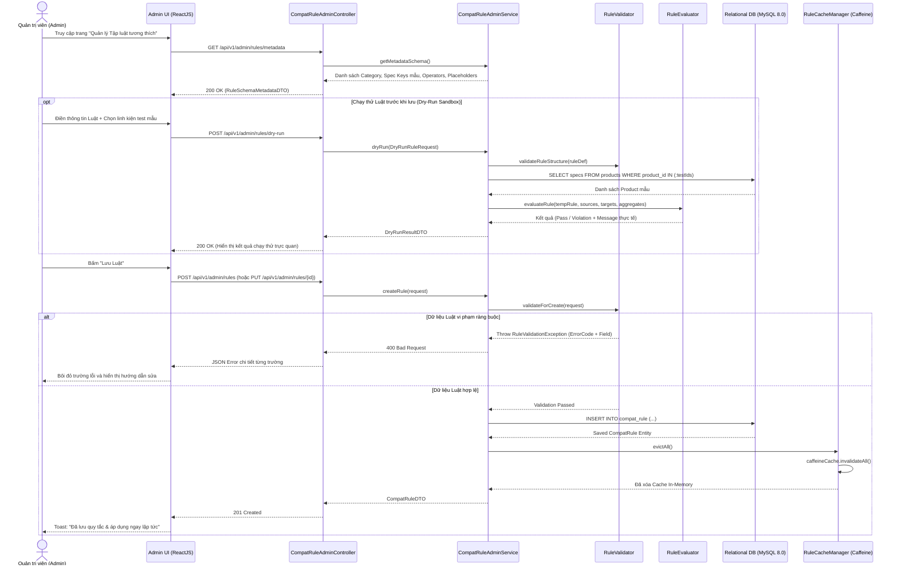
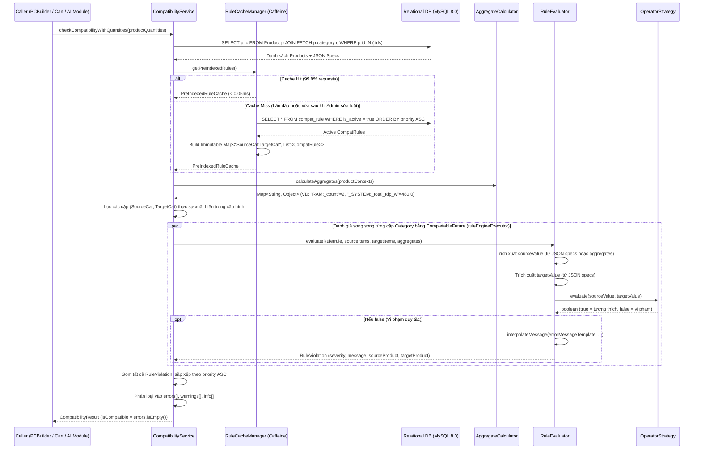

# TÀI LIỆU THIẾT KẾ CHI TIẾT (DETAILED DESIGN)
## Phân hệ: Core Rule Engine - Quản lý Tập luật (UC6 & WBS 7.4)

* **Mã tài liệu:** `DD-UC6-RULE-ENGINE`
* **Phân hệ (Package):** `com.smartpc.modules.ruleengine` (Backend) & `src/features/admin/rules` (Frontend)
* **Liên kết Use-Case:** `UC6` (Quản lý Tập Luật Tương thích), hỗ trợ trực tiếp cho `UC2` (PC Builder), `UC3` (PC Profile & Đề xuất nâng cấp), `UC4` (Checkout).
* **Liên kết WBS:** `7.4 Core Rule Engine - Quản lý Tập luật (UC6)` (`7.4.1` $\rightarrow$ `7.4.5`).

---

## 1. Tổng quan Phân hệ (Module Overview)

Phân hệ **Core Rule Engine** là bộ máy suy diễn tính tương thích phần cứng (Hardware Compatibility Rule Engine) được nhúng trực tiếp dưới dạng **Internal Module** bên trong khối **Core Backend (Java 25 - Spring Boot 3.5.x)**.

### 1.1. Mục tiêu Thiết kế
1. **Zero-Code Rule Configuration (UC6):** Quản trị viên (Admin) có thể thêm mới, chỉnh sửa, bật/tắt hoặc xóa các quy tắc tương thích phần cứng trên giao diện quản trị mà không cần biên dịch lại mã nguồn hay khởi động lại hệ thống.
2. **Độ trễ cực thấp (Ultra-low Latency $< 2\text{ms}$):** Đáp ứng yêu cầu kiểm tra tương thích theo thời gian thực khi người dùng chọn từng linh kiện trên PC Builder hoặc khi AI Module lặp qua hàng loạt phương án nâng cấp.
3. **An toàn dữ liệu (Strict Validation & Null-Safety):** Ngăn chặn tuyệt đối việc Admin nhập sai cấu trúc luật (`spec_key`, `operator`, `category`) thông qua bộ `RuleValidator` và công cụ chạy thử `Dry-Run Sandbox`.
4. **Dễ mở rộng (Open-Closed Principle):** Áp dụng mẫu thiết kế **Strategy Pattern** cho các phép toán so sánh (`OperatorStrategy`) và cơ chế **Dynamic Aggregate** cho các phép tính tổng hợp trên toàn cấu hình.

### 1.2. Cấu trúc Package Chi tiết

```text
backend/src/main/java/com/smartpc/modules/ruleengine/
├── controller/
│   ├── CompatRuleAdminController.java     # REST API quản trị tập luật (UC6 - ROLE_ADMIN)
│   └── CompatibilityController.java       # REST API kiểm tra tương thích công khai (UC2/UC4)
├── service/
│   ├── CompatRuleAdminService.java        # Nghiệp vụ CRUD luật, Dry-run & Evict Cache
│   ├── CompatibilityService.java          # Entry-point đánh giá tương thích song song
│   └── RuleCacheManager.java              # Quản lý Caffeine Cache tiền phân nhóm (Pre-indexed)
├── validator/
│   └── RuleValidator.java                 # Kiểm tra tính hợp lệ 5 bước khi tạo/sửa luật
├── evaluator/
│   └── RuleEvaluator.java                 # Điều phối trích xuất JSON specs & nội suy thông báo lỗi
├── calculator/
│   └── AggregateCalculator.java           # Tính toán thông số tổng hợp (_count, _total_tdp_w...)
├── strategy/
│   ├── OperatorStrategy.java              # Interface chung cho các phép toán
│   ├── EqualsOperatorStrategy.java        # Phép toán EQUALS
│   ├── InOperatorStrategy.java            # Phép toán IN
│   ├── NotInOperatorStrategy.java         # Phép toán NOT_IN
│   ├── LteOperatorStrategy.java           # Phép toán LTE (<=)
│   ├── GteOperatorStrategy.java           # Phép toán GTE (>=)
│   └── RangeOperatorStrategy.java         # Phép toán RANGE ([min, max])
├── repository/
│   └── CompatRuleRepository.java          # Spring Data JPA Repository cho bảng compat_rule
├── entity/
│   └── CompatRule.java                    # JPA Entity ánh xạ bảng compat_rule
├── model/
│   ├── RuleOperator.java                  # Enum: EQUALS, IN, NOT_IN, LTE, GTE, RANGE
│   ├── RuleSeverity.java                  # Enum: ERROR, WARNING, INFO
│   └── PreIndexedRuleCache.java           # Cấu trúc dữ liệu bất biến lưu trong Caffeine Cache
└── dto/
    ├── CompatRuleDTO.java                 # DTO trả về thông tin quy tắc
    ├── CreateCompatRuleRequest.java       # Request tạo mới quy tắc
    ├── UpdateCompatRuleRequest.java       # Request cập nhật quy tắc
    ├── RuleFilterRequest.java             # Bộ lọc tìm kiếm quy tắc cho Admin
    ├── DryRunRuleRequest.java             # Request chạy thử quy tắc (Sandbox)
    ├── DryRunResultDTO.java               # Kết quả chạy thử quy tắc
    ├── RuleSchemaMetadataDTO.java         # Metadata gợi ý Category, Spec Keys, Operators cho UI
    ├── CompatibilityResult.java           # Kết quả kiểm tra tương thích tổng hợp
    └── RuleViolation.java                 # Chi tiết 1 vi phạm tương thích
```

---

## 2. Thiết kế Sơ đồ Lớp (Class Diagram)

```mermaid
classDiagram
    class CompatRuleAdminController {
        -CompatRuleAdminService ruleAdminService
        +getAllRules(RuleFilterRequest) ApiResponse~PageResponse~CompatRuleDTO~~
        +getRuleById(UUID ruleId) ApiResponse~CompatRuleDTO~
        +createRule(CreateCompatRuleRequest) ApiResponse~CompatRuleDTO~
        +updateRule(UUID ruleId, UpdateCompatRuleRequest) ApiResponse~CompatRuleDTO~
        +toggleRuleStatus(UUID ruleId, boolean isActive) ApiResponse~Void~
        +deleteRule(UUID ruleId) ApiResponse~Void~
        +dryRunRule(DryRunRuleRequest) ApiResponse~DryRunResultDTO~
        +getMetadataSchema() ApiResponse~RuleSchemaMetadataDTO~
    }

    class CompatRuleAdminService {
        -CompatRuleRepository ruleRepository
        -ProductRepository productRepository
        -RuleValidator ruleValidator
        -RuleCacheManager ruleCacheManager
        -AggregateCalculator aggregateCalculator
        -RuleEvaluator ruleEvaluator
        +createRule(CreateCompatRuleRequest) CompatRuleDTO
        +updateRule(UUID, UpdateCompatRuleRequest) CompatRuleDTO
        +toggleActive(UUID, boolean) void
        +deleteRule(UUID) void
        +dryRun(DryRunRuleRequest) DryRunResultDTO
        +getMetadataSchema() RuleSchemaMetadataDTO
    }

    class RuleValidator {
        -CategoryRepository categoryRepository
        -CompatRuleRepository ruleRepository
        +validateForCreate(CreateCompatRuleRequest) void
        +validateForUpdate(UUID ruleId, UpdateCompatRuleRequest) void
        -validateCategories(String sourceCat, String targetCat) void
        -validateSpecKeys(String sourceKey, String targetKey) void
        -validateOperatorCompatibility(String sourceCat, String sourceKey, RuleOperator op) void
        -validateMessageTemplate(String template) void
        -validateNoDuplicate(String srcCat, String tgtCat, String srcKey, String tgtKey, RuleOperator op, UUID excludeId) void
    }

    class CompatibilityService {
        -ProductRepository productRepository
        -RuleCacheManager ruleCacheManager
        -AggregateCalculator aggregateCalculator
        -RuleEvaluator ruleEvaluator
        -Executor ruleEngineExecutor
        +checkCompatibility(List~UUID~ productIds) CompatibilityResult
        +checkCompatibilityWithQuantities(Map~UUID, Integer~ productQuantities) CompatibilityResult
    }

    class RuleCacheManager {
        -CompatRuleRepository ruleRepository
        -Cache~String, PreIndexedRuleCache~ caffeineCache
        +getPreIndexedRules() PreIndexedRuleCache
        +getRulesForPair(String sourceCat, String targetCat) List~CompatRule~
        +evictAll() void
    }

    class AggregateCalculator {
        +calculateAggregates(List~ProductItemContext~ items) Map~String, Object~
        -countUnits(List~ProductItemContext~ items, String categoryCode) int
        -sumSpecValue(List~ProductItemContext~ items, String categoryCode, String specKey) double
        -maxSpecValue(List~ProductItemContext~ items, String categoryCode, String specKey) double
        -calculateTotalSystemTdp(List~ProductItemContext~ items) double
    }

    class RuleEvaluator {
        -Map~RuleOperator, OperatorStrategy~ strategyMap
        +evaluateRule(CompatRule rule, List~ProductItemContext~ sources, List~ProductItemContext~ targets, Map~String, Object~ aggregates) List~RuleViolation~
        -extractSourceValue(CompatRule rule, ProductItemContext source, Map~String, Object~ aggregates) Object
        -extractTargetValue(CompatRule rule, ProductItemContext target) Object
        -interpolateMessage(String template, Object srcVal, Object tgtVal, ProductItemContext src, ProductItemContext tgt) String
    }

    class OperatorStrategy {
        <<interface>>
        +getOperator() RuleOperator
        +evaluate(Object sourceValue, Object targetValue) boolean
    }

    class EqualsOperatorStrategy {
        +evaluate(Object sourceValue, Object targetValue) boolean
    }
    class InOperatorStrategy {
        +evaluate(Object sourceValue, Object targetValue) boolean
    }
    class NotInOperatorStrategy {
        +evaluate(Object sourceValue, Object targetValue) boolean
    }
    class LteOperatorStrategy {
        +evaluate(Object sourceValue, Object targetValue) boolean
    }
    class GteOperatorStrategy {
        +evaluate(Object sourceValue, Object targetValue) boolean
    }
    class RangeOperatorStrategy {
        +evaluate(Object sourceValue, Object targetValue) boolean
    }

    class CompatRule {
        +UUID ruleId
        +String ruleName
        +String sourceCategory
        +String targetCategory
        +String sourceSpecKey
        +String targetSpecKey
        +RuleOperator operator
        +RuleSeverity severity
        +String errorMessageTemplate
        +Boolean isActive
        +Integer priority
        +LocalDateTime createdAt
    }

    CompatRuleAdminController --> CompatRuleAdminService
    CompatRuleAdminService --> RuleValidator
    CompatRuleAdminService --> RuleCacheManager
    CompatRuleAdminService --> RuleEvaluator
    CompatibilityService --> RuleCacheManager
    CompatibilityService --> AggregateCalculator
    CompatibilityService --> RuleEvaluator
    RuleEvaluator --> OperatorStrategy
    OperatorStrategy <|.. EqualsOperatorStrategy
    OperatorStrategy <|.. InOperatorStrategy
    OperatorStrategy <|.. NotInOperatorStrategy
    OperatorStrategy <|.. LteOperatorStrategy
    OperatorStrategy <|.. GteOperatorStrategy
    OperatorStrategy <|.. RangeOperatorStrategy
    RuleCacheManager --> CompatRule
```



---

## 3. Thiết kế Sơ đồ Tuần tự (Sequence Diagrams)

### 3.1. Luồng Admin Tạo/Cập nhật Luật, Chạy thử (Dry-run) & Xóa Cache (UC6)



### 3.2. Luồng Thực thi Đánh giá Tập luật Nội bộ (Rule Engine Execution Flow)



---

## 4. Thiết kế Chi tiết theo Tác vụ WBS (7.4.1 $\rightarrow$ 7.4.5)

### 4.1. Quản lý Tập luật - Giao diện Admin & REST API (WBS 7.4.1)

#### A. Thiết kế Bố cục Giao diện Admin (`src/features/admin/rules`)
Giao diện Quản lý Tập luật dành cho Admin được thiết kế theo bố cục 2 khu vực trực quan:
1. **Danh sách & Bộ lọc Tập luật (Rule Management Table):**
   * **Thanh lọc nhanh (Filter Bar):** Lọc theo `Danh mục nguồn (Source Category)`, `Danh mục đích (Target Category)`, `Mức độ (ERROR / WARNING / INFO)`, `Trạng thái (Active / Inactive)`, và ô tìm kiếm theo tên quy tắc.
   * **Bảng dữ liệu:** Hiển thị cột `Độ ưu tiên (Priority)`, `Tên quy tắc`, `Luồng đối chiếu (Source → Target)`, `Biểu thức điều kiện (source_spec_key [OPERATOR] target_spec_key)`, `Badge mức độ (Đỏ/Vàng/Xanh dương)`, `Nút gạt (Toggle Switch) Bật/Tắt nhanh`, và nút `Sửa / Xóa`.
2. **Modal Tạo/Sửa Luật kèm Khu vực Chạy thử (Rule Editor & Dry-Run Sandbox):**
   * **Trình dựng biểu thức trực quan (Visual Expression Builder):**
     * Chọn `Source Category` $\rightarrow$ Dropdown `Source Spec Key` tự động gợi ý các khóa JSON tương ứng của danh mục đó cộng với các khóa tổng hợp (`_count`, `_sum_capacity_gb`...).
     * Chọn `Operator` (`EQUALS`, `IN`, `NOT_IN`, `LTE`, `GTE`, `RANGE`).
     * Chọn `Target Category` $\rightarrow$ Dropdown `Target Spec Key` tự động gợi ý các khóa JSON của linh kiện đích.
   * **Trình soạn thông báo lỗi (Message Template Editor):** Có các nút bấm chèn nhanh biến nội suy (`+ {source_name}`, `+ {source_value}`, `+ {target_name}`, `+ {target_value}`).
   * **Khung kiểm thử trực tiếp (Dry-Run Sandbox Panel):** Admin chọn 2 sản phẩm bất kỳ trong kho để bấm **"Chạy thử (Test Rule)"**, hệ thống trả về ngay kết quả `PASS` hoặc `FAIL` kèm câu thông báo lỗi đã được điền dữ liệu thật.

#### B. Đặc tả REST API Quản trị Tập luật (`CompatRuleAdminController`)
Tất cả các API dưới đây yêu cầu JWT Token có quyền `ROLE_ADMIN` (`@PreAuthorize("hasRole('ADMIN')")`).

| STT | HTTP Method & Endpoint | Mô tả chức năng | Mã phản hồi |
| :--- | :--- | :--- | :--- |
| 1 | `GET /api/v1/admin/rules` | Lấy danh sách quy tắc có lọc & phân trang | `200 OK` |
| 2 | `GET /api/v1/admin/rules/metadata` | Lấy danh sách Category, Spec Keys chuẩn, Operators, Placeholders cho UI | `200 OK` |
| 3 | `GET /api/v1/admin/rules/{ruleId}` | Xem chi tiết 1 quy tắc theo ID | `200 OK`, `404 Not Found` |
| 4 | `POST /api/v1/admin/rules` | Thêm mới quy tắc tương thích & xóa Cache | `201 Created`, `400 Bad Request`, `409 Conflict` |
| 5 | `PUT /api/v1/admin/rules/{ruleId}` | Cập nhật toàn bộ quy tắc & xóa Cache | `200 OK`, `400 Bad Request`, `404 Not Found` |
| 6 | `PATCH /api/v1/admin/rules/{ruleId}/status` | Bật/Tắt nhanh trạng thái `is_active` & xóa Cache | `200 OK`, `404 Not Found` |
| 7 | `DELETE /api/v1/admin/rules/{ruleId}` | Xóa quy tắc khỏi hệ thống & xóa Cache | `204 No Content`, `404 Not Found` |
| 8 | `POST /api/v1/admin/rules/dry-run` | Chạy thử quy tắc (chưa lưu) với danh sách sản phẩm mẫu | `200 OK`, `400 Bad Request` |

**Mẫu Payload `POST /api/v1/admin/rules`:**
```json
{
  "rule_name": "CPU-Motherboard Socket Match",
  "source_category": "CPU",
  "target_category": "MOTHERBOARD",
  "source_spec_key": "socket_type",
  "target_spec_key": "supported_sockets",
  "operator": "IN",
  "severity": "ERROR",
  "error_message_template": "CPU {source_name} (Socket {source_value}) không tương thích với Mainboard {target_name} (Chỉ hỗ trợ: {target_value})",
  "is_active": true,
  "priority": 10
}
```

**Mẫu Payload & Response `POST /api/v1/admin/rules/dry-run`:**
```json
// Request Body
{
  "rule_definition": {
    "rule_name": "GPU Length vs Case",
    "source_category": "GPU",
    "target_category": "CASE",
    "source_spec_key": "length_mm",
    "target_spec_key": "max_gpu_length_mm",
    "operator": "LTE",
    "severity": "ERROR",
    "error_message_template": "VGA {source_name} dài {source_value}mm vượt quá chiều dài tối đa của vỏ Case {target_name} ({target_value}mm)"
  },
  "test_product_ids": ["550e8400-e29b-41d4-a716-446655440010", "550e8400-e29b-41d4-a716-446655440020"]
}

// Response Body (200 OK)
{
  "success": true,
  "data": {
    "is_compatible": false,
    "extracted_source_value": 357.6,
    "extracted_target_value": 320,
    "rendered_violation_message": "VGA ASUS ROG Strix RTX 4090 dài 357.6mm vượt quá chiều dài tối đa của vỏ Case NZXT H210 (320mm)",
    "execution_time_ms": 0.85
  }
}
```

---

### 4.2. Bộ Kiểm tra Tính hợp lệ Cấu trúc Luật (`RuleValidator` - WBS 7.4.2)

`RuleValidator` bảo vệ hệ thống khỏi các quy tắc sai cú pháp hoặc mâu thuẫn logic trước khi ghi vào bảng `compat_rule`.

#### A. Bảng Quy tắc Kiểm tra 5 Bước

| Bước | Hạng mục kiểm tra | Điều kiện Hợp lệ Chi tiết | Mã lỗi (`ErrorCode`) |
| :--- | :--- | :--- | :--- |
| **1** | **Danh mục Nguồn & Đích (`source_category`, `target_category`)** | - `target_category` bắt buộc phải tồn tại trong bảng `CATEGORY` (`category_code`).<br>- `source_category` phải tồn tại trong bảng `CATEGORY` HOẶC bằng hằng số đặc biệt `"_SYSTEM"`.<br>- Nếu `source_category == target_category`, báo lỗi không cho phép tự đối chiếu chính nó. | `RULE_INVALID_CATEGORY`<br>`RULE_SELF_REFERENCE` |
| **2** | **Định dạng Khóa Thông số (`source_spec_key`, `target_spec_key`)** | - Khớp biểu thức chính quy `^[a-z_][a-z0-9_]{1,99}$` (chuẩn `snake_case`).<br>- `target_spec_key` **không** được bắt đầu bằng dấu `_` (vì đích phải là thuộc tính tĩnh trong JSON `specs` của linh kiện đích).<br>- Nếu `source_spec_key` bắt đầu bằng `_`, nó phải thuộc tập khóa tổng hợp cố định (`_count`, `_sum_capacity_gb`, `_total_tdp_w`) hoặc khớp mẫu động `^(_sum_|_max_)[a-z0-9_]+$`. | `RULE_INVALID_SPEC_KEY`<br>`RULE_UNKNOWN_AGGREGATE_KEY` |
| **3** | **Tính tương thích giữa Khóa và Toán tử (`operator`)** | - Nếu `source_category == "_SYSTEM"`, `source_spec_key` bắt buộc phải là `"_total_tdp_w"`.<br>- Nếu `source_spec_key` bắt đầu bằng `_` (luôn trả về kiểu `Number`), `operator` chỉ được phép thuộc `{LTE, GTE, EQUALS, RANGE}`. Cấm sử dụng `IN` hoặc `NOT_IN` cho khóa tổng hợp số học. | `RULE_INCOMPATIBLE_OPERATOR` |
| **4** | **Mẫu thông báo lỗi (`error_message_template`)** | - Độ dài từ `10` đến `500` ký tự.<br>- Số lượng dấu `{` và `}` phải cân bằng.<br>- Mọi placeholder `{...}` bên trong chuỗi chỉ được nằm trong danh sách cho phép: `{source_name}`, `{target_name}`, `{source_value}`, `{target_value}`, `{source_category}`, `{target_category}`. | `RULE_INVALID_TEMPLATE_SYNTAX`<br>`RULE_UNKNOWN_PLACEHOLDER` |
| **5** | **Chống Trùng lặp Quy tắc (`Duplicate Check`)** | - Truy vấn DB kiểm tra không tồn tại bản ghi nào khác (`rule_id != excludeId`) có cùng bộ 5 thuộc tính: `(source_category, target_category, source_spec_key, target_spec_key, operator)`. | `RULE_DUPLICATE_DEFINITION` |

#### B. Thiết kế Mã nguồn Tham chiếu (`RuleValidator.java`)

```java
package com.smartpc.modules.ruleengine.validator;

import com.smartpc.common.exception.BusinessException;
import com.smartpc.modules.product.repository.CategoryRepository;
import com.smartpc.modules.ruleengine.model.RuleOperator;
import com.smartpc.modules.ruleengine.repository.CompatRuleRepository;
import lombok.RequiredArgsConstructor;
import org.springframework.stereotype.Component;

import java.util.EnumSet;
import java.util.Set;
import java.util.UUID;
import java.util.regex.Matcher;
import java.util.regex.Pattern;

@Component
@RequiredArgsConstructor
public class RuleValidator {

    private static final String SYSTEM_CATEGORY = "_SYSTEM";
    private static final Pattern SPEC_KEY_PATTERN = Pattern.compile("^[a-z_][a-z0-9_]{1,99}$");
    private static final Pattern DYNAMIC_AGG_PATTERN = Pattern.compile("^(_sum_|_max_)[a-z0-9_]+$");
    private static final Pattern PLACEHOLDER_PATTERN = Pattern.compile("\\{([^}]+)\\}");

    private static final Set<String> BUILTIN_AGGREGATE_KEYS = Set.of(
            "_count", "_sum_capacity_gb", "_total_tdp_w"
    );

    private static final Set<String> ALLOWED_PLACEHOLDERS = Set.of(
            "source_name", "target_name", "source_value", "target_value",
            "source_category", "target_category"
    );

    private static final Set<RuleOperator> NUMERIC_OPERATORS = EnumSet.of(
            RuleOperator.LTE, RuleOperator.GTE, RuleOperator.EQUALS, RuleOperator.RANGE
    );

    private final CategoryRepository categoryRepository;
    private final CompatRuleRepository compatRuleRepository;

    public void validateRule(
            String sourceCategory,
            String targetCategory,
            String sourceSpecKey,
            String targetSpecKey,
            RuleOperator operator,
            String errorMessageTemplate,
            UUID excludeRuleId
    ) {
        // 1. Validate Categories
        if (sourceCategory.equalsIgnoreCase(targetCategory)) {
            throw new BusinessException("RULE_SELF_REFERENCE", "Danh mục nguồn và đích không được trùng nhau.");
        }
        if (!SYSTEM_CATEGORY.equals(sourceCategory) && !categoryRepository.existsByCategoryCode(sourceCategory)) {
            throw new BusinessException("RULE_INVALID_CATEGORY", "Danh mục nguồn không tồn tại: " + sourceCategory);
        }
        if (!categoryRepository.existsByCategoryCode(targetCategory)) {
            throw new BusinessException("RULE_INVALID_CATEGORY", "Danh mục đích không tồn tại: " + targetCategory);
        }

        // 2. Validate Spec Keys
        if (!SPEC_KEY_PATTERN.matcher(sourceSpecKey).matches() || !SPEC_KEY_PATTERN.matcher(targetSpecKey).matches()) {
            throw new BusinessException("RULE_INVALID_SPEC_KEY", "Spec key phải tuân theo định dạng snake_case.");
        }
        if (targetSpecKey.startsWith("_")) {
            throw new BusinessException("RULE_INVALID_SPEC_KEY", "target_spec_key phải là thuộc tính tĩnh, không được bắt đầu bằng '_'.");
        }
        if (sourceSpecKey.startsWith("_")) {
            boolean isValidAgg = BUILTIN_AGGREGATE_KEYS.contains(sourceSpecKey)
                    || DYNAMIC_AGG_PATTERN.matcher(sourceSpecKey).matches();
            if (!isValidAgg) {
                throw new BusinessException("RULE_UNKNOWN_AGGREGATE_KEY", "Khóa tổng hợp không hợp lệ: " + sourceSpecKey);
            }
        }

        // 3. Validate Operator & Aggregate Compatibility
        if (SYSTEM_CATEGORY.equals(sourceCategory) && !"_total_tdp_w".equals(sourceSpecKey)) {
            throw new BusinessException("RULE_INCOMPATIBLE_OPERATOR", "Danh mục _SYSTEM chỉ hỗ trợ khóa _total_tdp_w.");
        }
        if (sourceSpecKey.startsWith("_") && !NUMERIC_OPERATORS.contains(operator)) {
            throw new BusinessException("RULE_INCOMPATIBLE_OPERATOR",
                    "Khóa tổng hợp số học (" + sourceSpecKey + ") chỉ hỗ trợ các toán tử LTE, GTE, EQUALS, RANGE.");
        }

        // 4. Validate Error Message Template
        validateTemplate(errorMessageTemplate);

        // 5. Check Duplicate Rule
        boolean isDuplicate = compatRuleRepository.existsDuplicateRule(
                sourceCategory, targetCategory, sourceSpecKey, targetSpecKey, operator, excludeRuleId
        );
        if (isDuplicate) {
            throw new BusinessException("RULE_DUPLICATE_DEFINITION", "Quy tắc tương thích này đã tồn tại trong hệ thống.");
        }
    }

    private void validateTemplate(String template) {
        if (template == null || template.trim().length() < 10 || template.length() > 500) {
            throw new BusinessException("RULE_INVALID_TEMPLATE_SYNTAX", "Mẫu thông báo lỗi phải từ 10 đến 500 ký tự.");
        }
        Matcher matcher = PLACEHOLDER_PATTERN.matcher(template);
        while (matcher.find()) {
            String placeholder = matcher.group(1);
            if (!ALLOWED_PLACEHOLDERS.contains(placeholder)) {
                throw new BusinessException("RULE_UNKNOWN_PLACEHOLDER",
                        "Biến nội suy không hợp lệ: {" + placeholder + "}. Chỉ hỗ trợ: " + ALLOWED_PLACEHOLDERS);
            }
        }
    }
}
```

---

### 4.3. Xây dựng Evaluator & Chiến lược Toán tử (`RuleEvaluator` & `OperatorStrategy` - WBS 7.4.3)

#### A. Đặc tả Chi tiết 6 Chiến lược Toán tử (`OperatorStrategy`)

Mỗi toán tử kế thừa interface `OperatorStrategy` và chịu trách nhiệm so sánh `sourceValue` với `targetValue`.

| Class Chiến lược | Toán tử | Xử lý kiểu dữ liệu & Logic so sánh chi tiết |
| :--- | :--- | :--- |
| **`EqualsOperatorStrategy`** | `EQUALS` | - Nếu cả hai là `Number`: chuyển về `BigDecimal` và kiểm tra `compareTo() == 0` (để `320` bằng `320.0`).<br>- Nếu là `String`: `source.trim().equalsIgnoreCase(target.trim())`.<br>- Nếu là `Boolean`: `Boolean.valueOf(source).equals(Boolean.valueOf(target))`. |
| **`InOperatorStrategy`** | `IN` | - Trường hợp chuẩn: `sourceValue` là giá trị đơn (`"LGA1700"`), `targetValue` là `Collection<?>` (`["LGA1700", "LGA1851"]`). Trả về `true` nếu tồn tại phần tử trong `targetValue` khớp (không phân biệt hoa thường/số học) với `sourceValue`.<br>- Trường hợp cả hai là `Collection<?>`: Trả về `true` nếu tập giao (intersection) khác rỗng. |
| **`NotInOperatorStrategy`** | `NOT_IN` | - Phủ định kết quả của `InOperatorStrategy`: Trả về `true` nếu `sourceValue` **không** nằm trong tập `targetValue`. |
| **`LteOperatorStrategy`** | `LTE` ($\le$) | - Ép kiểu an toàn cả `sourceValue` và `targetValue` sang `double`.<br>- Trả về `Double.compare(srcDouble, tgtDouble) <= 0`. |
| **`GteOperatorStrategy`** | `GTE` ($\ge$) | - Ép kiểu an toàn cả `sourceValue` và `targetValue` sang `double`.<br>- Trả về `Double.compare(srcDouble, tgtDouble) >= 0`. |
| **`RangeOperatorStrategy`** | `RANGE` | - `sourceValue` là `Number`.<br>- `targetValue` trong JSON có thể là `List [min, max]` (VD: `[1.1, 1.4]`) hoặc `Map {"min": 1.1, "max": 1.4}`.<br>- Trả về `srcDouble >= min && srcDouble <= max`. |

#### B. Chính sách An toàn khi Thiếu Thông số (`Null-Safety & Missing Spec Policy`)
Trong thực tế vận hành TMĐT, một số sản phẩm mới nhập có thể bị bỏ sót một trường trong cột JSON `specs`:
1. Khi `sourceValue == null` hoặc `targetValue == null`:
   * **Không ném Exception** làm gián đoạn luồng mua hàng.
   * Ghi log cảnh báo `log.warn("Missing spec key [{}] or [{}] when evaluating rule [{}]", ...)` để Admin rà soát dữ liệu sản phẩm.
   * Bỏ qua quy tắc đó (coi như không vi phạm `ERROR`) để tránh chặn nhầm khách hàng thanh toán.
2. Khi chạy ở chế độ **Dry-Run Sandbox (Admin Test)**:
   * Nếu thiếu spec key trên sản phẩm mẫu, trả về thông báo rõ ràng cho Admin: `"Sản phẩm [Tên SP] hiện chưa được khai báo trường thông số [spec_key] trong JSON specs"`.

#### C. Thuật toán Nội suy Thông báo Lỗi (`interpolateMessage`)
Khi `strategy.evaluate(sourceValue, targetValue)` trả về `false`, `RuleEvaluator` sinh thông báo lỗi thân thiện cho người dùng từ `rule.getErrorMessageTemplate()`:
* Nếu `targetValue` là một `List` (VD: `["DDR4", "DDR5"]`), định dạng thành chuỗi gọn gàng `"DDR4, DDR5"` thay vì `"[DDR4, DDR5]"`.
* Nếu `sourceValue` hoặc `targetValue` là số thực có phần thập phân `.0` (VD: `480.0`), tự động làm gọn thành `"480"`.
* Thay thế các biến:
  * `{source_name}` $\rightarrow$ `sourceItem != null ? sourceItem.getProductName() : "Toàn hệ thống"`
  * `{target_name}` $\rightarrow$ `targetItem.getProductName()`
  * `{source_value}` $\rightarrow$ `formatValue(sourceValue)`
  * `{target_value}` $\rightarrow$ `formatValue(targetValue)`

---

### 4.4. Xây dựng Aggregate Calculator (`AggregateCalculator` - WBS 7.4.4)

`AggregateCalculator` chịu trách nhiệm tính toán các thông số cộng dồn hoặc đếm số lượng linh kiện trong cấu hình trước khi đánh giá các quy tắc.

#### A. Cấu trúc Đầu vào & Đầu ra
* **Đầu vào:** `List<ProductItemContext> items` — Mỗi phần tử gồm `Product product` (chứa `category_code` và `Map<String, Object> specs`) kèm theo `int quantity` (số lượng người dùng chọn trong PC Builder hoặc Giỏ hàng, ví dụ: mua 2 thanh RAM lẻ hoặc 2 kit RAM).
* **Đầu ra:** `Map<String, Object> aggregateContext` với khóa có định dạng `"<CATEGORY_CODE>:<AGGREGATE_SPEC_KEY>"`.

#### B. Công thức Tính toán Chi tiết

1. **Đếm số lượng khe vật lý chiếm dụng (`<CATEGORY>:_count`):**
   * Một sản phẩm RAM có thể là **Kit 2 thanh** (`"modules_per_kit": 2` trong JSON specs). Nếu người dùng chọn `quantity = 2` bộ kit này, tổng số khe RAM vật lý chiếm dụng trên Mainboard phải là $2 \times 2 = 4$ khe.
   * Công thức tổng quát:
     $$\text{Count}(C) = \sum_{p \in C} \text{p.quantity} \times \text{p.specs.getOrDefault("modules\_per\_kit", 1)}$$

2. **Tổng dung lượng bộ nhớ (`RAM:_sum_capacity_gb`, `STORAGE:_sum_capacity_gb`):**
   * Công thức:
     $$\text{SumCapacity}(C) = \sum_{p \in C} \text{p.quantity} \times \text{p.specs.getDouble("capacity\_gb", 0.0)}$$

3. **Tổng công suất tiêu thụ toàn hệ thống (`_SYSTEM:_total_tdp_w`):**
   * Cộng dồn trường `tdp_w` của tất cả các linh kiện trong cấu hình (CPU, GPU, Cooler, RAM, SSD...), cộng thêm `50W` hao phí cơ bản của bo mạch chủ/quạt thùng máy (`BASE_SYSTEM_OVERHEAD_W = 50.0`), sau đó nhân hệ số tải an toàn `1.2` (đảm bảo PSU hoạt động dưới ngưỡng 80% tải đỉnh) hoặc giữ nguyên tổng TDP thực tế tùy quy ước rule.
   * Để thông báo lỗi hiển thị chính xác mức TDP thực tế của dàn máy (như ví dụ trong SDD: *"Tổng TDP hệ thống (380W)..."*) và dự phòng biên độ an toàn:
     $$\text{TotalTDP} = \left( \sum_{\text{all } p} \text{p.quantity} \times \text{p.specs.getDouble("tdp\_w", 0.0)} \right) + 50\text{W (Mainboard/Fans overhead)}$$
     *(Lưu ý: Nếu linh kiện đã khai báo sẵn `tdp_w` trên Mainboard/Fan thì chỉ cần cộng trực tiếp $\sum \text{quantity} \times \text{tdp\_w}$).*

4. **Hỗ trợ Khóa Tổng hợp Động (`_sum_<field>` và `_max_<field>`):**
   * Khi quét qua `specs` của từng linh kiện thuộc danh mục $C$, mọi trường kiểu `Number` (ví dụ `power_draw_w`, `radiator_size_mm`) đều được tự động cộng dồn vào khóa `C:_sum_<field>` và cập nhật giá trị cực đại vào `C:_max_<field>`.
   * Độ phức tạp thuật toán: **$O(N \times K)$** với $N$ là số linh kiện trong cấu hình ($N \le 15$) và $K$ là số trường JSON trung bình mỗi linh kiện ($K \le 10$), thời gian chạy thực tế $< 0.02\text{ms}$.

---

### 4.5. Hệ thống Cache In-Memory Caffeine (`RuleCacheManager` - WBS 7.4.5)

#### A. Cấu trúc Dữ liệu Tiền phân nhóm (`PreIndexedRuleCache`)
Thay vì chỉ cache một danh sách phẳng `List<CompatRule>` và bắt CPU phải duyệt qua toàn bộ danh sách ở mỗi lần gọi `checkCompatibility()`, `RuleCacheManager` đóng gói tập luật vào đối tượng bất biến `PreIndexedRuleCache`:

```java
package com.smartpc.modules.ruleengine.model;

import com.smartpc.modules.ruleengine.entity.CompatRule;
import java.util.Collections;
import java.util.List;
import java.util.Map;

public final class PreIndexedRuleCache {
    // Key: "SOURCE_CATEGORY:TARGET_CATEGORY" (VD: "CPU:MOTHERBOARD", "_SYSTEM:PSU")
    // Value: Danh sách CompatRule đã sắp xếp theo priority ASC
    private final Map<String, List<CompatRule>> rulesByPair;
    private final List<CompatRule> allActiveRules;

    public PreIndexedRuleCache(Map<String, List<CompatRule>> rulesByPair, List<CompatRule> allActiveRules) {
        this.rulesByPair = Collections.unmodifiableMap(rulesByPair);
        this.allActiveRules = Collections.unmodifiableList(allActiveRules);
    }

    public List<CompatRule> getRulesForPair(String sourceCategory, String targetCategory) {
        return rulesByPair.getOrDefault(sourceCategory + ":" + targetCategory, Collections.emptyList());
    }

    public Map<String, List<CompatRule>> getAllPairs() {
        return rulesByPair;
    }
}
```

#### B. Cấu hình Caffeine Cache & Cơ chế Đồng bộ (`RuleCacheManager.java`)
* **Cấu hình trong `CacheConfig.java`:**
  * Sử dụng `Caffeine.newBuilder().maximumSize(10).expireAfterWrite(1, TimeUnit.HOURS).recordStats().build()`.
* **Độ an toàn đa luồng (Thread-Safety):**
  * Khi có nhiều luồng gọi `getPreIndexedRules()` cùng lúc ngay sau khi Cache vừa bị xóa, phương thức `caffeineCache.get(CACHE_KEY, k -> loadAndIndexFromDb())` của Caffeine đảm bảo **chỉ có duy nhất 1 luồng** thực thi câu lệnh SQL xuống Database (chống hiện tượng *Cache Stampede*), các luồng còn lại chờ nhận chung kết quả bất biến `PreIndexedRuleCache`.
* **Cơ chế Xóa Cache Tức thời (Write Invalidation):**
  * Ngay khi Admin thực hiện `createRule`, `updateRule`, `toggleActive`, hoặc `deleteRule` trong `CompatRuleAdminService`, hàm `ruleCacheManager.evictAll()` được kích hoạt sau khi Transaction commit thành công.

---

## 5. Thiết kế Cơ sở Dữ liệu & Chỉ mục (DDL & Indexing cho UC6)

Để việc nạp tập luật khi Cache Miss và việc kiểm tra trùng lặp quy tắc (`Duplicate Check`) của Admin đạt tốc độ tối đa, bảng `compat_rule` trong `V1__init_schema.sql` được thiết kế kèm các chỉ mục chuyên biệt:

```sql
CREATE TABLE compat_rule (
    rule_id CHAR(36) NOT NULL PRIMARY KEY,
    rule_name VARCHAR(255) NOT NULL,
    source_category VARCHAR(50) NOT NULL COMMENT 'FK logic tới category.category_code hoặc _SYSTEM',
    target_category VARCHAR(50) NOT NULL COMMENT 'FK tới category.category_code',
    source_spec_key VARCHAR(100) NOT NULL,
    target_spec_key VARCHAR(100) NOT NULL,
    operator ENUM('EQUALS', 'IN', 'NOT_IN', 'LTE', 'GTE', 'RANGE') NOT NULL,
    severity ENUM('ERROR', 'WARNING', 'INFO') NOT NULL DEFAULT 'ERROR',
    error_message_template TEXT NOT NULL,
    is_active BOOLEAN NOT NULL DEFAULT TRUE,
    priority INT NOT NULL DEFAULT 10,
    created_at TIMESTAMP NOT NULL DEFAULT CURRENT_TIMESTAMP,
    updated_at TIMESTAMP NOT NULL DEFAULT CURRENT_TIMESTAMP ON UPDATE CURRENT_TIMESTAMP,

    CONSTRAINT fk_rule_target_category
        FOREIGN KEY (target_category) REFERENCES category (category_code)
        ON UPDATE CASCADE ON DELETE RESTRICT,

    -- Chỉ mục phục vụ RuleCacheManager nạp toàn bộ rule active theo thứ tự ưu tiên
    INDEX idx_compat_rule_active_priority (is_active, priority ASC),

    -- Chỉ mục Unique chống tạo trùng quy tắc tương thích (hỗ trợ RuleValidator)
    UNIQUE INDEX uk_compat_rule_definition (
        source_category,
        target_category,
        source_spec_key,
        target_spec_key,
        operator
    )
) ENGINE=InnoDB DEFAULT CHARSET=utf8mb4 COLLATE=utf8mb4_unicode_ci;
```

---

## 6. Kịch bản Kiểm thử Đơn vị & Hiệu năng (`RuleEngineBenchmarkTest`)

Phân hệ đi kèm bộ Unit Test & Benchmark (`backend/src/test/java/com/smartpc/ruleengine/RuleEngineBenchmarkTest.java`) bao phủ các kịch bản cốt lõi:

| Mã Test Case | Kịch bản kiểm thử | Đầu vào giả lập | Kết quả kỳ vọng |
| :--- | :--- | :--- | :--- |
| **`TC-RE-01`** | Kiểm tra xung đột Socket CPU & Mainboard (`IN` Operator) | CPU `socket_type: "LGA1700"`, Mainboard `supported_sockets: ["AM5"]` | `isCompatible = false`, 1 `ERROR` với thông báo đã điền tên sản phẩm và socket. |
| **`TC-RE-02`** | Kiểm tra số khe RAM với Kit đa thanh (`_count` + `LTE`) | 2x Kit RAM (`quantity=2`, `modules_per_kit=2` $\rightarrow$ `_count=4`), Mainboard `ram_slots: 2` | `isCompatible = false`, 1 `ERROR` báo vượt quá số khe RAM (`4 > 2`). |
| **`TC-RE-03`** | Kiểm tra tổng công suất nguồn (`_total_tdp_w` + `WARNING`) | CPU (`125W`) + GPU (`285W`) + Hệ thống (`50W`) = `460W`, PSU `rated_wattage_w: 450` | `isCompatible = true` (không có `ERROR`), nhưng có 1 `WARNING` khuyến nghị nâng cấp nguồn. |
| **`TC-RE-04`** | Kiểm tra `RuleValidator` chặn toán tử sai cho khóa tổng hợp | Tạo luật với `source_spec_key = "_count"` và `operator = "IN"` | Ném ngoại lệ `BusinessException` với mã `RULE_INCOMPATIBLE_OPERATOR`. |
| **`TC-RE-05`** | Kiểm tra `Null-Safety` khi sản phẩm thiếu thông số JSON | GPU không có trường `length_mm`, Case có `max_gpu_length_mm: 330` | Không ném `NullPointerException`, ghi log `WARN` và trả về `isCompatible = true`. |
| **`TC-RE-06`** | Kiểm tra đồng bộ Cache khi Admin tắt quy tắc (`Cache Eviction`) | Admin gọi `toggleActive(ruleId, false)` cho luật Socket Match, sau đó gọi `checkCompatibility()` | `RuleCacheManager` tự động nạp lại tập luật mới, không còn bắt lỗi Socket Match. |
| **`TC-RE-07`** | Kiểm thử hiệu năng đánh giá song song (`Benchmark`) | Cấu hình đầy đủ 8 linh kiện, 50 quy tắc active trong Cache, chạy 1.000 lần liên tiếp | Thời gian trung bình mỗi lần đánh giá (P99 Latency) **$< 2.0\text{ms}$**. |
