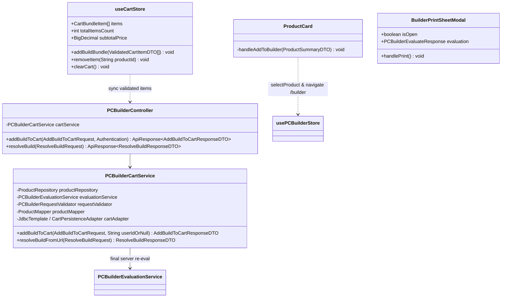
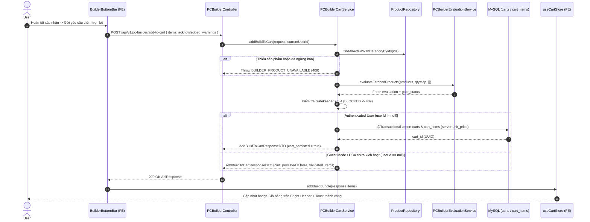

# SUB-DD `7.5.6`: Đẩy Cấu hình vào Giỏ hàng, `+ Builder` & Share URL

> **Agent Context Card (Đọc nhanh phạm vi trước khi code)**
> * **Parent DD:** [dd-uc2-pc-builder.md](../dd-uc2-pc-builder.md) *(xem Mục 2 Shared Contracts cho Auth/Cart Boundary, ErrorCode & Header Policy)*
> * **WBS:** `7.5.6` — Tích hợp đẩy toàn bộ cấu hình từ PC Builder vào Giỏ hàng (`Add All to Cart`), `+ Builder` từ Storefront & Chia sẻ URL
> * **Owned Files:** `backend/.../pcbuilder/service/PCBuilderCartService.java`, `dto/request/AddBuildToCartRequest.java`, `ResolveBuildRequest.java`, `dto/response/AddBuildToCartResponseDTO.java`, `ResolveBuildResponseDTO.java`, `ValidatedCartItemDTO.java`, endpoints `/add-to-cart` & `/resolve` trong `PCBuilderController.java`, `frontend/src/stores/useCartStore.ts`, `frontend/src/features/pc-builder/components/BuilderPrintSheetModal.tsx`, nút `+ Builder` tại `ProductCard.tsx`, `ProductDetailPage.tsx`; mở rộng `PCBuilderCartService.java` (tạo ở 7.5.4) & resolve `?items=` trong `PCBuilderPage.tsx` theo Write Lock *(Master DD §3.1)*. **`App.tsx`** (route `/builder`, badge giỏ hàng — §3.3) do Coordinator thực thi ở `Final Wave`.
> * **Shared / Read-only Dependencies:** Bảng `carts` & `cart_items` (`V1__init_schema.sql`); `ProductRepository` & `ProductMapper` (`UC5`); `PCBuilderEvaluationService` & `PCBuilderRequestValidator` (`7.5.2`); `BuilderGateStatus` (`7.5.4`); `ErrorCode.BUILDER_*` & `PROD_OUT_OF_STOCK` (`Master DD §2.3`); `usePCBuilderStore` (`7.5.1`); Bright Header 3 tầng (`AGENTS.md` §4)
> * **Test Target:** `PCBuilderCartServiceTest.java`, `useCartStore.test.ts` (`TC-UC2-25` $\rightarrow$ `TC-UC2-30`)

---

## 1. Mục tiêu & Phạm vi (`WBS 7.5.6`)

Chức năng `7.5.6` hoàn thiện vòng đời tích hợp của **PC Builder (`UC2`)** với phần còn lại của hệ thống thương mại điện tử:
1. **Batch Add-to-Cart (`POST /api/v1/pc-builder/add-to-cart`):** Xác thực lần cuối giá chuẩn DB, tồn kho và Gatekeeper (`7.5.4`). Tự động lưu xuống bảng `carts`/`cart_items` (ACID Transaction) khi đã có phiên đăng nhập (`UC0`/`UC4`), hoặc trả về giỏ hàng đã chuẩn hóa giá server để `useCartStore` lưu ở client đối với khách vãng lai (`Guest Mode`).
2. **Chia sẻ & Khôi phục Cấu hình qua URL (`?items=id1:qty1,...`):** Sinh liên kết chia sẻ nhỏ gọn và khôi phục nguyên trạng 8 slot + bảng đánh giá chỉ qua 1 lần gọi `POST /api/v1/pc-builder/resolve`.
3. **Đưa linh kiện từ Storefront vào Builder (`+ Builder`):** Nối trực tiếp hai nút stub hiện có tại `ProductCard.tsx` và `ProductDetailPage.tsx` vào `usePCBuilderStore`.
4. **In / Xuất Bảng Báo giá (`BuilderPrintSheetModal`) & Cập nhật Global Header (`App.tsx`):** Gắn route `/builder`, đồng bộ badge số lượng giỏ hàng thật từ `useCartStore` (thay số cứng `2` hiện tại) và giữ đúng quy chuẩn Header `AGENTS.md` §4.

---

## 2. Sơ đồ Lớp & Tuần tự Cục bộ

### 2.1. Class Diagram (Cart Bridge & Storefront Integration)


### 2.2. Sequence Diagram: Đẩy Cấu hình Vào Giỏ hàng (`ACID` / `Guest Fallback`)


---

## 3. Thiết kế Logic & Tích hợp Hệ thống

### 3.1. Logic `addBuildToCart` trong `PCBuilderCartService` (`@Transactional`)
1. **Validation Biên:** Gọi `PCBuilderRequestValidator.validateEvaluateItems(request.getItems(), true)` — nếu rỗng ném `BUILDER_EMPTY_CONFIG` (`400`), nếu > 30 SP hoặc qty > 16 ném lỗi biên `UC6`.
2. **Xác thực Tồn tại Thực tế:** Truy vấn `findAllActiveWithCategoryByIds`. So sánh tập ID trả về với tập ID yêu cầu: nếu bất kỳ ID nào không có mặt (do `is_active = false`, `deleted_at IS NOT NULL`, hoặc ID giả) $\rightarrow$ ném `BUILDER_PRODUCT_UNAVAILABLE` (`409`).
3. **Kiểm tra Gatekeeper & Giá Server (`7.5.4`):** Chạy `evaluateFetchedProducts(...)`. Kiểm tra `gate_status`: chặn `BLOCKED_OUT_OF_STOCK` (`409`), `BLOCKED_COMPATIBILITY_ERROR` (`409`), và `WARNING_CONFIRM_REQUIRED` nếu `!request.isAcknowledgedWarnings()` (`409`). Toàn bộ đơn giá `unit_price` và `total_price` được tính từ `Product.getPrice()` trong DB.
4. **Cơ chế Lưu Trữ Kép (`Dual-Mode Persistence`):**
   * **Khi có `userId` hợp lệ (sau khi `UC0`/`UC4` hoàn thiện):** Mở transaction trên `carts` & `cart_items` (`V1__init_schema.sql`). Nếu người dùng chưa có row trong `carts`, chèn mới `UUID`. Với từng dòng sản phẩm, thực hiện upsert `INSERT ... ON DUPLICATE KEY UPDATE quantity = LEAST(quantity + VALUES(quantity), stock_quantity)` (hoặc đặt lại nếu vượt `16`). Trả `cart_persisted = true`.
   * **Khi là Khách vãng lai (`userId == null`):** Không ghi bảng `carts` (vì cột `user_id` trong `V1` thiết kế `NOT NULL` trỏ tới `users`), trả `cart_persisted = false` kèm danh sách `ValidatedCartItemDTO` để `useCartStore` lưu vào `localStorage` (`smartpc_cart_v1`).

### 3.2. Chia sẻ Cấu hình qua URL (`Share Link` & `/resolve`)
* **Định dạng URL:** `/builder?items=<productId1>:<qty1>,<productId2>:<qty2>` (VD: `/builder?items=e001:1,e002:1,e003:2`). Chỉ mã hóa ID + số lượng giúp link ngắn gọn, không lưu giá phía URL để tránh lỗi giá cũ.
* **Khôi phục qua `/resolve`:** Khi `PCBuilderPage` mount và phát hiện query param `items`:
  1. Parse chuỗi tối đa `30` cặp `id:qty` (bỏ qua token sai cú pháp, kẹp `qty` trong `[1..16]`).
  2. Gửi `POST /api/v1/pc-builder/resolve`. Backend truy vấn `findAllActiveWithCategoryByIds`, phân tách các ID hợp lệ (`resolved_slots`: ánh xạ `ProductSummaryDTO` + `slot_code` theo `category.code`) và các ID không còn tồn tại (`dropped_product_ids`), đồng thời chạy luôn `evaluateFetchedProducts(...)` để trả kèm đánh giá trong **1 HTTP request duy nhất**.
  3. Frontend nạp `resolved_slots` vào `usePCBuilderStore`, xóa param `?items` khỏi URL hoặc giữ nguyên tùy chọn, và hiển thị cảnh báo nếu `dropped_product_ids` khác rỗng.

### 3.3. Nối `+ Builder` trên Storefront & Tuân thủ Bright Header (`App.tsx`)
* **Trên `ProductCard.tsx` & `ProductDetailPage.tsx`:** Khi bấm `+ Builder`, gọi `e.stopPropagation()` (trên Card), kiểm tra `category_code` có thuộc danh sách linh kiện trong thùng máy (`BuilderSlotCode` gồm 8 core slots + `SSD_SATA` lưu trữ nội bộ tùy chọn chế độ `MULTI`) hay 3 thiết bị ngoại vi (`PeripheralSlotCode`: `MONITOR`, `KEYBOARD`, `MOUSE`):
  * Nếu thuộc `BuilderSlotCode`: gọi `usePCBuilderStore.getState().selectProduct(categoryCode, productSummary)` để lưu vào `coreSlots.<slotCode>` (VD: `coreSlots.CPU`, `coreSlots.SSD_SATA`) và hiển thị toast góc màn hình với nút `"Mở PC Builder"` dẫn tới `/builder`.
  * Nếu thuộc `PeripheralSlotCode`: lưu vào `peripherals.<slotCode>` (`MONITOR`, `KEYBOARD`, `MOUSE`) và hiển thị toast tương ứng.
  * Nếu là danh mục chưa thuộc nhóm linh kiện PC: thông báo rõ ràng không thay thế nhầm slot.
* **Tuân thủ `AGENTS.md` §4 trên `App.tsx`:**
  * Đăng ký `<Route path="/builder" element={<PCBuilderPage />} />`.
  * Sửa liên kết điều hướng mục số 3 ở Tầng 2 Header từ `/#builder` thành `<Link to="/builder">`, **BẮT BUỘC giữ nguyên** icon `Wrench` (`text-smart-blue`) và chữ **`PC Builder`** (tuyệt đối không thêm `(AI)` hoặc huy hiệu `PRO`).
  * Thay con số tĩnh `2` tại badge icon `ShoppingCart` ở Tầng 1 bằng `useCartStore((s) => s.totalItemsCount())`.

### 3.4. Xuất Bảng Báo giá In (`BuilderPrintSheetModal.tsx`)
* Trình bày bảng kê chuẩn A4 (tên cấu hình, ngày giờ, bảng từng Slot: Tên linh kiện, Số lượng, Đơn giá, Thành tiền; khối tổng kết Công suất TDP, Chứng nhận Tương thích SmartPC Rule Engine). Sử dụng `window.print()` kết hợp CSS `@media print` ẩn Header/Sidebar ngoài modal.

---

## 4. Đặc tả REST API (`Add to Cart` & `Resolve URL`)

### 4.1. `POST /api/v1/pc-builder/add-to-cart`
```json
// Request Body: AddBuildToCartRequest
{
  "items": [
    { "product_id": "e0000001-0000-0000-0000-000000000001", "quantity": 1, "slot_code": "CPU" },
    { "product_id": "e0000003-0000-0000-0000-000000000001", "quantity": 2, "slot_code": "RAM" }
  ],
  "acknowledged_warnings": false
}
```
```json
// Response Body: 200 OK ApiResponse<AddBuildToCartResponseDTO>
{
  "success": true,
  "data": {
    "cart_persisted": false,
    "cart_id": null,
    "gate_status": "READY_SAFE",
    "added_items_count": 3,
    "subtotal_price": 17980000,
    "items": [
      {
        "product_id": "e0000001-0000-0000-0000-000000000001",
        "slot_code": "CPU",
        "name": "Intel Core i5-14600K",
        "category_code": "CPU",
        "image_url": "/images/cpu-14600k.jpg",
        "unit_price": 7990000,
        "quantity": 1,
        "line_total": 7990000,
        "available_stock": 12
      }
    ]
  }
}
```

### 4.2. `POST /api/v1/pc-builder/resolve`
```json
// Request: { "items": [{ "product_id": "uuid-1", "quantity": 1 }] }
// Response 200 OK ApiResponse<ResolveBuildResponseDTO>
{
  "success": true,
  "data": {
    "resolved_items": [
      { "slot_code": "CPU", "quantity": 1, "product": { /* ProductSummaryDTO */ } }
    ],
    "dropped_product_ids": [],
    "evaluation": { /* PCBuilderEvaluateResponse */ }
  }
}
```

---

## 5. Thiết kế Cơ sở Dữ liệu & Lưu trữ Cục bộ

* **Thay đổi DDL / SQL:** Không có. Khi `cart_persisted = true`, ghi vào đúng 2 bảng đã định nghĩa trong `V1__init_schema.sql`:
  * `carts(id, user_id, created_at, updated_at)`
  * `cart_items(id, cart_id, product_id, quantity, is_selected, created_at)` với ràng buộc `UNIQUE(cart_id, product_id)`.
* **Local Storage Schema (`smartpc_cart_v1`):** `useCartStore` lưu mảng `ValidatedCartItemDTO[]` kèm `updated_at` để giỏ hàng khách vãng lai tồn tại qua các lần F5 trình duyệt.

---

## 6. Kịch bản Kiểm thử (`Test Cases & Scenarios`)

| Mã Test Case | Phạm vi kiểm thử | Đầu vào / Thao tác | Kết quả kỳ vọng |
| :--- | :--- | :--- | :--- |
| `TC-UC2-25` | Đầu vào không hợp lệ & SP ngừng bán | Gửi `/add-to-cart` rỗng; sau đó gửi với 1 `product_id` không tồn tại / `is_active = false` | Trường hợp 1 trả `400 BUILDER_EMPTY_CONFIG`; trường hợp 2 trả `409 BUILDER_PRODUCT_UNAVAILABLE` |
| `TC-UC2-26` | Server-Authoritative Price & Guest Mode | Cấu hình hợp lệ ở chế độ Guest (`userId == null`) | Trả `200 OK`, `cart_persisted = false`, `unit_price` & `subtotal_price` lấy đúng từ DB, `useCartStore` cập nhật tổng số lượng |
| `TC-UC2-27` | ACID Persistence khi có User | Cấu hình 4 món với `userId` hợp lệ, món thứ 4 gặp lỗi tồn kho đồng thời | Giao dịch rollback toàn bộ, không để lại giỏ hàng dở dang; khi đủ kho thì ghi trọn bộ `carts` + `cart_items` |
| `TC-UC2-28` | Share URL `/resolve` | Mở `/builder?items=validCpu:1,deletedId:1` | Gọi `/resolve` trả `validCpu` vào slot `CPU` kèm `evaluation`, liệt kê `deletedId` trong `dropped_product_ids` |
| **`TC-UC2-29`** | Storefront `+ Builder` | Click `+ Builder` trên `ProductCard` và `ProductDetailPage` của 1 `GPU` (core), 1 `SSD_SATA` (lưu trữ nội bộ tùy chọn) và 1 `MONITOR` (ngoại vi) hợp lệ | Lưu `GPU` vào `usePCBuilderStore.coreSlots.GPU`, `SSD_SATA` vào `usePCBuilderStore.coreSlots.SSD_SATA`, `MONITOR` vào `usePCBuilderStore.peripherals.MONITOR`, hiện toast chứa liên kết tới `/builder` |
| `TC-UC2-30` | Header Compliance (`AGENTS.md` §4) | Render `App.tsx` tại route `/builder` sau khi thêm trọn bộ `3` món vào `useCartStore` | Link Tầng 2 hiển thị đúng nhãn **`PC Builder`** (không có `(AI)` hay `PRO`); badge giỏ hàng Tầng 1 hiển thị đúng `3` |
