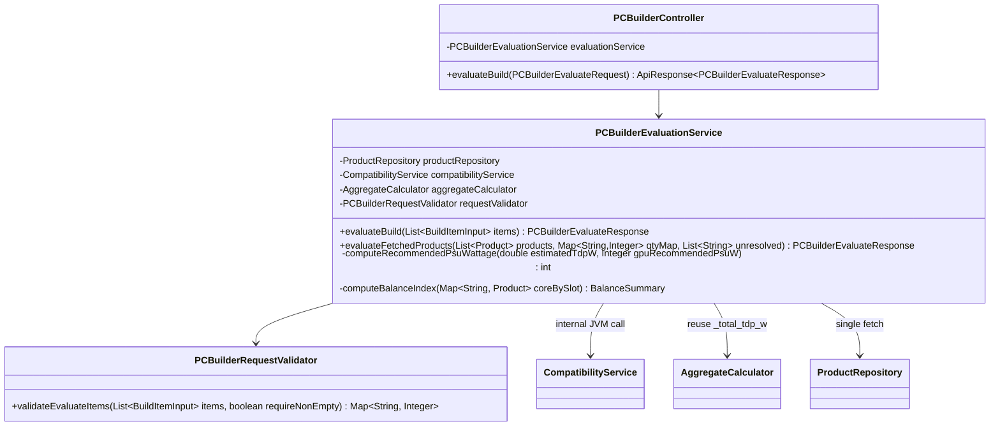
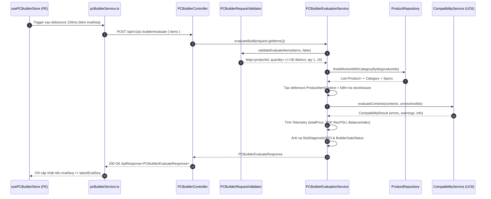

# SUB-DD `7.5.2`: Đánh giá Tương thích Real-time & Tính Telemetry Cấu hình

> **Agent Context Card (Đọc nhanh phạm vi trước khi code)**
> * **Parent DD:** [dd-uc2-pc-builder.md](../dd-uc2-pc-builder.md) *(xem Mục 2 Shared Contracts cho DTO & ErrorCode)*
> * **WBS:** `7.5.2` — Xử lý gọi Rule Engine để check tương thích khi thêm món mới
> * **Owned Files:** `backend/.../pcbuilder/controller/PCBuilderController.java` *(chỉ thêm `/evaluate`; skeleton do Coordinator tạo ở `Wave 0`)*, `service/PCBuilderEvaluationService.java`, `validator/PCBuilderRequestValidator.java`, `model/BuilderSlotCode.java`, `model/SlotStatusLevel.java`, `dto/request/BuildItemInput.java`, `PCBuilderEvaluateRequest.java`, `dto/response/PCBuilderEvaluateResponse.java`, `BuildTelemetryDTO.java`, `SlotDiagnosticDTO.java`, `StockIssueDTO.java`, `frontend/src/services/pcBuilderService.ts`
> * **Shared / Read-only Dependencies:** `CompatibilityService.evaluateContexts(...)` & `AggregateCalculator` (`UC6`), `ProductRepository.findAllActiveWithCategoryByIds(...)` (`UC5`), `ErrorCode` (`BUILDER_*` do Coordinator thêm ở `Wave 0`), `BuilderGateStatus` (enum tạo ở `Wave 0`), `builder.types.ts` (append-only type của 7.5.2 — Master DD §3.1)
> * **Test Target:** `PCBuilderEvaluationServiceTest.java` (`TC-UC2-05` $\rightarrow$ `TC-UC2-10`)

---

## 1. Mục tiêu & Phạm vi (`WBS 7.5.2`)

Chức năng `7.5.2` là cầu nối hiệu năng cao giữa giao diện **PC Builder** và **Hardware Rule Engine (`UC6`)**. Thay vì để Frontend phải tự cộng giá, tự ước lượng TDP hay gọi nhiều API rời rạc, `PCBuilderEvaluationService` thực hiện **1 lần truy vấn DB duy nhất** (`findAllActiveWithCategoryByIds`) và chạy toàn bộ các tác vụ trong cùng tiến trình JVM (`< 15ms` P99):
1. Kiểm tra biên & làm sạch input (`PCBuilderRequestValidator`).
2. Gọi `CompatibilityService.evaluateContexts(...)` (`UC6`, `< 2ms`) để lấy `errors`, `warnings`, `info`, `unresolved_product_ids`.
3. Tính toán `BuildTelemetryDTO`: Tổng giá chuẩn từ DB, Tổng TDP ước tính, Công suất PSU khuyến nghị, % tải PSU đang chọn và **Chỉ số Cân bằng Cấu hình (`balance_index`)**.
4. Ánh xạ các vi phạm thành `slot_statuses` cho từng trong 8 slot cốt lõi và xác định `gate_status` (`7.5.4`).

---

## 2. Sơ đồ Lớp & Tuần tự Cục bộ

### 2.1. Class Diagram


### 2.2. Sequence Diagram: Luồng Đánh giá Real-time Khi Thay đổi Cấu hình


---

## 3. Thiết kế Logic & Thuật toán Nội bộ

### 3.1. Chuẩn hóa & Kiểm tra Biên (`PCBuilderRequestValidator`)
* Nếu `items == null` hoặc rỗng:
  * Với `/evaluate`: hợp lệ, trả về response rỗng (`is_compatible = true`, `total_price = 0`, `estimated_tdp_w = 0`, `gate_status = BLOCKED_EMPTY`, tất cả 8 slot trạng thái `EMPTY`).
  * Với `/add-to-cart` (`requireNonEmpty = true`): ném `BusinessException(ErrorCode.BUILDER_EMPTY_CONFIG)` (`400`).
* Gom nhóm trùng `product_id` (trim chuỗi, bỏ qua null/blank), cộng dồn `quantity` dùng `long` và kiểm tra ngưỡng bảo vệ UC6:
  * Số `product_id` phân biệt `> 30` $\rightarrow$ `ErrorCode.RULE_CHECK_TOO_MANY_PRODUCTS` (`400`).
  * `quantity <= 0` hoặc `> 16` $\rightarrow$ `ErrorCode.RULE_CHECK_QUANTITY_EXCEEDED` (`400`).
  * Nếu `slot_code` được gửi kèm và thuộc slot `SINGLE` (`CPU`, `MOTHERBOARD`, `GPU`, `PSU`, `CASE`, `CPU_COOLER`) nhưng có `> 1` item hoặc `quantity > 1` $\rightarrow$ ném `ErrorCode.BUILDER_SLOT_CAPACITY_EXCEEDED` (`400`).

### 3.2. Tính Telemetry Cấu hình (`BuildTelemetryDTO`)
1. **Tổng chi phí (`total_price`):** $\sum_{p \in \text{foundProducts}} \text{p.price} \times \text{qty}(p)$, tính bằng `long` chống tràn số, luôn lấy giá trực tiếp từ DB.
2. **Tổng TDP & Công suất Nguồn Khuyến nghị:**
   * Nếu chưa chọn linh kiện cốt lõi nào $\rightarrow$ `estimated_tdp_w = 0` (vẫn tính `total_price`, `stock_issues` và `gate_status` cho các slot tùy chọn như `SSD_SATA` nếu có).
   * Ngược lại, gọi `aggregateCalculator.calculateAggregates(contexts)` lấy khóa `"_SYSTEM:_total_tdp_w"` (đã gồm `50W` overhead hệ thống, tự động loại trừ `PSU`, `CPU_COOLER` và cộng `tdp_w * quantity` của `SSD_SATA` khớp với `evaluateBuildOffline`). **Rule 9 (`M.2 Slot Count`)** chỉ kiểm tra `SSD_M2`, không đếm `SSD_SATA`.
   * Tính công suất PSU khuyến nghị (`recommended_psu_w`):
     $$\text{headroomW} = \lceil (\text{estimated\_tdp\_w} \times 1.35) / 50 \rceil \times 50$$
     $$\text{recommended\_psu\_w} = \max(450,\ \text{headroomW},\ \text{gpu.recommended\_psu\_w nếu có})$$
   * Nếu đã chọn `PSU` có `rated_wattage_w > 0`:
     $$\text{psu\_load\_percent} = \text{round}\left(\frac{\text{estimated\_tdp\_w}}{\text{rated\_wattage\_w}} \times 100,\ 1\right)$$
3. **Chỉ số Cân bằng Cấu hình (`balance_index` $0..100$):**
   * Tính hoàn toàn trong RAM dựa trên `benchmark_score` ($0..100$) của linh kiện thực tế:
     * Nếu có cả `CPU` và `GPU` với `benchmark_score > 0`:
       $$\text{diff} = |\text{cpu.benchmarkScore} - \text{gpu.benchmarkScore}|$$
       $$\text{pairBalance} = \max(0,\ 100 - 1.2 \times \text{diff})$$
       Cộng/trừ theo độ hoàn thiện slot (`selectedCoreSlots / 8.0 * 20` điểm, tối đa `100`).
     * Nếu chỉ có `CPU` (chưa chọn `GPU`): lấy `min(100, round(cpu.benchmarkScore * 0.75 + selectedCoreSlots * 3))`.
     * Phân loại `balance_label`: $\ge 80 \rightarrow$ `"CÂN BẰNG TỐT"`, $60..79 \rightarrow$ `"KHÁ TỐT"`, $< 60 \rightarrow$ `"CÓ ĐIỂM NGHẼN"`.
4. **Ánh xạ `slot_statuses` cho 8 Slot:**
   * Khởi tạo 8 slot mặc định là `EMPTY` (hoặc `COMPATIBLE` nếu slot có ít nhất 1 sản phẩm).
   * Duyệt qua từng `ViolationDetail` trong `errors` $\rightarrow$ `warnings` $\rightarrow$ `info`: xác định slot từ `source_product.category_code` và `target_product.category_code`, tăng bộ đếm `error_count` / `warning_count` / `info_count`, ghi `rule_id`, và nâng mức trạng thái theo độ ưu tiên: `ERROR > WARNING > INFO > COMPATIBLE`.

### 3.3. Chống Race Condition ở Frontend (`pcBuilderService.ts`)
* Khi người dùng chọn/xóa liên tiếp nhiều linh kiện, `usePCBuilderStore` dùng debounce `150ms`, đồng thời lưu `latestEvalSeq` tăng đơn điệu (và `AbortController` hủy request HTTP cũ). Phản hồi đến muộn có `seq < latestEvalSeq` bị loại bỏ, tuyệt đối không ghi đè trạng thái mới nhất.
* Nếu Backend gặp lỗi mạng (Local Dev không bật server), `pcBuilderService.ts` tính fallback cục bộ từ `MOCK_PRODUCTS` (tự đối chiếu 10 luật chuẩn từ `V2__seed_rules.sql`) để giữ UI chạy mượt.

---

## 4. Đặc tả REST API (`POST /api/v1/pc-builder/evaluate`)

* **Xác thực:** Public (`permitAll`).

### Request Body
```json
{
  "items": [
    { "product_id": "e0000001-0000-0000-0000-000000000002", "quantity": 1, "slot_code": "CPU" },
    { "product_id": "e0000001-0000-0000-0000-000000000007", "quantity": 1, "slot_code": "MOTHERBOARD" }
  ]
}
```

### Response Body (`200 OK`)
```json
{
  "success": true,
  "status_code": 200,
  "message": "Đánh giá cấu hình PC thành công",
  "data": {
    "compatibility": {
      "is_compatible": false,
      "errors": [
        {
          "rule_id": "r0000001-0000-0000-0000-000000000001",
          "rule_name": "CPU-Motherboard Socket Match",
          "severity": "ERROR",
          "message": "CPU socket LGA1700 không tương thích với Mainboard (hỗ trợ: AM5).",
          "source_product": { "id": "e0000001-0000-0000-0000-000000000002", "name": "Intel Core i7-14700K", "category_code": "CPU" },
          "target_product": { "id": "e0000001-0000-0000-0000-000000000007", "name": "ASUS ROG Crosshair X670E", "category_code": "MOTHERBOARD" }
        }
      ],
      "warnings": [],
      "info": [],
      "unresolved_product_ids": []
    },
    "telemetry": {
      "total_price": 21380000,
      "estimated_tdp_w": 175.0,
      "recommended_psu_w": 450,
      "selected_psu_wattage_w": null,
      "psu_load_percent": null,
      "balance_index": 76,
      "balance_label": "KHÁ TỐT",
      "selected_core_slots": 2,
      "total_core_slots": 8,
      "evaluation_time_ms": 1.85
    },
    "slot_statuses": {
      "CPU": { "slot_code": "CPU", "status": "ERROR", "error_count": 1, "warning_count": 0, "info_count": 0, "violation_rule_ids": ["r0000001-0000-0000-0000-000000000001"] },
      "MOTHERBOARD": { "slot_code": "MOTHERBOARD", "status": "ERROR", "error_count": 1, "warning_count": 0, "info_count": 0, "violation_rule_ids": ["r0000001-0000-0000-0000-000000000001"] }
    },
    "gate_status": "BLOCKED_COMPATIBILITY_ERROR",
    "stock_issues": [],
    "missing_recommended_slots": ["RAM", "SSD_M2", "PSU", "CASE"]
  },
  "timestamp": "2026-11-13T23:56:00"
}
```

---

## 5. Thiết kế Cơ sở Dữ liệu & Hiệu năng

* **Không thay đổi DDL.** Không giữ `@Transactional` trong quá trình tính toán Rule Engine (chỉ mở kết nối ngắn trong `findAllActiveWithCategoryByIds` rồi giải phóng ngay trước khi gọi `CompatibilityService.evaluateContexts`).

---

## 6. Kịch bản Kiểm thử (`TC-UC2-05` $\rightarrow$ `TC-UC2-10`)

| Mã Test | Cấp độ | Kịch bản kiểm thử | Đầu vào | Kết quả kỳ vọng |
| :--- | :---: | :--- | :--- | :--- |
| **`TC-UC2-05`** | Unit (`BE`) | Đánh giá cấu hình trống | `items = []` | `is_compatible = true`, `total_price = 0`, `estimated_tdp_w = 0`, `gate_status = BLOCKED_EMPTY`. |
| **`TC-UC2-06`** | Unit (`BE`) | Phát hiện xung đột socket & gán `slot_statuses` | CPU `LGA1700` + Mainboard `AM5` | `errors` có 1 lỗi; `slot_statuses[CPU].status = ERROR` và `slot_statuses[MOTHERBOARD].status = ERROR`. |
| **`TC-UC2-07`** | Unit (`BE`) | Tính TDP, `recommended_psu_w` & `psu_load_percent` | CPU `125W` + GPU `220W` + Cooler `250W` + PSU `650W` | `estimated_tdp_w = 395W` (không cộng Cooler), `recommended_psu_w = 550W`, `psu_load_percent = 60.8`. |
| **`TC-UC2-08`** | Unit (`BE`) | Chặn cấu hình vượt biên `MAX_DISTINCT_PRODUCTS` | 31 `product_id` khác nhau | Ném `BusinessException(RULE_CHECK_TOO_MANY_PRODUCTS)`. |
| **`TC-UC2-09`** | Unit (`BE`) | Chặn chọn quá số lượng trên slot `SINGLE` | `slot_code = "CPU"`, `quantity = 2` | Ném `BusinessException(BUILDER_SLOT_CAPACITY_EXCEEDED)`. |
| **`TC-UC2-10`** | Unit (`FE`) | Sequence guard chống stale response | Gửi Eval #1 (chậm) rồi Eval #2 (nhanh) | Store giữ kết quả của Eval #2, bỏ qua Eval #1 khi trả về sau. |
| **`TC-UC2-32`** | Unit (`BE`/`FE`) | Đánh giá `SSD_SATA` không làm sai lệch `Rule 9` & `8 core slots` | Mainboard `1 khe M.2` + `1 SSD_M2` + `3 SSD_SATA` (`tdp_w = 2`) | Không kích hoạt `Rule 9` warning, `total_core_slots = 8`, `slot_statuses` giữ 8 khe cốt lõi, `total_price` & `estimated_tdp_w` cộng đủ cả 3 ổ SATA. |
