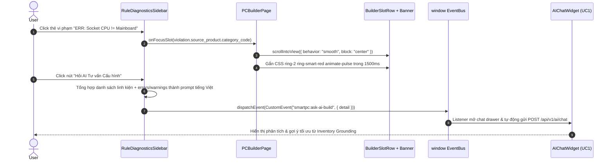

# SUB-DD `7.5.3`: Hiển thị Thông báo Mức độ & Telemetry Sidebar (`Diagnostics UI`)

> **Agent Context Card (Đọc nhanh phạm vi trước khi code)**
> * **Parent DD:** [dd-uc2-pc-builder.md](../dd-uc2-pc-builder.md) *(xem Mục 2 Shared Contracts cho DTO, Enum & Header Policy)*
> * **WBS:** `7.5.3` — Hiển thị thông báo màu sắc (`ERROR`/`WARNING`/`INFO`) trên từng slot & Sidebar chẩn đoán
> * **Owned Files:** `frontend/src/features/pc-builder/components/BuilderTelemetryBar.tsx`, `RuleDiagnosticsSidebar.tsx`, `SlotViolationBanner.tsx`, `frontend/src/features/ai-chat/components/AIChatWidget.tsx` *(chỉ thêm listener CustomEvent `smartpc:ask-ai-build`)*; mount 3 component vào `PCBuilderPage.tsx` theo Write Lock của Wave *(Master DD §3.1)*
> * **Shared / Read-only Dependencies:** `PCBuilderEvaluateResponse`, `BuildTelemetryDTO`, `SlotDiagnosticDTO`, `SlotStatusLevel`, `ViolationDetail` (`Master DD §2.5` & `7.5.2`); `usePCBuilderStore` (`7.5.1`); `POST /api/v1/ai/chat` (`UC1` - [dd-uc1-ai-chat.md](../dd-uc1-ai-chat.md)); bảng màu Tailwind `smart-navy`, `smart-blue`, `smart-cyan`, `smart-red`, `smart-bg` (`tailwind.config.js`)
> * **Test Target:** `BuilderTelemetryBar.test.tsx`, `RuleDiagnosticsSidebar.test.tsx` (`TC-UC2-11` $\rightarrow$ `TC-UC2-14`)

---

## 1. Mục tiêu & Phạm vi (`WBS 7.5.3`)

Chức năng `7.5.3` chuyển hóa dữ liệu đánh giá thô (`PCBuilderEvaluateResponse`) từ Backend thành giao diện phản hồi trực quan tức thì trên nền **Sáng chuyên nghiệp (Bright White / Slate `#F8F9FA`)** đồng bộ với bố cục `docs/screens/screen4.png`:
1. **Dải KPI 4 thẻ (`BuilderTelemetryBar`):** Hiển thị Tổng chi phí chuẩn server, Công suất tiêu thụ ước tính (`TDP`) & % tải PSU, Trạng thái tổng thể của Rule Engine kèm độ trễ `evaluation_time_ms`, và Chỉ số Cân bằng Cấu hình (`Balance Index`).
2. **Cảnh báo Inline trên từng Slot (`SlotViolationBanner`):** Tô viền theo mức độ nghiêm trọng (`ERROR`, `WARNING`, `INFO`, `COMPATIBLE`) và gắn đúng danh sách vi phạm liên quan ngay bên dưới hàng linh kiện, tạo điểm neo cho `QuickFixPanel` (`7.5.5`).
3. **Sidebar Chẩn đoán Cố định (`RuleDiagnosticsSidebar`):** Gom nhóm và sắp xếp mọi thông báo theo thứ tự ưu tiên `ERROR` $\rightarrow$ `WARNING` $\rightarrow$ `INFO`, hỗ trợ **Click-to-Scroll** cuộn tới đúng khe linh kiện gây xung đột và mở hộp thoại **AI Advisor (`UC1`)** với ngữ cảnh cấu hình hiện tại.

---

## 2. Sơ đồ Lớp & Tuần tự Cục bộ

### 2.1. Component & Event Relationship Diagram
```mermaid
classDiagram
    class PCBuilderPage {
        -Map~String, HTMLElement~ slotRowRefs
        -String highlightedSlotCode
        +handleFocusSlot(String slotCode) void
    }

    class BuilderTelemetryBar {
        +BuildTelemetryDTO telemetry
        +CompatibilityResult compatibility
        +boolean isEvaluating
        +boolean isOfflineMock
        -getPsuLoadTone(Double loadPercent) ToneToken
    }

    class SlotViolationBanner {
        +BuilderSlotCode slotCode
        +SlotDiagnosticDTO diagnostic
        +ViolationDetail[] violations
        +ReactNode quickFixSlot
    }

    class RuleDiagnosticsSidebar {
        +PCBuilderEvaluateResponse evaluation
        +BuildItemInput[] currentItems
        +onFocusSlot(String slotCode) void
        -dispatchAskAIBuild() void
    }

    class AIChatWidget {
        -boolean isOpen
        +handleAskAIBuildEvent(CustomEvent e) void
        +sendMessage(String prompt) Promise~void~
    }

    PCBuilderPage *-- BuilderTelemetryBar
    PCBuilderPage *-- RuleDiagnosticsSidebar
    PCBuilderPage ..> SlotViolationBanner : per slot diagnostic
    RuleDiagnosticsSidebar ..> AIChatWidget : window event smartpc:ask-ai-build
```

### 2.2. Sequence Diagram: Tương tác Click-to-Scroll & Hỏi AI Cấu hình


---

## 3. Thiết kế Logic & Quy tắc Hiển thị Nội bộ

### 3.1. Ánh xạ Màu sắc & Mức độ Nghiêm trọng (`SlotStatusLevel` Design Tokens)
Tuân thủ thiết kế nền sáng của SmartPC (`tailwind.config.js`), các thành phần tuyệt đối không dùng nền tối HUD; toàn bộ trạng thái dùng hệ viền + badge độ tương phản cao WCAG AA:

| Mức độ (`SlotStatusLevel`) | Thứ tự ưu tiên | Màu chủ đạo | Class Tailwind Viền & Nền Banner | Biểu tượng (`lucide-react`) | Nhãn trạng thái tiếng Việt |
| :--- | :---: | :--- | :--- | :--- | :--- |
| `ERROR` | `1` (Cao nhất) | Đỏ (`#E30019`) | `border-smart-red bg-red-50/90 text-red-900` | `XCircle` | `Xung đột nghiêm trọng` |
| `WARNING` | `2` | Hổ phách (`#D97706`) | `border-amber-400 bg-amber-50/90 text-amber-900` | `AlertTriangle` | `Cần lưu ý / Rủi ro` |
| `INFO` | `3` | Xanh dương (`#1A44D8`) | `border-blue-300 bg-blue-50/80 text-slate-800` | `Info` | `Thông tin kỹ thuật` |
| `COMPATIBLE` | `4` | Ngọc lục bảo (`#059669`) | `border-emerald-300 bg-emerald-50/50 text-emerald-800` | `CheckCircle2` | `Tương thích chuẩn` |
| `EMPTY` | `5` | Xám nhạt (`#CBD5E1`) | `border-dashed border-slate-300 bg-white` | `PlusCircle` | `Chưa chọn linh kiện` |

### 3.2. Logic Hiển thị 4 Thẻ KPI (`BuilderTelemetryBar.tsx`)
1. **Thẻ 1 — Tổng chi phí (`total_price`):** Định dạng `Intl.NumberFormat('vi-VN')` + `đ`. Hiển thị phụ đề tiến độ `${selected_core_slots}/${total_core_slots} linh kiện cốt lõi`. Khi `isEvaluating = true`, hiện spinner nhỏ cạnh giá nhưng giữ nguyên số cũ tránh giật layout (CLS = 0).
2. **Thẻ 2 — Công suất & Nguồn (`estimated_tdp_w` & `psu_load_percent`):**
   * Hiển thị `${estimated_tdp_w} W` (đã gồm `50W` base system overhead từ `AggregateCalculator` `UC6` và tự động không cộng `tdp_w` của `CPU_COOLER`).
   * Nếu chưa chọn `PSU` (`selected_psu_wattage_w == null`): hiển thị badge xám `"PSU khuyến nghị: ≥ ${recommended_psu_w}W"`.
   * Nếu đã chọn `PSU`: vẽ thanh tiến trình `psu_load_percent%` với ngưỡng màu: `<= 75%` (`bg-emerald-500`), `75% < x <= 90%` (`bg-amber-500`), `> 90%` (`bg-smart-red`).
3. **Thẻ 3 — Trạng thái Rule Engine (`CompatibilityResult`):**
   * Hiển thị pill tổng hợp: số lỗi đỏ (`errors.length`), số cảnh báo vàng (`warnings.length`), hoặc pill xanh `"100% Tương thích"`.
   * Góc phải thẻ gắn huy hiệu hiệu năng `${evaluation_time_ms}ms` (hoặc pill cam `"Chế độ Offline Mock"` nếu `isOfflineMock = true` giúp dev dễ nhận biết).
4. **Thẻ 4 — Chỉ số Cân bằng (`balance_index` & `balance_label`):**
   * Vẽ đồng hồ/thanh điểm `0–100` (`bg-smart-blue` / `bg-amber-500`). Gắn tooltip giải thích: *"Ước lượng nhanh dựa trên benchmark_score của CPU/GPU; phân tích nghẽn cổ chai theo từng tựa game sẽ có tại PC Profile (UC3)"*.

### 3.3. Quy tắc Ánh xạ Vi phạm lên Slot & Sidebar
* **Ánh xạ vào `SlotViolationBanner`:** Đọc `slot_statuses[slotCode].violation_rule_ids`; tìm các phần tử tương ứng trong `compatibility.errors` và `compatibility.warnings`. Mỗi khe chỉ hiển thị tối đa **2 thông báo inline**, kèm nút `"Xem tất cả trong Sidebar"` nếu nhiều hơn để giữ chiều cao bảng khe gọn gàng.
* **Hộp Khuyên Dùng PSU Riêng (`PSU Advisory Box`):** Tương tự `screen4.png`, nếu bất kỳ `warning` hoặc `error` nào chạm tới `PSU` (`category_code == "PSU"` hoặc `rule_id` chứa rule PSU), `RuleDiagnosticsSidebar` hiển thị thêm một hộp nổi màu vàng nhạt ở đầu danh sách warning với thông điệp nhấn mạnh mức công suất khuyến nghị (`≥ ${recommended_psu_w}W`).
* **Chiến lược Click-to-Scroll (`resolveTargetSlot`):** Khi người dùng click một thẻ vi phạm ở Sidebar:
  1. Ưu tiên `violation.target_product?.category_code` nếu slot đó nằm trong 8 core slots; nếu không, lấy `violation.source_product?.category_code`.
  2. Nếu vi phạm cấp hệ thống không gắn sản phẩm cụ thể (`source_product == null`), mặc định cuộn tới khe `PSU` (nếu thiếu công suất) hoặc đầu danh sách `#builder-slot-list`.
  3. Kích hoạt timer `highlightedSlotCode = slotCode`, tự động xóa sau `1500ms` (dọn timer trong `useEffect` cleanup).
* **Null-Safety & Fallback:** Nếu `evaluation` là `null` (khởi tạo ban đầu khi giỏ rỗng), hiển thị trạng thái rỗng hướng dẫn chọn `CPU` hoặc `MOTHERBOARD` trước; tuyệt đối không crash khi `source_product` hoặc `target_product` bị `null`.

---

## 4. Đặc tả Contract Giao diện & Sự kiện (`UI & Event Spec`)

> Chức năng `7.5.3` tiêu thụ trực tiếp `PCBuilderEvaluateResponse` (`7.5.2`) và gửi prompt sang `POST /api/v1/ai/chat` (`UC1`). Không tạo thêm endpoint REST mới.

### 4.1. Hợp đồng CustomEvent `smartpc:ask-ai-build`
```typescript
// Định nghĩa trong frontend/src/features/pc-builder/types/builder.types.ts
export interface AskAIBuildEventDetail {
  /** Prompt tiếng Việt đã tóm tắt các linh kiện đang chọn, TDP và danh sách lỗi/cảnh báo */
  prompt: string;
  /** Danh sách product_id đang chọn để AI Chat có thêm ngữ cảnh nếu cần */
  build_items: Array<{ slot_code: string; product_id: string; name: string; quantity: number }>;
  /** Cờ yêu cầu AIChatWidget mở drawer ngay và gửi prompt tự động */
  auto_send: boolean;
}
```

### 4.2. Mẫu Prompt Sinh tự động cho AI Advisor (`buildAIPrompt`)
```text
Tôi đang lắp cấu hình PC trên SmartPC Builder:
- CPU: Intel Core i9-14900K (SL: 1)
- MOTHERBOARD: MSI MAG B650 TOMAHAWK WIFI (SL: 1)
- Tổng công suất ước tính: 485W | Ngân sách hiện tại: 25.400.000đ
Hệ thống Rule Engine báo 1 LỖI (Socket CPU LGA1700 không khớp AM5) và 0 CẢNH BÁO.
Hãy tư vấn giúp tôi nên đổi linh kiện nào tối ưu nhất về hiệu năng/giá?
```

### 4.3. Props Contract các Component Chính
| Component | Props Bắt buộc | Hành vi chính |
| :--- | :--- | :--- |
| `BuilderTelemetryBar` | `{ telemetry, compatibility, isEvaluating, isOfflineMock }` | Render 4 KPI card responsive (`grid-cols-1 sm:grid-cols-2 xl:grid-cols-4`) |
| `SlotViolationBanner` | `{ slotCode, diagnostic, errors, warnings, renderQuickFix? }` | Render thông báo inline nếu `diagnostic.status` là `ERROR`/`WARNING`/`INFO` |
| `RuleDiagnosticsSidebar` | `{ evaluation, selectedItems, onFocusSlot }` | Sticky (`lg:sticky lg:top-28`), gom nhóm lỗi, render nút `Hỏi AI Tư vấn` |

---

## 5. Thiết kế Cơ sở Dữ liệu & Cấu hình

* **Thay đổi DDL / SQL:** Không có (tất cả dữ liệu đánh giá đến từ `PCBuilderEvaluateResponse` trong bộ nhớ).
* **Tài nguyên CSS / Tailwind (`frontend/tailwind.config.js`):** Tái sử dụng nguyên vẹn các token màu đã khai báo (`smart-navy: #1A2332`, `smart-blue: #1A44D8`, `smart-cyan: #00BCD4`, `smart-red: #E30019`, `smart-bg: #F8F9FA`) kết hợp bảng màu chuẩn của Tailwind (`amber-*`, `emerald-*`, `slate-*`). Không cần chỉnh sửa `tailwind.config.js`.

---

## 6. Kịch bản Kiểm thử (`Test Cases & Scenarios`)

| Mã Test Case | Đối tượng kiểm thử | Điều kiện đầu vào | Kết quả kỳ vọng |
| :--- | :--- | :--- | :--- |
| `TC-UC2-11` | `BuilderTelemetryBar` | `estimated_tdp_w = 620`, `selected_psu_wattage_w = 650`, `psu_load_percent = 95.4`, `evaluation_time_ms = 2` | Hiển thị `620 W`, thanh tải PSU màu đỏ (`>90%`), badge độ trễ `2ms`, tổng giá định dạng VND chuẩn |
| `TC-UC2-12` | `RuleDiagnosticsSidebar` & `SlotViolationBanner` | Payload có `1 ERROR` (CPU-Mainboard), `1 WARNING` (PSU thấp), `1 INFO` (RAM XMP) | Sidebar xếp đúng thứ tự `ERROR` $\rightarrow$ `WARNING` $\rightarrow$ `INFO`; hiện hộp vàng khuyến nghị PSU; `SlotViolationBanner` của `CPU`/`MOTHERBOARD` hiển thị viền đỏ |
| `TC-UC2-13` | Click-to-Scroll Sync | Click vào thẻ `WARNING` có `target_product.category_code = "PSU"` trong Sidebar | Callback `onFocusSlot("PSU")` được gọi, hàng `PSU` chạy `scrollIntoView` và nhận class highlight trong `1500ms` |
| `TC-UC2-14` | AI Advisor CustomEvent Hook | Click `"Hỏi AI Tư vấn Cấu hình"` khi đang chọn ít nhất 1 linh kiện | `window` phát sự kiện `smartpc:ask-ai-build` đúng schema; `AIChatWidget` mở cửa sổ chat và gọi `aiChatService.sendMessage(prompt)` |
