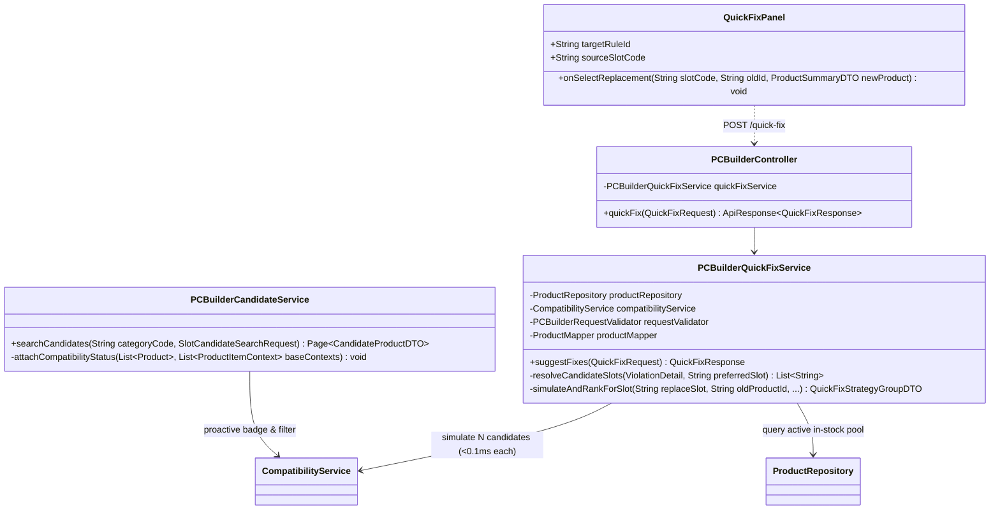
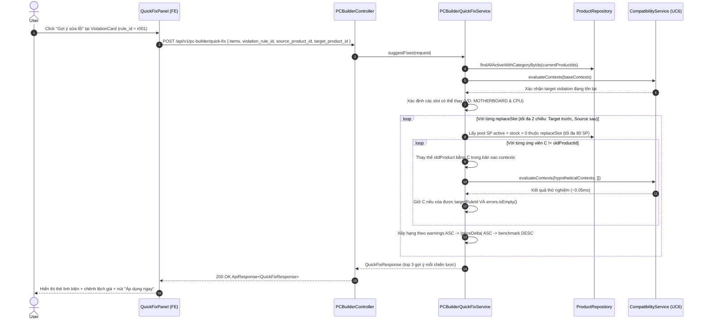

# SUB-DD `7.5.5`: Gợi ý Linh kiện Thay thế Tương thích (`Quick Fix & Pre-check`)

> **Agent Context Card (Đọc nhanh phạm vi trước khi code)**
> * **Parent DD:** [dd-uc2-pc-builder.md](../dd-uc2-pc-builder.md) *(xem Mục 2 Shared Contracts cho DTO, SLA & Zero-Code Policy)*
> * **WBS:** `7.5.5` — Xây dựng tính năng gợi ý linh kiện thay thế tương thích (`Quick Fix Suggestions`)
> * **Owned Files:** `backend/.../pcbuilder/service/PCBuilderQuickFixService.java`, `dto/request/QuickFixRequest.java`, `dto/response/QuickFixResponse.java`, `dto/response/QuickFixStrategyGroupDTO.java`, `QuickFixOptionDTO.java`, hàm pre-check tương thích trong `PCBuilderCandidateService.java` *(mở rộng 7.5.1)*, endpoint `quickFix(...)` trong `PCBuilderController.java`, `frontend/src/features/pc-builder/components/QuickFixPanel.tsx` *(gắn vào `SlotViolationBanner.renderQuickFix` ở `Final Wave` — Master DD §3.1)*
> * **Shared / Read-only Dependencies:** `CompatibilityService.evaluateContexts(...)` & `CompatibilityResult` (`UC6`); `ProductRepository` & `ProductMapper` (`UC5`); `PCBuilderEvaluationService` & `PCBuilderRequestValidator` (`7.5.2`); `ErrorCode.BUILDER_INVALID_SLOT` (`Master DD §2.3`); `usePCBuilderStore` (`7.5.1`)
> * **Test Target:** `PCBuilderQuickFixServiceTest.java`, `QuickFixPanel.test.tsx` (`TC-UC2-20` $\rightarrow$ `TC-UC2-24`)

---

## 1. Mục tiêu & Phạm vi (`WBS 7.5.5`)

Chức năng `7.5.5` giúp người dùng khắc phục ngay lập tức xung đột phần cứng bằng **1 cú click (`Áp dụng ngay`)** mà **tuyệt đối không hardcode bất kỳ logic phần cứng nào** (Zero-Code Rule Sync):
1. **Reactive Quick Fix (`POST /api/v1/pc-builder/quick-fix`):** Khi cấu hình có `ERROR` (hoặc `WARNING` nghiêm trọng như thiếu công suất PSU), người dùng bấm `"Gợi ý sửa lỗi"` trên khe hoặc banner xung đột. Backend tự động chạy **mô phỏng phản thực tế (Counterfactual Simulation)** trên `CompatibilityService` (`UC6`) để tìm ra các linh kiện thay thế xóa sạch lỗi đang gặp mà không đẻ thêm lỗi mới.
2. **Proactive Candidate Pre-check (`7.5.1` + `7.5.5`):** Mở rộng `PCBuilderCandidateService` (`POST /api/v1/pc-builder/slots/{categoryCode}/candidates`) khi cờ `evaluate_compatibility = true`, gắn sẵn badge `COMPATIBLE` / `WARNING` / `ERROR` lên từng ứng viên trong `ComponentPickerModal` và hỗ trợ lọc `compatible_only = true`.

---

## 2. Sơ đồ Lớp & Tuần tự Cục bộ

### 2.1. Class Diagram


### 2.2. Sequence Diagram: Thuật toán Mô phỏng Counterfactual Quick Fix


---

## 3. Thiết kế Logic & Thuật toán Mô phỏng Nội bộ

### 3.1. Chiến lược Xác định Slot Thay thế (`resolveCandidateSlots`)
Tất cả thông tin đều rút trực tiếp từ `ViolationDetail` do `UC6` trả về, không rẽ nhánh `if (ruleName.equals(...))`:
1. Nếu người dùng truyền tường minh `preferred_replace_slot` hợp lệ: ưu tiên xử lý khe đó đầu tiên.
2. Nếu vi phạm liên quan 2 sản phẩm (`target_product` và `source_product` khác danh mục): trả về danh sách `[target_product.category_code, source_product.category_code]` để người dùng có cả 2 phương án (VD: *"Đổi Mainboard khớp CPU hiện tại"* hoặc *"Đổi CPU khớp Mainboard hiện tại"*).
3. Nếu vi phạm chỉ gắn `source_product` (VD: luật tổng công suất PSU `_total_tdp_w <= rated_wattage_w` gắn trên `PSU`): chỉ tìm ứng viên thay thế cho `source_product.category_code` (`PSU`).
4. Nếu vi phạm cấp cấu hình không gắn `source_product`/`target_product` (`null`): trả về rỗng kèm thông báo hướng dẫn người dùng bổ sung linh kiện còn thiếu.

### 3.2. Bộ lọc Chấp nhận & Hàm Xếp hạng Ứng viên (`simulateAndRankForSlot`)
Với mỗi khe thay thế `replaceSlot`, giả sử sản phẩm hiện tại là `oldProduct` (có giá `oldPrice`, số lượng `qty`):
1. **Truy vấn Pool Giới hạn (`Bounded Candidate Pool`):** Chỉ lấy sản phẩm thỏa `is_active = true`, `deleted_at IS NULL`, `stock_quantity >= qty`, `id != oldProduct.id`, thuộc danh mục `replaceSlot`, giới hạn tối đa **`MAX_QUICKFIX_POOL = 80`** phần tử (ưu tiên gần tầm giá `oldProduct.price` nhất hoặc theo `benchmark_score DESC` khi `price = 0`). Với `80` ứng viên $\times 2$ chiều $= 160$ lần gọi `evaluateContexts` trên Caffeine Cache, tổng CPU time chỉ mất $\approx 8\text{ms}$.
2. **Điều kiện Chấp nhận (Acceptance Predicate):** Một ứng viên `C` được giữ lại **chỉ khi** kết quả mô phỏng `simResult = compatibilityService.evaluateContexts(hypothetical, List.of())` thỏa cả 2 điều kiện:
   * `targetRuleId` **không còn xuất hiện** trong cả `simResult.errors()` lẫn `simResult.warnings()`.
   * `simResult.errors().isEmpty()` là **`true`** (bắt buộc không làm phát sinh lỗi tương thích mới sang RAM, Case hay Cooler!).
3. **Thứ tự Xếp hạng (`Comparator`):**
   1. `simResult.warnings().size() ASC` — ưu tiên cấu hình sạch `0` cảnh báo lên đầu.
   2. `Math.abs(candidate.getPrice().subtract(oldPrice)) ASC` — ưu tiên đổi linh kiện có mức giá sát ngân sách ban đầu nhất.
   3. `candidate.getBenchmarkScore() DESC` — nếu đồng hạng, ưu tiên linh kiện mạnh hơn.
   4. Cắt lấy tối đa `limit` phần tử (mặc định `3`, tối đa `5`).

### 3.3. Tích hợp Pre-check Tương thích trong `PCBuilderCandidateService` (`7.5.1`)
Khi người dùng mở `ComponentPickerModal` với cờ `evaluate_compatibility = true`:
* **Chế độ Thường (`compatible_only = false`):** Truy vấn phân trang SQL qua `ProductSpecifications.of(...)` bình thường (`size <= 24`). Chỉ chạy `evaluateContexts(...)` trên đúng tối đa **24 sản phẩm thuộc trang hiện tại** để gắn `compat_status` (`COMPATIBLE` / `WARNING` / `ERROR`) và `compat_reasons` (tối đa 2 lý do đầu tiên). Chi phí $< 2\text{ms}$.
* **Chế độ Lọc Ẩn lỗi (`compatible_only = true`):** Lấy tối đa **`MAX_PREFILTER_SCAN = 120`** sản phẩm khớp điều kiện lọc giá/hãng/keyword từ DB (`stock_quantity > 0`), mô phỏng `evaluateContexts(...)` để loại bỏ các phần tử có `errors` không rỗng, sau đó cắt lát (`subList`) trả về `Page<CandidateProductDTO>` chuẩn kích thước trang.
* **An toàn Tham chiếu (Null-safety):** Nếu danh sách `current_items` rỗng (người dùng đang chọn linh kiện đầu tiên), bỏ qua vòng lặp mô phỏng và gán mặc định `compat_status = "COMPATIBLE"`.

---

## 4. Đặc tả Contract REST API (`POST /api/v1/pc-builder/quick-fix`)

| Thuộc tính | Giá trị |
| :--- | :--- |
| **Endpoint & Method** | `POST /api/v1/pc-builder/quick-fix` |
| **Phân quyền** | `Public` (`permitAll`) |
| **Mã lỗi có thể trả** | `400 BUILDER_INVALID_SLOT`, `400 RULE_CHECK_TOO_MANY_PRODUCTS`, `400 VALIDATION_ERROR` |

### Mẫu Request & Response JSON
```json
// Request Body: QuickFixRequest
{
  "current_items": [
    { "product_id": "cpu-i9-14900k", "quantity": 1, "slot_code": "CPU" },
    { "product_id": "mb-b650-am5", "quantity": 1, "slot_code": "MOTHERBOARD" }
  ],
  "violation_rule_id": "r0000001-0000-0000-0000-000000000001",
  "source_product_id": "cpu-i9-14900k",
  "target_product_id": "mb-b650-am5",
  "preferred_replace_slot": null,
  "limit_per_strategy": 3
}
```
```json
// Response Body: 200 OK ApiResponse<QuickFixResponse>
{
  "success": true,
  "data": {
    "violation_rule_id": "r0000001-0000-0000-0000-000000000001",
    "strategies": [
      {
        "replace_slot": "MOTHERBOARD",
        "current_product_id": "mb-b650-am5",
        "current_product_name": "MSI MAG B650 TOMAHAWK WIFI",
        "strategy_label": "Đổi Mainboard tương thích với CPU Intel Core i9-14900K",
        "options": [
          {
            "product": {
              "product_id": "mb-z790-aorus",
              "name": "GIGABYTE Z790 AORUS ELITE AX",
              "brand": "GIGABYTE",
              "category_code": "MOTHERBOARD",
              "price": 6990000,
              "in_stock": true,
              "benchmark_score": 88,
              "key_specs": { "socket_type": "LGA1700", "memory_type": "DDR5" }
            },
            "price_delta": 500000,
            "resulting_status": "COMPATIBLE",
            "remaining_warnings_count": 0,
            "cleared_violation_count": 1
          }
        ]
      },
      {
        "replace_slot": "CPU",
        "current_product_id": "cpu-i9-14900k",
        "current_product_name": "Intel Core i9-14900K",
        "strategy_label": "Đổi CPU tương thích với Mainboard MSI MAG B650 TOMAHAWK WIFI",
        "options": [ /* ... */ ]
      }
    ],
    "evaluation_time_ms": 6
  }
}
```

---

## 5. Thiết kế Cơ sở Dữ liệu & Cấu hình

* **Thay đổi DDL / SQL:** Không có. Việc truy vấn pool sản phẩm `is_active = true`, `deleted_at IS NULL`, `category_id = ?`, `price` tận dụng trực tiếp chỉ mục có sẵn trên bảng `products` (`V1__init_schema.sql`) và bộ nhớ đệm tập luật `PreIndexedRuleCache` (`Caffeine`) của `UC6`.

---

## 6. Kịch bản Kiểm thử (`Test Cases & Scenarios`)

| Mã Test Case | Phạm vi kiểm thử | Đầu vào mô phỏng | Kết quả kỳ vọng |
| :--- | :--- | :--- | :--- |
| `TC-UC2-20` | Gợi ý đổi 2 chiều (CPU vs Mainboard) | Cấu hình `i9-14900K` (`LGA1700`) + `B650` (`AM5`) xung đột rule socket `r0000001-...0001` | Trả về đủ 2 chiến lược (`MOTHERBOARD` socket `LGA1700` và `CPU` socket `AM5`); mọi gợi ý đều đạt `0 errors` |
| `TC-UC2-21` | Chống phát sinh lỗi dây chuyền | Chọn `CPU LGA1700` + `Mainboard AM5` + `RAM DDR5`; có 1 Mainboard `LGA1700` chỉ hỗ trợ `DDR4` trong DB | Thuật toán loại bỏ Mainboard `LGA1700/DDR4` vì sau mô phỏng phát sinh lỗi `RAM DDR5` mới |
| `TC-UC2-22` | Thứ tự Xếp hạng Gợi ý | Hai ứng viên cùng xóa được lỗi: `A` có `1 WARNING` (+100kđ) và `B` có `0 WARNING` (+500kđ) | `B` xếp trước `A` nhờ ưu tiên `remaining_warnings_count ASC` trước `ABS(price_delta) ASC` |
| `TC-UC2-23` | Candidate Picker `compatible_only` | Đã chọn Case `max_gpu_length_mm = 320`, gọi `/slots/GPU/candidates` với `compatible_only = true` | GPU dài `357mm` bị lọc bỏ khỏi danh sách; các GPU `<= 320mm` được giữ lại kèm `compat_status = "COMPATIBLE"` |
| `TC-UC2-24` | `QuickFixPanel` Áp dụng 1-click | User bấm `"Áp dụng ngay"` trên thẻ gợi ý Mainboard `Z790` trong `QuickFixPanel` | `usePCBuilderStore.replaceSlotProduct` cập nhật Mainboard, kích hoạt `evaluate`, banner đỏ biến mất |
