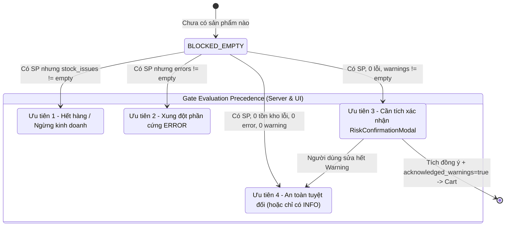
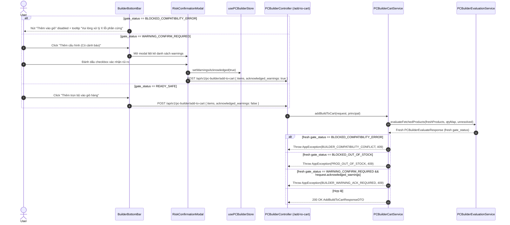

# SUB-DD `7.5.4`: Thuật toán Gatekeeper Chặn `ERROR` & Xác nhận Rủi ro `WARNING`

> **Agent Context Card (Đọc nhanh phạm vi trước khi code)**
> * **Parent DD:** [dd-uc2-pc-builder.md](../dd-uc2-pc-builder.md) *(xem Mục 2 Shared Contracts cho `BuilderGateStatus`, `ErrorCode` & Auth Boundary)*
> * **WBS:** `7.5.4` — Cài đặt thuật toán chặn nút Thêm vào giỏ nếu có lỗi (`ERROR`) hoặc cảnh báo xác nhận rủi ro (`WARNING`)
> * **Owned Files:** hàm `determineGateStatus(...)` trong `PCBuilderEvaluationService.java`, tạo mới `PCBuilderCartService.java` *(phần gate server-side)*, `frontend/src/features/pc-builder/components/RiskConfirmationModal.tsx`, `BuilderBottomBar.tsx`; mở rộng theo Write Lock của Wave: mount `BuilderBottomBar` trong `PCBuilderPage.tsx`, `Auto-Reset Ack` trong `usePCBuilderStore.ts` *(Master DD §3.1)*. Enum `BuilderGateStatus.java` do Coordinator tạo ở `Wave 0` (chỉ đọc).
> * **Shared / Read-only Dependencies:** `CompatibilityResult` (`UC6`); `ErrorCode.BUILDER_EMPTY_CONFIG`, `BUILDER_COMPATIBILITY_CONFLICT`, `BUILDER_WARNING_ACK_REQUIRED`, `PROD_OUT_OF_STOCK` (`Master DD §2.3`); `PCBuilderEvaluateResponse`, `StockIssueDTO` (`7.5.2`); `usePCBuilderStore` (`7.5.1`)
> * **Test Target:** `PCBuilderGatekeeperTest.java`, `RiskConfirmationModal.test.tsx` (`TC-UC2-15` $\rightarrow$ `TC-UC2-19`)

---

## 1. Mục tiêu & Phạm vi (`WBS 7.5.4`)

Chức năng `7.5.4` đóng vai trò **cổng kiểm soát an toàn (Risk Gatekeeper)** bắt buộc trước khi cấu hình PC Builder được chuyển sang giỏ hàng. Khác với giỏ hàng độc lập `UC4` (vốn cho phép mua lẻ linh kiện với `force_bypass`), **PC Builder (`UC2`) tuyệt đối CẤM thêm bộ máy có lỗi phần cứng (`ERROR`) vào giỏ** để bảo vệ người dùng khỏi việc đặt nhầm linh kiện không thể lắp ráp:
1. **Chặn cứng (`Hard Block`):** Cấu hình rỗng, có sản phẩm hết hàng/ngừng bán, hoặc còn bất kỳ vi phạm mức `ERROR` nào (`!errors.isEmpty()`) $\rightarrow$ khóa nút đặt hàng trên UI và trả HTTP `409 Conflict` ở Backend.
2. **Xác nhận Rủi ro Có kiểm soát (`Soft Gate`):** Khi chỉ có cảnh báo mức `WARNING` (VD: PSU sát ngưỡng hoặc cần cập nhật BIOS), UI bật `RiskConfirmationModal` yêu cầu người dùng tích chọn đồng ý rủi ro trước khi mở khóa nút xác nhận gửi lên Backend (`acknowledged_warnings = true`).
3. **Tin cậy Cấp Server (Server-Authoritative):** Backend không bao giờ tin cờ `gate_status` từ Frontend mà luôn tính lại trạng thái từ dữ liệu DB + `CompatibilityService` mới nhất trong `/add-to-cart`.

---

## 2. Sơ đồ Trạng thái & Tuần tự Cục bộ

### 2.1. State Diagram: Máy Trạng thái 5 Bước của `BuilderGateStatus`


### 2.2. Sequence Diagram: Kiểm tra Gatekeeper Hai Tầng (UI + Server)


---

## 3. Thiết kế Logic & Thuật toán Gatekeeper Nội bộ

### 3.1. Thuật toán Quyết định `BuilderGateStatus` (Thứ tự Ưu tiên Tuyệt đối)
Hàm `determineGateStatus(...)` trong `PCBuilderEvaluationService.java` phải giữ đúng thứ tự kiểm tra ngắn mạch dưới đây để Backend và Frontend luôn cho ra cùng 1 kết quả:

1. **Bước 1 (`BLOCKED_EMPTY`):** Nếu `totalSelectedQuantity == 0` (hoặc danh sách `items` rỗng) $\rightarrow$ trả về `BLOCKED_EMPTY`.
2. **Bước 2 (`BLOCKED_OUT_OF_STOCK`):** Nếu `!stockIssues.isEmpty()` (bao gồm `stock_quantity < requested_qty` hoặc sản phẩm có trong `unresolved_product_ids`) $\rightarrow$ trả về `BLOCKED_OUT_OF_STOCK`. *(Lưu ý: trên `/add-to-cart`, trường hợp sản phẩm ngừng kinh doanh/không tồn tại sẽ ném riêng `BUILDER_PRODUCT_UNAVAILABLE` trước khi vào bước này).*
3. **Bước 3 (`BLOCKED_COMPATIBILITY_ERROR`):** Nếu `!compatibility.errors().isEmpty()` $\rightarrow$ trả về `BLOCKED_COMPATIBILITY_ERROR`.
4. **Bước 4 (`WARNING_CONFIRM_REQUIRED`):** Nếu `!compatibility.warnings().isEmpty()` $\rightarrow$ trả về `WARNING_CONFIRM_REQUIRED`.
5. **Bước 5 (`READY_SAFE`):** Trường hợp còn lại (chỉ có `COMPATIBLE` hoặc `INFO`) $\rightarrow$ trả về `READY_SAFE`.

### 3.2. Bảng Chính sách Thực thi tại `BuilderBottomBar` & `PCBuilderCartService`

| `BuilderGateStatus` | Trạng thái nút CTA trên `BuilderBottomBar` | Màu nút / Nhãn hiển thị | Phản ứng Backend `/add-to-cart` |
| :--- | :--- | :--- | :--- |
| `BLOCKED_EMPTY` | `disabled` | Xám (`"Chọn linh kiện để bắt đầu"`) | `400 BUILDER_EMPTY_CONFIG` |
| `BLOCKED_OUT_OF_STOCK` | `disabled` | Đỏ (`"Có linh kiện vượt tồn kho"`) | `409 PROD_OUT_OF_STOCK` |
| `BLOCKED_COMPATIBILITY_ERROR` | `disabled` | Đỏ (`"Cần sửa N xung đột phần cứng"`) | `409 BUILDER_COMPATIBILITY_CONFLICT` |
| `WARNING_CONFIRM_REQUIRED` | `enabled` (Mở modal) | Hổ phách (`"Xem cảnh báo & Thêm vào giỏ"`) | Nếu `acknowledged_warnings=false`: `409 BUILDER_WARNING_ACK_REQUIRED`; nếu `true`: Cho phép (`200 OK`) |
| `READY_SAFE` | `enabled` (Gửi thẳng) | Xanh `bg-smart-blue` (`"Thêm trọn bộ vào giỏ hàng"`) | Cho phép (`200 OK`) |

### 3.3. Quy tắc An toàn & Invalidation State trên Frontend
* **Tự động hủy xác nhận khi sửa cấu hình (`Auto-Reset Ack`):** Trong `usePCBuilderStore`, bất kỳ hành động nào thay đổi danh sách linh kiện (`selectProduct`, `removeItem`, `updateQuantity`, `replaceSlotProduct`, `clearBuild`, `loadFromResolved`) **BẮT BUỘC** phải đặt lại `warningsAcknowledged = false`. Tránh trường hợp người dùng đã tick đồng ý ở cấu hình cũ rồi đổi sang cấu hình khác phát sinh cảnh báo mới nặng hơn mà bỏ qua modal.
* **Khóa xác nhận trong `RiskConfirmationModal`:** Nút `"Xác nhận & Thêm vào giỏ hàng"` trong modal mặc định bị `disabled` cho tới khi checkbox bắt buộc được người dùng chủ động tích (`isChecked === true`). Mỗi mở modal mới phải reset `isChecked = false`.
* **Lỗi 409 Đồng bộ lại State:** Nếu Backend trả về `409 BUILDER_COMPATIBILITY_CONFLICT` hoặc `409 PROD_OUT_OF_STOCK` do dữ liệu tồn kho/luật vừa thay đổi phía server trong lúc người dùng chuẩn bị bấm mua, Frontend tự động kích hoạt `evaluateBuild()` ngay lập tức để cập nhật lại UI theo thực tế mới nhất.

---

## 4. Đặc tả Contract Lỗi & Modal (`API Error Spec`)

### 4.1. Mẫu Response `409 Conflict` Khi Vi phạm Gatekeeper
```json
// Case A: Cố tình gọi /add-to-cart khi còn lỗi ERROR (dù gửi acknowledged_warnings: true)
{
  "success": false,
  "error_code": "BUILDER_COMPATIBILITY_CONFLICT",
  "message": "Cấu hình đang có xung đột phần cứng mức ERROR. Vui lòng khắc phục trước khi thêm vào giỏ",
  "data": {
    "gate_status": "BLOCKED_COMPATIBILITY_ERROR",
    "error_count": 1,
    "errors": [
      {
        "rule_id": "r0000001-0000-0000-0000-000000000001",
        "rule_name": "Socket CPU phải khớp Mainboard",
        "severity": "ERROR",
        "message": "CPU socket LGA1700 không tương thích Mainboard AM5"
      }
    ]
  },
  "timestamp": "2026-11-14T10:15:30Z"
}
```
```json
// Case B: Gọi /add-to-cart khi có WARNING nhưng acknowledged_warnings = false
{
  "success": false,
  "error_code": "BUILDER_WARNING_ACK_REQUIRED",
  "message": "Cấu hình có cảnh báo kỹ thuật (WARNING). Vui lòng xác nhận rủi ro để tiếp tục",
  "data": {
    "gate_status": "WARNING_CONFIRM_REQUIRED",
    "warning_count": 1
  },
  "timestamp": "2026-11-14T10:16:05Z"
}
```

### 4.2. Props Contract của `RiskConfirmationModal.tsx` & `BuilderBottomBar.tsx`
```typescript
export interface RiskConfirmationModalProps {
  isOpen: boolean;
  warnings: ViolationDetail[];
  totalPrice: number;
  isSubmitting: boolean;
  onConfirm: () => Promise<void>;
  onCancel: () => void;
}
```

---

## 5. Thiết kế Cơ sở Dữ liệu & Cấu hình (`ErrorCode`)

* **Thay đổi DDL / SQL:** Không có.
* **Cập nhật Enum `com.smartpc.common.exception.ErrorCode`** (do Coordinator tổng hợp một lần cho toàn UC2 theo `Master DD §2.3`):
  * `BUILDER_EMPTY_CONFIG(HttpStatus.BAD_REQUEST, ...)`
  * `BUILDER_INVALID_SLOT(HttpStatus.BAD_REQUEST, ...)`
  * `BUILDER_SLOT_CAPACITY_EXCEEDED(HttpStatus.BAD_REQUEST, ...)`
  * `BUILDER_COMPATIBILITY_CONFLICT(HttpStatus.CONFLICT, ...)`
  * `BUILDER_WARNING_ACK_REQUIRED(HttpStatus.CONFLICT, ...)`
  * `BUILDER_PRODUCT_UNAVAILABLE(HttpStatus.CONFLICT, ...)`

---

## 6. Kịch bản Kiểm thử (`Test Cases & Scenarios`)

| Mã Test Case | Phạm vi kiểm thử | Đầu vào / Thao tác | Kết quả kỳ vọng |
| :--- | :--- | :--- | :--- |
| `TC-UC2-15` | `determineGateStatus` Precedence | Cấu hình vừa có sản phẩm vượt tồn kho (`stock=0`), vừa có `1 ERROR`, vừa có `1 WARNING` | Gatekeeper trả về `BLOCKED_OUT_OF_STOCK` (ưu tiên cao hơn `BLOCKED_COMPATIBILITY_ERROR`) |
| `TC-UC2-16` | Hard Block `ERROR` phía Server | Gửi `POST /add-to-cart` với CPU LGA1700 + Mainboard AM5 kèm `acknowledged_warnings = true` | Từ chối bằng HTTP `409`, `error_code = BUILDER_COMPATIBILITY_CONFLICT`, không chạm DB `carts` |
| `TC-UC2-17` | Soft Gate `WARNING` thiếu Ack | Cấu hình có `1 WARNING` (`PSU` sát ngưỡng tải) + `0 ERROR`, gửi `acknowledged_warnings = false` | Backend trả HTTP `409`, `error_code = BUILDER_WARNING_ACK_REQUIRED`; UI không gọi thành công mà bật `RiskConfirmationModal` |
| `TC-UC2-18` | `WARNING` đã xác nhận Ack | Cùng cấu hình `TC-UC2-17`, người dùng tích checkbox trong `RiskConfirmationModal` và gửi `acknowledged_warnings = true` | Gatekeeper cho phép đi tiếp sang bước đóng gói giỏ hàng (`200 OK`) |
| `TC-UC2-19` | Auto-Reset `warningsAcknowledged` | Đã set `warningsAcknowledged = true`, sau đó gọi `selectProduct("GPU", newGpu)` trên store | `warningsAcknowledged` tự động reset về `false`; nếu vẫn còn warning, lần bấm mua tiếp theo mở lại modal |
