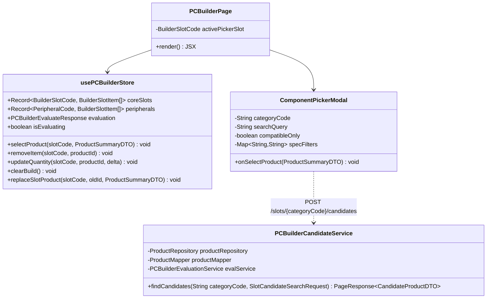
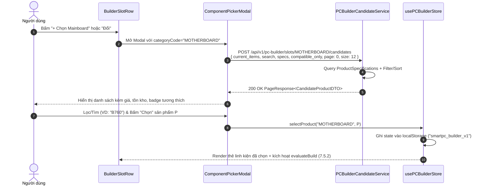

# SUB-DD `7.5.1`: Giao diện Chọn Linh kiện theo Slot & Quản lý Cấu hình

> **Agent Context Card (Đọc nhanh phạm vi trước khi code)**
> * **Parent DD:** [dd-uc2-pc-builder.md](../dd-uc2-pc-builder.md) *(chỉ đọc Mục 2 Shared Contracts khi cần)*
> * **WBS:** `7.5.1` — Giao diện chọn linh kiện theo slot (`CPU`, `MOTHERBOARD`, `RAM`, `GPU`, `SSD_M2`, `PSU`, `CASE`, `CPU_COOLER`)
> * **Owned Files:** `frontend/src/features/pc-builder/pages/PCBuilderPage.tsx`, `BuilderSlotList.tsx`, `BuilderSlotRow.tsx`, `ComponentPickerModal.tsx`, `constants/slotConfig.ts`, `types/builder.types.ts`, `frontend/src/stores/usePCBuilderStore.ts`, `backend/.../pcbuilder/service/PCBuilderCandidateService.java`, `dto/request/SlotCandidateSearchRequest.java`, `dto/response/CandidateProductDTO.java`
> * **Shared / Read-only Dependencies:** `ProductRepository`, `ProductSpecifications`, `ProductMapper`, `CategoryService`, `CategorySpecSchemaRegistry` (`UC5`); `ErrorCode.BUILDER_INVALID_SLOT` (`Master DD §2.3`); `PCBuilderController` (chỉ thêm endpoint `/slots/{categoryCode}/candidates`; skeleton tạo ở `Wave 0`); `builder.types.ts` (khung tạo ở `Wave 0`, 7.5.1 append type riêng); `App.tsx` (route `/builder` gắn ở `Final Wave` — Header rule `AGENTS.md` §4)
> * **Test Target:** `PCBuilderCandidateServiceTest.java`, `usePCBuilderStore.test.ts`, `ComponentPickerModal.sort.test.tsx`, `ComponentPickerModal.test.tsx` (`TC-UC2-01` $\rightarrow$ `TC-UC2-04`, `TC-UC2-31`, `TC-UC2-33`)

---

## 1. Mục tiêu & Phạm vi (`WBS 7.5.1`)

Chức năng `7.5.1` cung cấp toàn bộ không gian làm việc lắp ráp PC tại route `/builder` (`PCBuilderPage`) và kho lưu trữ trạng thái cấu hình cục bộ (`usePCBuilderStore` bền vững trên `localStorage`). Người dùng có thể chọn từng linh kiện theo **8 khe phần cứng cốt lõi** (`total_core_slots = 8`) cùng **khe lưu trữ nội bộ tùy chọn `SSD_SATA` (`Ổ cứng SSD SATA 2.5"`, `is_core = false`, hiển thị trực tiếp ngay dưới `SSD_M2` với nhãn `Tùy chọn`)** trong danh sách linh kiện chính, điều chỉnh số lượng cho các khe đa thanh/đa ổ (`RAM`, `SSD_M2`, `SSD_SATA`), mở modal tìm kiếm + lọc động theo thông số danh mục (`productService.getFacets` hỗ trợ cả `SSD_SATA`/`SSD_M2` khi offline) và mở rộng khối **3 thiết bị ngoại vi tùy chọn (`MONITOR`, `KEYBOARD`, `MOUSE`)** ở bên dưới.

### Ràng buộc Giao diện Header (`AGENTS.md` §4)
* Khi kích hoạt route `/builder` trong `App.tsx`, thanh điều hướng Tầng 2 **BẮT BUỘC** giữ nguyên đúng 5 mục và hiển thị nhãn **`PC Builder`** kèm icon `Wrench` (`text-smart-blue`); **KHÔNG** ghi `PC Builder (AI)` và **KHÔNG** gắn badge `PRO`.

---

## 2. Sơ đồ Lớp & Tuần tự Cục bộ

### 2.1. Class Diagram (Storefront & Candidate Backend)


### 2.2. Sequence Diagram: Mở Picker & Chọn Linh kiện Vào Slot


---

## 3. Thiết kế Chi tiết Logic & Quy tắc Slot

### 3.1. Cấu hình 8 Slot Cốt lõi + Khe Lưu trữ Nội bộ Tùy chọn (`SSD_SATA`) & 3 Khe Ngoại vi (`slotConfig.ts`)

| Thứ tự | `slotCode` | Tên hiển thị | `selectionMode` | `maxTotalQty` | `requiredHint` | `is_core` | Thuộc tính nổi bật hiển thị trên Row |
| :---: | :--- | :--- | :---: | :---: | :---: | :---: | :--- |
| 1 | `CPU` | Bộ vi xử lý (CPU) | `SINGLE` | `1` | Bắt buộc | `true` | `socket_type`, `core_count`, `tdp_w` |
| 2 | `MOTHERBOARD` | Bo mạch chủ (Mainboard) | `SINGLE` | `1` | Bắt buộc | `true` | `supported_sockets`, `form_factor`, `supported_memory_types` |
| 3 | `RAM` | Bộ nhớ trong (RAM) | `MULTI` | `16` | Bắt buộc | `true` | `memory_type`, `capacity_gb`, `bus_speed_mhz`, `modules_per_kit` |
| 4 | `GPU` | Card đồ họa (VGA) | `SINGLE` | `1` | Khuyến nghị | `true` | `vram_gb`, `length_mm`, `tdp_w` |
| 5 | `SSD_M2` | Ổ cứng SSD M.2 NVMe | `MULTI` | `16` | Bắt buộc | `true` | `interface_type`, `capacity_gb`, `read_speed_mbps` |
| 6 | `SSD_SATA` | Ổ cứng SSD SATA 2.5" | `MULTI` | `16` | Tùy chọn | `false` *(Internal Optional)* | `interface_type`, `capacity_gb`, `read_speed_mbps` |
| 7 | `PSU` | Nguồn máy tính (PSU) | `SINGLE` | `1` | Bắt buộc | `true` | `rated_wattage_w`, `efficiency_rating` |
| 8 | `CASE` | Vỏ máy tính (Case) | `SINGLE` | `1` | Bắt buộc | `true` | `supported_form_factors`, `max_gpu_length_mm` |
| 9 | `CPU_COOLER` | Tản nhiệt CPU | `SINGLE` | `1` | Tùy chọn | `true` | `cooler_type`, `supported_sockets`, `height_mm` |

* **Khe lưu trữ nội bộ tùy chọn (`SSD_SATA`):** Nằm trực tiếp trong `CORE_SLOT_CONFIGS` / `coreSlots.SSD_SATA` (`is_core = false`, `display_order: 6`), hiển thị ngay dưới `SSD_M2` trong danh sách linh kiện chính với badge `Tùy chọn` (tương tự `CPU_COOLER`). Vì `is_core = false`, `SSD_SATA` **không** tính vào tiến độ `selectedCoreCount / 8` (`TOTAL_CORE_SLOTS = 8`, `total_core_slots = 8`), và **không** tính vào **Rule 9 (`M.2 Slot Count`)**.
* **Nhóm thiết bị ngoại vi tùy chọn (`PERIPHERAL_SLOT_CONFIGS`, `is_core = false`, ngoài tiến độ `X/8`):** Gồm đúng 3 thiết bị ngoại vi `MONITOR` (`display_order: 10`), `KEYBOARD` (`11`), `MOUSE` (`12`). Khi mở rộng hoặc có sản phẩm ngoại vi được chọn, `BuilderSlotList` hiển thị khối `"Thiết bị ngoại vi tùy chọn (Màn hình, Bàn phím, Chuột)"` kèm phụ đề `"Không tính vào tiến độ X/8 linh kiện cốt lõi"`.

### 3.2. Quy tắc Thao tác State trong `usePCBuilderStore`
1. **Chọn sản phẩm (`selectProduct`):**
   * Nếu `slotConfig.selectionMode === 'SINGLE'`: Ghi đè mảng thành `[{ product, quantity: 1 }]`.
   * Nếu `selectionMode === 'MULTI'` (`RAM`, `SSD_M2`): Nếu `product_id` đã có trong slot $\rightarrow$ tăng `quantity` thêm `1` (nếu tổng slot $\le 16$); nếu chưa có $\rightarrow$ thêm mới `{ product, quantity: 1 }`. Giới hạn tổng số sản phẩm phân biệt toàn cấu hình $\le 30$ (khớp `CompatibilityService.MAX_DISTINCT_PRODUCTS`).
2. **Thay đổi số lượng (`updateQuantity`):** Chỉ cho phép trên slot `MULTI` (hoặc ngoại vi), kẹp giá trị trong `[1, 16]` và không vượt quá tổng `30` distinct items. Nếu giảm xuống `0` $\rightarrow$ tự động xóa item khỏi slot.
3. **Làm mới (`clearBuild`):** Xóa sạch `coreSlots`, `peripherals`, reset `evaluation = null` và xóa khóa trong `localStorage`. Khi `coreSlots` rỗng, UI hiển thị CTA gợi ý chọn CPU đầu tiên.
4. **Hỗ trợ Mock Fallback ở `ComponentPickerModal`:** Khi mất kết nối Backend, lọc trực tiếp từ `MOCK_PRODUCTS` trong `mockData.ts` theo `category_code`, `search`, `brand`, `min_price`, `max_price` và `specs`.
5. **Thanh công cụ Header cố định trên `ComponentPickerModal` (Không xê dịch bố cục):**
   * Phần đầu modal (`Modal Header` + thanh `Search & Filter Controls` gồm: ô tìm kiếm, dropdown `sort`, nút `Còn hàng`, nút `Chỉ hiện tương thích`, nút `Đặt lại`) dùng `shrink-0` cố định phía trên vùng danh sách cuộn (`flex-1 overflow-y-auto`).
   * Nút **`Đặt lại`** **luôn được render cố định trong DOM** (không ẩn/hiện điều kiện theo `hasActiveFilters`) với cùng kích thước, padding và viền (`border`, `whitespace-nowrap`, `shrink-0`) để mọi phần tử trên thanh không bị xê dịch khi thao tác lần đầu hoặc sau khi nhấn `Đặt lại`.
   * Điều kiện kích hoạt nút `Đặt lại`: `canReset = hasActiveFilters || sort !== 'newest'` (với `hasActiveFilters` gồm `searchInput.trim()`, `selectedBrands`, `priceRangeKey`, `selectedSpecs`, `inStockOnly`, `compatibleOnly`).
   * Khi `!canReset` (chưa chọn lọc/tìm kiếm/đổi sắp xếp): nút `Đặt lại` có thuộc tính `disabled`, hiển thị màu xám (`bg-slate-100 text-slate-400 border-slate-200 cursor-not-allowed`) và không thể bấm. Khi `canReset === true`: nút chuyển sang trạng thái kích hoạt (nền trắng, hover đỏ) và bấm để gọi `resetAllFilters()` đưa mọi bộ lọc và `sort = 'newest'`, `page = 0` về mặc định.

### 3.3. Bộ lọc & Quy tắc Validation của `PCBuilderCandidateService`
* Kiểm tra `categoryCode` thuộc 8 slot cốt lõi (`BuilderSlotCode.fromCode`), khe lưu trữ nội bộ tùy chọn (`BuilderSlotCode.isOptionalInternalSlot`: `SSD_SATA`) hoặc 3 thiết bị ngoại vi (`BuilderSlotCode.isKnownPeripheral`: `MONITOR`, `KEYBOARD`, `MOUSE`); nếu không $\rightarrow$ ném `BusinessException(ErrorCode.BUILDER_INVALID_SLOT)` (`400`).
* Kẹp phân trang `page >= 0`, `size` trong `[1, 48]` (mặc định `12`).
* Tái sử dụng `ProductFilterValidator.validate(criteria)` và `ProductSpecifications.of(criteria)` (`UC5`) để hỗ trợ đầy đủ `search`, `brand`, `min_price`, `max_price`, `specs[key]`, `sort` (chỉ gồm đúng 4 lựa chọn theo thứ tự: `newest`, `oldest`, `price_asc`, `price_desc` — mặc định `newest`; từ chối `benchmark_desc` hoặc giá trị khác với `400 PROD_INVALID_FILTER`).
* Khi `in_stock_only = true`, lọc bổ sung `stockQuantity > 0`.

---

## 4. Đặc tả REST API (`POST /api/v1/pc-builder/slots/{categoryCode}/candidates`)

* **Xác thực:** Public (`permitAll`).

### Request Body
```json
{
  "current_items": [
    { "product_id": "e0000001-0000-0000-0000-000000000001", "quantity": 1, "slot_code": "CPU" }
  ],
  "search": "B760",
  "brand": ["ASUS", "MSI"],
  "min_price": 2000000,
  "max_price": 8000000,
  "specs": { "form_factor": "ATX" },
  "compatible_only": false,
  "in_stock_only": true,
  "sort": "price_asc",
  "page": 0,
  "size": 12
}
```

### Response Body (`200 OK`)
```json
{
  "success": true,
  "status_code": 200,
  "message": "Lấy danh sách linh kiện ứng viên thành công",
  "data": {
    "content": [
      {
        "product": {
          "product_id": "e0000001-0000-0000-0000-000000000005",
          "name": "Bo mạch chủ ASUS ROG STRIX B760-A GAMING WIFI D4",
          "brand": "ASUS",
          "category_code": "MOTHERBOARD",
          "category_name": "Bo mạch chủ (Mainboard)",
          "image_url": "/images/products/e0000001-0000-0000-0000-000000000005.jpg",
          "price": 5490000,
          "in_stock": true,
          "benchmark_score": 82.0,
          "key_specs": { "supported_sockets": ["LGA1700"], "form_factor": "ATX" }
        },
        "compat_status": "COMPATIBLE",
        "compat_summary": "Tương thích với cấu hình hiện tại",
        "blocking_errors": [],
        "warnings": []
      }
    ],
    "page": 0,
    "size": 12,
    "total_elements": 4,
    "total_pages": 1,
    "last": true
  },
  "timestamp": "2026-11-13T23:55:00"
}
```

---

## 5. Thiết kế Cơ sở Dữ liệu & Indexing

* **Không thay đổi DDL:** Truy vấn ứng viên tái sử dụng các chỉ mục sẵn có của `V3__product_catalog.sql` (`idx_products_cat_price`, `idx_products_cat_brand`, `idx_products_v_socket`, `idx_products_v_form_factor`, `idx_products_v_memory`). Cấu hình nháp lưu ở `localStorage` phía client.

---

## 6. Kịch bản Kiểm thử (`TC-UC2-01` $\rightarrow$ `TC-UC2-04`, `TC-UC2-31`, `TC-UC2-33`)

| Mã Test | Cấp độ | Kịch bản kiểm thử | Đầu vào | Kết quả kỳ vọng |
| :--- | :---: | :--- | :--- | :--- |
| **`TC-UC2-01`** | Unit (`BE`) | Từ chối slot không hợp lệ | `categoryCode = "INVALID_PART"` | Ném `BusinessException(BUILDER_INVALID_SLOT)` (`400`). |
| **`TC-UC2-02`** | Unit (`BE`) | Lọc ứng viên theo từ khóa, thông số & chuẩn hóa sort | `categoryCode = "MOTHERBOARD"`, `search = "B760"`, `specs = {form_factor: "ATX"}`, `sort = "price_asc"`; gọi lại với `sort = "benchmark_desc"` | Chỉ trả sản phẩm active, chưa xóa mềm, tên chứa `"B760"`, `form_factor = "ATX"` và sort `price ASC, productId ASC`; `sort = "benchmark_desc"` ném `PROD_INVALID_FILTER` (`400`). |
| **`TC-UC2-03`** | Unit (`FE`) | Thao tác chọn slot đơn & đa thanh RAM | Chọn 2 CPU liên tiếp; thêm 2 lần cùng 1 kit RAM | CPU ghi đè giữ 1 item; RAM tăng `quantity = 2` (không vượt 16). |
| **`TC-UC2-04`** | Unit (`FE`) | Lưu bền vững trên `localStorage` | Chọn CPU + GPU, reload store | State `coreSlots` khôi phục chính xác từ `smartpc_builder_v1`. |
| **`TC-UC2-31`** | Unit (`BE`/`FE`) | Hỗ trợ slot lưu trữ nội bộ tùy chọn `SSD_SATA` (`2.5"`) | BE `findCandidates("ssd_sata")`; FE chọn/cộng dồn `SSD_SATA` & migrate state `localStorage` cũ có `peripherals.SSD_SATA` | BE chấp nhận `SSD_SATA` qua `isOptionalInternalSlot` & `isValidBuilderSlotOrPeripheral` (đồng thời `isKnownPeripheral("SSD_SATA") == false`, `BuilderSlotCode.values().length == 8`); FE `isCoreSlotCode('SSD_SATA') === true`, lưu vào `coreSlots.SSD_SATA` (`1..16`), migrate `peripherals.SSD_SATA` cũ sang `coreSlots.SSD_SATA`, `BuilderSlotList` hiển thị `"Ổ cứng SSD SATA 2.5\""` ngay dưới `SSD_M2` trong danh sách chính và giữ tiến độ `X/8` (`TOTAL_CORE_SLOTS = 8`). |
| **`TC-UC2-33`** | Unit (`FE`) | Thanh công cụ `ComponentPickerModal` cố định & trạng thái nút `Đặt lại` | Mở `ComponentPickerModal` mặc định; sau đó bật `Còn hàng` / `Chỉ hiện tương thích` / đổi `sort` / nhập tìm kiếm rồi bấm `Đặt lại` | Nút `Đặt lại` luôn hiện diện ngay từ lúc mở modal ở trạng thái `disabled` màu xám (`bg-slate-100 text-slate-400 cursor-not-allowed`); khi có bộ lọc hoặc đổi `sort != newest` thì `Đặt lại` được bật (`enabled`); bấm `Đặt lại` đưa toàn bộ filter + `sort = newest` về mặc định và nút `Đặt lại` vẫn giữ nguyên trong DOM ở trạng thái `disabled` màu xám. |
