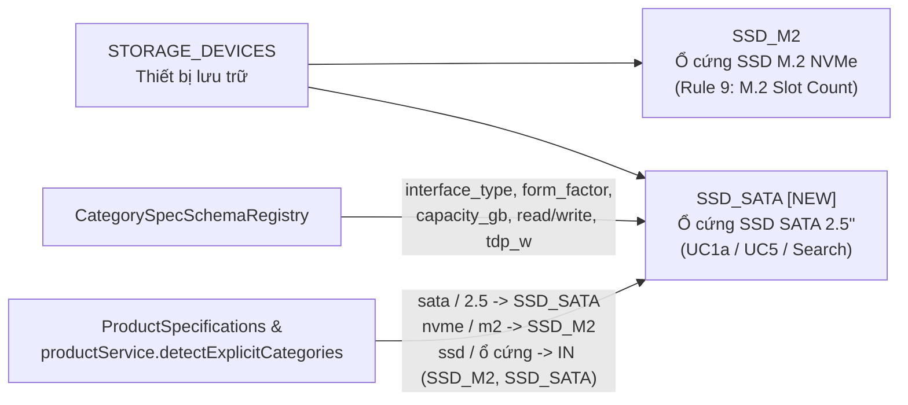
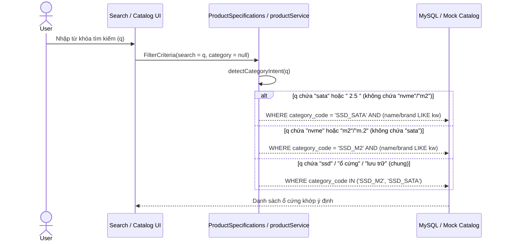

# TÀI LIỆU THIẾT KẾ CHI TIẾT CHỨC NĂNG (SUB-DD)
## UC5 - Bổ sung Danh mục & Sản phẩm Ổ cứng SSD SATA 2.5" (`SSD_SATA`) cho Máy tính Cá nhân

### Agent Context Card
* **Parent DD:** [dd-uc5-product-catalog.md](../dd-uc5-product-catalog.md) *(chỉ đọc khi cần đối chiếu Shared Contracts, ErrorCode hoặc Validation Rules dùng chung)*
* **WBS:** `7.2.7` *(Mở rộng Danh mục Thiết bị lưu trữ `STORAGE_DEVICES` theo Phương án PA1 — không gồm HDD)*
* **Owned Files:**
  * DB Migration: `backend/src/main/resources/db/migration/V12__add_ssd_sata_category_and_products.sql`
  * Backend: `CategorySpecSchemaRegistry.java`, `ProductSpecifications.java`
  * Backend Tests: `CategoryServiceTest.java`, `CategorySpecSchemaRegistryTest.java`, `SpecSchemaValidatorTest.java`, `ProductSeedEncodingTest.java`, `ProductSpecificationsTest.java`
  * Frontend: `types/index.ts`, `services/mockData.ts`, `services/productService.ts`, `services/aiChatService.ts`, `utils/productImageFallback.ts`, `features/product-catalog/components/CategoryHierarchyNav.tsx`, `features/product-catalog/components/ProductSpecsTable.tsx`, `App.tsx`, `public/images/products/*.svg`
  * Frontend Tests: `services/productService.test.ts`
* **Shared / Read-only Dependencies:** `SpecSchemaValidator.java`, `ProductFilterValidator.java`, `ProductService.java`, `CategoryService.java`, `ProductMapper.java`, `compat_rules` V2 Rule 9 (`M.2 Slot Count`). *(Mở rộng PC Builder cho `SSD_SATA` được đặc tả trong `dd-uc2-pc-builder.md` v1.2).*
* **Test Target:** `CategoryServiceTest` (`TC-CAT-01`), `CategorySpecSchemaRegistryTest` (`TC-PROD-29`), `SpecSchemaValidatorTest` (`TC-PROD-30`), `ProductSeedEncodingTest` (`TC-PROD-31`), `ProductSpecificationsTest` (`TC-PROD-32`), Vitest `productService.test.ts` (`TC-PROD-33`) & `App.header.test.tsx`.

---

## 1. Mục tiêu & Phạm vi Nghiệp vụ

### 1.1. Bối cảnh & Quyết định Kiến trúc (PA1 không gồm HDD)
Trước phiên bản `v1.7`, nhóm cấp 1 `STORAGE_DEVICES` (`Thiết bị lưu trữ`) chỉ có duy nhất một danh mục lá là `SSD_M2` (`Ổ cứng SSD M.2 NVMe`). Cách thiết kế đó khiến người dùng muốn mua **SSD SATA 2.5"** (dùng nâng cấp máy tính cá nhân, tối ưu chi phí/dung lượng, bổ sung kho lưu trữ thứ cấp ngoài khe M.2) không tìm thấy sản phẩm trong danh mục.

Thay vì gộp chung SATA vào `SSD_M2`, hệ thống áp dụng **Phương án 1 (PA1 — Không gồm HDD cho định hướng PC cá nhân)**:
1. Giữ nguyên `SSD_M2` độc lập để bảo toàn tính chính xác của **Rule 9 (`M.2 Slot Count`)** trong Rule Engine (`UC6`) và khe cắm chính trên PC Builder (`UC2`).
2. Bổ sung danh mục lá mới **`SSD_SATA`** (`Ổ cứng SSD SATA 2.5"`) trực thuộc nhóm **`STORAGE_DEVICES`** (`g0000001-0000-0000-0000-000000000002`).
3. Không bổ sung `HDD` do định hướng tập trung hoàn toàn vào bộ nhớ thể rắn cho máy tính cá nhân.

### 1.2. Ranh giới với PC Builder (`UC2`) & Rule Engine (`UC6`)
* `SSD_SATA` hoạt động đầy đủ trên **Product Catalog (`UC1a`)**, **Semantic/Keyword Search**, **AI Chat Tư vấn (`UC1`)**, **Admin Catalog & Vector Sync (`UC5`)**, **Giỏ hàng (`UC4`)** và **khe lưu trữ nội bộ tùy chọn trong PC Builder (`UC2`)**.
* Trên Backend (`UC2`), enum `BuilderSlotCode` giữ nguyên 8 khe cốt lõi (`CPU`, `MOTHERBOARD`, `RAM`, `GPU`, `SSD_M2`, `PSU`, `CASE`, `CPU_COOLER`) để bảo toàn `total_core_slots = 8` và `Rule 9 (M.2 Slot Count)` chỉ đếm `SSD_M2`; đồng thời đăng ký `SSD_SATA` vào tập `BuilderSlotCode.OPTIONAL_INTERNAL_CODES` (tách biệt hoàn toàn khỏi `PERIPHERAL_CODES` chỉ gồm `MONITOR`, `KEYBOARD`, `MOUSE`). Trên Frontend (`UC2`), `SSD_SATA` thuộc `CORE_SLOT_CONFIGS` (`coreSlots.SSD_SATA`, `is_core = false`, `required_hint = 'Tùy chọn'`) hiển thị ngay dưới `SSD_M2` trong danh sách linh kiện chính với đầy đủ `+ Builder`, lọc ứng viên, đánh giá giá/TDP/tồn kho, chia sẻ `?items=` và `Add All to Cart`.

---

## 2. Kiến trúc Cục bộ & Luồng Tìm kiếm (Diagrams)

### 2.1. Cấu trúc Phân cấp & Thành phần Tác động

### 2.2. Sequence Diagram — Nhận diện Ý định Tìm kiếm Ổ cứng

---

## 3. Thiết kế Schema Specs & Logic Nội bộ

### 3.1. Schema Thông số cho `SSD_SATA` (`CategorySpecSchemaRegistry`)

| Spec Key | Nhãn (`label`) | Kiểu (`FieldType`) | Bắt buộc (`required`) | Lọc (`filterable`) | Đơn vị / `allowedValues` |
| :--- | :--- | :--- | :---: | :---: | :--- |
| `interface_type` | Giao tiếp | `STRING` | Có | **Có** | `["SATA III 6Gb/s"]` |
| `form_factor` | Kích thước | `STRING` | Có | Không | `["2.5 inch"]` |
| `capacity_gb` | Dung lượng | `INTEGER` | Có | **Có** | Đơn vị `GB`, `minValue = 1.0` |
| `read_speed_mbps` | Tốc độ đọc | `INTEGER` | Không | Không | Đơn vị `MB/s`, `minValue = 1.0` |
| `write_speed_mbps` | Tốc độ ghi | `INTEGER` | Không | Không | Đơn vị `MB/s`, `minValue = 1.0` |
| `tdp_w` | Công suất tiêu thụ | `NUMBER` | Không | Không | Đơn vị `W`, `minValue = 0.0001` |

* **Lý do chọn khóa lọc (`filterable`):** `interface_type` và `capacity_gb` đồng nhất với `SSD_M2` (`CategorySpecSchemaRegistry`), giúp `ProductMapper.extractKeySpecs` và `DynamicSpecsFilterPanel` hiển thị bộ lọc dung lượng & chuẩn kết nối trực quan.
* **Độ phủ Dữ liệu Bộ lọc (Filter Coverage):** Mọi giá trị `capacity_gb` (`240`, `480`, `500`, `1000`, `2000`) và mọi hãng (`KINGSTON`, `WD`, `CRUCIAL`, `SAMSUNG`) trong tập seed đều có **$\ge 2$ sản phẩm** (tổng 12 sản phẩm), không sinh lựa chọn lọc rỗng hoặc chỉ có 1 kết quả.

### 3.2. Thuật toán Nhận diện Danh mục Tìm kiếm (`detectCategoryIntent`)
Thay thế biến đơn `String detectedCat` trong `ProductSpecifications` (Backend) và nhánh đơn `explicit.push('SSD_M2')` trong `productService.detectExplicitCategories` (Frontend) bằng danh sách `List<String>`:

1. **Chuẩn hóa chuỗi:** `raw = query.trim().toLowerCase()`.
2. **Nhận diện lưu trữ theo độ đặc hiệu:**
   * `hasNvme = raw` khớp `\b(nvme|m2|m\.2)\b`
   * `hasSata = raw` khớp `\bsata\b` hoặc `(?:^|\s)2\.5(?:\s|"|inch|$)` *(ràng buộc ranh giới trái-phải để `24.5 inch` của Màn hình không nhận nhầm là `SSD_SATA`)*
   * `hasGenericStorage = raw` khớp `\b(ssd|ổ cứng|ổ ssd|lưu trữ)\b`
3. **Ánh xạ kết quả:**
   * Chỉ `hasNvme` $\rightarrow$ `["SSD_M2"]`
   * Chỉ `hasSata` $\rightarrow$ `["SSD_SATA"]`
   * `hasGenericStorage` hoặc đồng thời cả 2 $\rightarrow$ `["SSD_M2", "SSD_SATA"]`
4. **Ràng buộc an toàn:** Nếu kết quả có 1 mã $\rightarrow$ `cb.equal(...)`; nếu $\ge 2$ mã $\rightarrow$ `cb.upper(...).in(detectedCats)`.

### 3.3. Cập nhật UI & Tài nguyên Hiển thị (Frontend)
* **`POPULAR_CATEGORIES` (`App.tsx`):** Giữ nguyên cấu trúc 3 tầng Header (`AGENTS.md` §4) và 5 liên kết nav Tầng 2 (`Sản phẩm`, `Danh mục linh kiện`, `PC Builder`, `PC Profile`, `Hỗ trợ kỹ thuật`). Tại Tầng 3 Storefront, đổi nhãn `'Ổ cứng SSD'` thành `{ label: 'SSD M.2 NVMe', code: 'SSD_M2' }` và bổ sung `{ label: 'SSD SATA 2.5"', code: 'SSD_SATA' }`.
* **Icon & Fallback Ảnh:**
  * `CategoryHierarchyNav.tsx`: ánh xạ `case 'SSD_SATA'` sang `<HardDrive className="w-4 h-4" />`.
  * `productImageFallback.ts`: ánh xạ `case 'SSD_SATA'` sang `/images/products/ssd-sata-fallback.svg`.
  * Tài nguyên ảnh nội bộ `/images/products/e0000001-0000-0000-0000-000000000086.svg`..`0097.svg` đảm bảo hiển thị ổn định trên Vite dev server và Docker Nginx không phụ thuộc CDN ngoài.
* **`ProductSpecsTable.tsx` & `aiChatService.ts`:** Bổ sung nhãn tiếng Việt cho `interface_type`, `form_factor`, `read_speed_mbps`, `write_speed_mbps` và cập nhật kịch bản tư vấn ổ cứng trong `aiChatService.ts` để giới thiệu song song cả SSD M.2 NVMe và SSD SATA 2.5".

---

## 4. Tác động REST API

Không thay đổi đường dẫn hay cấu trúc JSON hợp đồng hiện có; các endpoint hiện hành tự động hỗ trợ `category=SSD_SATA`:
* `GET /api/v1/categories/tree` $\rightarrow$ Nhóm `STORAGE_DEVICES` trả 2 node con: `SSD_M2` và `SSD_SATA` (`has_schema: true`).
* `GET /api/v1/categories/specs-schema?category_code=SSD_SATA` $\rightarrow$ Trả 6 `FieldDefinitionDTO` theo Bảng 3.1.
* `GET /api/v1/products?category=SSD_SATA&specs[capacity_gb]=500` $\rightarrow$ Lọc chính xác theo JSON specs & thương hiệu (`SAMSUNG`, `CRUCIAL`, `WD`, `KINGSTON`).
* `GET /api/v1/products/facets?category=SSD_SATA` $\rightarrow$ Trả facet `interface_type` (`SATA III 6Gb/s`), `capacity_gb` (`240`, `480`, `500`, `1000`, `2000` GB), brands và dải giá động (`Dưới 2 triệu`, `Từ 2 - 5 triệu`).

---

## 5. Thiết kế Cơ sở Dữ liệu & Seed Dữ liệu (`V12`)

**File Migration:** `backend/src/main/resources/db/migration/V12__add_ssd_sata_category_and_products.sql`

1. **Danh mục:**
   * Cập nhật `categories.description` của `STORAGE_DEVICES` (`g0000001-0000-0000-0000-000000000002`) thành `'Ổ cứng SSD M.2 NVMe & SSD SATA 2.5"'`.
   * Chèn idempotent (`INSERT ... ON DUPLICATE KEY UPDATE`) danh mục `SSD_SATA` (`c0000001-0000-0000-0000-000000000012`) với `parent_category_id = 'g0000001-0000-0000-0000-000000000002'`.
2. **Danh sách 12 Sản phẩm Seed (`e0000001-0000-0000-0000-000000000086` .. `0097`):**

| ID hậu tố | Tên sản phẩm | Hãng | Dung lượng (`GB`) | Giá (VND) | Tồn | Score |
| :--- | :--- | :--- | :---: | :---: | :---: | :---: |
| `0086` | SSD Kingston A400 240GB 2.5" SATA III | `KINGSTON` | 240 | 590.000 | 45 | 62.0 |
| `0087` | SSD WD Green 240GB 2.5" SATA III | `WD` | 240 | 570.000 | 40 | 63.0 |
| `0088` | SSD Kingston A400 480GB 2.5" SATA III | `KINGSTON` | 480 | 890.000 | 38 | 66.0 |
| `0089` | SSD Crucial BX500 480GB 2.5" SATA III | `CRUCIAL` | 480 | 850.000 | 36 | 68.0 |
| `0090` | SSD WD Blue SA510 500GB 2.5" SATA III | `WD` | 500 | 1.150.000 | 32 | 72.0 |
| `0091` | SSD Crucial MX500 500GB 2.5" SATA III | `CRUCIAL` | 500 | 1.290.000 | 30 | 76.0 |
| `0092` | SSD Samsung 870 EVO 500GB 2.5" SATA III | `SAMSUNG` | 500 | 1.490.000 | 28 | 80.0 |
| `0093` | SSD WD Blue SA510 1TB 2.5" SATA III | `WD` | 1000 | 1.950.000 | 24 | 75.0 |
| `0094` | SSD Crucial MX500 1TB 2.5" SATA III | `CRUCIAL` | 1000 | 2.190.000 | 22 | 79.0 |
| `0095` | SSD Samsung 870 EVO 1TB 2.5" SATA III | `SAMSUNG` | 1000 | 2.590.000 | 20 | 84.0 |
| `0096` | SSD Crucial BX500 2TB 2.5" SATA III | `CRUCIAL` | 2000 | 3.590.000 | 14 | 74.0 |
| `0097` | SSD Samsung 870 QVO 2TB 2.5" SATA III | `SAMSUNG` | 2000 | 4.290.000 | 12 | 78.0 |

*(Không cần thêm virtual column mới vì truy vấn lọc theo `category_id` và JSON spec trên tập sản phẩm nhỏ; `idx_products_cat_price` phục vụ tốt hiệu năng lọc cơ bản.)*

---

## 6. Kịch bản Kiểm thử (Test Cases)

| Mã Test Case | Loại | Kịch bản | Đầu vào | Kết quả kỳ vọng |
| :--- | :--- | :--- | :--- | :--- |
| **`TC-CAT-01`** | Unit | Dựng cây danh mục 16 node (4 nhóm, 12 lá) | `PC_CORE`(4), `STORAGE_DEVICES`(2: `SSD_M2`, `SSD_SATA`), `POWER_COOLING_CASE`(3), `PERIPHERALS`(3) | `STORAGE_DEVICES` có đúng 2 con (`hasSchema = true`); tổng 4 node gốc |
| **`TC-PROD-29`** | Unit | Schema `SSD_SATA` trong `CategorySpecSchemaRegistry` | `registry.getSchema("SSD_SATA")` | `hasCategory("SSD_SATA") == true`; có `interface_type` (`SATA III 6Gb/s`, filterable), `form_factor`, `capacity_gb` (filterable), `read_speed_mbps`, `write_speed_mbps`, `tdp_w` |
| **`TC-PROD-30`** | Unit | `SpecSchemaValidator` chuẩn hóa & chặn lỗi `SSD_SATA` | Specs hợp lệ chữ thường `"sata iii 6gb/s"`, `capacity_gb="500"` & specs sai `"IDE"` / thiếu `capacity_gb` | Bản hợp lệ chuẩn hóa đúng `Integer 500` và `"SATA III 6Gb/s"`; bản sai ném `PROD_INVALID_SPECS` |
| **`TC-PROD-31`** | Unit | UTF-8 & nội dung `V12` migration | Đọc `V12__add_ssd_sata_category_and_products.sql` | Chuỗi UTF-8 chuẩn tiếng Việt, không chứa `\uFFFD` hay `?\u00C0`, đủ 12 sản phẩm `0086..0097` và danh mục `SSD_SATA` |
| **`TC-PROD-32`** | Unit | Backend search intent 2 loại SSD | `"ssd"`, `"ổ cứng"`, `"ssd sata"`, `"ssd 2.5"`, `"màn hình 24.5"`, `"ssd nvme"` | `"ssd"`/`"ổ cứng"` $\rightarrow$ `["SSD_M2", "SSD_SATA"]`; `"ssd sata"`/`"ssd 2.5"` $\rightarrow$ `["SSD_SATA"]`; `"màn hình 24.5"` $\rightarrow$ `["MONITOR"]` (không dính `SSD_SATA`); `"ssd nvme"` $\rightarrow$ `["SSD_M2"]` |
| **`TC-PROD-33`** | Frontend Unit | Frontend `detectExplicitCategories` & mock data `SSD_SATA` | Query `"ổ cứng"`, `"ssd sata"`, `"24.5 inch"` & duyệt `MOCK_CATEGORY_TREE`/`MOCK_PRODUCTS` | Tách đúng `SSD_M2` vs `SSD_SATA` vs cả 2; `STORAGE_DEVICES` có `SSD_SATA`; `MOCK_PRODUCTS` có 12 SP `SSD_SATA` và mọi hãng/dung lượng $\ge 2$ SP |
