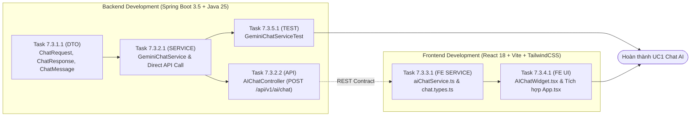

# KẾ HOẠCH TRIỂN KHAI (IMPLEMENTATION PLAN)
## Phân hệ: Chat Tư Vấn Phần Cứng Với AI (UC1 & WBS 7.3)

* **Mã kế hoạch:** `PLAN-UC1-AI-CHAT`
* **Tài liệu Thiết kế Chi tiết:** [docs/detail-design/dd-uc1-ai-chat.md](../detail-design/dd-uc1-ai-chat.md)
* **Use-Case liên quan:** `UC1`
* **Mã WBS:** `7.3 Tìm kiếm Ngữ nghĩa & AI Chat (UC1)`
* **Trạng thái tổng thể:** `COMPLETED`

---

## 1. Sơ đồ Phụ thuộc Task (Dependency Flowchart)

---

## 2. Bảng Danh mục Tác vụ Chi tiết

| Mã Task | Work Package WBS | Tầng | Mô tả công việc | File tác động | Tham chiếu DD | Depends on | Tiêu chí hoàn thành (DoD) | Trạng thái |
|:---|:---|:---|:---|:---|:---|:---|:---|:---|
| `7.3.1.1` | 7.3.2 Tích hợp LLM | `DOMAIN/DTO` | Tạo các DTO trao đổi dữ liệu: `ChatRequest`, `ChatResponse`, `ChatMessage` | `backend/.../modules/ai/dto/*` | DD §2 & §5 | None | Build pass, đầy đủ getters/setters/validation | `DONE` |
| `7.3.2.1` | 7.3.2 Tích hợp LLM | `SERVICE` | Xây dựng `GeminiChatService` gọi Gemini REST API kèm dynamic fallback chain | `backend/.../modules/ai/service/GeminiChatService.java` | DD §3 & §4 | `7.3.1.1` | Xử lý timeout, fallback khi không có key | `DONE` |
| `7.3.2.2` | 7.3.2 Tích hợp LLM | `API` | Xây dựng `AIChatController` endpoint `POST /api/v1/ai/chat` | `backend/.../modules/ai/controller/AIChatController.java` | DD §2 & §5 | `7.3.2.1` | Endpoint trả về `ApiResponse<ChatResponse>` | `DONE` |
| `7.3.2.3` | 7.3.2 Tích hợp LLM | `SERVICE/RAG` | Grounding danh mục hàng có sẵn: Tích hợp ngữ cảnh sản phẩm kho SmartPC vào Prompt Backend & Frontend | `GeminiChatService.java`, `aiChatService.ts` | DD §4.1 & §4.2 | `7.3.2.1` | Chỉ tư vấn hàng trong kho, không hallucinate | `DONE` |
| `7.3.3.1` | 7.3.1 Giao diện Chat | `FE SERVICE` | Khai báo types và Axios service client `aiChatService.ts` | `frontend/src/services/aiChatService.ts`, `types/chat.types.ts` | DD §1.2 & §5 | `7.3.2.2` | Gọi backend thành công, có fallback mock | `DONE` |
| `7.3.4.1` | 7.3.1 Giao diện Chat | `FE UI` | Tạo Floating Widget `AIChatWidget.tsx`, hiển thị tin nhắn Markdown, Quick Chips, tích hợp vào `App.tsx` | `frontend/src/features/ai-chat/components/AIChatWidget.tsx`, `App.tsx` | DD §1.2 & §7 | `7.3.3.1` | Widget mở/đóng mượt mà, chat phản hồi tốt | `DONE` |
| `7.3.5.1` | 7.3.4 AI suy luận | `TEST` | Viết Unit Test cho `GeminiChatService` | `backend/src/test/.../ai/GeminiChatServiceTest.java` | DD §7 | `7.3.2.1` | 100% test case trong DD Mục 7 pass | `DONE` |

---

## 3. Thứ tự Thực thi & Mốc Nghiệm thu

* **Mốc 1 (Backend Core):** Hoàn thành `7.3.1.1`, `7.3.2.1`, `7.3.2.2` $\rightarrow$ API sẵn sàng nhận request (`POST /api/v1/ai/chat`).
* **Mốc 2 (Frontend Client):** Hoàn thành `7.3.3.1`, `7.3.4.1` $\rightarrow$ Widget nổi xuất hiện trên toàn bộ các trang, trang `/ai-search` nhận câu hỏi và trả về câu trả lời.
* **Mốc 3 (Kiểm thử & Bàn giao):** Hoàn thành `7.3.5.1`, kiểm thử kết nối trực tiếp và kịch bản fallback.
