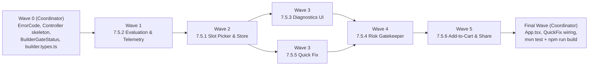

# WAVE & COORDINATION PLAN
## Phân hệ: PC Builder & Kiểm tra Tương thích Real-time (UC2 & WBS 7.5)

* **Mã kế hoạch:** `PLAN-UC2-PC-BUILDER`
* **Master DD:** [dd-uc2-pc-builder.md](../detail-design/dd-uc2-pc-builder.md) — Feature Index §3 & Shared-File Ownership §3.1 (nguồn chuẩn về `Owned Files` / `Test Target`, plan này không lặp lại)
* **Use-Case & WBS:** `UC2` — `7.5.1` $\rightarrow$ `7.5.6` (phụ thuộc `UC6` Rule Engine & `UC5` Catalog đã `DONE`)
* **Trạng thái tổng:** `DONE`

---

## 1. Sơ đồ Wave

---

## 2. Bảng Điều phối Wave & Trạng thái

| Wave | Hạng mục (`WBS` / Scope) | Chế độ | Shared-File Write Lock | Depends on | Cổng kiểm chứng (Verify Gate) | Trạng thái |
|---|---|---|---|---|---|---|
| `Wave 0` | Shared Contracts & FE Test Harness: 6 mã `BUILDER_*` (Master §2.3), `pcbuilder` + `PCBuilderController` skeleton, `BuilderGateStatus` (§2.5), `builder.types.ts`, cài `vitest` + `@testing-library/react` + `jsdom` | `Coordinator` | `ErrorCode.java`, `PCBuilderController.java`, `BuilderGateStatus.java`, `builder.types.ts`, `frontend/package.json`, `vitest.config.ts`, `src/test/setup.ts` | `UC5`, `UC6` | `mvn -q test-compile`, `npm --prefix frontend run build` & `npm --prefix frontend test` pass | `DONE` |
| `Wave 1` | `7.5.2` Evaluation & Telemetry ([dd-uc2-compatibility-eval.md](../detail-design/uc2-pc-builder/dd-uc2-compatibility-eval.md)) | `Scoped Subagent` | `PCBuilderController.java` (`/evaluate`), `builder.types.ts` | `Wave 0` | `PCBuilderEvaluationServiceTest` (`TC-UC2-05..09`) | `DONE` |
| `Wave 2` | `7.5.1` Slot Picker & Store ([dd-uc2-slot-picker.md](../detail-design/uc2-pc-builder/dd-uc2-slot-picker.md)) | `Scoped Subagent` | `PCBuilderController.java` (`/candidates`), `builder.types.ts`, tạo `PCBuilderPage.tsx`, `usePCBuilderStore.ts`, `PCBuilderCandidateService.java` | `Wave 1` | `PCBuilderCandidateServiceTest` (`TC-UC2-01..02`) + FE `TC-UC2-03..04`, `TC-UC2-10` (sequence guard 7.5.2 §3.3, cần store) | `DONE` |
| `Wave 3` | `7.5.3` Diagnostics UI ([dd-uc2-diagnostics-ui.md](../detail-design/uc2-pc-builder/dd-uc2-diagnostics-ui.md)) — song song với `7.5.5` | `Scoped Subagent` | `PCBuilderPage.tsx`, `AIChatWidget.tsx` | `Wave 2`, `UC1` | FE `TC-UC2-11..14` + `npm run build` | `DONE` |
| `Wave 3` | `7.5.5` Quick Fix ([dd-uc2-quick-fix.md](../detail-design/uc2-pc-builder/dd-uc2-quick-fix.md)) — song song với `7.5.3` | `Scoped Subagent` | `PCBuilderController.java` (`/quick-fix`), `PCBuilderCandidateService.java`, `builder.types.ts` | `Wave 2` | `PCBuilderQuickFixServiceTest` (`TC-UC2-20..23`) + FE `TC-UC2-24` | `DONE` |
| `Wave 4` | `7.5.4` Risk Gatekeeper ([dd-uc2-risk-gatekeeper.md](../detail-design/uc2-pc-builder/dd-uc2-risk-gatekeeper.md)) | `Scoped Subagent` | `PCBuilderEvaluationService.java`, tạo `PCBuilderCartService.java`, `PCBuilderPage.tsx`, `usePCBuilderStore.ts`, `builder.types.ts` | `Wave 3` (`7.5.3`) | `PCBuilderGatekeeperTest` (`TC-UC2-15..18`) + FE `TC-UC2-19` | `DONE` |
| `Wave 5` | `7.5.6` Add-to-Cart, `+ Builder` & Share URL ([dd-uc2-add-to-cart.md](../detail-design/uc2-pc-builder/dd-uc2-add-to-cart.md)) | `Scoped Subagent` | `PCBuilderController.java` (`/add-to-cart`, `/resolve`), `PCBuilderCartService.java`, `PCBuilderPage.tsx`, `builder.types.ts`, `ProductCard.tsx`, `ProductDetailPage.tsx` | `Wave 4` | `PCBuilderCartServiceTest` (`TC-UC2-25..26`, `28`; `TC-UC2-27` hoãn tới `UC0`/`UC4`) + FE `TC-UC2-29` | `DONE` |
| `Final Wave` | Integration: `App.tsx` route `/builder` + badge `useCartStore` (7.5.6 §3.3, Header `AGENTS.md` §4), gắn `QuickFixPanel` vào `SlotViolationBanner.renderQuickFix`, smoke flow chọn linh kiện $\rightarrow$ evaluate $\rightarrow$ quick-fix $\rightarrow$ add-to-cart | `Coordinator` | `App.tsx`, `PCBuilderPage.tsx` | `Wave 5` | `TC-UC2-30` + `mvn test` + `npm --prefix frontend run build` pass | `DONE` |

* Trạng thái: `TODO` / `IN_PROGRESS` / `DONE` / `BLOCKED` (ghi rõ lý do).
* `Wave 3` là Wave song song duy nhất: `7.5.3` (chỉ FE) và `7.5.5` không ghi chung file nào.

---

## 3. Rủi ro & Câu hỏi mở

1. **Test runner Frontend (Đã chốt):** User đồng ý bổ sung `vitest`, `@testing-library/react`, `@testing-library/jest-dom` và `jsdom` (tương thích Node 20 CI/Docker & Vite 5.4) kèm script `test` trong `frontend/package.json`, mở khóa toàn bộ 11 FE tests (`TC-UC2-03..04`, `10..14`, `19`, `24`, `29..30`).
2. **Ranh giới `UC0`/`UC4` chưa hoàn thiện:** `7.5.6` chỉ chạy luồng Guest (`cart_persisted = false`); nhánh ghi `carts`/`cart_items` cho user đăng nhập để trống tới khi có `UC0`/`UC4` (Master §2.4) — `TC-UC2-27` (ACID persistence) ở trạng thái hoãn.
3. **Nhánh liên UC1:** `7.5.3` chỉ thêm listener `smartpc:ask-ai-build` vào `AIChatWidget.tsx`; không đổi contract `POST /api/v1/ai/chat`.
4. **Không có Flyway mới:** UC2 không tạo bảng (Master §2.1); nếu Sub-DD phát sinh nhu cầu DDL, Coordinator đặt số `V12__*.sql` sau khi cập nhật DD.
