# KẾ HOẠCH TRIỂN KHAI (IMPLEMENTATION PLAN)
## Bổ sung Danh mục Ngoại vi (MONITOR, KEYBOARD, MOUSE) & Mở rộng Kho Mẫu Kiểm thử $\ge 50$ Sản phẩm

* **Mã Kế hoạch:** `PLAN-UC5-PERIPHERALS-AND-EXPANDED-SEED`
* **Tham chiếu Thiết kế Chi tiết:** [docs/detail-design/dd-uc5-product-catalog.md](../detail-design/dd-uc5-product-catalog.md) (v1.5)
* **Phân hệ & WBS:** Phân hệ Quản lý Sản phẩm & Danh mục (UC1a, UC5 & WBS 7.2)
* **Trạng thái tổng thể:** `DONE`

---

## 1. Sơ đồ Phụ thuộc Thực thi (Dependency Flowchart)

```mermaid
flowchart LR
    subgraph M1_DATABASE_SCHEMA["Milestone 1: Database & Seed Data"]
        T1["7.2.1.1 [DB]<br>Tạo Migration V6: Thêm nhóm PERIPHERALS & 3 Danh mục lá"]
        T2["7.2.2.1 [DB]<br>Seed kho sản phẩm mẫu V6 & V7 (Tổng 79 SP, >=2 SP/điều kiện lọc)"]
        T1 --> T2
    end

    subgraph M2_BACKEND_ENGINE["Milestone 2: Backend Registry & Search Intent"]
        T3["7.2.3.1 [DOMAIN/SERVICE]<br>Đăng ký Spec Schema cho MONITOR, KEYBOARD, MOUSE"]
        T4["7.2.5.1 [DOMAIN/SERVICE]<br>Cập nhật Regex Intent nhận diện danh mục trong ProductSpecifications"]
        T3 --> T4
    end

    subgraph M3_FRONTEND_UI["Milestone 3: Frontend Navigation & Filters"]
        T5["7.2.5.2 [FE]<br>Bổ sung Icon CategoryHierarchyNav (Monitor, Keyboard, Mouse)"]
        T6["7.2.5.3 [FE]<br>Cập nhật App.tsx (Popular categories) và Dynamic Filter UI"]
        T5 --> T6
    end

    subgraph M4_TEST_VERIFY["Milestone 4: Unit Test & Container Update"]
        T7["7.2.6.1 [TEST]<br>Viết Unit Test CategorySpecSchemaRegistryTest & SpecSchemaValidatorTest"]
        T8["7.2.6.2 [DEPLOY]<br>Biên dịch Maven & Docker reload, kiểm thử trực quan trên Web"]
        T7 --> T8
    end

    subgraph M7_MEDIA_SYNC["Milestone 7: Chuẩn hóa & Đa dạng hóa Hình ảnh 79 SP (WBS 7.2.7)"]
        T9["7.2.7.1 [ASSET]<br>Thiết lập kho ảnh 79 SP đúng model tại public/images/products/"]
        T10["7.2.7.2 [DB]<br>Tạo Migration V10 cập nhật image_url & gallery_urls"]
        T11["7.2.7.3 [FE]<br>Fallback thông minh theo category & đồng bộ mockData"]
        T12["7.2.7.4 [DEPLOY/TEST]<br>Rebuild bundle, đồng bộ Docker Nginx & restart Backend"]
        T9 --> T10
        T9 --> T11
        T10 --> T12
        T11 --> T12
    end

    T2 --> T3
    T4 --> T5
    T6 --> T7
    T8 --> T9
```

---

## 2. Bảng Phân rã Tác vụ Chi tiết (Detailed Task Breakdown)

| Mã Task | Work Package | Tầng | Mô tả công việc | File / Class tác động | Tham chiếu DD | Depends on | Tiêu chí hoàn thành (DoD) | Trạng thái |
| :--- | :--- | :--- | :--- | :--- | :--- | :--- | :--- | :--- | :--- |
| `7.2.1.1` | 7.2.1 Cây danh mục | `DB` | Viết migration Flyway `V6__peripherals_and_expanded_inventory.sql`: tạo nhóm `PERIPHERALS`, 3 danh mục lá `MONITOR`, `KEYBOARD`, `MOUSE` | `backend/src/main/resources/db/migration/V6__peripherals_and_expanded_inventory.sql` | DD §4.1.A | — | Migration hợp lệ, chèn 1 nhóm và 3 danh mục con | `DONE` |
| `7.2.2.1` | 7.2.2 Kho hàng khởi tạo | `DB` | Viết script seed sản phẩm mẫu vào `V6` & `V7` (đưa tổng kho lên 79 sản phẩm), đảm bảo mọi danh mục (cả 11 loại) khi lọc các điều kiện chính đều có ít nhất 2 sản phẩm thỏa mãn | `backend/src/main/resources/db/migration/V6__peripherals_and_expanded_inventory.sql`, `V7__supplemental_test_seed_coverage.sql` | DD §4.1, §4.3 | `7.2.1.1` | Tổng sản phẩm $\ge 50$ (thực tế 79 SP), mỗi nhánh điều kiện lọc có $\ge 2$ SP | `DONE` |
| `7.2.3.1` | 7.2.3 Dynamic JSON Specs | `DOMAIN/SERVICE` | Bổ sung định nghĩa schema `MONITOR`, `KEYBOARD`, `MOUSE` vào `CategorySpecSchemaRegistry` với các trường bắt buộc, min/allowedValues và filterable | `CategorySpecSchemaRegistry.java` | DD §4.3.A | `7.2.1.1` | `getSchema(code)` trả về đúng danh sách trường, validate specs không lỗi | `DONE` |
| `7.2.5.1` | 7.2.5 Bộ lọc & Intent | `DOMAIN/SERVICE` | Cập nhật bộ nhận diện từ khóa `rawSearch` trong `ProductSpecifications.java` để tự động gán `category` cho màn hình, bàn phím, chuột | `ProductSpecifications.java` | DD §1.1, §4.3 | `7.2.3.1` | Nhập "màn hình", "chuột", "bàn phím" tự động ánh xạ đúng danh mục; so khớp số nguyên/thực linh hoạt | `DONE` |
| `7.2.5.2` | 7.2.5 Giao diện danh mục | `FE` | Bổ sung icon `Monitor`, `Keyboard`, `Mouse` trong helper `getCategoryIcon` | `CategoryHierarchyNav.tsx` | DD §4.1.C | `7.2.1.1` | Thanh danh mục và breadcrumb hiển thị đúng icon tương ứng | `DONE` |
| `7.2.5.3` | 7.2.5 Popular Bar | `FE` | Cập nhật `POPULAR_CATEGORIES` trong `App.tsx` hỗ trợ truy cập nhanh Màn hình, Bàn phím, Chuột | `App.tsx` | Rule 4 | `7.2.5.2` | Thanh Header phổ biến có lối tắt cho 3 loại sản phẩm mới | `DONE` |
| `7.2.6.1` | 7.2.6 Kiểm thử tự động | `TEST` | Cập nhật `CategorySpecSchemaRegistryTest.java` và `SpecSchemaValidatorTest.java` theo `TC-PROD-24`, `TC-PROD-25`, `TC-PROD-26` | `*Test.java` | DD §8 | `7.2.3.1` | Toàn bộ unit tests pass 100% (10/10 tests pass) | `DONE` |
| `7.2.6.2` | 7.2.6 Build & Container Sync | `DEPLOY` | Build frontend bundle, reload Nginx, build backend image và restart container theo Rule 5 | Terminal / Docker | Rule 5 | `7.2.6.1` | Ứng dụng chạy mượt mà trên web, API trả đủ 79 sản phẩm và 11 danh mục | `DONE` |
| `7.2.5.4` | 7.2.5 Sắp xếp Kho Admin | `SERVICE/FE` | Cho phép hiển thị linh kiện ngưng kinh doanh (`is_active = false`), sắp xếp xuống cuối bảng và phân biệt trực quan trên UI | `ProductSpecifications.java`, `ProductAdminService.java`, `ProductAdminController.java`, `AdminProductListPage.tsx`, `productAdminService.ts` | DD §4.2.E | `7.2.5.3` | Bật/tắt kinh doanh không làm mất sản phẩm, linh kiện `is_active=false` hiển thị ở cuối danh sách | `DONE` |
| `7.2.6.3` | 7.2.6 Kiểm thử ngưng kinh doanh | `TEST` | Viết Unit Test kiểm thử cơ chế sắp xếp ngưng kinh doanh theo `TC-PROD-28` | `ProductAdminServiceTest.java` | DD §8 | `7.2.5.4` | Test case pass 100% (3/3 tests pass) | `DONE` |
| `7.2.5.5` | 7.2.5 Chuẩn hóa Layout Phím | `DB/DOMAIN` | Tạo migration `V9__normalize_keyboard_layout_percentage.sql`, cập nhật `CategorySpecSchemaRegistry` và `SpecSchemaValidator` hỗ trợ dạng số % thông dụng | `V9__normalize_keyboard_layout_percentage.sql`, `CategorySpecSchemaRegistry.java`, `SpecSchemaValidator.java` | DD §4.3.B, §8 (TC-PROD-25) | `7.2.3.1` | DB cập nhật sang `75%`, `68%`; Validator tự động chuẩn hóa strip `Compact `; tests pass | `DONE` |
| `7.2.5.6` | 7.2.5 Giao diện Layout Phím | `FE` | Chuẩn hóa hiển thị layout bàn phím chỉ ghi số % trên thẻ sản phẩm, bảng thông số, bộ lọc và form admin | `ProductCard.tsx`, `ProductSpecsTable.tsx`, `DynamicSpecsFilterPanel.tsx`, `DynamicSpecsEditor.tsx` | DD §4.3.B | `7.2.5.5` | Hiển thị `75%`, `68%` thay vì `Compact 75%` trên toàn bộ giao diện Storefront & Admin | `DONE` |
| `7.2.7.1` | 7.2.7 Chuẩn hóa Ảnh Sản phẩm | `ASSET` | Thiết lập kho ảnh tĩnh 79 sản phẩm chính xác theo model niêm yết lưu trữ tại `frontend/public/images/products/{id}.{ext}` | `frontend/public/images/products/*` | DD §4.6.B | — | Đầy đủ 79 tệp ảnh, định danh theo product_id, chất lượng cao, đúng model/brand | `DONE` |
| `7.2.7.2` | 7.2.7 Cập nhật DB Migration | `DB` | Tạo migration Flyway `V10__update_product_images_accuracy.sql` cập nhật image_url và gallery_urls cho 79 sản phẩm | `backend/src/main/resources/db/migration/V10__update_product_images_accuracy.sql` | DD §4.6.D | `7.2.7.1` | 79 sản phẩm được cập nhật image_url local và link CDN trong gallery_urls | `DONE` |
| `7.2.7.3` | 7.2.7 Frontend & Fallback | `FE` | Cập nhật `mockData.ts` đồng bộ đầy đủ toàn bộ 85 sản phẩm từ V5, V6, V7, V11 kèm 3 danh mục ngoại vi (`MONITOR`, `KEYBOARD`, `MOUSE`) & schema; triển khai `getProductImageFallback` theo category trong `ProductCard.tsx`, `ProductDetailPage.tsx`, `AdminProductListPage.tsx` | `mockData.ts`, `productService.ts`, `ProductCard.tsx`, `ProductDetailPage.tsx`, `AdminProductListPage.tsx` | DD §4.6.B | `7.2.7.1` | Mock data đồng bộ 100% (85 SP), đầy đủ cây danh mục & schema; khi chạy local dev không bật backend vẫn hiển thị đầy đủ kho hàng | `DONE` |
| `7.2.7.4` | 7.2.7 Kiểm thử & Container Sync | `DEPLOY/TEST` | Kiểm thử TC-PROD-29..32, build frontend bundle, đồng bộ Docker Nginx và restart backend | Terminal / Docker | DD §8 (TC-PROD-29..32) | `7.2.7.2`, `7.2.7.3` | Toàn bộ 79 sản phẩm hiển thị ảnh chính xác trên web, không lỗi CORS/404 | `DONE` |

---

## 3. Thứ tự Thực thi & Mốc Bàn giao (Milestones)

* **M1 — Database & Flyway Migration (Tasks `7.2.1.1` & `7.2.2.1`):** Hoàn thành script `V6` & `V7` tạo danh mục và 51 sản phẩm seed mới chất lượng cao (ảnh Unsplash, specs chuẩn xác, tổng 79 SP).
* **M2 — Backend Dynamic Specs & Search Intent (Tasks `7.2.3.1` & `7.2.5.1`):** Cập nhật `CategorySpecSchemaRegistry` và `ProductSpecifications`.
* **M3 — Frontend UI & Icon Integration (Tasks `7.2.5.2` & `7.2.5.3`):** Cập nhật UI navigation, icon và thanh popular.
* **M4 — Unit Test, Build & Container Reload (Tasks `7.2.6.1` & `7.2.6.2`):** Chạy test tự động, build và đồng bộ vào container Docker.
* **M5 — Hiển thị Linh Kiện Ngưng Kinh Doanh & Đưa Xuống Cuối Bảng (Tasks `7.2.5.4` & `7.2.6.3`):** Cập nhật `ProductSpecifications`, `ProductAdminService`, `ProductAdminController`, `AdminProductListPage.tsx`, `productAdminService.ts` và Unit Test `TC-PROD-28`.
* **M6 — Chuẩn hóa Giá trị Layout Bàn phím Dạng Số % (Tasks `7.2.5.5` & `7.2.5.6`):** Tạo migration V9, chuẩn hóa registry và giao diện hiển thị %.
* **M7 — Chuẩn hóa & Đa dạng hóa Hình ảnh 79 Sản phẩm theo Tên Niêm Yết (Tasks `7.2.7.1` → `7.2.7.4`):** Thiết lập kho ảnh static 79 sản phẩm, tạo migration V10, nâng cấp fallback thông minh theo category, đồng bộ container Docker Nginx.
