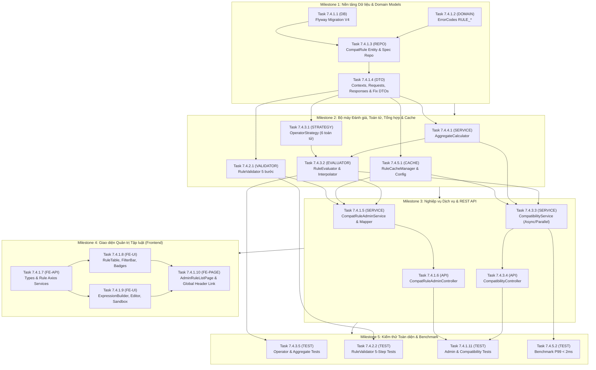

# KẾ HOẠCH TRIỂN KHAI (IMPLEMENTATION PLAN)
## Phân hệ: Core Rule Engine - Quản lý Tập luật & Đánh giá Tương thích Phần cứng (UC6 & WBS 7.4)

* **Mã kế hoạch:** `PLAN-UC6-CORE-RULE-ENGINE`
* **Tài liệu Thiết kế Chi tiết (DD):** [docs/detail-design/dd-uc6-core-rule-engine.md](../detail-design/dd-uc6-core-rule-engine.md) (`DD-UC6-RULE-ENGINE v1.1`)
* **Use-Case liên quan:** `UC6` (Quản lý Tập Luật Tương thích Admin) & Cung cấp dịch vụ đánh giá lõi cho `UC2` (PC Builder), `UC3` (PC Profile), `UC4` (Giỏ hàng/Checkout)
* **Khung WBS:** `7.4 Core Rule Engine - Quản lý Tập luật (UC6)` (`7.4.1` $\rightarrow$ `7.4.5`)
* **Trạng thái tổng thể:** `DONE` (Đã hoàn thành 100% 18 task theo 5 Milestone)

---

## 1. Sơ đồ Phụ thuộc Công việc (Dependency Graph)

---

## 2. Bảng Phân rã Công việc & Chi tiết Tác vụ (Task Breakdown)

| Mã Task | Work Package WBS | Tầng | Mô tả công việc | File / Class tác động | Tham chiếu DD | Phụ thuộc (Depends on) | Tiêu chí hoàn thành (DoD) | Trạng thái |
| :--- | :--- | :---: | :--- | :--- | :--- | :--- | :--- | :---: |
| **`7.4.1.1`** | 7.4.1 Quản lý Tập luật | `DB` | Tạo migration Flyway `V4__compat_rules_enhancements.sql`: Gỡ FK source, đổi FK target RESTRICT, add `updated_at`, add index active priority & unique definition | `backend/src/main/resources/db/migration/V4__compat_rules_enhancements.sql` | DD §6 | Không | File SQL hợp lệ, đúng cú pháp MySQL 8.0, migration sẵn sàng chạy | `DONE` |
| **`7.4.1.2`** | 7.4.1 Quản lý Tập luật | `DOMAIN` | Thêm 10 mã lỗi `RULE_*` chuẩn hóa vào `ErrorCode.java` | `backend/src/main/java/com/smartpc/common/exception/ErrorCode.java` | DD §7 | Không | Đủ 10 enum codes với đúng HTTP status và default message | `DONE` |
| **`7.4.1.3`** | 7.4.1 Quản lý Tập luật | `ENTITY/REPO` | Tạo entity JPA `CompatRule`, repository `CompatRuleRepository` (truy vấn duplicate, list active priority, countByCat) và `CompatRuleSpecifications` (lọc đa tiêu chí) | `CompatRule.java` `CompatRuleRepository.java` `CompatRuleSpecifications.java` | DD §1.2, §2, §4.2 | `7.4.1.1`, `7.4.1.2` | Entity map chuẩn bảng `compat_rules`, repository compile không lỗi | `DONE` |
| **`7.4.1.4`** | 7.4.1 Quản lý Tập luật | `DOMAIN/DTO` | Chuẩn hóa `CompatibilityResult.java` (`String` ID, `rule_id`, `category_code`), tạo `ProductItemContext`, `PreIndexedRuleCache`, các DTO request & response theo đặc tả | `ProductItemContext.java` `PreIndexedRuleCache.java` `CompatibilityResult.java` `CreateCompatRuleRequest.java` `UpdateCompatRuleRequest.java` `UpdateRuleStatusRequest.java` `DryRunRuleRequest.java` `RuleFilterCriteria.java` `CompatRuleDTO.java` `DryRunResultDTO.java` `RuleSchemaMetadataDTO.java` `CompatibilityCheckRequest.java` | DD §1.2, §4.5, §5.2 | `7.4.1.3` | Tất cả DTOs & Models đầy đủ thuộc tính, JSON annotations đúng chuẩn snake_case | `DONE` |
| **`7.4.4.1`** | 7.4.4 Xây dựng Aggregate Calculator | `DOMAIN/SERVICE` | Xây dựng `AggregateCalculator`: tính `<CAT>:_count` có xét `modules_per_kit`, `<CAT>:_sum_capacity_gb`, `_total_tdp_w` (+50W overhead, loại trừ PSU và CPU_COOLER) map cho cả `_SYSTEM` và `CPU`, dynamic `_sum_*`, `_max_*` | `AggregateCalculator.java` | DD §1.2, §4.4 | `7.4.1.4` | Tính toán chính xác theo công thức §4.4, null-safe, test tính toán pass | `DONE` |
| **`7.4.3.1`** | 7.4.3 Xây dựng Evaluator & Toán tử | `DOMAIN/SERVICE` | Xây dựng interface `OperatorStrategy` và 6 implementations: `EqualsOperatorStrategy`, `InOperatorStrategy`, `NotInOperatorStrategy`, `LteOperatorStrategy`, `GteOperatorStrategy`, `RangeOperatorStrategy` | `OperatorStrategy.java` `EqualsOperatorStrategy.java` `InOperatorStrategy.java` `NotInOperatorStrategy.java` `LteOperatorStrategy.java` `GteOperatorStrategy.java` `RangeOperatorStrategy.java` | DD §1.2, §4.3 | `7.4.1.4` | Cả 6 strategies xử lý chuẩn kiểu dữ liệu (BigDecimal, String ignore case, Collection, Range), test unit pass | `DONE` |
| **`7.4.5.1`** | 7.4.5 Tích hợp Cache & Concurrency | `DOMAIN/SERVICE` | Xây dựng `RuleEngineConfig` (Caffeine cache + ThreadPool `ruleEngineExecutor`) và `RuleCacheManager` (PreIndexedRuleCache theo cặp `"SRC:TGT"`, single-flight loading, `evictAll`) | `RuleEngineConfig.java` `RuleCacheManager.java` | DD §1.2, §4.5 | `7.4.1.3`, `7.4.1.4` | Cache tải và phân nhóm đúng, evict hoạt động chuẩn xác, thread pool cấu hình đúng | `DONE` |
| **`7.4.3.2`** | 7.4.3 Xây dựng Evaluator & Toán tử | `DOMAIN/SERVICE` | Xây dựng `RuleEvaluator`: trích xuất specs / aggregates, phân biệt Item-level vs Aggregate-level rule (chỉ evaluate 1 lần / target item), `interpolateMessage` với formatValue số/collection và 6 placeholders, missing spec logging | `RuleEvaluator.java` | DD §1.2, §4.3 | `7.4.3.1`, `7.4.4.1` | Đánh giá chính xác, nội suy thông báo đúng chuẩn, không ném NPE khi thiếu specs | `DONE` |
| **`7.4.2.1`** | 7.4.2 Validate cấu trúc Luật | `DOMAIN/SERVICE` | Xây dựng `RuleValidator`: 5 bước xác thực chặt chẽ (Categories leaf & `_SYSTEM`, spec keys regex & aggregate rules, operator & Registry type compatibility, error template syntax & placeholders, duplicate check) | `RuleValidator.java` | DD §1.2, §4.2 | `7.4.1.2`, `7.4.1.3`, `7.4.1.4` | Bắt chính xác 10 trường hợp vi phạm, ném đúng BusinessException và FieldErrorDTO | `DONE` |
| **`7.4.1.5`** | 7.4.1 Quản lý Tập luật | `DOMAIN/SERVICE` | Xây dựng `CompatRuleMapper` và `CompatRuleAdminService`: CRUD tập luật, toggle status, getMetadataSchema (tích hợp `CategorySpecSchemaRegistry`), dryRun sandbox (chọn SP mẫu, tính aggregates, evaluate và trả kết quả) | `CompatRuleMapper.java` `CompatRuleAdminService.java` | DD §1.2, §4.1, §5.2 | `7.4.2.1`, `7.4.3.2`, `7.4.5.1` | Nghiệp vụ CRUD, Dry-Run hoạt động đầy đủ, xóa cache sau mọi thao tác ghi | `DONE` |
| **`7.4.3.3`** | 7.4.3 Xây dựng Evaluator & Toán tử | `DOMAIN/SERVICE` | Xây dựng `CompatibilityService`: entrypoint kiểm tra tương thích PC (nhận IDs / Map quantity), nạp Product & Category specs, tính aggregates, nạp cache luật, đánh giá song song bằng CompletableFuture trên `ruleEngineExecutor`, gom nhóm errors/warnings/info theo priority ASC | `CompatibilityService.java` | DD §1.2, §3.2, §5.2 | `7.4.4.1`, `7.4.5.1`, `7.4.3.2` | Đánh giá song song không deadlock, tổng hợp kết quả chính xác, null-safe | `DONE` |
| **`7.4.1.6`** | 7.4.1 Quản lý Tập luật | `API` | Xây dựng `CompatRuleAdminController`: 8 REST endpoints cho Admin (`/api/v1/admin/rules/**`), tích hợp phân quyền `ROLE_ADMIN`, validation và Swagger/OpenAPI | `CompatRuleAdminController.java` | DD §1.2, §5.1, §5.2 | `7.4.1.5` | Đủ 8 endpoints, xử lý chuẩn ApiResponse, trả đúng HTTP status codes (200, 201, 204, 400, 404, 409) | `DONE` |
| **`7.4.3.4`** | 7.4.3 Xây dựng Evaluator & Toán tử | `API` | Xây dựng `CompatibilityController`: endpoint công khai `POST /api/v1/compatibility/check` cho PC Builder, Cart, AI Module | `CompatibilityController.java` | DD §1.2, §5.1, §5.2 | `7.4.3.3` | Endpoint nhận cả `product_ids` và `items`, trả về CompatibilityResult chuẩn | `DONE` |
| **`7.4.1.7`** | 7.4.1 Quản lý Tập luật (FE) | `FE` | Xây dựng TypeScript interfaces (`rule.types.ts`) và 2 Axios services: `ruleAdminService.ts`, `compatibilityService.ts` | `frontend/src/features/admin/rules/types/rule.types.ts` `frontend/src/services/ruleAdminService.ts` `frontend/src/services/compatibilityService.ts` | DD §1.2, §5.2 | `7.4.1.6`, `7.4.3.4` | Định nghĩa type chặt chẽ khớp 100% Backend DTOs, Axios client gọi đúng format | `DONE` |
| **`7.4.1.8`** | 7.4.1 Quản lý Tập luật (FE) | `FE` | Xây dựng UI components danh sách: `RuleSeverityBadge.tsx`, `RuleFilterBar.tsx` (lọc nguồn, đích, severity, active, keyword) và `RuleTable.tsx` (bảng hiển thị, toggle switch active, action buttons) | `RuleSeverityBadge.tsx` `RuleFilterBar.tsx` `RuleTable.tsx` | DD §1.2, §4.1 | `7.4.1.7` | UI hiển thị sắc nét, responsive, toggle switch tương tác mượt mà | `DONE` |
| **`7.4.1.9`** | 7.4.1 Quản lý Tập luật (FE) | `FE` | Xây dựng Modal & Sandbox components: `VisualExpressionBuilder.tsx` (gợi ý spec keys theo category và aggregate keys), `MessageTemplateEditor.tsx` (chèn nhanh placeholder), `DryRunSandboxPanel.tsx` (chọn SP test và bấm chạy thử), `RuleFormModal.tsx` | `VisualExpressionBuilder.tsx` `MessageTemplateEditor.tsx` `DryRunSandboxPanel.tsx` `RuleFormModal.tsx` | DD §1.2, §4.1 | `7.4.1.8` | Form tạo/sửa luật mượt mà, dry-run hiển thị ngay kết quả PASS/FAIL và câu lỗi | `DONE` |
| **`7.4.1.10`** | 7.4.1 Quản lý Tập luật (FE) | `FE` | Xây dựng trang `AdminRuleListPage.tsx`, cấu hình route `/admin/rules` trong `frontend/src/App.tsx`, bổ sung nút "Tập Luật Tương Thích (UC6)" trên Tầng 3 Admin Submenu theo đúng quy chuẩn Bright Global Header 3 tầng | `AdminRuleListPage.tsx` `frontend/src/App.tsx` | DD §1.2, §4.1, Quy chuẩn Header | `7.4.1.9` | Trang hoạt động trọn vẹn, Bright Header giữ nguyên 100%, frontend build pass sạch | `DONE` |
| **`7.4.3.5`** | 7.4.3 Xây dựng Evaluator & Toán tử | `TEST` | Viết Unit Test cho `OperatorStrategyTest` (TC-RE-05) và `AggregateCalculatorTest` (TC-RE-02, TC-RE-03, TC-RE-04) | `OperatorStrategyTest.java` `AggregateCalculatorTest.java` | DD §8 | `7.4.3.1`, `7.4.4.1` | 100% test cases pass, kiểm tra đủ các trường hợp biên và ép kiểu | `DONE` |
| **`7.4.2.2`** | 7.4.2 Validate cấu trúc Luật | `TEST` | Viết Unit Test cho `RuleValidatorTest`: 5 bước xác thực (TC-RE-06, TC-RE-07, TC-RE-08, TC-RE-09) | `RuleValidatorTest.java` | DD §8 | `7.4.2.1` | Kiểm chứng đầy đủ cả trường hợp hợp lệ và các mã lỗi BusinessException | `DONE` |
| **`7.4.1.11`** | 7.4.1 Quản lý Tập luật | `TEST` | Viết Unit Test cho `CompatRuleAdminServiceTest` (TC-RE-11 Dry-Run, TC-RE-12 Cache Eviction) và `CompatibilityServiceTest` (TC-RE-01 Socket Match, TC-RE-10 Null-Safety) | `CompatRuleAdminServiceTest.java` `CompatibilityServiceTest.java` | DD §8 | `7.4.1.5`, `7.4.3.3` | Mockito test pass, xác minh gọi evictAll và xử lý null specs an toàn | `DONE` |
| **`7.4.5.2`** | 7.4.5 Tích hợp Cache & Concurrency | `TEST` | Viết Benchmark Test `RuleEngineBenchmarkTest` (TC-RE-13): Đánh giá cấu hình 8 linh kiện với 50 rules, 1.000 iterations, kiểm tra P99 $< 2.0\text{ms}$ | `RuleEngineBenchmarkTest.java` | DD §8 | `7.4.3.3`, `7.4.5.1` | P99 latency đạt dưới 2.0ms, throughput cao | `DONE` |

---

## 3. Các Cột Mốc Triển khai (Milestones & Demo Gates)

* **M1 — Nền tảng Dữ liệu & DTOs (Task `7.4.1.1` $\rightarrow$ `7.4.1.4`):**
  * Migration V4 sẵn sàng, Entity, Repository, DTOs và ErrorCode hoàn tất.
* **M2 — Bộ máy Đánh giá, Toán tử, Tổng hợp & Cache (Task `7.4.4.1` $\rightarrow$ `7.4.2.1`):**
  * Hoàn thành 6 toán tử so sánh, công cụ tính aggregate có xét `modules_per_kit`, bộ máy Caffeine Cache tiền phân nhóm và bộ kiểm tra cấu trúc 5 bước.
* **M3 — Dịch vụ Nghiệp vụ & REST APIs (Task `7.4.1.5` $\rightarrow$ `7.4.3.4`):**
  * Toàn bộ 8 REST endpoints Quản trị (`/api/v1/admin/rules/**`) và REST endpoint Đánh giá Tương thích (`/api/v1/compatibility/check`) hoạt động độc lập, sẵn sàng test qua Postman/cURL.
* **M4 — Frontend Quản trị Tập luật Hoàn chỉnh (Task `7.4.1.7` $\rightarrow$ `7.4.1.10`):**
  * Giao diện Admin Rules với bảng dữ liệu, lọc đa tiêu chí, Modal dựng biểu thức trực quan, Dry-Run Sandbox chạy thử ngay trên giao diện; giữ nguyên 100% Bright Global Header 3 tầng.
* **M5 — Bộ Kiểm thử Toàn diện & Benchmark (Task `7.4.3.5` $\rightarrow$ `7.4.5.2`):**
  * Toàn bộ các test cases `TC-RE-01` đến `TC-RE-13` được thực thi và pass, cam kết độ trễ đánh giá P99 $< 2\text{ms}$.

---

## 4. Rủi ro Kỹ thuật & Biện pháp Xử lý (Risks & Mitigations)

1. **Rủi ro Cache Stampede khi Admin cập nhật tập luật:**
   * *Giải pháp:* `RuleCacheManager` sử dụng Caffeine atomic loader `ruleCaffeineCache.get("ACTIVE_RULES", k -> loadAndIndexFromDb())`, đảm bảo chỉ có 1 thread nạp DB khi cache rỗng.
2. **Rủi ro Chậm trễ do CPU_COOLER có trường `tdp_w`:**
   * *Giải pháp:* `AggregateCalculator` loại trừ cụ thể danh mục `CPU_COOLER` và `PSU` khi tính tổng TDP tiêu thụ, tránh việc cộng nhầm công suất giải nhiệt của tản nhiệt vào công suất tiêu thụ điện của linh kiện.
3. **Rủi ro Lệch Schema giữa Backend và Seed Rules cũ:**
   * *Giải pháp:* `AggregateCalculator` và `RuleEvaluator` hỗ trợ cả `_SYSTEM:_total_tdp_w` và `CPU:_total_tdp_w`, đảm bảo tương thích 100% với các rule đã seed từ `V2__seed_rules.sql`.

---

## 5. Đợt Gia cố An toàn & Ổn định (Hardening — DD `v1.2`, Mục 4.6)

> Hạng mục phân quyền `ROLE_ADMIN` cho `/api/v1/admin/rules/**` **hoãn** tới khi hoàn thành UC0 (chưa có hệ thống Role).

| Mã Task | Work Package WBS | Tầng | Mô tả công việc | File / Class tác động | Tham chiếu DD | Phụ thuộc | Tiêu chí hoàn thành (DoD) | Trạng thái |
| :--- | :--- | :---: | :--- | :--- | :--- | :--- | :--- | :---: |
| **`7.4.1.12`** | 7.4.1 Quản lý Tập luật | `DOMAIN` | Thêm mã lỗi `RULE_CHECK_TOO_MANY_PRODUCTS`, `RULE_CHECK_QUANTITY_EXCEEDED` | `ErrorCode.java` | DD §7 | — | Compile pass | `DONE` |
| **`7.4.1.13`** | 7.4.1 Quản lý Tập luật | `API` | `@Valid` + `@Size(max=100)` cho request, `@Max(16)` quantity; kẹp phân trang; handler `400` cho JSON/enum/param lỗi | `CompatibilityController.java`, `CompatibilityCheckRequest.java`, `CompatibilityItemRequest.java`, `DryRunRuleRequest.java`, `CompatRuleAdminController.java`, `GlobalExceptionHandler.java` | DD §4.6.A, §4.6.E | `7.4.1.12` | `TC-RE-22` pass | `DONE` |
| **`7.4.3.6`** | 7.4.3 Evaluator & Toán tử | `SERVICE` | `CompatibilityService`: `validateRequestBounds()`, bỏ `@Transactional` & executor, đánh giá tuần tự, sao chép specs, `unresolved_product_ids`, null-safe category | `CompatibilityService.java`, `CompatibilityResult.java`, `RuleEngineConfig.java` | DD §4.5.B, §4.6.A–C | `7.4.1.12` | `TC-RE-14..16`, `TC-RE-20` pass | `DONE` |
| **`7.4.3.7`** | 7.4.3 Evaluator & Toán tử | `SERVICE` | `RuleEvaluator`: cảnh báo "Không thể xác minh..." khi thiếu spec (khử trùng lặp) | `RuleEvaluator.java` | DD §4.3.C | `7.4.3.6` | `TC-RE-10` (cập nhật) pass | `DONE` |
| **`7.4.3.8`** | 7.4.3 Evaluator & Toán tử | `SERVICE` | Chuyển đổi số an toàn (`NaN`/`Infinity`), `RANGE` cận âm | `EqualsOperatorStrategy.java`, `RangeOperatorStrategy.java` | DD §4.3.A | — | `TC-RE-19`, `TC-RE-21` pass | `DONE` |
| **`7.4.4.2`** | 7.4.4 Aggregate Calculator | `SERVICE` | `_count` tính bằng `long` + chặn trần; chỉ nhận số hữu hạn | `AggregateCalculator.java` | DD §4.4.B.5 | — | `TC-RE-18`, `TC-RE-19` pass | `DONE` |
| **`7.4.5.3`** | 7.4.5 Cache & Concurrency | `SERVICE` | `RuleCacheManager.evictAllAfterCommit()`; `CompatRuleAdminService` dùng hàm mới; dry-run áp giới hạn | `RuleCacheManager.java`, `CompatRuleAdminService.java` | DD §4.5.B.3 | `7.4.3.6` | `TC-RE-12` (cập nhật), `TC-RE-17` pass | `DONE` |
| **`7.4.2.3`** | 7.4.2 Validate cấu trúc Luật | `SERVICE` | Đối chiếu `_sum_/_max_<field>` với Registry (tồn tại & kiểu số) | `RuleValidator.java` | DD §4.6.D | — | `TC-RE-23` pass | `DONE` |
| **`7.4.5.4`** | 7.4.5 Cache & Concurrency | `TEST` | Cập nhật & bổ sung Unit Test `TC-RE-10`, `TC-RE-12..23` | `*Test.java` trong `ruleengine` | DD §8 | Tất cả task trên | `mvn test` pass toàn bộ | `DONE` |
