# TÀI LIỆU THIẾT KẾ DỰ ÁN: NỀN TẢNG THƯƠNG MẠI ĐIỆN TỬ LINH KIỆN ĐIỆN TỬ THÔNG MINH

## 1. Tổng quan dự án

**Sơ đồ Use-Case:**

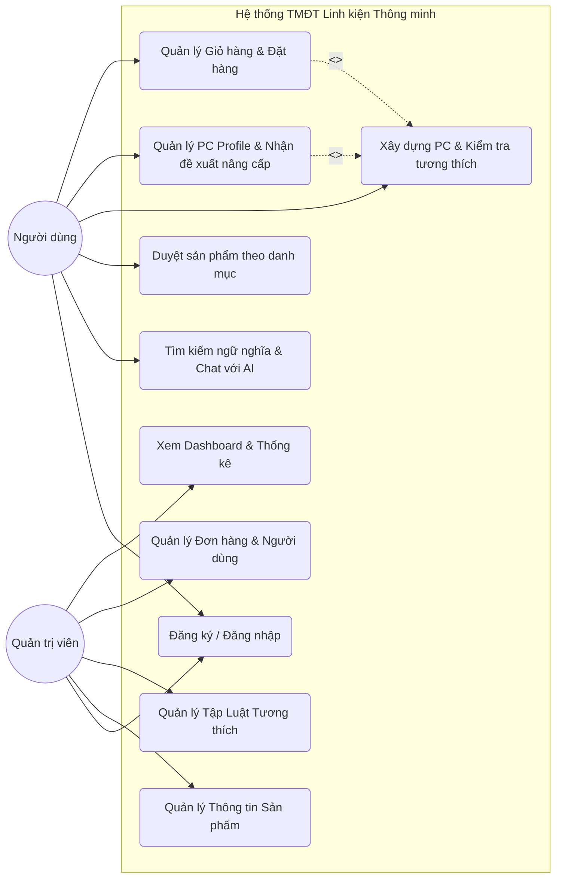

**Mục tiêu:**
*   **Mục đích:** Xây dựng một nền tảng thương mại điện tử chuyên biệt phân phối linh kiện điện tử/máy tính. Giải quyết khó khăn lớn nhất của người dùng khi tự lắp ráp (build) hoặc nâng cấp máy tính: sự thiếu hụt kiến thức về tính tương thích phần cứng, khó khăn trong việc tìm đúng mã sản phẩm và không biết bắt đầu nâng cấp từ đâu.
*   **Phạm vi:** 
    *   Hệ thống quản lý bán hàng cơ bản (Quản lý người dùng, Sản phẩm, Giỏ hàng, Thanh toán, Đơn hàng).
    *   **Công cụ kiểm tra tính tương thích (Compatibility Checker):** Tự động phát hiện xung đột phần cứng.
    *   **Hồ sơ cấu hình (PC Profile) & Đề xuất nâng cấp:** Lưu trữ cấu hình hiện tại của người dùng, phân tích điểm nghẽn (bottleneck) và gợi ý lộ trình nâng cấp.
    *   **Tích hợp AI suy luận (LLM - ví dụ: Gemini) vào Tìm kiếm:** Vượt ra ngoài việc tìm kiếm từ khóa hay chatbot thông thường, AI được sử dụng như một "chuyên gia phần cứng" có khả năng suy luận. AI giúp phân tích ngữ nghĩa truy vấn phức tạp của người dùng để tìm kiếm, tự động trích xuất thông số và đánh giá mức độ phù hợp của các linh kiện dựa trên nhu cầu cụ thể (ví dụ: render 3D vs. chơi game).
*   **Bối cảnh:** Nhu cầu tự tùy biến và nâng cấp thiết bị công nghệ ngày càng cao. Người dùng cần một hệ thống không chỉ để "mua" mà còn để "được tư vấn" như một chuyên gia phần cứng thực thụ.
*   **Tài liệu tham khảo:** Chuẩn tài liệu đặc tả yêu cầu phần mềm IEEE 830, tài liệu API tích hợp LLM (Gemini API / OpenAI API), tài liệu Elasticsearch.

### 1.1. Đặc tả Use-Case chi tiết

Dưới đây là đặc tả chi tiết cho các luồng nghiệp vụ (Use-case) cốt lõi của hệ thống, giúp làm rõ các kịch bản tương tác giữa người dùng, hệ thống AI, Rule Engine và Admin.

#### UC0: Đăng ký & Đăng nhập

**Mô tả:** Người dùng hoặc Quản trị viên đăng nhập vào hệ thống bằng tài khoản (Email/Mật khẩu) hoặc thông qua mạng xã hội (Google/Facebook).
**Actor chính:** Người dùng (User), Quản trị viên (Admin).
**Actor phụ:** OAuth Providers (Google, Facebook).
**Tiền điều kiện:** Người dùng chưa đăng nhập.

**Sơ đồ hoạt động (Activity Diagram):**
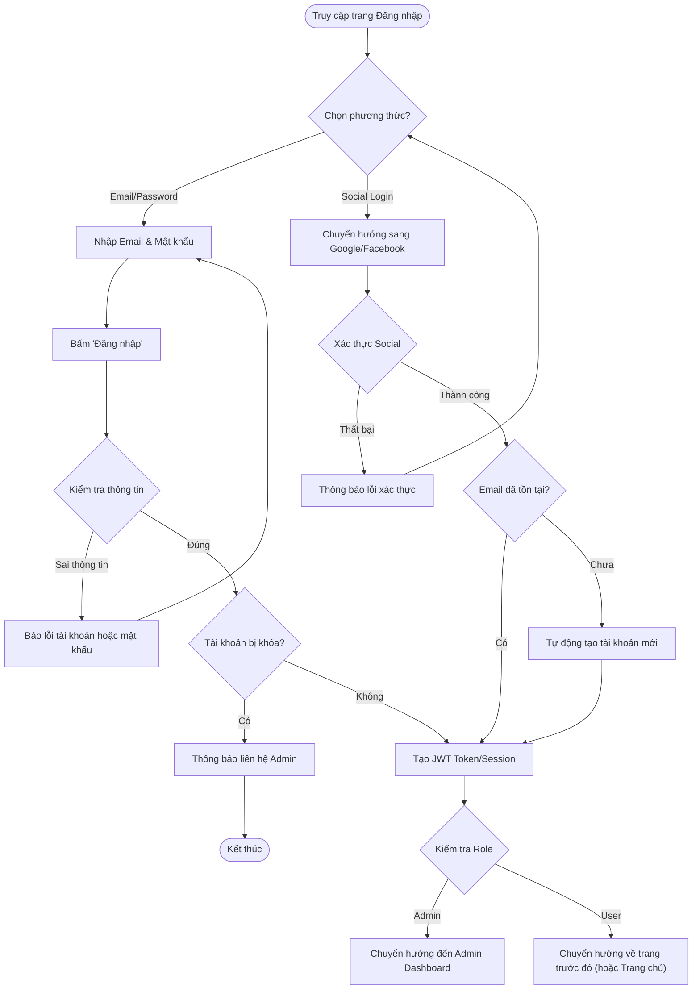

**Luồng sự kiện chính (Happy Path - Email/Password):**
1. Người dùng truy cập trang Đăng nhập.
2. Nhập thông tin `Email` và `Mật khẩu`.
3. Nhấn nút "Đăng nhập".
4. Hệ thống kiểm tra trùng khớp trong Database.
5. Kiểm tra trạng thái tài khoản (`is_active = true`).
6. Hệ thống tạo JWT Token (hoặc Session) lưu vào Cookie/Local Storage.
7. Điều hướng người dùng về trang họ đang truy cập trước đó (Ví dụ: đang ở Giỏ hàng -> Trở lại Giỏ hàng). Đối với Admin, điều hướng vào Admin Dashboard.

**Luồng sự kiện chính (Happy Path - Social Login):**
1. Người dùng nhấn nút "Đăng nhập bằng Google".
2. Hệ thống chuyển hướng sang cửa sổ xác thực của Google.
3. Người dùng cho phép quyền truy cập.
4. Google trả về Auth Code, hệ thống gọi lên Google API lấy thông tin Profile (Email, Name).
5. Nếu Email chưa có trong hệ thống, tự động tạo tài khoản mới. Nếu có rồi, tiến hành cấp JWT Token và đăng nhập thành công.

**Luồng ngoại lệ (Exception/Alternative Paths):**
*   *0a. Sai mật khẩu quá số lần quy định:* Nếu đăng nhập sai mật khẩu 5 lần liên tiếp, hệ thống khóa tài khoản tạm thời trong 15 phút và gửi email cảnh báo.
*   *0b. Tài khoản bị khóa (Banned):* Ở bước 5 (kiểm tra trạng thái), nếu `is_active = false`, hệ thống chặn đăng nhập và hiện thông báo: "Tài khoản của bạn đã bị khóa do vi phạm chính sách."

#### UC1: Tìm kiếm ngữ nghĩa & Chat với AI

**Mô tả:** Người dùng nhập yêu cầu bằng ngôn ngữ tự nhiên (không cần chính xác từ khóa kỹ thuật) để tìm kiếm linh kiện phù hợp với nhu cầu. AI sẽ đóng vai trò như một chuyên gia tư vấn.
**Actor chính:** Người dùng (User).
**Actor phụ:** AI Engine (Gemini), Vector DB.
**Tiền điều kiện:** Người dùng đang ở trang chủ hoặc thanh tìm kiếm. Hệ thống AI đang hoạt động.

**Sơ đồ hoạt động (Activity Diagram):**
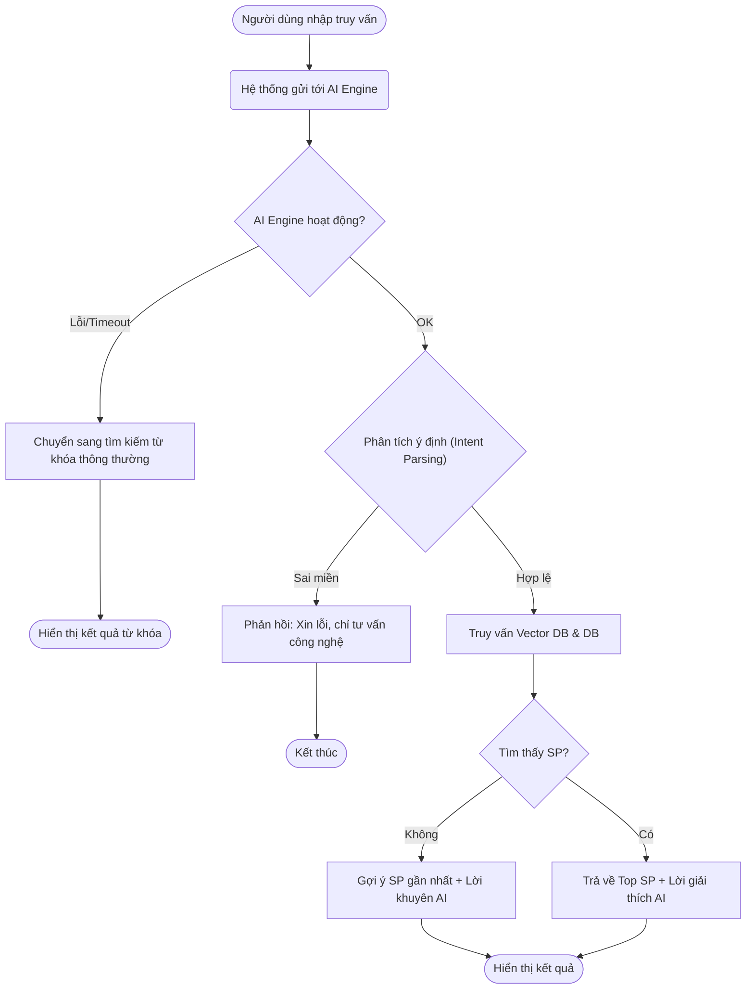

**Luồng sự kiện chính (Happy Path):**
1. Người dùng nhập câu truy vấn (Ví dụ: "Card màn hình nào dưới 8 triệu chơi mượt game AAA?").
2. Người dùng nhấn "Tìm kiếm" hoặc Enter.
3. Hệ thống gửi truy vấn đến AI Engine để phân tích ý định (Intent Parsing).
4. AI Engine bóc tách được: `Category = VGA`, `Budget <= 8000000`, `Purpose = Gaming AAA`.
5. Hệ thống truy vấn Vector DB và Database để tìm top 5 sản phẩm phù hợp nhất.
6. AI Engine nhận danh sách sản phẩm, tạo câu trả lời giải thích lý do đề xuất dựa trên nhu cầu của User.
7. Hệ thống hiển thị kết quả tìm kiếm gồm: Câu tư vấn của AI và Danh sách thẻ sản phẩm.

**Luồng ngoại lệ (Exception/Alternative Paths):**
*   *1a. AI Service không phản hồi (Timeout) hoặc báo lỗi:* Hệ thống tự động chuyển sang luồng tìm kiếm từ khóa thông thường (Fuzzy Search bằng Elasticsearch), bỏ qua phần tư vấn AI. Hiển thị thông báo: "AI tạm thời không khả dụng, hiển thị kết quả tìm kiếm theo từ khóa".
*   *1b. Truy vấn không liên quan (Ví dụ: "Thời tiết hôm nay thế nào?"):* AI nhận diện ý định sai miền. Hệ thống phản hồi: "Xin lỗi, tôi chỉ có thể tư vấn về linh kiện máy tính và thiết bị công nghệ."
*   *1c. Không tìm thấy sản phẩm thỏa mãn điều kiện:* Hệ thống hiển thị câu tư vấn của AI (ví dụ: "Hiện không có card nào dưới 8 triệu đáp ứng chơi mượt mọi game AAA Ultra setting") và gợi ý các sản phẩm gần mức giá nhất hoặc có hiệu năng tốt nhất trong tầm giá.

#### UC1a: Duyệt sản phẩm theo danh mục (Category Browsing & Filter)

**Mô tả:** Người dùng duyệt xem danh sách linh kiện theo từng danh mục phân cấp (CPU, VGA, RAM, Mainboard...), áp dụng các bộ lọc thông số kỹ thuật (Thương hiệu, mức giá, socket, form factor, dung lượng...) và sắp xếp kết quả để tìm linh kiện mong muốn.
**Actor chính:** Người dùng (User).
**Tiền điều kiện:** Người dùng truy cập trang Danh mục hoặc chọn một danh mục từ Menu/Trang chủ.

**Sơ đồ hoạt động (Activity Diagram):**
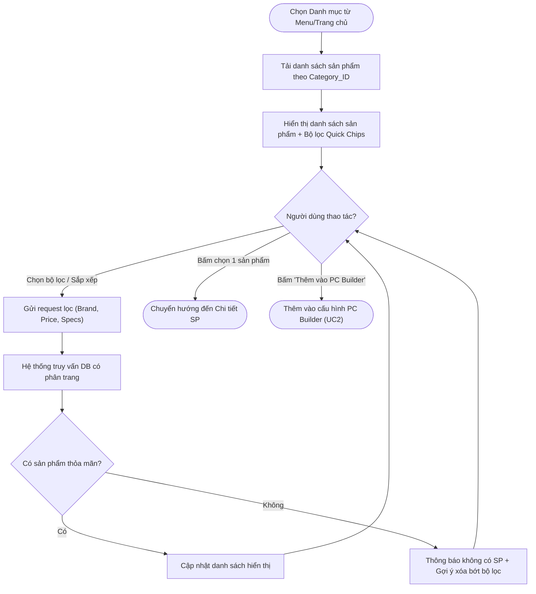

**Luồng sự kiện chính (Happy Path):**
1. Người dùng chọn một danh mục linh kiện (Ví dụ: "Card màn hình - VGA") từ thanh điều hướng hoặc icon danh mục trên trang chủ.
2. Hệ thống tải và hiển thị trang danh mục gồm: Bộ lọc thông số (Hãng, Khoảng giá, VRAM, Chuẩn PCIe), danh sách sản phẩm dạng lưới (Grid), và thanh sắp xếp (Giá tăng/giảm, Mới nhất, Bán chạy).
3. Người dùng chọn bộ lọc mong muốn (Ví dụ: Hãng "NVIDIA", VRAM "8GB", Mức giá "< 10 triệu").
4. Hệ thống gửi request lọc đến backend, truy vấn cơ sở dữ liệu và trả về danh sách sản phẩm thỏa mãn kèm phân trang.
5. Người dùng có thể bấm vào thẻ sản phẩm để xem chi tiết, hoặc bấm nút "+ PC Builder" để đưa trực tiếp vào cấu hình máy tính đang lắp ráp.

**Luồng ngoại lệ (Exception/Alternative Paths):**
*   *1a.a. Không có sản phẩm nào phù hợp bộ lọc:* Ở bước 4, nếu không có linh kiện nào thỏa mãn đồng thời tất cả các tiêu chí lọc, hệ thống hiển thị thông báo "Không tìm thấy sản phẩm phù hợp" kèm nút bấm "Xóa bộ lọc" để người dùng dễ dàng thử lại.

#### UC2: Xây dựng PC & Kiểm tra tương thích (PC Builder)

**Mô tả:** Người dùng chọn từng linh kiện để lắp ráp thành một bộ PC hoàn chỉnh. Hệ thống sẽ tự động kiểm tra và cảnh báo nếu các linh kiện xung đột hoặc không tối ưu.
**Actor chính:** Người dùng (User).
**Actor phụ:** Hardware Rule Engine.
**Tiền điều kiện:** Người dùng truy cập công cụ PC Builder.

**Sơ đồ hoạt động (Activity Diagram):**
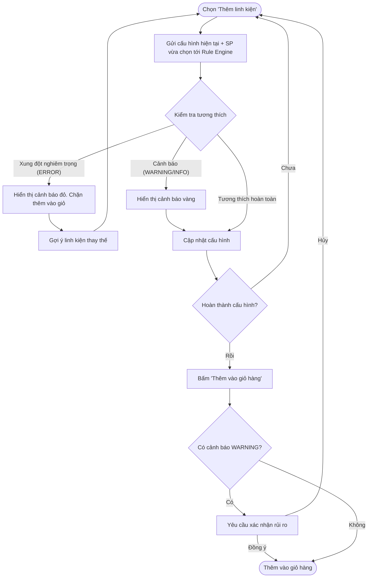

**Luồng sự kiện chính (Happy Path):**
1. Người dùng chọn mục "Thêm CPU" và chọn 1 CPU (VD: Intel Core i5 13600K).
2. Hệ thống gửi cấu hình hiện tại đến Rule Engine.
3. Rule Engine đánh giá không có xung đột, hệ thống cập nhật cấu hình và hiển thị CPU đã chọn.
4. Người dùng tiếp tục chọn "Thêm Mainboard" và chọn 1 Mainboard socket LGA 1700.
5. Hệ thống gửi danh sách (CPU, Mainboard) đến Rule Engine.
6. Rule Engine kiểm tra tương thích (Socket match) thành công.
7. Hệ thống hiển thị trạng thái "Tương thích" (Màu xanh).
8. Người dùng lặp lại đến khi hoàn thành cấu hình và bấm "Thêm toàn bộ vào giỏ hàng".

**Luồng ngoại lệ (Exception/Alternative Paths):**
*   *2a. Xung đột nghiêm trọng (ERROR):* Ở bước 4, nếu User chọn Mainboard socket AM5. Rule Engine trả về vi phạm mức ERROR. Hệ thống hiển thị cảnh báo đỏ ngay lập tức: "Mainboard không hỗ trợ CPU này (LGA1700 vs AM5)". Giao diện KHÔNG cho phép "Thêm toàn bộ vào giỏ hàng" cho đến khi lỗi được khắc phục. Hệ thống gợi ý danh sách Mainboard tương thích.
*   *2b. Cảnh báo không tối ưu (WARNING/INFO):* User chọn Nguồn (PSU) 450W cho cấu hình có RTX 4070. Rule Engine trả về WARNING. Hệ thống hiển thị cảnh báo vàng: "Công suất nguồn có thể không đủ tải (Khuyến nghị >= 650W)". User VẪN CÓ THỂ tiếp tục mua hàng nếu phớt lờ cảnh báo, hệ thống yêu cầu xác nhận rủi ro.

#### UC3: Quản lý PC Profile & Nhận đề xuất nâng cấp

**Mô tả:** Người dùng lưu lại cấu hình PC hiện tại của mình. Hệ thống sử dụng AI và Rule Engine để phân tích điểm nghẽn (bottleneck) của cấu hình và đưa ra lộ trình nâng cấp phù hợp với ngân sách.
**Actor chính:** Người dùng (User).
**Actor phụ:** AI Engine, Rule Engine.
**Tiền điều kiện:** Người dùng đã đăng nhập và truy cập trang PC Profile.

**Sơ đồ hoạt động (Activity Diagram):**
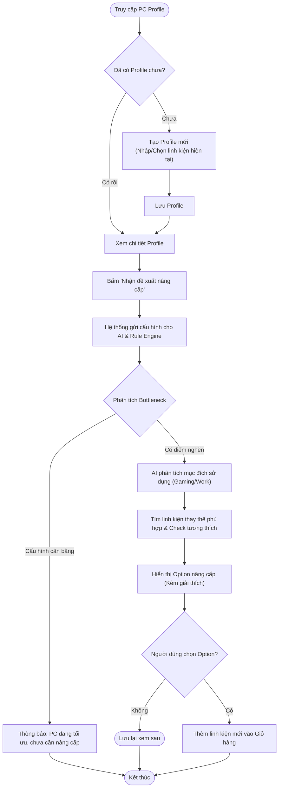

**Luồng sự kiện chính (Happy Path):**
1. Người dùng vào trang "PC Profile" và xem cấu hình hiện tại của mình (ví dụ: đang dùng Core i3 gen 10, GTX 1050).
2. Người dùng nhấn nút "Tư vấn nâng cấp".
3. Hệ thống hiển thị popup hỏi: "Ngân sách của bạn?" và "Mục tiêu nâng cấp (Ví dụ: Chơi mượt game XYZ)?".
4. Người dùng nhập thông tin và xác nhận.
5. AI Engine phân tích cấu hình hiện tại, nhận diện "VGA GTX 1050 là điểm nghẽn lớn nhất cho gaming".
6. AI tìm kiếm VGA mới phù hợp ngân sách, gửi qua Rule Engine kiểm tra xem nguồn (PSU) và Mainboard hiện tại có gánh được VGA mới không.
7. Hệ thống trả về đề xuất: "Nâng cấp lên RTX 3060 (Lý do...) + Đổi Nguồn lên 600W (Vì nguồn cũ không đủ)".
8. Người dùng đồng ý và nhấn "Thêm các món nâng cấp vào Giỏ hàng".

**Luồng ngoại lệ (Exception/Alternative Paths):**
*   *3a. Ngân sách quá thấp:* Ở bước 5, AI không tìm được linh kiện nào tạo ra sự nâng cấp rõ rệt với ngân sách cung cấp. Hệ thống phản hồi: "Ngân sách hiện tại khó tạo ra thay đổi lớn. Bạn nên tích lũy thêm khoảng X triệu hoặc tìm mua đồ cũ."
*   *3b. Cấu hình quá cũ không thể nâng cấp lẻ:* Ở bước 6, Rule Engine phát hiện Mainboard quá cũ không hỗ trợ linh kiện đời mới. AI đề xuất: "Cấu hình đã hết vòng đời nâng cấp. Bạn nên build một dàn PC mới hoàn toàn thay vì nâng cấp từng món."

#### UC4: Quản lý Giỏ hàng & Đặt hàng (Checkout)

**Mô tả:** Người dùng xem lại các sản phẩm đã chọn, nhập thông tin giao hàng, thanh toán và hoàn tất đơn hàng.
**Actor chính:** Người dùng (User).
**Tiền điều kiện:** Người dùng đã có sản phẩm trong giỏ hàng và đã đăng nhập (Nếu chưa đăng nhập sẽ được yêu cầu).

**Sơ đồ hoạt động (Activity Diagram):**
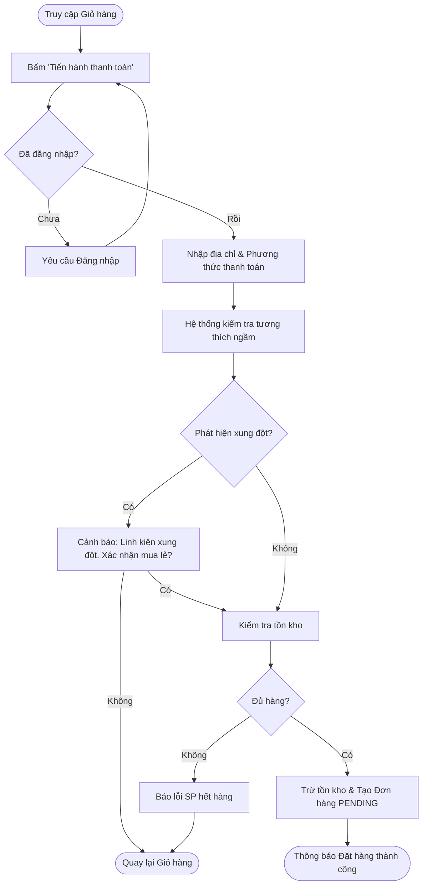

**Luồng sự kiện chính (Happy Path):**
1. Người dùng truy cập Giỏ hàng, kiểm tra lại danh sách linh kiện và tổng tiền.
2. Người dùng nhấn "Tiến hành Thanh toán".
3. *(Include UC0)* Nếu chưa đăng nhập, hệ thống điều hướng sang trang Đăng nhập. Sau khi đăng nhập thành công, quay lại trang Thanh toán.
4. Người dùng điền/chọn địa chỉ giao hàng và phương thức thanh toán (COD / Chuyển khoản / Ví điện tử).
5. Hệ thống tự động gọi hàm `CheckCompatibility()` lần cuối ngầm bên dưới (để đảm bảo không có linh kiện xung đột nào bị sót).
6. Kết quả trả về an toàn, Người dùng nhấn "Xác nhận đặt hàng".
7. Hệ thống trừ tồn kho (Stock quantity), tạo bản ghi Order mới với trạng thái PENDING.
8. Hệ thống hiển thị trang "Đặt hàng thành công" và gửi email xác nhận.

**Luồng ngoại lệ (Exception/Alternative Paths):**
*   *4a. Hết hàng (Out of stock) tại thời điểm checkout:* Ở bước 7, khi kiểm tra tồn kho để trừ hàng, nếu một sản phẩm trong giỏ đã hết. Hệ thống báo lỗi, bôi đỏ sản phẩm hết hàng và yêu cầu người dùng loại bỏ khỏi giỏ trước khi thanh toán.
*   *4b. Phát hiện xung đột (ERROR) ở bước check cuối:* Ở bước 5, nếu trong giỏ có chứa các linh kiện xung đột (do người dùng thêm lẻ từ trang chi tiết sản phẩm, không qua PC Builder). Hệ thống hiện Pop-up cảnh báo chặn (Blocker): "Phát hiện linh kiện không tương thích trong giỏ hàng. Bạn có chắc chắn muốn mua lẻ không?". Nếu User xác nhận "Mua lẻ", hệ thống cho phép tiếp tục sang bước 6 (Xác nhận đặt hàng).

#### UC5: Quản lý Thông tin Sản phẩm (Admin)

**Mô tả:** Admin thêm mới hoặc cập nhật thông tin linh kiện. Điểm đặc biệt của hệ thống là khi lưu sản phẩm, hệ thống sẽ tự động cập nhật thông số kỹ thuật (JSON) phục vụ Rule Engine và tạo Vector Embedding phục vụ AI Search.
**Actor chính:** Quản trị viên (Admin).
**Actor phụ:** AI Engine (Vector DB).
**Tiền điều kiện:** Admin đã đăng nhập vào trang Quản trị.

**Sơ đồ hoạt động (Activity Diagram):**
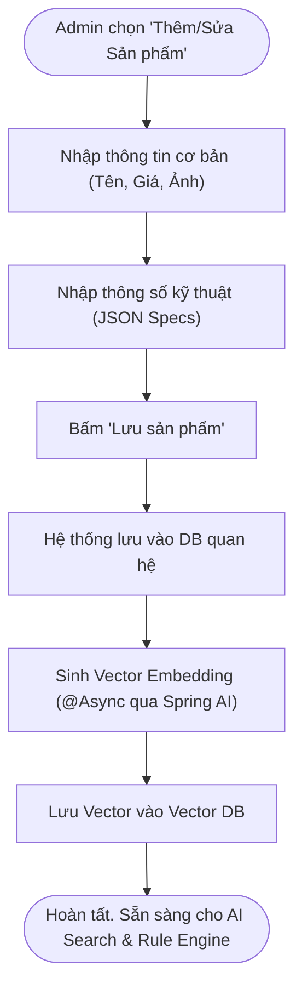

**Luồng sự kiện chính (Happy Path):**
1. Admin truy cập trang Quản lý Sản phẩm và chọn "Thêm mới".
2. Admin nhập các thông tin cơ bản: Tên, Hãng, Danh mục, Giá, Số lượng.
3. Admin nhập các trường thông số kỹ thuật động (Ví dụ: `socket_type: LGA1700`, `form_factor: ATX`).
4. Admin nhấn "Lưu". Hệ thống lưu dữ liệu vào bảng `Product`.
5. Hệ thống kích hoạt một sự kiện ngầm (@Async) gọi Spring AI để tạo Vector Embedding.
6. Lưu Vector vào Vector DB.
7. Hệ thống hiển thị thông báo "Thêm sản phẩm thành công".

**Luồng ngoại lệ (Exception/Alternative Paths):**
*   *5a. Lỗi đồng bộ Vector DB:* Ở bước 6, Spring AI bị lỗi không thể tạo vector (vd: lỗi gọi API). Hệ thống lưu log lỗi và đánh dấu sản phẩm `sync_status = FAILED`. Sản phẩm vẫn xuất hiện trên web nhưng sẽ không được tìm thấy qua AI Semantic Search cho đến khi Admin bấm "Đồng bộ lại" bằng tay.

#### UC6: Quản lý Tập Luật Tương thích (Admin)

**Mô tả:** Admin định nghĩa các quy tắc để hệ thống PC Builder biết linh kiện nào lắp được với nhau (Ví dụ: CPU Intel đời 13 phải đi với Mainboard LGA1700).
**Actor chính:** Quản trị viên (Admin).
**Actor phụ:** Rule Engine.
**Tiền điều kiện:** Admin đã đăng nhập vào trang Quản trị.

**Sơ đồ hoạt động (Activity Diagram):**
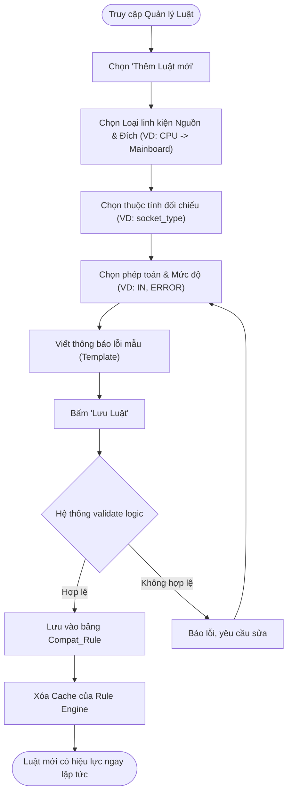

**Luồng sự kiện chính (Happy Path):**
1. Admin vào module "Luật Tương Thích".
2. Admin thiết lập luật mới: `Source=CPU`, `Target=Motherboard`.
3. Admin định nghĩa logic: Thuộc tính `socket_type` của CPU phải `IN` (nằm trong) mảng `supported_sockets` của Motherboard. Nếu vi phạm, báo mức `ERROR`.
4. Admin điền câu thông báo mẫu: "CPU {source_value} không lắp vừa mainboard này".
5. Admin nhấn Lưu.
6. Hệ thống kiểm tra tính hợp lệ của cấu trúc luật, lưu vào DB và tự động clear Cache của Rule Engine (module nội bộ trong Core Backend).
7. Các User đang dùng PC Builder ngay lập tức bị áp dụng luật mới này.

#### UC7: Quản lý Đơn hàng & Người dùng (Admin)

**Mô tả:** Admin theo dõi và cập nhật trạng thái các đơn hàng (Từ lúc chờ xác nhận đến khi giao thành công). Đồng thời, Admin có thể quản lý trạng thái của người dùng.
**Actor chính:** Quản trị viên (Admin).
**Tiền điều kiện:** Admin đã đăng nhập vào trang Quản trị.

**Sơ đồ hoạt động (Activity Diagram - Xử lý Đơn hàng):**
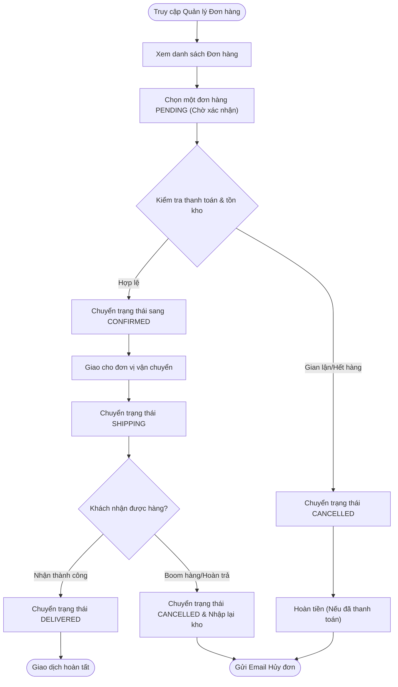

**Luồng sự kiện chính (Happy Path - Quản lý Đơn hàng):**
1. Admin truy cập module "Quản lý Đơn hàng".
2. Hệ thống hiển thị danh sách đơn hàng mới (Trạng thái `PENDING`).
3. Admin xem chi tiết đơn hàng, xác nhận thông tin thanh toán.
4. Admin nhấn "Xác nhận đơn". Trạng thái chuyển thành `CONFIRMED`. Hệ thống gửi email thông báo cho User.
5. Khi hàng được giao cho shipper, Admin cập nhật thành `SHIPPING`.
6. Khi có đối soát giao hàng thành công, Admin cập nhật thành `DELIVERED`.

**Luồng ngoại lệ (Exception/Alternative Paths):**
*   *7a. Hủy đơn hàng:* Nếu phát hiện gian lận hoặc hết hàng thực tế, Admin chuyển trạng thái sang `CANCELLED`. Hệ thống tự động hoàn lại số lượng tồn kho vào bảng `Product` và gửi email xin lỗi khách hàng.
*   *7b. Khóa tài khoản User:* Trong module "Quản lý Người dùng", nếu Admin phát hiện User có dấu hiệu boom hàng nhiều lần, Admin có thể đổi trạng thái User `is_active = false`. User này sẽ bị chặn đăng nhập (tham chiếu UC0).

#### UC8: Xem Dashboard & Thống kê (Admin Analytics & Reporting)

**Mô tả:** Quản trị viên truy cập trang tổng quan (Dashboard) để theo dõi các chỉ số vận hành quan trọng của sàn TMĐT: doanh thu theo mốc thời gian, số lượng đơn hàng theo từng trạng thái, sản phẩm bán chạy nhất, và thống kê các vi phạm tương thích phần cứng được người dùng tra cứu nhiều nhất.
**Actor chính:** Quản trị viên (Admin).
**Tiền điều kiện:** Admin đã đăng nhập thành công vào hệ thống.

**Sơ đồ hoạt động (Activity Diagram):**
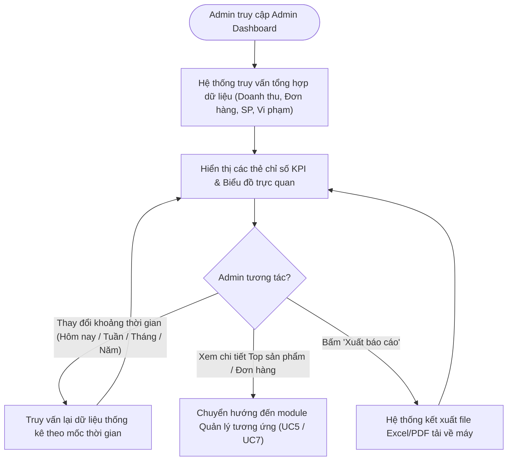

**Luồng sự kiện chính (Happy Path):**
1. Admin truy cập trang Quản trị, hệ thống mặc định điều hướng vào mục "Dashboard & Thống kê".
2. Hệ thống tổng hợp các số liệu KPI chính trong tháng hiện tại:
   - Tổng doanh thu bán hàng và tỷ lệ tăng trưởng so với kỳ trước.
   - Tổng số đơn hàng được phân bổ theo trạng thái (`PENDING`, `CONFIRMED`, `SHIPPING`, `DELIVERED`, `CANCELLED`).
   - Top 5 linh kiện bán chạy nhất và cảnh báo các mã linh kiện sắp hết hàng trong kho.
   - Thống kê tỷ lệ cấu hình PC tương thích và các lỗi phần cứng thường gặp nhất được Rule Engine ghi nhận.
3. Admin có thể thay đổi mốc thời gian xem báo cáo (7 ngày qua, 30 ngày qua, quý này).
4. Hệ thống cập nhật biểu đồ đường (Doanh thu) và biểu đồ tròn (Trạng thái đơn hàng) theo thời gian thực.
5. Admin có thể bấm "Xuất báo cáo" để lưu file bảng tính phục vụ đối soát tài chính.

**Luồng ngoại lệ (Exception/Alternative Paths):**
*   *8a. Dữ liệu chưa phát sinh trong kỳ lọc:* Nếu chọn khoảng thời gian chưa có phát sinh giao dịch, hệ thống hiển thị biểu đồ rỗng kèm thông báo "Không có dữ liệu trong khoảng thời gian đã chọn" thay vì báo lỗi hệ thống.

## 2. Thiết kế kiến trúc phần mềm (High-Level Design)

**Sơ đồ Kiến trúc Hệ thống (System Architecture Diagram):**

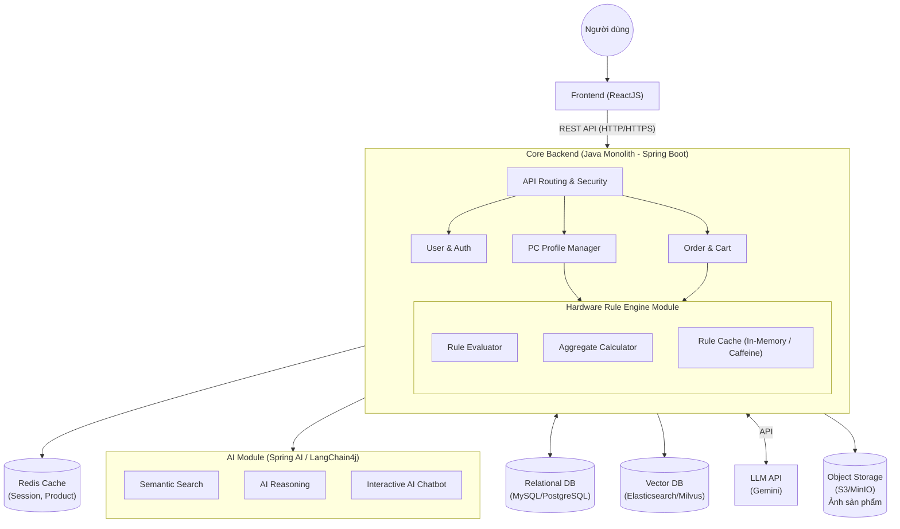

**Mô hình kiến trúc:**
Dự án sử dụng mô hình **Client-Server** kết hợp với kiến trúc **Java Monolith** cho Core Backend. Lựa chọn này gộp tất cả các tính năng nghiệp vụ E-commerce, Rule Engine và AI Module thành một khối duy nhất, rất phù hợp với quy mô team nhỏ (2 người), loại bỏ độ trễ mạng gọi chéo, giảm thiểu các thành phần hạ tầng (không cần Message Queue và AI Server riêng), dễ bảo trì mà vẫn đảm bảo hiệu suất tốt.
*   **Client (Frontend):** Ứng dụng Web (ReactJS).
*   **Core Backend (Java Monolith):** Hệ thống nghiệp vụ cốt lõi (Java - Spring Boot). Đóng vai trò là khối trung tâm xử lý toàn bộ nghiệp vụ. Tự xử lý API Routing, CORS và Security (Spring Security). Phía sau nó xử lý quản lý người dùng, đơn hàng, giỏ hàng, hồ sơ PC Profile. **Hardware Rule Engine** được tích hợp như một module nội bộ, sử dụng `CompletableFuture` và `@Async` để đánh giá nhiều rule song song. Các request liên quan đến AI sẽ được xử lý trực tiếp thông qua **AI Module** nằm cùng trên Spring Boot.
*   **AI Module (Spring AI / LangChain4j):** Trái tim thông minh của hệ thống, được nhúng trực tiếp vào Core Backend. Giao tiếp trực tiếp với Vector Database (truy vấn nhanh qua mạng cục bộ) và các API Mô hình ngôn ngữ lớn (LLM như Gemini) để thực hiện tác vụ suy luận.

**Phân rã hệ thống (Modules):**
1.  **User & E-commerce Core Module (Java Spring Boot):** Quản lý tài khoản, danh mục, giỏ hàng, đơn hàng, hồ sơ PC Profile.
2.  **Hardware Rule Engine Module (Java Spring Boot — cùng ứng dụng):** Module nội bộ chuyên đánh giá tính tương thích phần cứng. Nhận danh sách linh kiện, tải luật từ DB (có cache in-memory bằng Caffeine), tính toán aggregate values, đánh giá song song các rule bằng `CompletableFuture` và trả về kết quả vi phạm. Giao tiếp với các module khác qua method call nội bộ (không cần gRPC hay REST).
3.  **Semantic Search Subsystem (Java Spring AI):** Khác với tìm kiếm truyền thống, module này kết hợp Elasticsearch (Fuzzy Search) và vector hóa dữ liệu (Vector Database) để tìm kiếm dựa trên "ý nghĩa" câu chữ.
4.  **AI Reasoning Subsystem (Java Spring AI):** Nhận đầu vào là các yêu cầu mơ hồ, sử dụng LLM để:
    *   Suy luận ra nhu cầu cấu hình thực tế (VD: "Máy làm đồ họa kiến trúc" -> Cần ưu tiên CPU đa nhân, RAM lớn, Card Nvidia).
5.  **Interactive AI Chatbot (Java Spring AI):** Giao diện giao tiếp bằng ngôn ngữ tự nhiên, đóng vai trò luân chuyển dữ liệu từ người dùng đến các module AI phía trên và trả kết quả dưới dạng hội thoại.

## 3. Thiết kế dữ liệu (Database Design)

**Sơ đồ thực thể liên kết (ERD):**

```mermaid
erDiagram
    USER ||--o{ ORDER : places
    USER ||--o{ PC_PROFILE : creates
    USER ||--o{ CART : has
    CART ||--o{ CART_ITEM : contains
    CART_ITEM }o--|| PRODUCT : refers
    PC_PROFILE ||--o{ PROFILE_COMPONENT : contains
    PROFILE_COMPONENT }o--|| PRODUCT : refers
    ORDER ||--o{ ORDER_DETAIL : contains
    ORDER_DETAIL }o--|| PRODUCT : refers
    CATEGORY ||--o{ PRODUCT : categorizes
    COMPAT_RULE }o--|| CATEGORY : "source_category"
    COMPAT_RULE }o--|| CATEGORY : "target_category"
    PRODUCT ||--o| PRODUCT_EMBEDDINGS : "has (Vector DB)"
    
    USER {
        uuid user_id PK
        string name
        string email
        string password_hash
        string phone
        string address
        enum role "USER | ADMIN"
        boolean is_active
        timestamp created_at
    }
    CATEGORY {
        uuid category_id PK
        string category_code UNIQUE "Ma danh muc: CPU, MOTHERBOARD, RAM, GPU, PSU, CASE..."
        string category_name
        string description
        uuid parent_category_id FK "nullable - danh muc cha"
    }
    PRODUCT {
        uuid product_id PK
        string name
        string brand
        text description
        json specs "Thong so ky thuat dong"
        string image_url
        int price
        int stock_quantity
        float benchmark_score "Diem benchmark phuc vu tier ranking %"
        enum sync_status "SYNCED | PENDING | FAILED - Trang thai vector"
        boolean is_active
        uuid category_id FK
        timestamp created_at
    }
    CART {
        uuid cart_id PK
        uuid user_id FK
        timestamp updated_at
    }
    CART_ITEM {
        uuid cart_item_id PK
        uuid cart_id FK
        uuid product_id FK
        int quantity
    }
    ORDER {
        uuid order_id PK
        uuid user_id FK
        string shipping_address
        string phone
        enum payment_method "COD | TRANSFER | EWALLET | INSTALLMENT"
        enum payment_status "UNPAID | PAID | REFUNDED"
        enum status "PENDING | CONFIRMED | SHIPPING | DELIVERED | CANCELLED"
        int total_amount
        int discount_amount "Tien giam gia tu voucher/coupon"
        string voucher_code "Ma khuyen mai ap dung"
        string note
        timestamp created_at
    }
    ORDER_DETAIL {
        uuid order_detail_id PK
        uuid order_id FK
        uuid product_id FK
        int quantity
        int unit_price "Gia tai thoi diem dat hang"
    }
    PC_PROFILE {
        uuid profile_id PK
        uuid user_id FK
        string profile_name "VD: PC Gaming cua toi"
        text description
        timestamp created_at
        timestamp updated_at
    }
    PROFILE_COMPONENT {
        uuid component_id PK
        uuid profile_id FK
        uuid product_id FK
        int quantity "VD: 2 thanh RAM"
    }
    COMPAT_RULE {
        uuid rule_id PK
        string rule_name
        string source_category FK "Tham chieu Category.category_code"
        string target_category FK "Tham chieu Category.category_code"
        string source_spec_key
        string target_spec_key
        enum operator "EQUALS | IN | NOT_IN | LTE | GTE | RANGE"
        enum severity "ERROR | WARNING | INFO"
        text error_message_template
        boolean is_active
        int priority "So nho = uu tien cao"
        timestamp created_at
    }
    PRODUCT_EMBEDDINGS {
        uuid product_id PK
        vector embedding_vector
    }
```

**Mô tả các thực thể AI Context:**
*   Các bảng cơ bản: `User`, `Order`, `Product`, `Category`, `PC_Profile`, `Compat_Rule`.
*   **Thực thể cho AI:**
    *   `Product_Embeddings`: (1) Product - (1) Product_Embeddings (Chứa vector biểu diễn thông tin sản phẩm để phục vụ Semantic Search).

**Từ điển dữ liệu bổ sung:**

| Tên bảng | Tên trường | Kiểu dữ liệu | Ràng buộc | Mô tả |
| :--- | :--- | :--- | :--- | :--- |
| **Product_Embeddings** | `product_id` | UUID | Primary Key/FK | Mã sản phẩm |
| | `embedding_vector` | VECTOR | NOT NULL | Vector ngữ nghĩa của tên, mô tả và thông số kỹ thuật (dùng để query bằng độ tương tự cosine) |
| **Product** | `sync_status` | ENUM('SYNCED', 'PENDING', 'FAILED') | DEFAULT 'PENDING' | Trạng thái đồng bộ Vector vào Vector DB (hỗ trợ retry thủ công khi lỗi) |
| | `benchmark_score` | FLOAT | DEFAULT 0 | Điểm hiệu năng tham chiếu (Cinebench, 3DMark...) dùng để tính thanh % Tier Ranking trong PC Profile |
| **Order** | `payment_status` | ENUM('UNPAID', 'PAID', 'REFUNDED') | DEFAULT 'UNPAID' | Trạng thái thanh toán đơn hàng (phục vụ đối soát và hoàn tiền khi hủy đơn) |
| | `discount_amount` | INT | DEFAULT 0 | Số tiền được giảm trừ từ mã khuyến mãi / voucher |
| | `voucher_code` | VARCHAR(50) | NULL | Mã voucher áp dụng (VD: SMARTPC2025) |
| **Category** | `category_code` | VARCHAR(50) | UNIQUE, NOT NULL | Mã định danh chuẩn của loại linh kiện (VD: CPU, MOTHERBOARD, RAM, GPU, PSU, CASE) |
| **Compat_Rule** | `rule_id` | UUID | Primary Key | Mã định danh quy tắc tương thích |
| | `rule_name` | VARCHAR(255) | NOT NULL | Tên mô tả quy tắc (VD: "CPU-Motherboard Socket Match") |
| | `source_category` | VARCHAR(50) | NOT NULL, FK → Category.category_code | Loại linh kiện nguồn cần kiểm tra (VD: `CPU`) |
| | `target_category` | VARCHAR(50) | NOT NULL, FK → Category.category_code | Loại linh kiện đích để đối chiếu (VD: `MOTHERBOARD`) |
| | `source_spec_key` | VARCHAR(100) | NOT NULL | Key thông số kỹ thuật ở linh kiện nguồn (VD: `socket_type`) |
| | `target_spec_key` | VARCHAR(100) | NOT NULL | Key thông số kỹ thuật ở linh kiện đích (VD: `supported_sockets`) |
| | `operator` | ENUM('EQUALS', 'IN', 'NOT_IN', 'LTE', 'GTE', 'RANGE') | NOT NULL | Phép so sánh giữa source_spec và target_spec |
| | `severity` | ENUM('ERROR', 'WARNING', 'INFO') | NOT NULL | Mức độ nghiêm trọng: `ERROR` = chặn thêm giỏ hàng, `WARNING` = cảnh báo, `INFO` = gợi ý |
| | `error_message_template` | TEXT | NOT NULL | Template thông báo khi vi phạm, hỗ trợ placeholder `{source_value}`, `{target_value}` |
| | `is_active` | BOOLEAN | DEFAULT TRUE | Bật/tắt quy tắc mà không cần xóa |
| | `priority` | INT | DEFAULT 0 | Thứ tự ưu tiên đánh giá (số nhỏ = ưu tiên cao) |
| | `created_at` | TIMESTAMP | DEFAULT NOW() | Thời điểm tạo quy tắc |

*Quan hệ: `Compat_Rule.source_category` và `Compat_Rule.target_category` → FK tham chiếu đến `Category.category_code`. Mỗi quy tắc áp dụng lên một cặp loại linh kiện (VD: CPU ↔ MOTHERBOARD, RAM ↔ MOTHERBOARD, GPU ↔ CASE). Thông số kỹ thuật (`source_spec_key`, `target_spec_key`) tham chiếu đến các key trong trường JSON specs của bảng `Product`.*

**Dữ liệu mẫu quy tắc tương thích (Compat_Rule Seed Data):**

| rule_name | source → target | source_spec_key | operator | target_spec_key | severity |
| :--- | :--- | :--- | :--- | :--- | :--- |
| CPU-Motherboard Socket Match | CPU → Motherboard | `socket_type` | IN | `supported_sockets` | ERROR |
| RAM Type Compatibility | RAM → Motherboard | `memory_type` | IN | `supported_memory_types` | ERROR |
| RAM Slot Count | RAM (count) → Motherboard | `_count` | LTE | `ram_slots` | ERROR |
| Max RAM Capacity | RAM (tổng) → Motherboard | `_sum_capacity_gb` | LTE | `max_ram_gb` | ERROR |
| GPU Length vs Case | GPU → Case | `length_mm` | LTE | `max_gpu_length_mm` | ERROR |
| CPU Cooler Socket Support | CPU → CPU_Cooler | `socket_type` | IN | `supported_sockets` | ERROR |
| PSU Wattage Sufficiency | _SYSTEM (tổng TDP) → PSU | `_total_tdp_w` | LTE | `rated_wattage_w` | WARNING |
| Mainboard Form Factor vs Case | Motherboard → Case | `form_factor` | IN | `supported_form_factors` | ERROR |
| M.2 Slot Count | SSD_M2 (count) → Motherboard | `_count` | LTE | `m2_slots` | WARNING |
| PCIe Generation | GPU → Motherboard | `pcie_gen` | LTE | `max_pcie_gen` | INFO |

> *Lưu ý thiết kế: Các `spec_key` bắt đầu bằng `_` (VD: `_count`, `_sum_capacity_gb`, `_total_tdp_w`) là các giá trị tính toán động (aggregate), được Rule Engine tính từ danh sách linh kiện trong PC Profile, không phải trường trực tiếp trong bảng Product.*

> *Lưu ý kiến trúc: Việc gộp AI Module trực tiếp vào Java Core Monolith giúp loại bỏ hoàn toàn độ trễ gọi chéo mạng. Quá trình Semantic Search sẽ query trực tiếp Vector Database, sau đó Java Core sử dụng thẳng JPA/Hibernate để lấy thông tin chi tiết sản phẩm ngay trong cùng một process, tối ưu hóa tối đa hiệu suất và băng thông.*

## 4. Thiết kế chi tiết (Low-Level Design / Internal Design)

**Sơ đồ tuần tự: Luồng Tìm kiếm ngữ nghĩa & Suy luận với LLM**

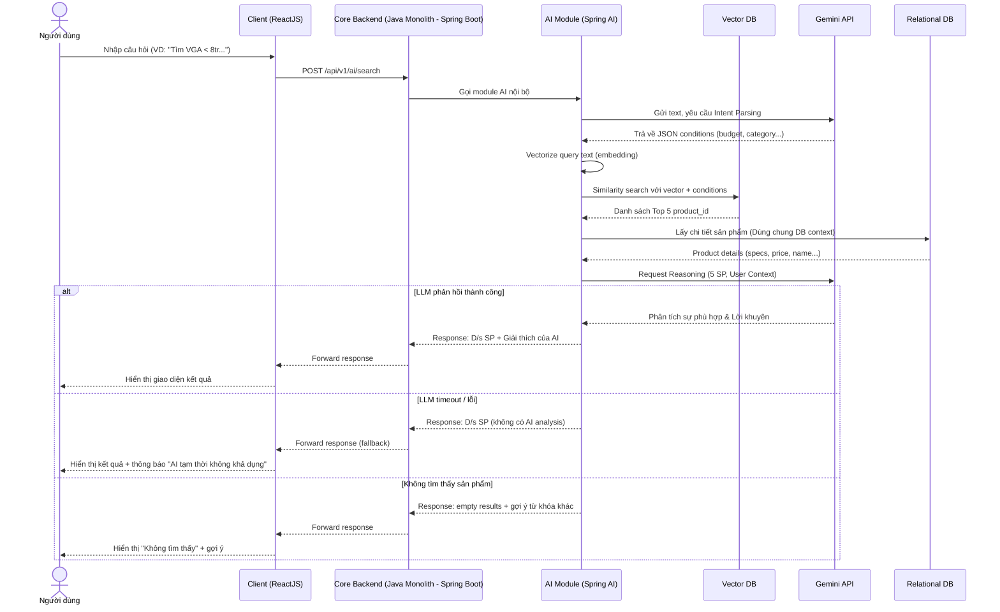

**Luồng xử lý (Data Flow): Luồng Tìm kiếm ngữ nghĩa & Suy luận với LLM**
1.  **Input:** Người dùng nhập: *"Cần mua card màn hình dưới 8 triệu chạy mượt Cyberpunk 2077 và thỉnh thoảng edit video"*.
2.  **Intent Parsing (LLM):** Hệ thống gửi chuỗi này đến LLM (Gemini). AI suy luận và trích xuất ra các điều kiện: `{ "budget": <= 8000000, "category": "VGA", "keywords": ["gaming high-end", "video editing"], "brand_preference": "Nvidia (tốt cho edit video)" }`.
3.  **Database Query:** Hệ thống dùng JSON trên để query vào database hoặc Vector DB, lấy ra top 5 sản phẩm phù hợp nhất (VD: RTX 4060, RX 7600).
4.  **AI Reasoning & Generation:** Gửi danh sách 5 sản phẩm này ngược lại cho LLM yêu cầu giải thích sự phù hợp dựa trên ngữ cảnh người dùng.
5.  **Output:** Trả về kết quả hiển thị cho Frontend gồm: Danh sách sản phẩm + Đoạn giải thích suy luận của AI (VD: *"RTX 4060 được đề xuất vì hỗ trợ CUDA tốt cho việc edit video của bạn..."*).

---

**Sơ đồ tuần tự: Luồng Kiểm tra tính tương thích phần cứng (Compatibility Check)**

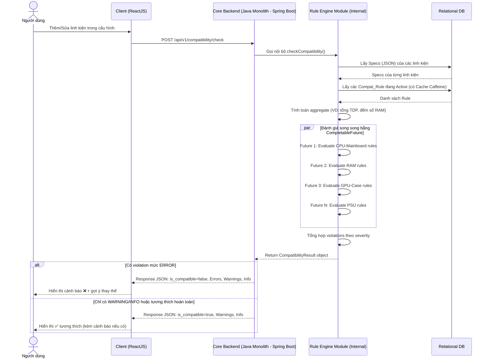

**Luồng xử lý (Data Flow): Luồng Kiểm tra tính tương thích phần cứng (Compatibility Check)**
1.  **Input:** Người dùng thêm linh kiện vào giỏ hàng hoặc vào PC Profile Builder (VD: chọn CPU Intel i7-13700K khi đã có Mainboard ASUS ROG X670E socket AM5).
2.  **Fetch Specs:** Core Backend (Java) nhận request trực tiếp từ Frontend, chuyển đến Rule Engine Module nội bộ. Module truy vấn bảng `Product` để lấy thông số kỹ thuật (JSON specs) của tất cả linh kiện hiện có trong cấu hình.
3.  **Load Rules:** Rule Engine Module tải toàn bộ quy tắc `is_active = TRUE` từ bảng `Compat_Rule` (có cache bằng Caffeine in-memory để tối ưu), lọc theo các cặp `source_category` ↔ `target_category` có mặt trong cấu hình.
4.  **Evaluate (Song song bằng CompletableFuture):** Các rule được nhóm theo cặp category và đánh giá song song bằng `CompletableFuture.supplyAsync()`. Với mỗi quy tắc, engine trích xuất giá trị `source_spec_key` và `target_spec_key` từ specs của linh kiện tương ứng, sau đó thực hiện phép so sánh theo `operator`:
    *   `EQUALS`: source_value == target_value
    *   `IN`: source_value nằm trong danh sách target_value
    *   `LTE` / `GTE`: source_value <= / >= target_value (dùng cho số)
    *   Với các aggregate key (bắt đầu bằng `_`): tính toán từ tập linh kiện (VD: đếm số thanh RAM, tổng dung lượng RAM, tổng TDP).
5.  **Output:** Tổng hợp kết quả từ tất cả CompletableFuture, trả về danh sách vi phạm (violations) kèm severity. Nếu có bất kỳ violation nào ở mức `ERROR`, hệ thống hiển thị cảnh báo và có thể chặn thêm vào giỏ hàng.

**Đặc tả API cho module kiểm tra tương thích (Module Specification):**
*   **REST Endpoint:** `POST /api/v1/compatibility/check` (Thuộc Core Backend - Java Spring Boot)
*   **Internal Method:** `CompatibilityService.checkCompatibility(List<UUID> productIds)` (Gọi nội bộ trong cùng ứng dụng Spring Boot, không cần gRPC)
*   **Tên class nội bộ (Java):** `CompatibilityService`, `RuleEvaluator`, `AggregateCalculator`
*   **Mô tả:** Nhận danh sách ID sản phẩm, đánh giá tính tương thích dựa trên các quy tắc trong bảng `Compat_Rule`, trả về kết quả chi tiết.
*   **Đầu vào (Request Body JSON):**
    `{ "product_ids": ["uuid-cpu", "uuid-mainboard", "uuid-ram-1", "uuid-ram-2", "uuid-gpu", "uuid-psu", "uuid-case"] }`
*   **Xử lý:** Nhận request → Fetch `Product` specs cho từng ID → Load `Compat_Rule` (active, có cache Caffeine) → Tính aggregate values → Đánh giá song song các rule bằng CompletableFuture → Tổng hợp violations theo severity.
*   **Kết quả trả về (Response JSON):**
```json
{
  "is_compatible": false,
  "errors": [
    {
      "rule_name": "CPU-Motherboard Socket Match",
      "severity": "ERROR",
      "message": "CPU socket LGA1700 không tương thích với Mainboard (hỗ trợ: AM5)",
      "source_product": { "id": "uuid-cpu", "name": "Intel Core i7-13700K" },
      "target_product": { "id": "uuid-mainboard", "name": "ASUS ROG X670E" }
    }
  ],
  "warnings": [
    {
      "rule_name": "PSU Wattage Sufficiency",
      "severity": "WARNING",
      "message": "Tổng TDP hệ thống (380W) đang gần ngưỡng 80% công suất PSU (500W). Khuyến nghị nâng cấp nguồn.",
      "source_product": null,
      "target_product": { "id": "uuid-psu", "name": "Corsair CV550" }
    }
  ],
  "info": []
}
```

---

**Sơ đồ tuần tự: Luồng Đặt hàng & Thanh toán (Checkout Flow)**

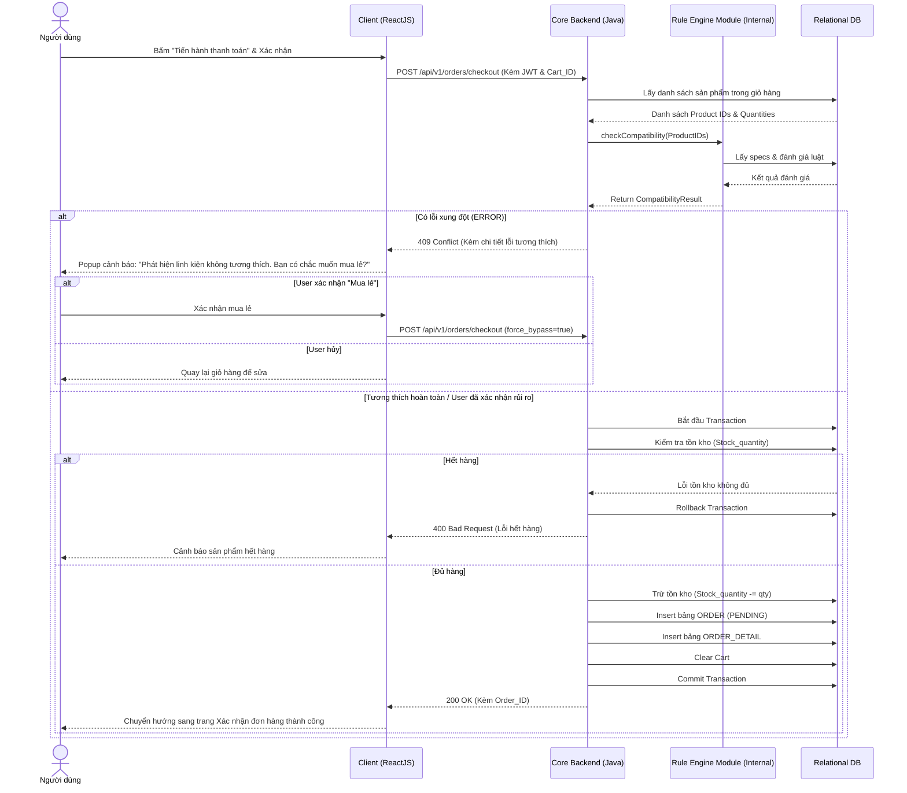

**Luồng xử lý (Data Flow): Luồng Đặt hàng & Thanh toán (Checkout Flow)**
1. **Input:** Người dùng xác nhận thanh toán giỏ hàng (chứa danh sách các sản phẩm và thông tin giao hàng).
2. **Compatibility Check (Ngầm):** Core Backend (Java) trước khi tạo đơn sẽ tổng hợp danh sách ID linh kiện và gọi Rule Engine Module nội bộ để kiểm tra lại toàn bộ giỏ hàng, đề phòng trường hợp người dùng thêm lẻ các linh kiện xung đột vào giỏ (VD: mua CPU AMD và Mainboard Intel).
3. **Database Transaction:** Nếu tương thích (hoặc người dùng đã chủ động xác nhận mua rời), Java Core mở một ACID transaction. Tiến hành kiểm tra và trừ tồn kho các sản phẩm, tạo record vào bảng `ORDER` và `ORDER_DETAIL`, đồng thời xóa dữ liệu trong giỏ hàng.
4. **Rollback & Error Handling:** Nếu bất kỳ bước nào thất bại (Rule Engine Module phát hiện xung đột, hoặc DB báo hết hàng), toàn bộ quá trình sẽ được Rollback, DB không thay đổi, và thông báo lỗi tương ứng được trả về để Frontend hiển thị cho người dùng xử lý.

---

**Sơ đồ tuần tự: Luồng Phân tích PC Profile & Đề xuất Nâng cấp**

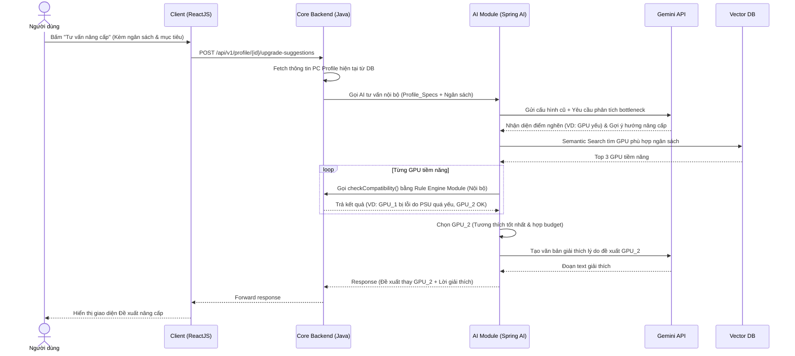

**Luồng xử lý (Data Flow): Luồng Phân tích PC Profile & Đề xuất Nâng cấp**
1. **Input:** Người dùng yêu cầu tư vấn nâng cấp dựa trên PC Profile có sẵn, kèm theo mức ngân sách và nhu cầu (VD: "Có 5 triệu, muốn chơi game mượt hơn").
2. **AI Bottleneck Analysis:** AI Module (Java Spring AI) gửi thông số chi tiết dàn PC cũ và mục tiêu của người dùng cho Gemini LLM để đánh giá tìm ra "điểm nghẽn" (bottleneck) cản trở hiệu năng (VD: CPU quá yếu so với GPU hiện tại).
3. **AI Search:** Khi biết cần thay linh kiện gì (VD: cần thay CPU), AI dùng Vector DB tìm các CPU thỏa mãn mức ngân sách.
4. **Rule Engine Validation (Bước chốt chặn):** Nhờ tích hợp chung trong Core Backend, AI Module gọi hàm kiểm tra tương thích của Rule Engine một cách trực tiếp (Method Call) đối với từng ứng viên linh kiện. Ví dụ: Nếu CPU mới khác socket so với Mainboard cũ, Rule Engine sẽ báo ERROR ngay lập tức. Khi đó AI sẽ biết phải gợi ý thay cả Mainboard, hoặc tìm CPU khác cùng socket.
5. **Output:** Sau khi tìm được phương án tối ưu (Hiệu năng tốt + Đúng ngân sách + Rule Engine báo tương thích an toàn), AI sẽ sinh văn bản giải thích lý luận của mình và trả về Frontend để người dùng tham khảo và bấm "Thêm vào giỏ".

## 5. Thiết kế giao diện người dùng (UI/UX)

### 5.1. Sơ đồ di chuyển màn hình (Screen Navigation Flow)

Luồng thao tác chính của người dùng giữa các màn hình:
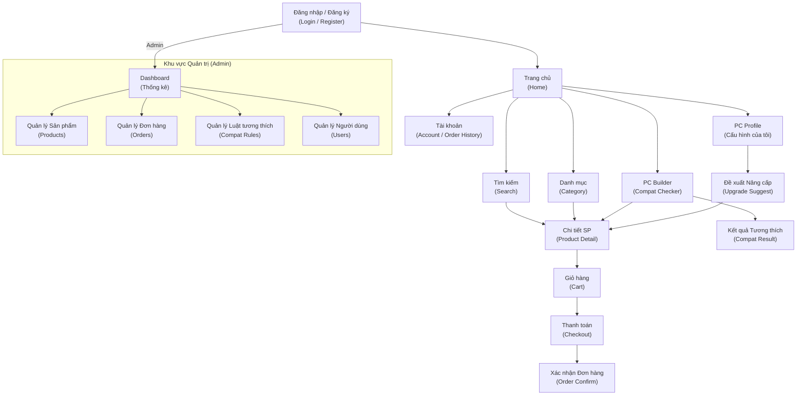

**Mô tả các luồng di chuyển chính:**

| STT | Luồng | Mô tả |
| :--- | :--- | :--- |
| 1 | Đăng nhập → Trang chủ → Tìm kiếm → Chi tiết SP → Giỏ hàng → Thanh toán → Xác nhận | Luồng mua hàng cơ bản |
| 2 | Trang chủ → Danh mục → Chi tiết SP | Duyệt sản phẩm theo danh mục |
| 3 | Trang chủ → PC Builder → Chọn linh kiện → Kết quả Tương thích | Xây dựng cấu hình và kiểm tra tương thích real-time |
| 4 | PC Builder → Chi tiết SP → Giỏ hàng | Từ builder, xem chi tiết rồi thêm cả bộ vào giỏ |
| 5 | Trang chủ → PC Profile → Đề xuất Nâng cấp → Chi tiết SP → Giỏ hàng | Xem cấu hình, nhận gợi ý nâng cấp, xem chi tiết và mua |
| 6 | Trang chủ → Tài khoản | Xem lịch sử đơn hàng, chỉnh sửa thông tin cá nhân |
| 7 | Đăng nhập (Admin) → Dashboard → Quản lý SP / Đơn hàng / Luật / Người dùng | Luồng quản trị hệ thống |

### 5.2. Bản vẽ giao diện (Layout / Mockup)

> *Ghi chú thiết kế: Các mockup dưới đây được thiết kế tham khảo chuẩn UI/UX từ các nền tảng TMĐT công nghệ hàng đầu tại Việt Nam: **Phong Vũ** (phongvu.vn) — hệ thống danh mục linh kiện chuyên sâu & công cụ Build PC; **Thế Giới Di Động** (thegioididong.com) — bộ lọc Quick Chips & checkout tinh gọn; **CellphoneS** (cellphones.com.vn) — giao diện hiện đại, cross-sell thông minh; **Mac24h** (mac24h.vn) — variant selector & trình bày sản phẩm cao cấp; **HACOM** (hacom.vn) — bảng thông số kỹ thuật chuyên sâu.*

#### Màn hình 0: Đăng nhập / Đăng ký (Login / Register)

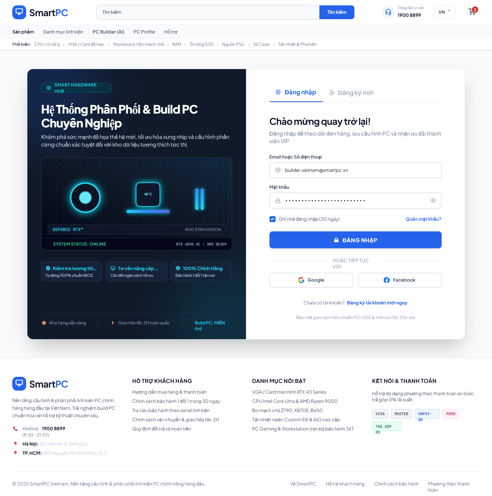

---

#### Màn hình 1: Trang chủ (Home)

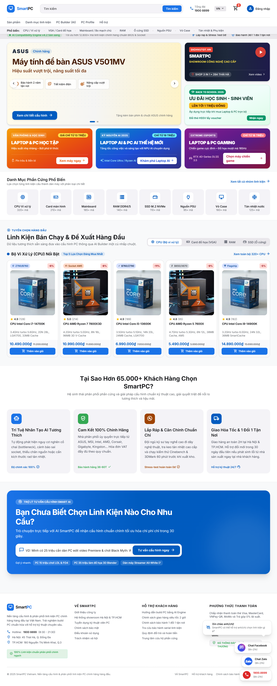

---

#### Màn hình 2: Tìm kiếm thông minh (AI Search)

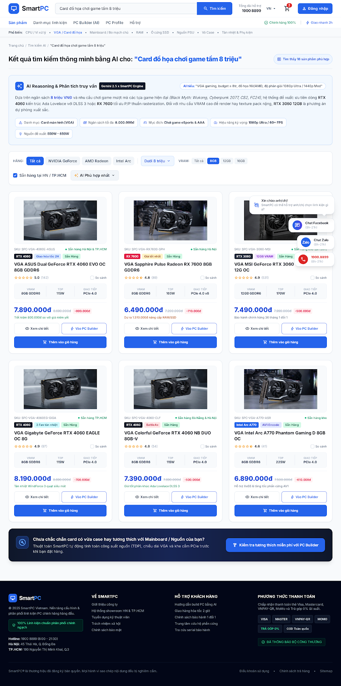

**Trạng thái Loading (khi AI đang xử lý, ~2-5 giây):**

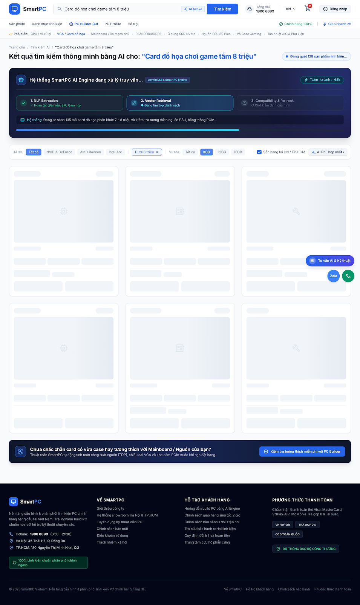

**Trạng thái Fallback (khi AI không khả dụng):**

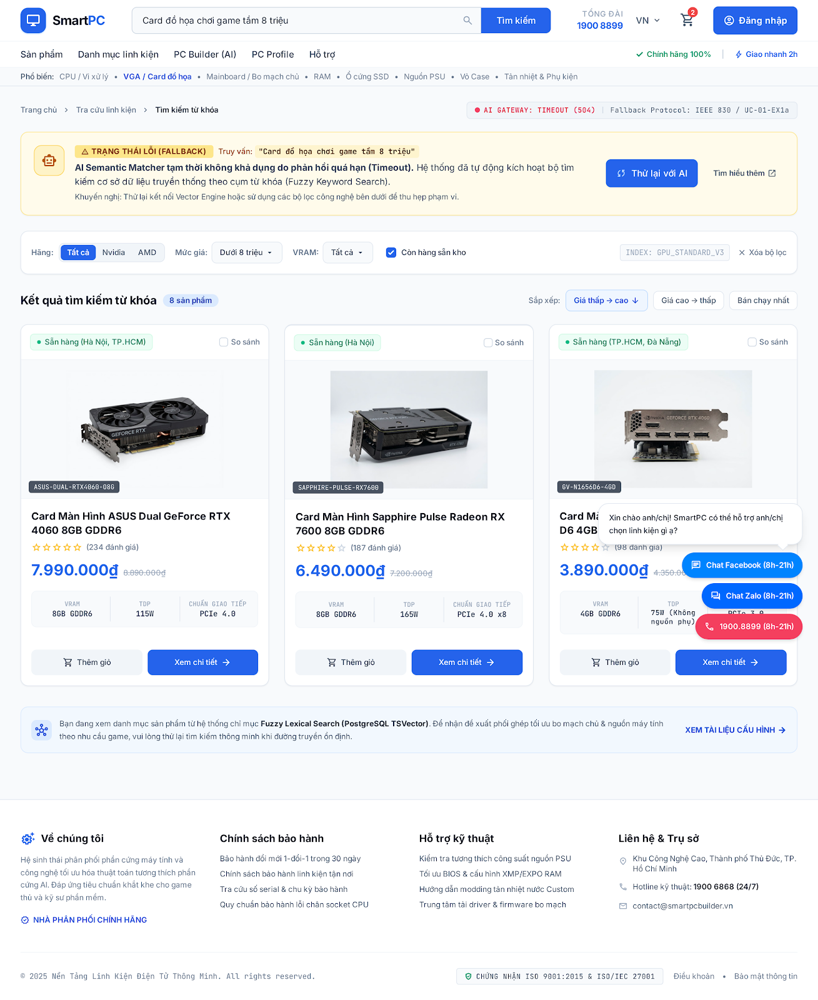

---

#### Màn hình 3: Chi tiết sản phẩm (Product Detail)

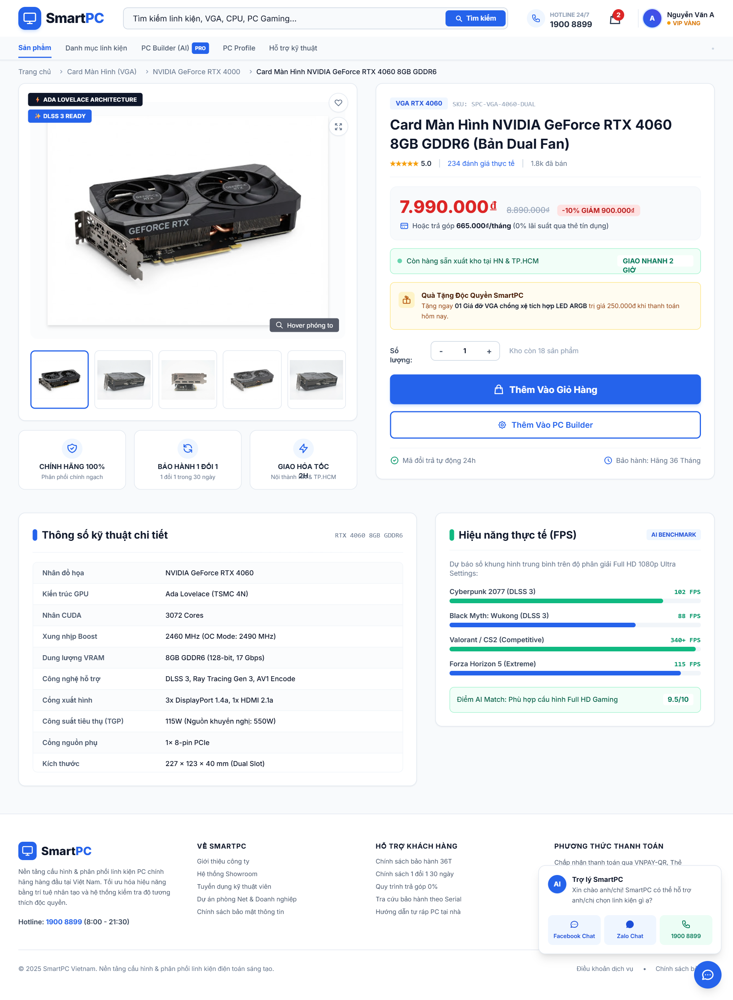

---

#### Màn hình 4: PC Builder & Compatibility Checker

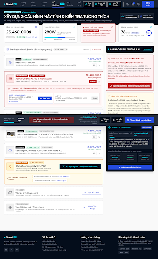

---

#### Màn hình 5: Giỏ hàng (Cart)

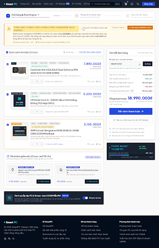

---

#### Màn hình 6: Thanh toán (Checkout — One-Page)

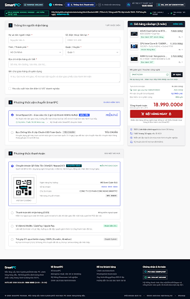

---

#### Màn hình 7: Xác nhận đơn hàng (Order Confirmation)

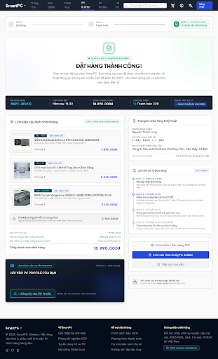

---

#### Màn hình 8: PC Profile & Đề xuất nâng cấp (Upgrade Suggestion)

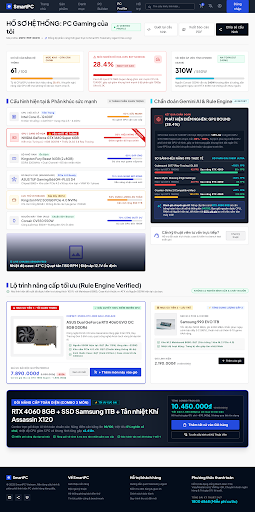

### 5.3. Prompt tạo hình ảnh giao diện qua Google Stitch

> *Hướng dẫn sử dụng: Truy cập [Google Stitch](https://stitch.withgoogle.com), tạo project mới, paste từng prompt bên dưới vào thanh nhập lệnh. Stitch sẽ sinh ra giao diện UI high-fidelity tương ứng. Có thể đính kèm ảnh mockup hiện tại (`docs/screens/screen0.png` — `docs/screens/screen6.png`) làm reference image để Stitch giữ nguyên bố cục cấu trúc khi cải tiến đồ họa.*
>
> *Quy chuẩn chung cho tất cả prompt: Nền tảng TMĐT linh kiện PC Việt Nam tên "SmartPC". Bảng màu: Navy đậm (#1A2332), Xanh dương (#1A44D8), Cyan/Teal (#00BCD4), Trắng (#FFFFFF), Xám viền (#E5E7EB), Đỏ CTA (#E30019). Font: Inter hoặc Be Vietnam Pro. Ngôn ngữ hiển thị: Tiếng Việt. Desktop web resolution (1440px width). KHÔNG vẽ khung thiết bị (laptop/phone), chỉ vẽ giao diện web thuần.*

---

#### Prompt 0 — Màn hình Đăng nhập / Đăng ký (`docs/screens/screen0.png`)
```text
Design a professional e-commerce login page for a Vietnamese PC hardware store called "SmartPC".

LAYOUT: Split-screen, 2 equal columns.

LEFT COLUMN (50%):
- Dark navy background (#1A2332)
- Large high-quality hero image showing assembled PC components: a GPU, motherboard with RGB RAM sticks, in dramatic lighting
- Below the image, 3 selling point items in a horizontal row with icons:
  ✅ "Tự Động Kiểm Tra Tương Thích"
  🤖 "Tư Vấn Nâng Cấp Bằng AI"
  🏅 "100% Linh Kiện Chính Hãng"
- Bottom thin bar with text: "Kho hàng sẵn sàng | Giao hỏa tốc 2H toàn quốc | Hỗ trợ Build PC: MIỄN PHÍ"

RIGHT COLUMN (50%):
- Clean white background
- Two tabs at top: "🔗 Đăng nhập" (active, blue underline) and "✏️ Đăng ký mới"
- Title: "Chào mừng quay trở lại!" with subtitle
- Form fields: Email input with mail icon, Password input with lock icon and show/hide eye toggle
- Checkbox: "Ghi nhớ đăng nhập (30 ngày)" with link "Quên mật khẩu?" aligned right
- Large blue (#1A44D8) CTA button: "🔒 ĐĂNG NHẬP"
- Divider line with text "HOẶC TIẾP TỤC VỚI"
- Two outlined social login buttons side by side: "G Google" and "f Facebook"
- Bottom text: "Chưa có tài khoản? Đăng ký tài khoản mới ngay" (link in blue)

HEADER: Navy bar with logo "SmartPC", nav items: Trang chủ, Sản phẩm, Danh mục, PC Builder, PC Profile, Hỗ trợ. Language selector "VN", cart icon, user icon.

FOOTER: 4-column footer.
```

#### Prompt 1 — Màn hình Trang chủ (`docs/screens/screen1.png`)
```text
Design a comprehensive Vietnamese e-commerce homepage for a PC hardware store called "SmartPC". Aspect ratio: 9:16 (tall).

HEADER (sticky, dark navy #1A2332):
- Logo "SmartPC", search bar with placeholder and "✨ AI prompt" button
- Cart icon with red badge "5", user avatar "Nguyễn Văn A"
- Navigation row below: 🏠 Trang chủ | 📦 Danh mục linh kiện ▾ | 🔧 PC Builder & Check Tương Thích | 💻 PC Profile của tôi

HERO SECTION:
- Left (60%): Dark gradient background with large text "Build PC Gaming từ 15 Triệu". Below: stats "99.98% Tương thích chính xác socket | < 2ms Thời gian rule-check". Two CTA buttons.
- Right (40%): Featured combo product card.

3 FEATURE CARDS (horizontal row):
- AI Reasoning & Semantic Search | Hardware Rule Engine | PC Profile & Bottleneck Detection

CATEGORY ICON ROW: 6 rounded square icons (CPU, GPU, RAM, SSD, Mainboard, Nguồn & Vỏ Case).

TRENDING PRODUCTS SECTION:
- 4-column product card grid. Each card: product image, name, star rating, key spec tags, price, "🛒 Thêm giỏ" and "🔧 + PC Builder" buttons.

AI ASSISTANT HUB SECTION (dark navy background):
- Gemini sparkle icon with title "Hỏi Chuyên Gia AI Phần Cứng"
- Large search input with button "Gửi câu hỏi cho AI ✨"
- Quick prompt chip suggestions below.

FOOTER: Dark footer with 4 columns.
```

#### Prompt 2 — Nhóm Màn hình Tìm kiếm AI (`docs/screens/screen2a.png`, `docs/screens/screen2b.png`, `docs/screens/screen2c.png`)
```text
Design an AI-powered search results page for a Vietnamese PC hardware store "SmartPC". User searched: "Card đồ họa chơi game tầm 8 triệu".

HEADER: Dark navy header.

AI ANALYSIS PANEL (light blue box):
- "AI hiểu: 'VGA gaming, budget ≤ 8tr, đồ họa NV/AMD'"
- AI advisory paragraph explaining GPU recommendations.
- Extracted condition tags (Category, Budget, Purpose, etc).

FILTER BAR (horizontal chips):
- Brand chips: [Tất cả] [Nvidia] [AMD] [Intel]
- Price dropdown: "Dưới 8 triệu ▾"
- VRAM chips: [8GB] [12GB] [16GB]
- Sort dropdown: "✨ AI Phù hợp nhất ▾"

PRODUCT RESULTS (vertical list cards):
- Card 1: TOP PICK (95% AI match). Product image of ASUS RTX 4060, full name, rating, specs. Price. AI explanation box explaining why it matches. "Thêm vào giỏ hàng" and "Thêm vào PC Builder" buttons.
- Card 2: BEST VALUE (89% match). AMD Radeon RX 7600.
- Card 3: VRAM LARGE (88% match). MSI RTX 3060 12GB.
```

#### Prompt 3 — Màn hình Chi tiết sản phẩm (`docs/screens/screen3.png`)
```text
Design a product detail page for an NVIDIA GeForce RTX 4060 8GB GPU on "SmartPC". Layout: 2.5 columns.

LEFT COLUMN (45% — Gallery):
- Large product image on white background, "ADA LOVELACE" and "DLSS 3 Ready" badges.
- 5 thumbnail images below. Trust badges (Chính hãng 100%, Bảo hành 36T).

CENTER COLUMN (35% — Purchase Info):
- Full name: "Card Màn Hình NVIDIA GeForce RTX 4060 8GB GDDR6 (Bản Dual Fan)"
- Rating: ★★★★★ 5.0 (234 reviews)
- Price: "7.990.000đ" with crossed out original price and "-10%" badge.
- Stock: "✅ Còn hàng sẵn xuất". Quantity selector.
- Two large CTA buttons: "🛒 Thêm vào giỏ hàng" and "🔧 Thêm vào PC Builder".

RIGHT COLUMN (20% — Compatibility Widget):
- Title: "⚙️ Kiểm tra tương thích phần cứng"
- Check results:
  🟢 "Chuẩn khe cắm PCIe: HOÀN TOÀN TƯƠNG THÍCH"
  🟡 "Kích thước khoang vỏ Case: VỪA VẶN KHÔNG"
  🔴 "Công suất nguồn đề xuất: CẦN NÂNG CẤP KHUYẾN NGHỊ"

BELOW FOLD:
- Left: Technical Specs Table (zebra striping)
- Right: AI Hardware Rating box with benchmark FPS scores (Cyberpunk 2077, CS2).
```

#### Prompt 4 — Màn hình PC Builder (`docs/screens/screen4.png`)
```text
Design a PC Builder & Compatibility Checker tool page for "SmartPC".

HEADER & TITLE: "XÂY DỰNG CẤU HÌNH MÁY TÍNH & KIỂM TRA TƯƠNG THÍCH".

DASHBOARD SUMMARY BAR (4 metric cards in a row):
1. TỔNG CHI PHÍ CẤU HÌNH: 25.460.000đ
2. TỔNG TDP ƯỚC TÍNH: 280W (bar chart)
3. TRẠNG THÁI RULE ENGINE: 1 Xung đột vật lý nghiêm trọng (red badge)
4. GEMINI BALANCE INDEX: 78/100

COMPONENT LIST SECTION (left 65%):
Row-by-row (CPU, Mainboard, RAM, VGA, SSD, PSU, Case, Cooler).
- CPU: Intel Core i7-13700K (selected).
- Mainboard: ASUS ROG Strix X670E-F with RED ERROR BANNER "❌ XUNG ĐỘT SOCKET". Quick fix suggestions below.
- RAM, VGA, SSD selected with green compatibility badges.
- PSU: Highlighted yellow box "BẮT BUỘC CHỌN | Khuyến nghị: ≥ 550W".

RIGHT SIDEBAR (35%) — "Chẩn Đoán Hardware Rule Engine":
- Error section detailing socket mismatch.
- Warning section about PSU capacity.
- Gemini AI Hardware Advisor panel with bottleneck analysis.

STICKY BOTTOM BAR: Progress (5/8 linh kiện), Total Price, "Thêm tất cả vào giỏ hàng" button.
```

#### Prompt 5 — Nhóm Màn hình Giỏ hàng & Thanh toán (`docs/screens/screen5a.png`, `docs/screens/screen5b.png`, `docs/screens/screen5c.png`)
```text
Design a shopping cart and one-page checkout flow for "SmartPC".

CART PAGE:
- Step indicator: ① Giỏ hàng & Rule Engine (active) ——→ ② Thanh toán ——→ ③ Hoàn tất
- Yellow Warning Banner at top: "CẢNH BÁO XUNG ĐỘT TƯƠNG THÍCH PHẦN CỨNG" regarding RAM bus speed.
- Left column (65%): List of 3 items (GPU, CPU, RAM) with thumbnail, specs tags, price, and quantity selector. Cross-sell section below "Mua kèm giảm sốc".
- Right column (35%): Sticky Order Summary. Subtotal, Shipping, Coupon input, Total "18.990.000đ". "Tiến hành thanh toán →" button.

CHECKOUT PAGE (One-page):
- Left column: Delivery Info form (Name, Phone, Address, Delivery notes). Payment Methods radio buttons (COD, VietQR, E-wallet, Installment). Rule Engine confirmation badge "PASSED - AN TOÀN".
- Right column: Sticky sidebar with order summary (3 mini-cards for products), total price, and large red "ĐẶT HÀNG NGAY" button.

ORDER CONFIRMATION:
- Success hero section (green) with checkmark: "ĐẶT HÀNG THÀNH CÔNG!".
- Order info bar (Order ID, Date, Total, COD, Status).
- Left: List of 3 components ordered.
- Right: Delivery info and vertical timeline "Lộ trình xử lý đơn hàng".
- Banner suggesting to add these items to the user's "PC Profile".
```

#### Prompt 6 — Màn hình PC Profile & Nâng cấp (`docs/screens/screen6.png`)
```text
Design a PC Profile and AI-powered upgrade suggestion page for "SmartPC".

TITLE SECTION: "HỒ SƠ HỆ THỐNG: PC Gaming của tôi" with "AI Verified Profile" badge.

DASHBOARD CARDS:
- CHỈ SỐ CÂN BẰNG: 61/100
- MỨC NGHẼN ĐỒ HỌA GPU: 28.4%
- TẢI ĐIỆN ÁP ƯỚC TÍNH: 310W / 550W

LEFT SECTION (55%) — "Cấu hình hiện tại & Phân khúc" (6 Components):
- CPU: i5-12400F — Tier bar 62% (yellow/amber)
- GPU: GTX 1660 Super — Tier bar 50% (RED fill, pulsing) with "⚠️ Yếu nhất hệ thống" warning (Bottleneck)
- RAM, SSD, Mainboard, PSU listed with specs and tier bars.

RIGHT SECTION (45%) — Bottleneck Analysis:
- "Phân tích điểm nghẽn hệ thống" panel. Red alert: GPU Bottleneck.
- FPS Comparison bars: Cyberpunk 2077 (Hiện tại 42 FPS → Sau nâng cấp 85+ FPS).

UPGRADE ROADMAP SECTION:
- "Lộ trình nâng cấp tối ưu (Rule Engine Verified)".
- Priority 1: GPU RTX 4060 8GB. Shows compatibility checks (PSU OK, PCIe OK, Case OK). "+ Thêm món này vào giỏ" button.
- Priority 2: SSD 1TB.
- Combo Deal Bar at bottom: "Gói Nâng Cấp Toàn Diện (Combo 3 Món)" showing discounted bundle price and "Thêm tất cả vào Giỏ hàng" button.
```

## 6. Cấu trúc Phân rã Công việc (WBS) theo Chức năng

Dựa vào tài liệu đặc tả, dưới đây là WBS phân rã hệ thống theo dạng cây chức năng (Feature-based WBS). Hệ thống được chia thành các phân hệ (Module) lớn, mỗi phân hệ tương ứng với các Use-Case cốt lõi và được bẻ nhỏ thành các tác vụ (Task) phát triển cụ thể.

```text
Nền tảng TMĐT Linh kiện Thông minh
│
├──── 6.1 Quản lý Tài khoản & Xác thực (UC0, UC7)
│     ├──── 6.1.1 Thiết kế Database User, Phân quyền Role (Admin/User)
│     ├──── 6.1.2 Đăng ký/Đăng nhập bằng Email & Mật khẩu
│     ├──── 6.1.3 Đăng nhập qua mạng xã hội (Google, Facebook)
│     ├──── 6.1.4 Quản lý JWT Token/Session
│     ├──── 6.1.5 Quản lý trạng thái tài khoản (Admin khóa/mở tài khoản)
│     ├──── 6.1.6 Quản lý Quên mật khẩu & Khóa tạm thời khi sai mật khẩu 5 lần
│     └──── 6.1.7 Trang Quản lý Hồ sơ cá nhân & Lịch sử đơn hàng (User)
│
├──── 6.2 Quản lý Sản phẩm & Danh mục (UC1a, UC5)
│     ├──── 6.2.1 Quản lý Cây danh mục (Category)
│     ├──── 6.2.2 Quản lý Thông tin cơ bản linh kiện (Tên, Ảnh, Giá, Tồn kho)
│     ├──── 6.2.3 Quản lý Thông số kỹ thuật động (Dynamic JSON Specs)
│     ├──── 6.2.4 Tự động đồng bộ Embedding Vector vào Vector DB khi lưu SP
│     ├──── 6.2.5 Trang danh sách & Duyệt sản phẩm theo danh mục (Frontend - UC1a)
│     └──── 6.2.6 Chức năng đồng bộ lại Vector DB thủ công (Manual Re-sync Vector)
│
├──── 6.3 Tìm kiếm Ngữ nghĩa & AI Chat (UC1)
│     ├──── 6.3.1 Giao diện Chat/Thanh tìm kiếm AI (Frontend)
│     ├──── 6.3.2 Tích hợp LLM để phân tích ý định (Intent Parsing)
│     ├──── 6.3.3 Truy vấn độ tương tự trong Vector DB (Similarity Search)
│     ├──── 6.3.4 AI suy luận, đánh giá sự phù hợp và tạo câu trả lời
│     └──── 6.3.5 Fallback sang tìm kiếm từ khóa ElasticSearch khi AI lỗi
│
├──── 6.4 Core Rule Engine - Quản lý Tập luật (UC6)
│     ├──── 6.4.1 Quản lý Tập luật (Giao diện Admin Thêm/Sửa/Xóa Luật)
│     ├──── 6.4.2 Validate cấu trúc dữ liệu Luật (Source, Target, Spec_key, Operator)
│     ├──── 6.4.3 Xây dựng Evaluator xử lý phép toán (EQUALS, IN, LTE, GTE...)
│     ├──── 6.4.4 Xây dựng Aggregate Calculator (Tính tổng số RAM, tổng TDP...)
│     └──── 6.4.5 Tích hợp Hệ thống Cache In-Memory (Caffeine) cho Rules
│
├──── 6.5 Công cụ Xây dựng PC - PC Builder (UC2)
│     ├──── 6.5.1 Giao diện chọn linh kiện theo slot (CPU, Mainboard, RAM, GPU...)
│     ├──── 6.5.2 Xử lý gọi Rule Engine để check tương thích khi thêm món mới
│     ├──── 6.5.3 Hiển thị thông báo màu sắc theo mức độ (ERROR, WARNING)
│     ├──── 6.5.4 Thuật toán chặn/cảnh báo rủi ro khi có vi phạm xung đột
│     ├──── 6.5.5 Gợi ý linh kiện thay thế tương thích (Quick Fix Suggestions)
│     └──── 6.5.6 Chức năng đẩy toàn bộ cấu hình PC vào giỏ hàng
│
├──── 6.6 Hồ sơ PC & Đề xuất nâng cấp (UC3)
│     ├──── 6.6.1 Chức năng tạo, xem và lưu Hồ sơ cấu hình cá nhân (PC Profile)
│     ├──── 6.6.2 Prompt Engineering để AI phân tích điểm nghẽn (Bottleneck)
│     ├──── 6.6.3 Thuật toán AI tìm linh kiện thay thế phù hợp ngân sách
│     ├──── 6.6.4 Chạy Rule Engine kiểm tra nguồn, mainboard cho món được đề xuất
│     └──── 6.6.5 Hiển thị lộ trình nâng cấp kèm giải thích chuyên sâu từ AI
│
├──── 6.7 Quản lý Giỏ hàng & Thanh toán (UC4)
│     ├──── 6.7.1 Quản lý Giỏ hàng (Thêm, sửa số lượng, xóa)
│     ├──── 6.7.2 Kiểm tra tương thích chéo ẩn cho toàn bộ Giỏ hàng trước checkout
│     ├──── 6.7.3 Form điền địa chỉ & Chọn phương thức thanh toán
│     ├──── 6.7.4 Xử lý trừ tồn kho đồng thời và Tạo Đơn hàng (Order PENDING)
│     └──── 6.7.5 Tích hợp Gửi Email xác nhận đặt hàng thành công
│
└──── 6.8 Quản lý Đơn hàng & Thống kê (UC7, UC8)
      ├──── 6.8.1 Giao diện Admin quản lý danh sách Đơn hàng (UC7)
      ├──── 6.8.2 Flow cập nhật trạng thái (PENDING, CONFIRMED, SHIPPING, DELIVERED)
      ├──── 6.8.3 Xử lý Hủy đơn và Hoàn lại tồn kho
      ├──── 6.8.4 Tích hợp Gửi Email thông báo khi thay đổi trạng thái
      └──── 6.8.5 Dashboard thống kê doanh thu và số lượng đơn hàng (UC8)
```
